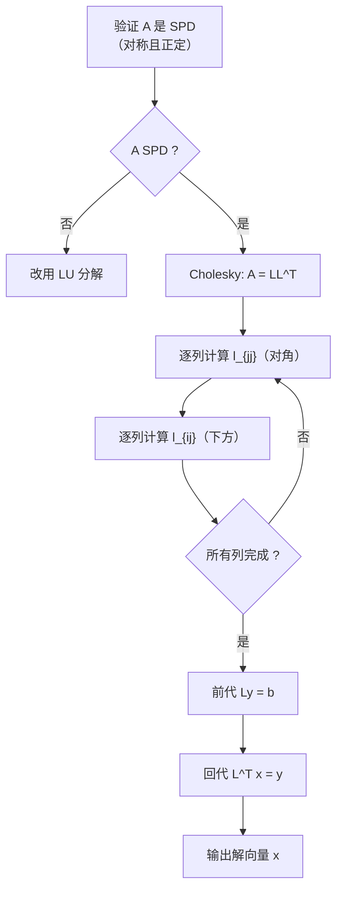

# Cholesky分解流程

## 适用场景
系数矩阵 $A$ 是对称正定（SPD）矩阵时的最优直接解法，计算量仅为 LU 分解的一半，且数值稳定无需选主元。

## 核心公式/步骤

1. 验证 $A$ 对称正定（所有顺序主子式 > 0 或所有特征值 > 0）
2. Cholesky 分解 $\boxed{A=LL^T}$，逐列计算：
   - 对角元：$\boxed{l_{jj}=\sqrt{a_{jj}-\sum_{k=1}^{j-1}l_{jk}^2}}$
   - 列元素：$\boxed{l_{ij}=\frac{1}{l_{jj}}\left(a_{ij}-\sum_{k=1}^{j-1}l_{ik}l_{jk}\right)}$，$i>j$
3. 前代：$\boxed{Ly=b}$ → $y_i=(b_i-\sum_{j=1}^{i-1}l_{ij}y_j)/l_{ii}$
4. 回代：$\boxed{L^T x=y}$ → $x_i=(y_i-\sum_{j=i+1}^n l_{ji}x_j)/l_{ii}$

## 典型例题

> **题目**：用 Cholesky 分解解 $A=\begin{bmatrix}4&2&-2\\2&10&2\\-2&2&6\end{bmatrix}$，$b=[2,-1,3]^T$。

> [!example]- 解答
> $A$ 对称正定。$L=\begin{bmatrix}2&0&0\\1&3&0\\-1&1&2\end{bmatrix}$
> $Ly=b$ → $y=[1,-2/3,2]^T$
> $L^T x=y$ → $x=[0.333,-0.556,1]^T$
> 点评：Cholesky 仅需 $n^3/6$ 次运算（LU 需 $n^3/3$），且数值稳定无需选主元。

## 链接的知识点
- [[知识点/数值分析/Cholesky分解]]

## 链接的习题
- [[课程/数值分析/习题库/05-对称正定线性方程组/README|第5章习题库]]
