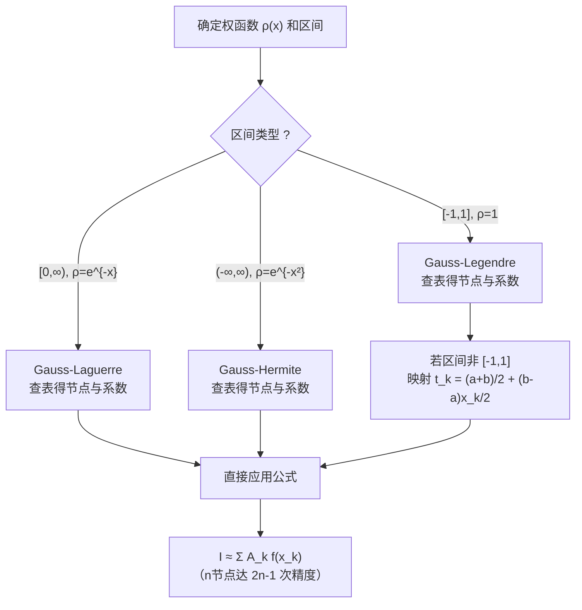

# Gauss求积节点与系数流程

## 适用场景
需要最高代数精度的求积公式，用 $n$ 个节点达到 $2n-1$ 次代数精度，远优于 Newton-Cotes 等距节点公式。

## 核心公式/步骤

1. 确定权函数 $\rho(x)$ 和积分区间 → 选择 Gauss 类型：
   - **Gauss-Legendre**：$\rho(x)=1$, $[-1,1]$，通用
   - **Gauss-Laguerre**：$\rho(x)=e^{-x}$, $[0,\infty)$，半无限区间
   - **Gauss-Hermite**：$\rho(x)=e^{-x^2}$, $(-\infty,\infty)$，无限区间
2. 查表获取 $n$ 个节点 $\{x_k\}$ 和对应权系数 $\{A_k\}$
3. 区间映射（Legendre 需映射）：若积分区间为 $[a,b]$，则 $\boxed{t_k=\frac{a+b}{2}+\frac{b-a}{2}x_k}$，$\boxed{A'_k=\frac{b-a}{2}A_k}$
4. 计算积分近似值：$\boxed{\int_a^b \rho(x)f(x)dx\approx\sum_{k=1}^n A_k f(x_k)}$

## 典型例题

> **题目**：用 2 点 Gauss-Legendre 求积分 $\int_{-1}^1 x^2 dx$。

> [!example]- 解答
> 查表：$n=2$，节点 $x_{1,2}=\pm 1/\sqrt{3}$，权重 $A_1=A_2=1$
> $\int_{-1}^1 x^2 dx\approx 1\cdot(1/\sqrt{3})^2+1\cdot(-1/\sqrt{3})^2=2/3$
> 精确值 $2/3$，完全精确（$x^2$ 为 2 次多项式，2 点 Gauss 精度达 $2n-1=3$ 次）。
> 点评：2 个节点达到 3 次精度，等距梯形公式 2 个节点仅 1 次精度。

## 链接的知识点
- [[知识点/数值分析/Gauss求积]]

## 链接的习题
- [[课程/数值分析/习题库/09-数值积分与数值微分/README|第9章习题库]]
