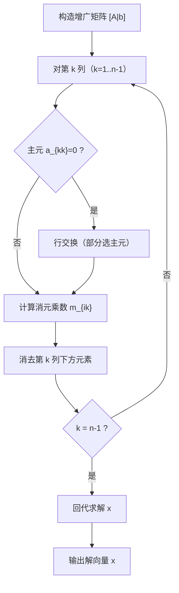

# Gauss消元求解流程

## 适用场景
求解一般稠密线性方程组 $Ax=b$，是最基础、最通用的直接解法。

## 核心公式/步骤

1. 构造增广矩阵 $\boxed{[A\mid b]}$
2. 逐列消元（$k=1,\ldots,n-1$）：
   - 选主元（列主元：选第 $k$ 列中绝对值最大者）
   - 必要时交换行（部分选主元）
   - 消元乘数 $\boxed{m_{ik}=a_{ik}^{(k)}/a_{kk}^{(k)}}$，消去下方元素：$\boxed{a_{ij}^{(k+1)}=a_{ij}^{(k)}-m_{ik}a_{kj}^{(k)}}$
3. 得到上三角形式 $Ux=\tilde{b}$
4. 回代：$\boxed{x_n=\tilde{b}_n/u_{nn},\quad x_i=(\tilde{b}_i-\sum_{j=i+1}^n u_{ij}x_j)/u_{ii}}$

## 典型例题

> **题目**：用 Gauss 消元法解 $\begin{cases}2x_1+x_2-x_3=1\\x_1-2x_2+3x_3=-2\\3x_1-x_2+2x_3=3\end{cases}$。

> [!example]- 解答
> 增广矩阵 $\begin{bmatrix}2&1&-1&|&1\\1&-2&3&|&-2\\3&-1&2&|&3\end{bmatrix}$
> 消元后得 $\begin{bmatrix}2&1&-1&|&1\\0&-2.5&3.5&|&-2.5\\0&0&-1.6&|&-0.8\end{bmatrix}$
> 回代：$x_3=0.5$, $x_2=1.7$, $x_1=-0.1$。点评：列主元保证数值稳定性。

## 链接的知识点
- [[知识点/数值分析/Gauss消元法]]

## 链接的习题
- [[课程/数值分析/习题库/03-线性方程组的直接解法/README|第3章习题库]]
