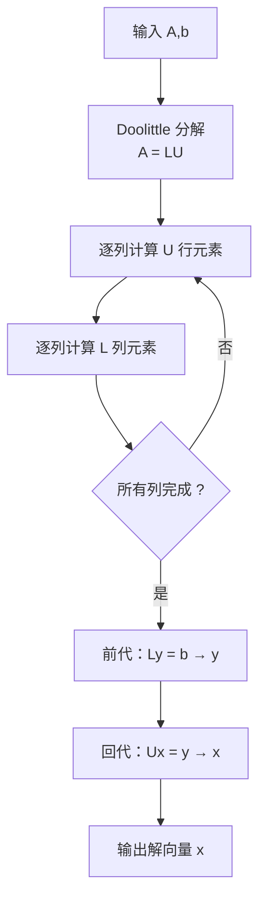

# LU分解求解流程

## 适用场景
同一系数矩阵 $A$ 对应多个右端项时，先分解再求解，避免重复消元。也用于分析矩阵结构和求行列式。

## 核心公式/步骤

1. Doolittle 分解 $A=LU$：$L$ 为单位下三角（对角元为 1），$U$ 为上三角
   - 逐列计算：先 $U$ 的行元素，再 $L$ 的列元素
   - $\boxed{u_{kj}=a_{kj}-\sum_{r=1}^{k-1}l_{kr}u_{rj}}$（$j\ge k$）
   - $\boxed{l_{ik}=(a_{ik}-\sum_{r=1}^{k-1}l_{ir}u_{rk})/u_{kk}}$（$i>k$）
2. 前代解 $Ly=b$：$\boxed{y_i=b_i-\sum_{j=1}^{i-1}l_{ij}y_j}$
3. 回代解 $Ux=y$：$\boxed{x_i=(y_i-\sum_{j=i+1}^n u_{ij}x_j)/u_{ii}}$

## 典型例题

> **题目**：对 $A=\begin{bmatrix}2&1&-1\\-1&3&1\\3&2&-2\end{bmatrix}$ 做 LU 分解并解 $Ax=[1,2,3]^T$。

> [!example]- 解答
> $L=\begin{bmatrix}1&0&0\\-0.5&1&0\\1.5&0.143&1\end{bmatrix}$, $U=\begin{bmatrix}2&1&-1\\0&3.5&0.5\\0&0&-0.571\end{bmatrix}$
> $Ly=b$ → $y=[1,2.5,-1.107]^T$
> $Ux=y$ → $x=[0.273,0.545,1.939]^T$
> 点评：LU 分解仅需 $O(n^3/3)$，之后每次求解仅 $O(n^2)$。

## 链接的知识点
- [[知识点/数值分析/LU分解(Doolittle)]]

## 链接的习题
- [[课程/数值分析/习题库/03-线性方程组的直接解法/README|第3章习题库]]
