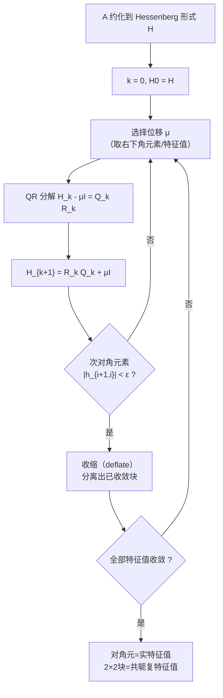

# QR算法迭代流程

## 适用场景
计算一般实矩阵的全部特征值（含复特征值），是数值线性代数中最重要、最通用的特征值算法。

## 核心公式/步骤

1. 预步：约化到上 Hessenberg 形式 $\boxed{H=Q_0^T A Q_0}$（Householder 约化，$O(n^3)$）
2. QR 迭代（$k=0,1,2,\ldots$）：
   - QR 分解：$\boxed{H_k=Q_k R_k}$
   - 逆序乘：$\boxed{H_{k+1}=R_k Q_k}$
3. 带位移加速：$\boxed{H_k-\mu I=Q_k R_k}$，$\boxed{H_{k+1}=R_k Q_k+\mu I}$（$\mu$ 取右下角元素或特征值估计）
4. 检查次对角线元素：若 $|h_{i+1,i}|<\varepsilon$ → 收缩（deflate），分离出 $1\times1$ 或 $2\times2$ 块
5. 对角块为实特征值，$2\times2$ 对角块为一对共轭复特征值

## 典型例题

> **题目**：简述 QR 算法求 $A=\begin{bmatrix}2&1\\1&2\end{bmatrix}$ 特征值的过程。

> [!example]- 解答
> 已是 Hessenberg 形式。无位移迭代：
> $H_0$ QR→$Q_1R_1$, $H_1=R_1Q_1$；迭代若干步后对角元趋于特征值。
> 带位移（$\mu\approx$右下角元素）可大幅加速收敛。
> 精确特征值为 $3$ 和 $1$。点评：实际中 QR 算法均带位移，使次对角元立方收敛到零。

## 链接的知识点
- [[知识点/数值分析/QR算法]]
- [[知识点/数值分析/幂法]]

## 链接的习题
- [[课程/数值分析/习题库/06-矩阵特征值的数值解法/README|第6章习题库]]
