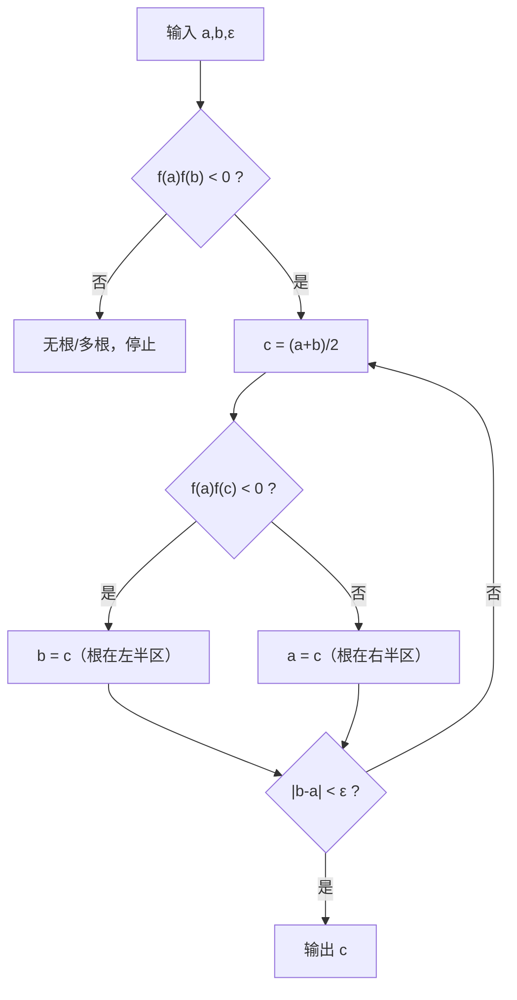

# 二分法求根流程

## 适用场景
已知有根区间 $[a,b]$ 满足 $f(a)f(b)<0$，求近似根，不需要导数信息，稳健但收敛较慢。

## 核心公式/步骤

1. 验证 $f(a)f(b)<0$（否则停止）
2. 取中点 $\boxed{c=\frac{a+b}{2}}$，计算 $f(c)$
3. 若 $f(a)f(c)<0$，根在 $[a,c]$，令 $b=c$；否则根在 $[c,b]$，令 $a=c$
4. 检查停机准则 $\boxed{|b-a|<\varepsilon}$ 或 $|f(c)|<\delta$
5. 若满足→输出 $c$；否则返回步骤 2

## 典型例题

> **题目**：用二分法求 $f(x)=x^3-x-1$ 在 $[1,2]$ 内的根，精度 $\varepsilon=0.5\times10^{-1}$。

> [!example]- 解答
> $f(1)=-1<0,\ f(2)=5>0$，有根。
> 
> 第1次：$c=1.5,\ f(1.5)=0.875>0$，$f(1)f(1.5)<0$→$b=1.5$，区间 $[1,1.5]$
> 第2次：$c=1.25,\ f(1.25)=-0.297<0$→$a=1.25$，区间 $[1.25,1.5]$
> 第3次：$c=1.375,\ f(1.375)=0.225>0$→$b=1.375$，区间 $[1.25,1.375]$
> 第4次：$c=1.3125$，$|b-a|=0.125<0.5$？不满足，继续。
> 
> 最终 $c\approx1.3247$，线性收敛，每步精度翻倍。

## 链接的知识点
- [[知识点/数值分析/二分法]]

## 链接的习题
- [[课程/数值分析/习题库/02-非线性方程求根/README|第2章习题库]]
