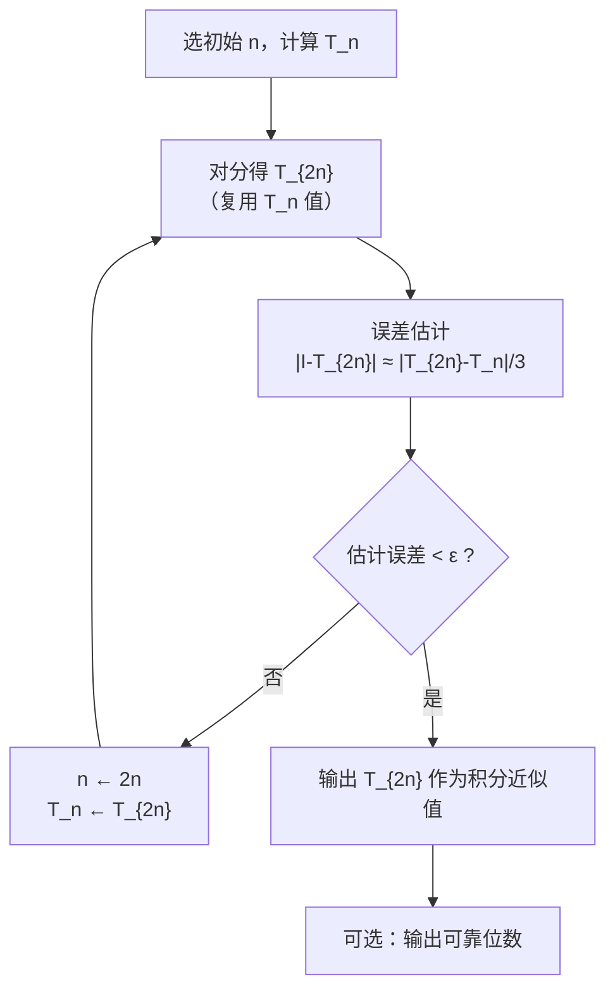

# 复化求积精度控制流程

## 适用场景
给定精度要求 $\varepsilon$，自适应确定复化求积的分段数以计算 $\int_a^b f(x)dx$，避免过度计算或精度不足。

## 核心公式/步骤

1. 选初始分段数 $n$（如 $n=1$），计算 $n$ 等分梯形公式 $T_n$
2. 将每个子区间对分，得 $2n$ 等分的 $T_{2n}$（可复用 $T_n$ 值：$\boxed{T_{2n}=\frac{1}{2}T_n+\frac{h}{2}\sum_{i=1}^n f(x_{i-1/2})}$）
3. 后验误差估计（梯形序列）：$\boxed{|I-T_{2n}|\approx\frac{|T_{2n}-T_n|}{3}}$
4. 若估计误差 $>\varepsilon$：$n\leftarrow 2n$，返回步骤 2
5. 若 $\le\varepsilon$：输出 $T_{2n}$ 作为近似值
6. 同理可扩展至 Simpson 复化公式：$\boxed{|I-S_{2n}|\approx\frac{|S_{2n}-S_n|}{15}}$

## 典型例题

> **题目**：用复化梯形公式计算 $\int_0^1 e^x dx$，要求误差 $\le10^{-4}$。

> [!example]- 解答
> $T_1=\frac{1}{2}[f(0)+f(1)]=1.8591$
> $T_2=\frac{1}{2}T_1+\frac{1}{2}f(0.5)=1.7539$
> 估计误差 $|T_2-T_1|/3\approx0.035$ → 继续
> $T_4=1.7272$, $T_8=1.7205$, $T_{16}=1.7189$
> $|T_{16}-T_8|/3\approx0.0005$ 仍大于 $10^{-4}$ → $T_{32}=1.7185$
> $|T_{32}-T_{16}|/3\approx4\times10^{-5}<10^{-4}$ → 输出 $1.7185$（精确值 $e-1\approx1.71828$）。

## 链接的知识点
- [[知识点/数值分析/复化求积法]]

## 链接的习题
- [[课程/数值分析/习题库/09-数值积分与数值微分/README|第9章习题库]]
