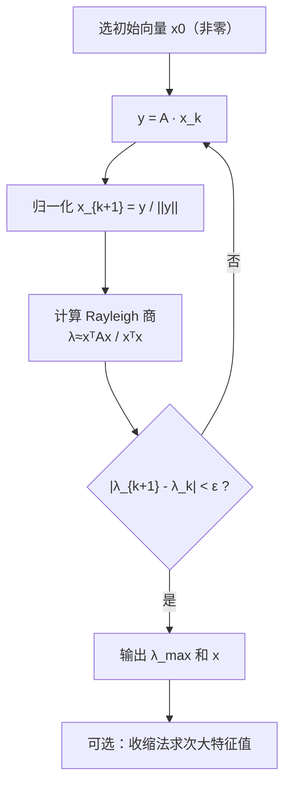

# 幂法求特征值流程

## 适用场景
只需求矩阵 $A$ 的模最大特征值（主特征值）及对应特征向量，矩阵可对角化且主特征值唯一。

## 核心公式/步骤

1. 选初始向量 $x_0$（非零），通常取全 1 向量
2. 迭代：$\boxed{y_{k+1}=A x_k}$（乘 $A$）
3. 归一化：$\boxed{x_{k+1}=\frac{y_{k+1}}{\|y_{k+1}\|}}$（常用 $\|\cdot\|_\infty$ 或 $\|\cdot\|_2$）
4. 估计主特征值：Rayleigh 商 $\boxed{\lambda_{\max}\approx\frac{x_{k+1}^T A x_{k+1}}{x_{k+1}^T x_{k+1}}}$ 或 $\boxed{\lambda_{\max}\approx\frac{y_{k+1}^{(i)}}{x_k^{(i)}}}$
5. 检查收敛：$\|\lambda_{k+1}-\lambda_k\|<\varepsilon$

## 典型例题

> **题目**：用幂法求 $A=\begin{bmatrix}3&-1&0\\-1&2&-1\\0&-1&3\end{bmatrix}$ 的主特征值，$x_0=[1,1,1]^T$。

> [!example]- 解答
> $y_1=Ax_0=[2,0,2]^T$, 归一化 $x_1=[1,0,1]^T$, $\lambda\approx2$
> $y_2=Ax_1=[3,-2,3]^T$, $x_2=[1,-0.667,1]^T$, $\lambda\approx3.33$
> $y_3=Ax_2=[3.667,-3.333,3.667]^T$, $\lambda\approx4.27$（精确主特征值为 $4$）
> 点评：收敛速度取决于 $|\lambda_2/\lambda_1|$，比值越小收敛越快。

## 链接的知识点
- [[知识点/数值分析/幂法]]

## 链接的习题
- [[课程/数值分析/习题库/06-矩阵特征值的数值解法/README|第6章习题库]]
