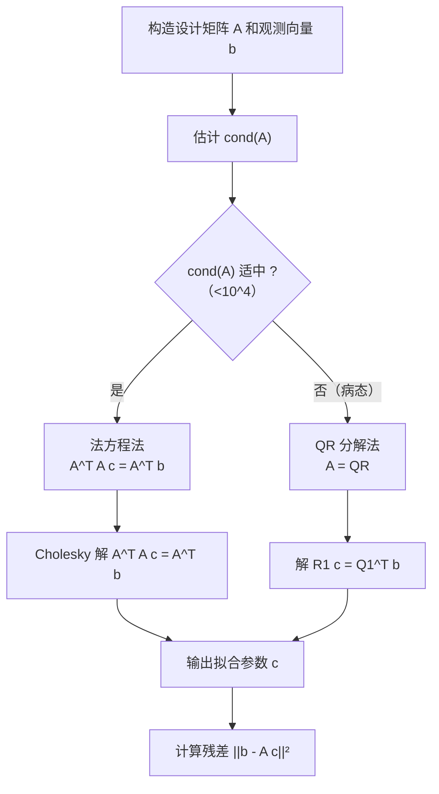

# 最小二乘拟合流程(法方程vsQR)

## 适用场景
给定含噪声的观测数据 $(x_i,y_i)$，求最佳拟合曲线 $\phi(x;c_1,\ldots,c_m)$，需在法方程（快速）和 QR（稳定）间选择。

## 核心公式/步骤

1. 构造设计矩阵 $A$（$n\times m$，$n>m$）和观测向量 $\mathbf{b}$
2. 判断矩阵条件：
   - **法方程法**（条件好时）：$\boxed{A^T A\mathbf{c}=A^T\mathbf{b}}$，解出 $\mathbf{c}$
   - **QR 法**（条件差时）：QR 分解 $\boxed{A=QR=Q\begin{bmatrix}R_1\\0\end{bmatrix}}$，解 $\boxed{R_1\mathbf{c}=Q_1^T\mathbf{b}}$
3. 法方程条件数被平方放大：$\boxed{\mathrm{cond}(A^T A)=\mathrm{cond}(A)^2}$，所以 QR 更稳定
4. 拟合残差：$\boxed{\|\mathbf{r}\|_2^2=\|\mathbf{b}-A\mathbf{c}\|_2^2}$

## 典型例题

> **题目**：用最小二乘法拟合直线 $y=c_1+c_2 x$ 到数据 $(1,2),(2,3),(3,4),(4,5)$。

> [!example]- 解答
> $A=\begin{bmatrix}1&1\\1&2\\1&3\\1&4\end{bmatrix}$, $b=[2,3,4,5]^T$
> 法方程 $A^T A=\begin{bmatrix}4&10\\10&30\end{bmatrix}$, $A^T b=[14,40]^T$
> 解 $\begin{bmatrix}4&10\\10&30\end{bmatrix}\begin{bmatrix}c_1\\c_2\end{bmatrix}=\begin{bmatrix}14\\40\end{bmatrix}$ → $c_1=1$, $c_2=1$
> 拟合直线 $y=1+x$，残差为零（数据共线）。点评：本题数据完美共线，实际数据需比较两种方法。

## 链接的知识点
- [[知识点/数值分析/最小二乘法(法方程)]]
- [[知识点/数值分析/QR分解求最小二乘]]

## 链接的习题
- [[课程/数值分析/习题库/08-数据拟合与最小二乘/README|第8章习题库]]
