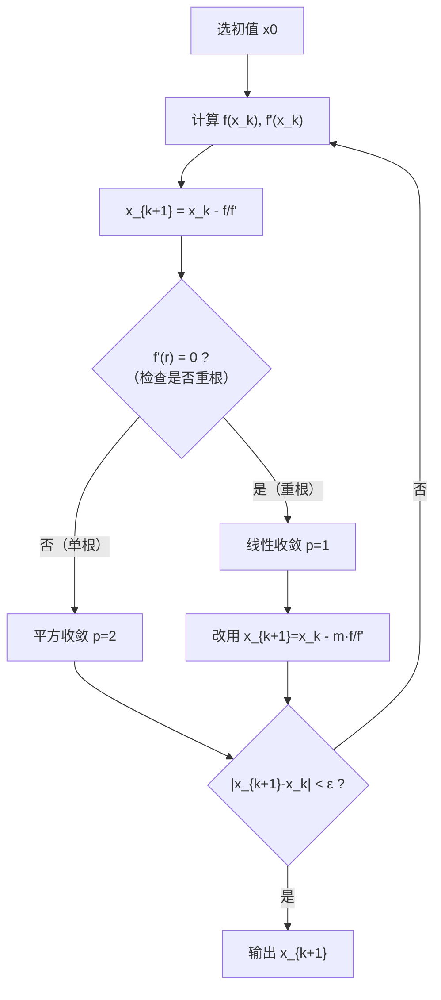

# 牛顿法迭代与收敛阶判断

## 适用场景
$f'(x)$ 存在且好算，初值足够靠近根时收敛最快（平方收敛），是求解非线性方程的首选方法。

## 核心公式/步骤

1. 选初值 $x_0$（靠近根）
2. 迭代公式：$\boxed{x_{k+1}=x_k-\frac{f(x_k)}{f'(x_k)}}$
3. 判断收敛阶：
   - 单根（$f'(r)\neq0$）：$\boxed{p=2}$（平方收敛）
   - 重根（$f'(r)=0$）：$\boxed{p=1}$（线性收敛），需改用 $\boxed{x_{k+1}=x_k-m\frac{f(x_k)}{f'(x_k)}}$（$m$ 为重数）
4. 停机准则：$|x_{k+1}-x_k|<\varepsilon$ 或 $|f(x_{k+1})|<\delta$

## 典型例题

> **题目**：用牛顿法求 $f(x)=x^2-2=0$ 的根 $\sqrt{2}$，初值 $x_0=1.5$，迭代 3 次。

> [!example]- 解答
> $f'(x)=2x$，迭代公式 $x_{k+1}=x_k-\frac{x_k^2-2}{2x_k}=\frac{x_k}{2}+\frac{1}{x_k}$。
> 
> $x_0=1.5$ → $x_1=1.4167$ → $x_2=1.4142157$ → $x_3=1.4142136$
> 
> 每次迭代有效数字翻倍（平方收敛特征）。点评：牛顿法对单根收敛极快，但初值必须足够近。

## 链接的知识点
- [[知识点/数值分析/牛顿法]]
- [[知识点/数值分析/改进牛顿法(重根)]]
- [[知识点/数值分析/收敛阶定理]]

## 链接的习题
- [[课程/数值分析/习题库/02-非线性方程求根/README|第2章习题库]]
