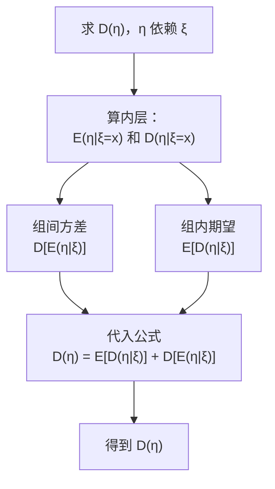

# 方差分解法

## 适用场景
含随机条件变量的方差计算。当 $\eta$ 依赖于另一个随机变量 $\xi$（如 $\eta|\xi=x \sim N(x, \tau^2)$），无条件方差 $D(\eta)$ 无法直接计算时，用方差分解公式拆为"组内"+"组间"两部分。

## 核心公式/步骤

**方差分解公式（全方差公式）**：
$$\boxed{D(\eta) = E[D(\eta|\xi)] + D[E(\eta|\xi)]}$$

- **第一项** $E[D(\eta|\xi)]$：组内方差的期望——已知 $\xi$ 后 $\eta$ 仍残留的平均不确定性
- **第二项** $D[E(\eta|\xi)]$：组间方差——$\xi$ 的不同取值导致 $\eta$ 的期望的系统性差异

**两层计算**：
1. 算条件期望 $E(\eta|\xi)$ 和条件方差 $D(\eta|\xi)$（把 $\xi$ 当常数）
2. 代入公式：对 $D(\eta|\xi)$ 求期望 + 对 $E(\eta|\xi)$ 求方差

## 典型例题

> **题目**（随机输入-正态输出）：设某系统输入为随机变量 $\xi$，其均值与方差分别为 $\mu$ 与 $\sigma^2$。当输入 $\xi = x$ 时，输出 $\eta \sim N(x, \tau^2)$。求 $D(\eta)$ 和 $\rho(\xi, \eta)$。

> [!example]- 解答
> 由题意：$E(\eta|\xi) = \xi$，$D(\eta|\xi) = \tau^2$。
>
> **(1) 无条件方差**（方差分解）：
> $$\begin{aligned}
> D(\eta) &= E[D(\eta|\xi)] + D[E(\eta|\xi)] \\
> &= E[\tau^2] + D[\xi] = \tau^2 + \sigma^2
> \end{aligned}$$
>
> 直观：总方差 = 噪声方差（$\tau^2$）+ 信号方差（$\sigma^2$）。
>
> **(2) 相关系数**：
> $$\begin{aligned}
> \text{Cov}(\xi, \eta) &= E[(\xi-\mu)(\eta-\mu)] \\
> &= E\big[E[(\xi-\mu)(\eta-\mu) \mid \xi]\big] \\
> &= E\big[(\xi-\mu) \cdot E[\eta-\mu \mid \xi]\big] \\
> &= E[(\xi-\mu)(\xi-\mu)] = D(\xi) = \sigma^2
> \end{aligned}$$
>
> $$\rho(\xi, \eta) = \frac{\text{Cov}(\xi,\eta)}{\sqrt{D(\xi) D(\eta)}} = \frac{\sigma^2}{\sigma\sqrt{\sigma^2+\tau^2}} = \frac{\sigma}{\sqrt{\sigma^2+\tau^2}}$$
>
> **点评**：方差分解是处理随机条件变量的核心工具。本题中条件方差来自噪声 $\tau^2$（组内），条件期望的方差来自输入 $\sigma^2$（组间）。$\tau$ 越小、$\sigma$ 越大，$\rho$ 越接近 1。

## 链接的知识点
- [[知识点/条件方差]]
- [[知识点/方差与切比雪夫不等式]]

## 链接的习题
- [[课程/概率论/习题库/04-数字特征/习题4.12]]
- [[课程/概率论/习题库/04-数字特征/习题4.21]]
