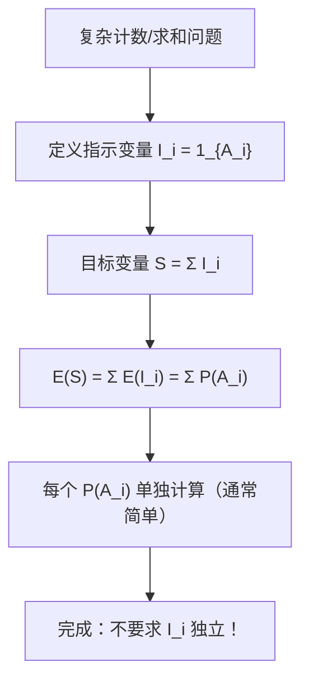

# 期望线性分解法

## 适用场景

计算复杂随机变量的期望——通过指示变量分解和期望的线性性质，将复杂的联合期望拆解为简单期望之和。

## 核心步骤

### 核心公式

$$\boxed{E\!\left(\sum_{i=1}^n c_i \xi_i\right) = \sum_{i=1}^n c_i \, E(\xi_i)}$$

**关键**：此公式**不要求 $\xi_i$ 相互独立**！——期望的线性性质是**无条件**成立的。

### 指示变量法

将复杂事件 $A$ 拆为 $A = \bigcup_{i=1}^n A_i$，令 $I_i = \mathbf{1}_{A_i}$（指示变量），则：

$$\boxed{\mu = \sum_{i=1}^n I_i, \quad E(\mu) = \sum_{i=1}^n E(I_i) = \sum_{i=1}^n P(A_i)}$$

### 操作步骤

**①** 定义指示变量 $I_i$，每个 $I_i$ 只取 $0$ 或 $1$，且 $E(I_i) = P(A_i)$

**②** 将目标随机变量表示为 $S = \sum_i I_i$

**③** 利用期望的线性性质：$E(S) = \sum_i E(I_i)$

**④** 计算每个 $P(A_i)$（通常很简单）

> [!warning] 关键点
> - **线性性质不要求独立**——这是期望最强大的性质之一。
> - 指示变量法的精髓在于"化整为零"——把复杂的计数问题拆为简单的 0-1 事件。
> - 典型应用：信封匹配问题、球箱模型、图中三角形计数等。

## 流程图

## 典型例题

> **题目**（信封匹配问题）：$n$ 封写好的信随机装入 $n$ 个写好的信封，每封装一个。求恰好装对的信封数 $\mu$ 的期望。

> [!example]- 解答
> 定义指示变量 $I_i = \begin{cases} 1, & \text{第 } i \text{ 封信装对} \\ 0, & \text{装错} \end{cases}$
>
> 装对总数 $\mu = \sum_{i=1}^n I_i$。
>
> 对于固定的 $i$，第 $i$ 封信装对的概率 $P(I_i=1) = 1/n$（$n$ 个信封中恰好选中自己的）。
>
> 由期望线性性质（**不要求 $I_i$ 独立**）：
> $$E(\mu) = \sum_{i=1}^n E(I_i) = \sum_{i=1}^n \frac{1}{n} = n \cdot \frac{1}{n} = 1$$
>
> 即**平均恰好有 1 封信装对**。
>
> **点评**：虽然 $I_i$ 之间高度相关（一封装对了意味着其他信封的排列空间被压缩），但期望的线性性质不依赖独立性——这一技巧在组合概率中极其强大。

## 知识链接

- [[知识点/方差与切比雪夫不等式]]
- [[知识点/全数学期望公式]]
- [[知识点/协方差]]

## 习题链接

- [[课程/概率论/习题库/04-数字特征/习题4.7]] — 证 $E\xi = \sum P\{\xi \geq k\}$（尾和公式）
- [[课程/概率论/习题库/04-数字特征/习题4.10]] — 各次概率不同的独立 Bernoulli 试验的期望和方差
