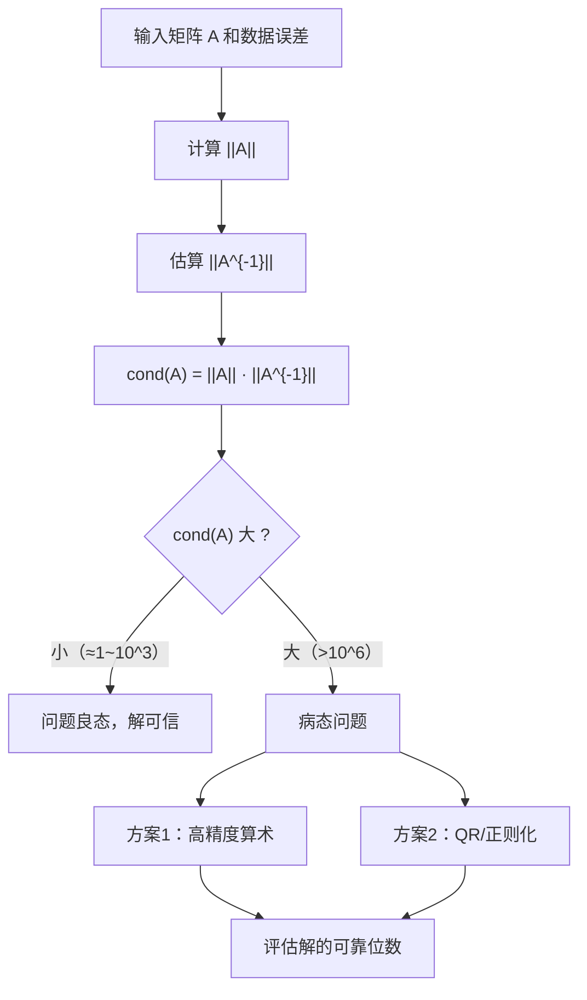

# 条件数误差分析流程

## 适用场景
评估线性方程组 $Ax=b$ 解的可靠性，判断问题是否病态；当数据有扰动时估计解的误差放大倍数。

## 核心公式/步骤

1. 计算（或估算）矩阵范数 $\boxed{\|A\|}$（常用 $\|\cdot\|_\infty$ 或 $\|\cdot\|_2$）
2. 计算（或估算）$\boxed{\|A^{-1}\|}$
3. 计算条件数：$\boxed{\mathrm{cond}(A)=\|A\|\cdot\|A^{-1}\|}$
4. 误差传播公式：$\boxed{\frac{\|\Delta x\|}{\|x\|}\le\mathrm{cond}(A)\frac{\|\Delta b\|}{\|b\|}}$
5. 判断：$\mathrm{cond}(A)$ 小（≈1）→可信；大（$>10^6$）→病态→考虑高精度或正则化

## 典型例题

> **题目**：判断 $A=\begin{bmatrix}1&0.99\\0.99&0.98\end{bmatrix}$ 是否病态。

> [!example]- 解答
> $A^{-1}=\begin{bmatrix}-9800&9900\\9900&-10000\end{bmatrix}$
> $\|A\|_\infty=1.99$, $\|A^{-1}\|_\infty=19900$
> $\mathrm{cond}(A)_\infty\approx39601$ → 严重病态！
> 点评：Hilbert 矩阵是典型病态矩阵，$\mathrm{cond}(H_n)$ 随 $n$ 指数增长。

## 链接的知识点
- [[方法/Gauss消元法]]
- [[方法/LU分解(Doolittle)]]

## 链接的习题
- [[课程/归档/数值分析/习题库/03-线性方程组的直接解法/README|第3章习题库]]
