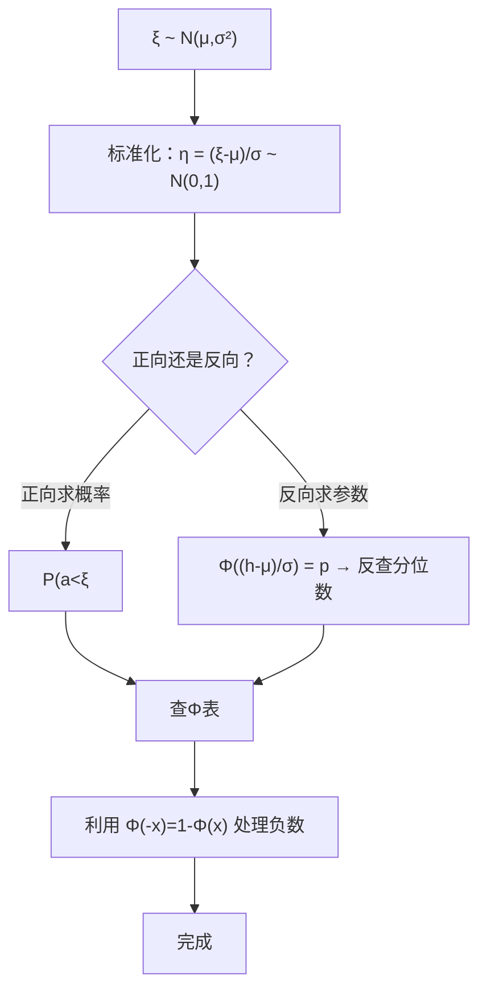

# 标准化法

## 适用场景

涉及正态分布 $N(\mu,\sigma^2)$ 的概率计算——将一般正态转化为标准正态 $N(0,1)$，查 $\Phi$ 表求解。

## 核心步骤

### 公式

$$\boxed{\eta = \frac{\xi - \mu}{\sigma} \sim N(0,1)}$$

$$\boxed{P\{\xi \leq x\} = \Phi\!\left(\frac{x - \mu}{\sigma}\right)} \qquad \boxed{P\{\xi \geq x\} = 1 - \Phi\!\left(\frac{x - \mu}{\sigma}\right)}$$

### $\Phi$ 的对称性

$$\boxed{\Phi(-x) = 1 - \Phi(x)}$$

### 操作步骤

**①** 确定 $\mu$ 和 $\sigma^2$

**②** 将概率不等式标准化：$P\{a < \xi < b\} = \Phi\!\left(\frac{b-\mu}{\sigma}\right) - \Phi\!\left(\frac{a-\mu}{\sigma}\right)$

**③** 查标准正态分布表（$\Phi$ 表）

**④** 利用对称性 $\Phi(-x) = 1 - \Phi(x)$ 转换负数

### 反问题（已知概率反求参数）

若已知 $P\{\xi < h\} = p$，反求 $h$：
1. 标准化：$\Phi\!\left(\frac{h-\mu}{\sigma}\right) = p$
2. 反查分位数：$\frac{h-\mu}{\sigma} = z_p$（$\Phi(z_p)=p$）
3. 解出：$h = \mu + \sigma \cdot z_p$

> [!warning] 关键点
> - 必须先标准化为 $N(0,1)$ 再查表，不能直接在 $N(\mu,\sigma^2)$ 上算积分。
> - $\Phi(-x) = 1 - \Phi(x)$ 是最常用的恒等式。
> - 常见分位数要记住：$z_{0.95}=1.645$，$z_{0.975}=1.96$，$z_{0.99}=2.33$，$z_{0.995}=2.58$。

## 流程图

## 典型例题

> **题目**（车门高度设计）：男子身高 $\xi \sim N(172, 36)$（cm），要求碰头概率不超过 $0.01$，设计车门高度 $h$。

> [!example]- 解答
> 需求 $P\{\xi \geq h\} \leq 0.01$，即 $P\{\xi < h\} \geq 0.99$。
>
> 标准化：$\Phi\!\left(\frac{h-172}{6}\right) \geq 0.99$。
>
> 反查 $\Phi$ 表：$\Phi(2.33) = 0.9901 > 0.99$，故取 $z_{0.99} \approx 2.33$。
>
> $$h = 172 + 6 \times 2.33 \approx 186 \text{ cm}$$
>
> **点评**：正态分布从"概率要求"反推"设计参数"的典型思路——标准化 → 反查分位点 → 还原原始尺度。

## 知识链接

- [[知识点/概率论/常见连续型分布]]
- [[知识点/概率论/二维正态分布]]
- [[知识点/概率论/中心极限定理]]

## 习题链接

- [[课程/概率论/习题库/03-多维随机变量/习题3.2]] — 正态分布下二次方程无实根概率
- [[课程/概率论/习题库/02-随机变量/习题2.12]] — 电子元件寿命指数分布：失效率与条件概率
