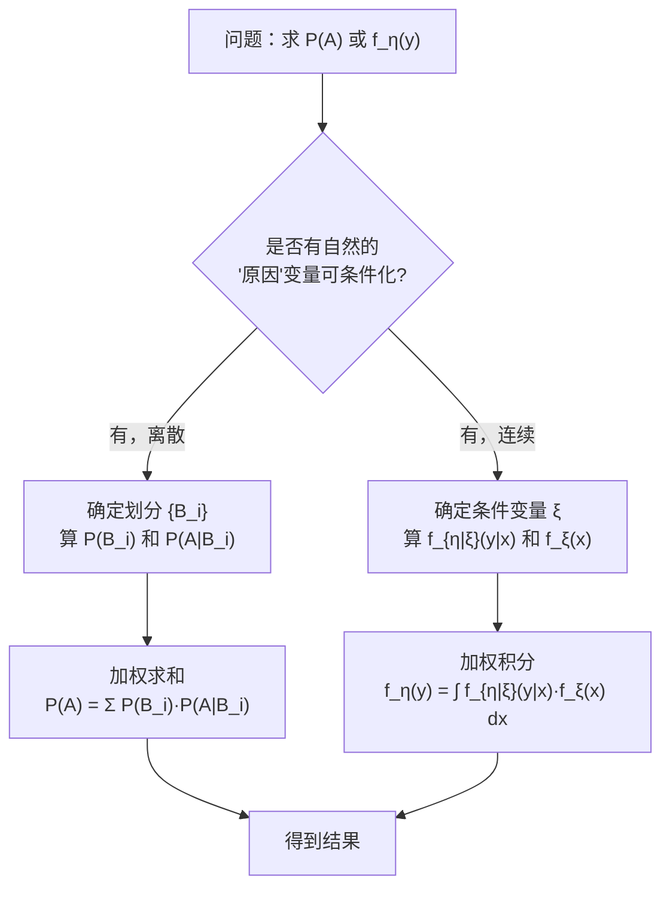

# 全概率公式法

## 适用场景
概率按"原因"分类加权求和。核心应用包括：(1) 离散+连续混合变量的分布（按离散变量取值拆分）；(2) 条件分布求边际分布：$f_\eta(y) = \int f_{\eta|\xi}(y|x)f_\xi(x)dx$；(3) 分层模型中的概率计算。

## 核心公式/步骤

**离散型全概率公式**（$\{B_i\}$ 为有限划分）：
$$\boxed{P(A) = \sum_{i} P(B_i) \cdot P(A|B_i)}$$

**连续型全概率公式**（条件密度求边际）：
$$\boxed{f_\eta(y) = \int_{-\infty}^{+\infty} f_{\eta|\xi}(y|x) \cdot f_\xi(x) \, dx}$$

**核心思路**：确定划分 $\{B_i\}$（或条件变量 $\xi$） → 算 $P(B_i)$ 和 $P(A|B_i)$ → 加权求和/积分。

## 典型例题

> **题目**（离散+连续混合）：设 $X, Y$ 相互独立，$X$ 的概率分布为 $P\{X = i\} = \frac{1}{3}\; (i = -1, 0, 1)$，$Y \sim U(0,1)$，$Z = X + Y$。求 $Z$ 的概率密度。

> [!example]- 解答
> $X$ 是离散型，$Y$ 是连续型——**不能直接套卷积公式**。用分布函数法 + 全概率公式，按 $X$ 的三个取值拆：
>
> $$\begin{aligned}
> F_Z(z) &= P\{X+Y \le z\} \\
> &= \frac{1}{3}\big[P\{Y \le z+1\} + P\{Y \le z\} + P\{Y \le z-1\}\big]
> \end{aligned}$$
>
> $Y \sim U(0,1)$，$F_Y(y) = y\; (0<y<1)$。求导得密度：
> $$f_Z(z) = \frac{1}{3}\big[f_Y(z+1) + f_Y(z) + f_Y(z-1)\big]$$
>
> $f_Y(t) = 1$ 仅当 $t \in (0,1)$，三段各贡献 $1/3$：
> - $f_Y(z+1) \neq 0 \iff -1 < z < 0$
> - $f_Y(z) \neq 0 \iff 0 < z < 1$
> - $f_Y(z-1) \neq 0 \iff 1 < z < 2$
>
> 在 $(-1,2)$ 上叠加为常数：
> $$\boxed{f_Z(z) = \frac{1}{3},\quad -1 < z < 2}$$
>
> 故 $Z \sim U(-1, 2)$。
>
> **点评**：离散+连续混合和的核心方法——全概率公式按离散取值拆分，每项是连续变量平移后的分布函数，叠加后求导。

## 链接的知识点
- [[知识点/概率论/全概率公式]]
- [[知识点/概率论/贝叶斯公式]]

## 链接的习题
- [[课程/概率论/习题库/01-概率基础/习题1.14]]
- [[课程/概率论/习题库/01-概率基础/习题1.15]]
