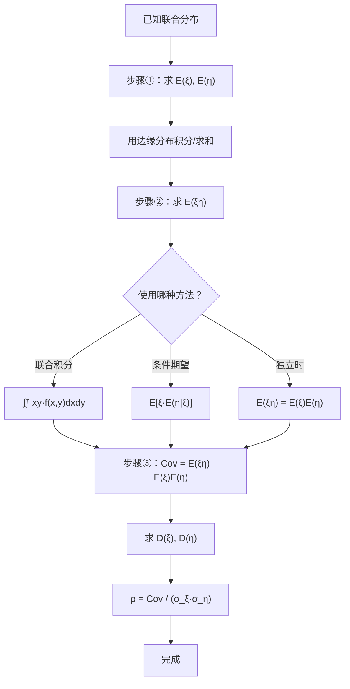

# 协方差计算流程

## 适用场景

计算两个随机变量 $\xi$ 与 $\eta$ 的协方差 $Cov(\xi,\eta)$ 和相关系数 $\rho_{\xi\eta}$。

## 核心步骤

### 三步法

**①** 求 $E(\xi)$ 和 $E(\eta)$（用边缘分布）

**②** 求 $E(\xi\eta)$（关键瓶颈——用联合分布）

$$\boxed{E(\xi\eta) = \begin{cases} \sum_i \sum_j x_i y_j \, p_{ij} & \text{离散型} \\ \iint_{\mathbb{R}^2} xy \, f(x,y) \, dxdy & \text{连续型} \end{cases}}$$

或利用条件期望：$\boxed{E(\xi\eta) = E[\xi \cdot E(\eta|\xi)]}$（当条件期望好算时）。

**③** 计算协方差：

$$\boxed{Cov(\xi,\eta) = E(\xi\eta) - E(\xi)E(\eta)}$$

### 相关系数

$$\boxed{\rho_{\xi\eta} = \frac{Cov(\xi,\eta)}{\sqrt{D(\xi)}\sqrt{D(\eta)}}}$$

### 快捷路径

- **二维正态**：直接从参数读取 $\boxed{Cov = r\sigma_1\sigma_2}$，$\rho = r$
- **独立变量**：$Cov = 0$（充分非必要）

> [!warning] 关键点
> - $E(\xi\eta)$ 是关键的瓶颈——需要联合积分或联合求和，不能只用边缘分布。
> - 协方差具有对称性、齐次性和可加性：$Cov(a\xi_1+b\xi_2, \eta) = a\,Cov(\xi_1,\eta) + b\,Cov(\xi_2,\eta)$。
> - 常数项不影响协方差：$Cov(a\xi+b, c\eta+d) = ac\,Cov(\xi,\eta)$。
> - $Cov=0$ 不一定独立（经典反例：圆内均匀分布）。

## 流程图

## 典型例题

> **题目**：$f(x,y) = 8xy$，$0 < x < y < 1$。求 $Cov(X,Y)$ 和 $\rho_{XY}$。

> [!example]- 解答
> **① 边缘期望**：
> $f_X(x) = \int_x^1 8xy\,dy = 4x(1-x^2)$，$f_Y(y) = \int_0^y 8xy\,dx = 4y^3$
> $$E(X) = \int_0^1 x \cdot 4x(1-x^2) dx = \frac{8}{15}$$
> $$E(Y) = \int_0^1 y \cdot 4y^3 dy = \frac{4}{5}$$
>
> **② $E(XY)$**：
> $$E(XY) = \int_0^1 \int_0^y xy \cdot 8xy \, dxdy = \int_0^1 8y^2 \left[\frac{x^3}{3}\right]_0^y dy = \int_0^1 \frac{8}{3}y^5 dy = \frac{4}{9}$$
>
> **③ 协方差与相关系数**：
> $$Cov(X,Y) = \frac{4}{9} - \frac{8}{15} \cdot \frac{4}{5} = \frac{4}{9} - \frac{32}{75} = \frac{4}{225}$$
>
> $D(X) = E(X^2) - [E(X)]^2 = \frac{1}{3} - \frac{64}{225} = \frac{11}{225}$，$D(Y) = E(Y^2) - [E(Y)]^2 = \frac{2}{3} - \frac{16}{25} = \frac{2}{75}$
>
> $$\rho = \frac{4/225}{\sqrt{11/225} \cdot \sqrt{2/75}} = \frac{4}{\sqrt{11 \cdot 6}} = \frac{4}{\sqrt{66}}$$

## 知识链接

- [[知识点/概率论/协方差]]
- [[知识点/概率论/相关系数]]
- [[知识点/概率论/全数学期望公式]]
- [[知识点/概率论/方差与切比雪夫不等式]]

## 习题链接

- [[课程/概率论/习题库/04-数字特征/习题4.1]] — 掷硬币 $n$ 次，正反面次数的相关系数
- [[课程/概率论/习题库/04-数字特征/习题4.2]] — 独立同分布样本均值与 $X_1$ 的协方差/方差
- [[课程/概率论/习题库/04-数字特征/习题4.14]] — $U=X+Y$ 与 $V=X-Y$ 的协方差关系
