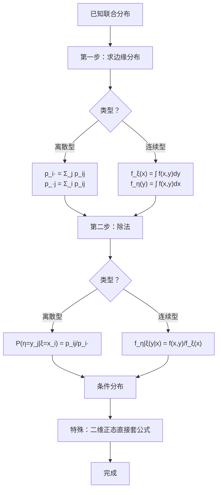

# 条件分布计算

## 适用场景

已知联合分布（联合分布律或联合概率密度），求在给定一个变量的条件下，另一个变量的条件分布。

## 核心步骤

### 离散型

给定联合分布律 $\{p_{ij}\}$，条件分布律为：

$$\boxed{P\{\eta = y_j \mid \xi = x_i\} = \frac{p_{ij}}{p_{i\cdot}}} \qquad \boxed{P\{\xi = x_i \mid \eta = y_j\} = \frac{p_{ij}}{p_{\cdot j}}}$$

其中 $p_{i\cdot} = \sum_j p_{ij}$（$\xi$ 的边缘分布律），$p_{\cdot j} = \sum_i p_{ij}$（$\eta$ 的边缘分布律）。

### 连续型

已知联合密度 $f(x,y)$，条件密度为：

$$\boxed{f_{\eta|\xi}(y|x) = \frac{f(x,y)}{f_\xi(x)}} \qquad \boxed{f_{\xi|\eta}(x|y) = \frac{f(x,y)}{f_\eta(y)}}$$

其中 $f_\xi(x) = \int f(x,y)dy$，$f_\eta(y) = \int f(x,y)dx$。

### 二维正态条件分布（直接套公式）

若 $(\xi,\eta) \sim N(m_1,\sigma_1^2; m_2,\sigma_2^2; r)$，则：

$$\boxed{\eta \mid \xi=x \sim N\left(m_2 + r\frac{\sigma_2}{\sigma_1}(x-m_1),\; \sigma_2^2(1-r^2)\right)}$$

条件期望是一条直线，条件方差与 $x$ 无关。

> [!warning] 关键点
> - **先求边缘，再除**——这是两步走的核心逻辑。
> - 分母的边缘分布必须非零（$p_{i\cdot} > 0$ 或 $f_\xi(x) > 0$）。
> - 条件分布也是一个完整的分布——离散型概率和为 1，连续型积分为 1。
> - 二维正态的特殊性：条件分布仍是正态，且条件方差与条件值无关。

## 流程图

## 典型例题

> **题目**：$(\xi,\eta) \sim N(\mu_1,\sigma_1^2; \mu_2,\sigma_2^2; r)$，求 $E(\eta|\xi=x)$ 和 $D(\eta|\xi=x)$。

> [!example]- 解答
> $$E(\eta|\xi=x) = \mu_2 + r\frac{\sigma_2}{\sigma_1}(x-\mu_1)$$
> $$D(\eta|\xi=x) = \sigma_2^2(1-r^2)$$
>
> 条件期望是 $x$ 的线性函数，斜率 $r\sigma_2/\sigma_1$；条件方差与 $x$ 无关，$|r|$ 越接近 1 条件方差越小。

---

> **题目**（离散型）：联合分布律如下，求 $\eta$ 在 $\xi=x_1$ 条件下的分布律。

> | $\xi\setminus\eta$ | $y_1$ | $y_2$ |
> |:---:|:---:|:---:|
> | $x_1$ | 0.2 | 0.3 |
> | $x_2$ | 0.1 | 0.4 |

> [!example]- 解答
> $p_{1\cdot} = 0.2 + 0.3 = 0.5$。
>
> $P(\eta=y_1|\xi=x_1) = 0.2/0.5 = 0.4$，$P(\eta=y_2|\xi=x_1) = 0.3/0.5 = 0.6$。
>
> 条件分布律：$\eta|\xi=x_1 \sim (y_1:0.4, \; y_2:0.6)$。

## 知识链接

- [[知识点/概率论/边缘分布]]
- [[知识点/概率论/二维正态分布]]
- [[知识点/概率论/联合分布]]

## 习题链接

- [[课程/概率论/习题库/03-多维随机变量/习题3.13]] — 二元正态密度标准化，求参数与边缘/条件密度
- [[课程/概率论/习题库/03-多维随机变量/习题3.14]] — $X\sim U(0,1), Y|X\sim U(x,1)$：联合与边缘密度
