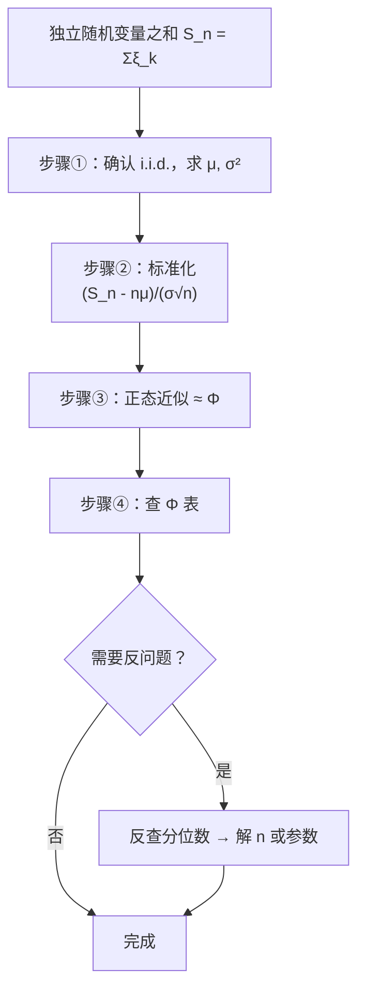

# 正态近似（CLT）

## 适用场景

大量独立同分布随机变量之和（或均值）的概率近似计算——无论个体分布是什么，标准化和近似服从标准正态分布。

## 核心步骤

### 林德伯格-莱维 CLT（独立同分布）

设 $\{\xi_k\}$ i.i.d.，$E(\xi_k)=\mu$，$D(\xi_k)=\sigma^2>0$：

$$\boxed{\frac{S_n - n\mu}{\sigma\sqrt{n}} \xrightarrow{d} N(0,1)}$$

即对充分大的 $n$：

$$\boxed{P\!\left\{\frac{S_n - n\mu}{\sigma\sqrt{n}} \leq x\right\} \approx \Phi(x)}$$

### 棣莫弗-拉普拉斯 CLT（二项正态近似）

$$\boxed{B(n,p) \approx N(np, np(1-p)) \quad (\text{当 } np \geq 5,\; n(1-p)\geq 5)}$$

### CLT 应用大题标准四步

**① 识别分布**：确认 $\xi_k$ i.i.d.，求出 $\mu = E(\xi_k)$ 和 $\sigma^2 = D(\xi_k)$

**② 标准化**：$P\{a < S_n < b\} = P\!\left\{\frac{a - n\mu}{\sigma\sqrt{n}} < \frac{S_n - n\mu}{\sigma\sqrt{n}} < \frac{b - n\mu}{\sigma\sqrt{n}}\right\}$

**③ 正态近似**：$\approx \Phi\!\left(\frac{b - n\mu}{\sigma\sqrt{n}}\right) - \Phi\!\left(\frac{a - n\mu}{\sigma\sqrt{n}}\right)$

**④ 查表**：利用 $\Phi(-x) = 1 - \Phi(x)$ 查表求解

> [!warning] 关键点
> - 标准化分母是 $\sigma\sqrt{n}$（$S_n$ 的标准差），不是 $\sigma$。
> - CLT 不要求个体分布是正态的——这正是它的威力所在。
> - 柯西分布（方差不存在）不满足 CLT。
> - 二项正态近似条件：$np \geq 5$ 且 $n(1-p) \geq 5$；$np < 5$ 时用泊松近似。

## 流程图

## 典型例题

> **题目 1**（掷骰子）：掷均匀骰子 300 次，求点数之和在 1000 到 1100 之间的概率。

> [!example]- 解答
> 单次 $\mu = 3.5$，$\sigma^2 = 35/12 \approx 2.9167$。
>
> $S_{300}$：$E(S) = 1050$，$D(S) = 875$，$\sigma_S = \sqrt{875} \approx 29.58$。
>
> $$P\{1000 < S < 1100\} = P\{-1.69 < Z < 1.69\} \approx 2\Phi(1.69)-1 = 0.909$$
>
> **点评**：骰子本身是离散均匀分布，远非正态——但 300 次之和的标准化形式近乎完美服从正态。

---

> **题目**：某理发店服务时间 $T_i \sim \text{Exp}(3)$（均值 $1/3$ 小时），独立。(1) 100 个顾客总时间在 31-35 小时的概率；(2) 以 95% 概率在 32 小时内可服务几人？

> [!example]- 解答
> $ET_i = 1/3$，$DT_i = 1/9$。对 100 人：$T \approx N(100/3, 100/9) = N(33.33, 11.11)$，$\sigma \approx 3.33$。
>
> **(1)** $P\{31 < T < 35\} = \Phi(0.5) - \Phi(-0.7) \approx 0.6915 - 0.2420 = 0.4495$
>
> **(2)** 反问题：$P\{T_n \leq 32\} \geq 0.95$。标准化：$\Phi\!\left(\frac{32 - n/3}{\sqrt{n}/3}\right) \geq 0.95$ → $\frac{32-n/3}{\sqrt{n}/3} \geq 1.645$ → 解 $n$。

## 知识链接

- [[知识点/概率论/中心极限定理]]
- [[知识点/概率论/大数定律]]
- [[知识点/概率论/随机变量序列的收敛性]]
- [[知识点/概率论/常见连续型分布]]

## 习题链接

- [[课程/概率论/习题库/05-极限定理/习题5.13]] — 切比雪夫不等式 + CLT：硬币抛掷次数估计
- [[课程/概率论/习题库/05-极限定理/习题5.18]] — 理发店 CLT 应用大题：求概率/反解样本量/置信区间
