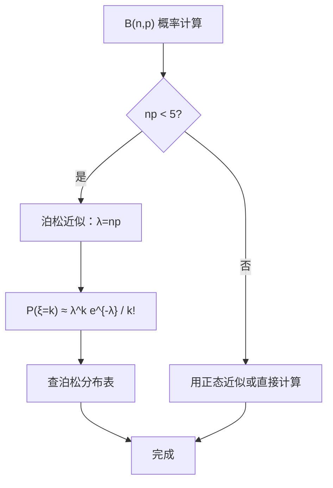

# 泊松近似

## 适用场景

当二项分布 $B(n,p)$ 中 $n$ 很大、$p$ 很小（稀有事件）时，用泊松分布 $P(np)$ 近似替代，大幅简化计算。

## 核心步骤

### 近似条件

$$\boxed{n \text{ 大}, \; p \text{ 小}, \; np < 5}$$

满足条件时：

$$\boxed{B(n,p) \approx P(\lambda), \quad \lambda = np}$$

### 泊松定理

$$\boxed{\lim_{\substack{n\to\infty \\ np_n\to\lambda}} C_n^k \, p_n^k (1-p_n)^{n-k} = \frac{\lambda^k}{k!} e^{-\lambda}}$$

### 操作步骤

**①** 检验条件：$n > 50$ 且 $np < 5$

**②** 计算 $\lambda = np$

**③** 将原二项概率 $P(\xi = k)$ 替换为 $\frac{\lambda^k}{k!} e^{-\lambda}$

**④** 查泊松分布表或直接计算

### 与正态近似的分工

| 条件 | 使用 |
|:--|:--|
| $np < 5$（或 $n(1-p) < 5$） | 泊松近似 $P(np)$ |
| $np \geq 5$ 且 $n(1-p) \geq 5$ | 正态近似 $N(np, np(1-p))$ |

> [!warning] 关键点
> - $p$ 必须小——若 $p \approx 0.5$，即使 $n$ 很大也不能用泊松近似，需用正态近似。
> - 泊松分布的最大可能值 $k_0 = [\lambda]$（$\lambda$ 为整数时有 $\lambda$ 和 $\lambda-1$ 两个）。

## 流程图

## 典型例题

> **题目**（机床故障）：300 台独立机床，每台故障概率 $0.01$，一人修一台。问至少需多少名工人，才能保证不能及时排除故障的概率小于 $0.01$？

> [!example]- 解答
> $n=300$ 大，$p=0.01$ 小，$np=3<5$，用泊松近似：$\xi \approx P(3)$。
>
> 设需工人数 $N$。"不能及时排除"即故障数 $>N$：$P\{\xi > N\} < 0.01$。
>
> 查泊松分布表（$\lambda=3$）：
> - $P\{\xi > 7\} = 0.0119 > 0.01$
> - $P\{\xi > 8\} = 0.0038 < 0.01$
>
> 故 $N = 8$，至少需要 **8** 名工人。
>
> **点评**：建模 → 近似 → 查表 → 决策的完整工程流程。泊松近似使原本计算量巨大的二项求和变得可行。

## 知识链接

- [[知识点/概率论/常见离散型分布]]
- [[知识点/概率论/中心极限定理]]

## 习题链接

- [[课程/概率论/习题库/02-随机变量/习题2.11]] — 螺丝钉装箱：泊松逼近求样本量
