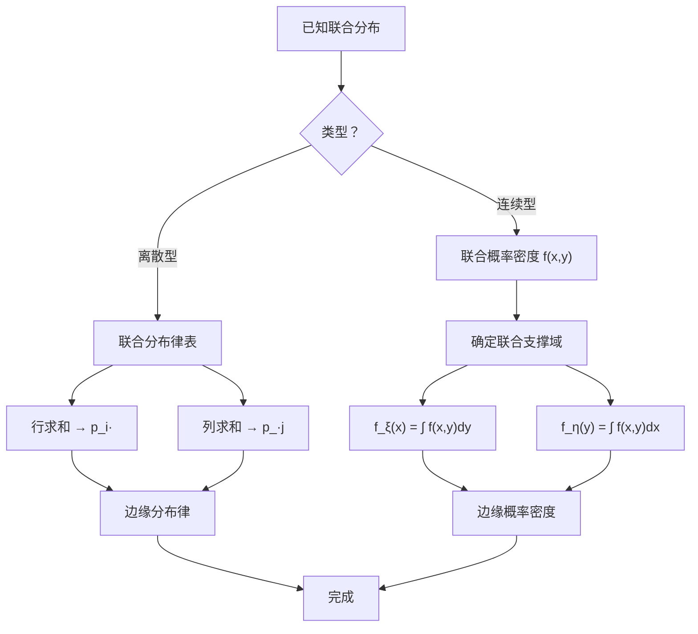

# 边缘分布计算

## 适用场景

已知联合分布（离散型联合分布律表，或连续型联合概率密度），求单个随机变量的分布。

## 核心步骤

### 离散型

给定联合分布律 $\{p_{ij}\}$，边缘分布律为行/列求和：

$$\boxed{p_{i\cdot} = P\{\xi = x_i\} = \sum_{j} p_{ij}} \qquad \boxed{p_{\cdot j} = P\{\eta = y_j\} = \sum_{i} p_{ij}}$$

### 连续型

给定联合概率密度 $f(x,y)$，边缘密度为对另一变量积分：

$$\boxed{f_\xi(x) = \int_{-\infty}^{+\infty} f(x,y) \, dy} \qquad \boxed{f_\eta(y) = \int_{-\infty}^{+\infty} f(x,y) \, dx}$$

> [!warning] 关键点
> - **积分限由联合支撑域决定**，不是简单的 $(-\infty, +\infty)$。非矩形支撑域（如三角形 $0<y<x<1$）必须分段写出积分限。
> - 联合可唯一确定边缘，但逆一般不真（除非变量独立）。

## 流程图

## 典型例题

> **离散型**：联合分布律如下，求边缘分布律并判断独立性。

> | $\xi\setminus\eta$ | $y_1$ | $y_2$ | $y_3$ |
> |:---:|:---:|:---:|:---:|
> | $x_1$ | 1/24 | 1/8 | 1/12 |
> | $x_2$ | 1/8 | 3/8 | 1/4 |

> [!example]- 解答
> 行求和：$p_{1\cdot} = 1/24 + 1/8 + 1/12 = 1/4$，$p_{2\cdot} = 1/8 + 3/8 + 1/4 = 3/4$
>
> 列求和：$p_{\cdot 1} = 1/24 + 1/8 = 1/6$，$p_{\cdot 2} = 1/8 + 3/8 = 1/2$，$p_{\cdot 3} = 1/12 + 1/4 = 1/3$
>
> 独立性检验：$p_{11} = 1/24 = (1/4)(1/6)$ ✓，全部 6 格检验通过 → 独立。

---

> **连续型**：$f(x,y) = \begin{cases} 2, & 0 < x < 1, 0 < y < x \\ 0, & \text{其他} \end{cases}$，求边缘密度。

> [!example]- 解答
> $f_\xi(x) = \int_0^x 2 \, dy = 2x$，$0 < x < 1$
>
> $f_\eta(y) = \int_y^1 2 \, dx = 2(1-y)$，$0 < y < 1$
>
> 验证：$f(x,y) = 2 \neq f_\xi(x)f_\eta(y) = 4x(1-y)$，故 $\xi$ 与 $\eta$ **不独立**。
>
> **点评**：非零区域是三角形（$0<y<x$）而非矩形——这是不独立的几何信号。

## 知识链接

- [[知识点/概率论/边缘分布]]
- [[知识点/概率论/联合分布]]
- [[知识点/概率论/二维正态分布]]

## 习题链接

- [[课程/概率论/习题库/03-多维随机变量/习题3.11]] — $f(x,y)=8xy$，判断独立（含边缘密度）
- [[课程/概率论/习题库/03-多维随机变量/习题3.14]] — $X\sim U(0,1), Y|X\sim U(x,1)$：联合与边缘密度
