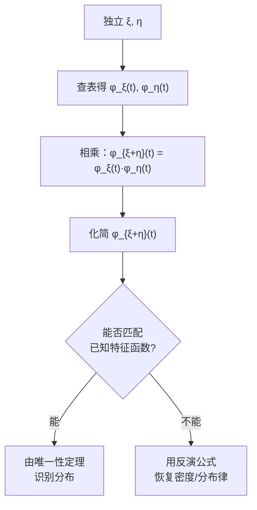

# 特征函数法

## 适用场景
求**独立随机变量之和**的分布（证可加性）、由特征函数**识别**分布类型、证明中心极限定理。核心优势：卷积变乘积——将复杂的求和/积分简化为代数乘法。

## 核心公式/步骤

**定义**：$\boxed{\varphi_\xi(t) = E[e^{jt\xi}]}$

**三条核心性质**：

| 性质 | 公式 |
|:--|:--|
| 线性变换 | $\boxed{\varphi_{a\xi+b}(t) = e^{jtb}\,\varphi_\xi(at)}$ |
| 独立和 | $\boxed{\varphi_{\xi+\eta}(t) = \varphi_\xi(t) \cdot \varphi_\eta(t)}$（卷积变乘积） |
| 求矩 | $E(\xi^k) = j^{-k}\,\varphi^{(k)}(0)$ |

**六个必记特征函数**：

| 分布 | $\varphi(t)$ |
|:--|:--|
| 单点 $P\{\xi=c\}=1$ | $e^{jtc}$ |
| 0-1 分布 $B(1,p)$ | $q + pe^{jt}$ |
| 二项 $B(n,p)$ | $(q + pe^{jt})^n$ |
| 泊松 $P(\lambda)$ | $e^{\lambda(e^{jt}-1)}$ |
| 指数 $\text{Exp}(\lambda)$ | $\dfrac{\lambda}{\lambda - jt}$ |
| 正态 $N(\mu,\sigma^2)$ | $e^{j\mu t - \frac{1}{2}\sigma^2 t^2}$ |

## 典型例题

> **题目**（复合泊松）：设 $\{X_i\}$ i.i.d. $\sim \text{Bernoulli}(p)$，$N \sim P(\lambda)$ 且与 $\{X_i\}$ 独立，$S = \sum_{i=1}^N X_i$。用特征函数法求 $S$ 的分布律。

> [!example]- 解答
> **步骤1**：单变量特征函数：$\varphi_{X_1}(t) = q + pe^{jt}$（$q=1-p$）。
>
> **步骤2**：条件特征函数 + 全期望公式：
> $$\varphi_S(t) = E[e^{jtS}] = E\big[E[e^{jtS} \mid N]\big] = E\big[(q + pe^{jt})^N\big]$$
>
> **步骤3**：$N \sim P(\lambda)$ 的概率生成函数 $E[z^N] = e^{\lambda(z-1)}$。取 $z = q + pe^{jt}$：
> $$\varphi_S(t) = e^{\lambda(q + pe^{jt} - 1)} = e^{\lambda p(e^{jt} - 1)}$$
>
> **步骤4**：由唯一性定理，$\varphi_S(t)$ 正是参数为 $\lambda p$ 的泊松分布的特征函数。故：
> $$S \sim P(\lambda p)$$
>
> 分布律：$P\{S = k\} = \dfrac{(\lambda p)^k}{k!} e^{-\lambda p},\; k=0,1,2,\ldots$
>
> **点评**：特征函数法 + 全期望公式是处理复合泊松的黄金组合。先对 $N$ 取条件把 $S$ 变成普通 i.i.d. 和，再用概率生成函数处理外层期望。结论：伯努利和 + 泊松个数 = 泊松（参数相乘）。

## 链接的知识点
- [[知识点/概率论/常见分布的特征函数]]
- [[知识点/概率论/多维随机变量的特征函数]]
- [[知识点/概率论/反演公式与唯一性定理]]
- [[知识点/概率论/中心极限定理]]

## 链接的习题
- [[课程/概率论/习题库/05-极限定理/习题5.1]]
- [[课程/概率论/习题库/05-极限定理/习题5.4]]
