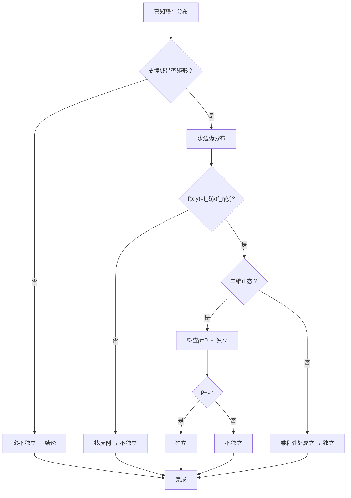

# 独立性验证

## 适用场景

判断两个随机变量 $\xi$ 与 $\eta$ 是否相互独立。

## 核心步骤

### 离散型

对**所有** $i,j$ 检验：

$$\boxed{p_{ij} \stackrel{?}{=} p_{i\cdot} \cdot p_{\cdot j}}$$

- 找到任意一组 $(i,j)$ 不满足 → **不独立**（只需一个反例）
- 全部满足 → **独立**

### 连续型

检验联合密度是否可分解：

$$\boxed{f(x,y) \stackrel{?}{=} f_\xi(x) \cdot f_\eta(y) \quad (\text{几乎处处成立})}$$

### 快捷判据

| 判据 | 结论 |
|:--|:--|
| 非矩形支撑域（如三角形、圆形） | **必不独立** |
| 密度可写成 $f(x,y)=g(x)h(y)$ 且支撑域为矩形 | **独立** |
| 二维正态且 $\rho = 0$ | **独立**（正态独有 $\rho=0\iff$ 独立） |

> [!warning] 关键点
> - **独立 $\Rightarrow$ 不相关（$\rho=0$），但逆一般不真。**
> - **二维正态特例**：$\rho = 0 \iff$ 独立，这是一般分布不具备的性质。
> - 非矩形支撑域是"不独立"的几何信号——变量取值范围互相制约。
> - 密度分离 $f(x,y)=g(x)h(y)$ 是独立的**必要条件**，但不充分——还必须支撑域是矩形。

## 流程图

## 典型例题

> **题目 1**：$f(x,y) = 8xy$，$0 < x < y < 1$。判断 $\xi$ 与 $\eta$ 是否独立。

> [!example]- 解答
> 支撑域 $0 < x < y < 1$ 是**三角形**（非矩形）→ **必不独立**。
>
> 验证：先求边缘 $f_\xi(x) = \int_x^1 8xy\,dy = 4x(1-x^2)$，$f_\eta(y) = \int_0^y 8xy\,dx = 4y^3$。
> $f_\xi(x)f_\eta(y) = 16x(1-x^2)y^3 \neq 8xy = f(x,y)$，确认不独立。
>
> 进一步计算协方差：$E(X)=8/15$，$E(Y)=4/5$，$E(XY)=4/9$，$\text{Cov}=4/225 \neq 0$。

---

> **题目 2**（二维正态特例）：$(\xi,\eta) \sim N(0,1;0,1;\rho)$，问何时独立？

> [!example]- 解答
> 二维正态下，$\rho=0 \iff$ 独立。
>
> 当 $\rho=0$ 时：联合密度 $f(x,y) = \frac{1}{2\pi} e^{-(x^2+y^2)/2} = \frac{1}{\sqrt{2\pi}}e^{-x^2/2} \cdot \frac{1}{\sqrt{2\pi}}e^{-y^2/2} = f_\xi(x)f_\eta(y)$，且支撑域是整个平面（矩形），故独立。
>
> **注意**：此结论仅对联合正态成立。一般分布下 $\rho=0$ 不能推出独立（如圆内均匀分布）。

## 知识链接

- [[知识点/概率论/联合分布]]
- [[知识点/概率论/边缘分布]]
- [[知识点/概率论/二维正态分布]]
- [[知识点/概率论/相关系数]]

## 习题链接

- [[课程/概率论/习题库/03-多维随机变量/习题3.11]] — $f(x,y)=8xy$，判断 $X$ 与 $Y$ 是否独立
- [[课程/概率论/习题库/04-数字特征/习题4.13]] — 二维正态 $Cov=0$ 时的独立/不相关关系
