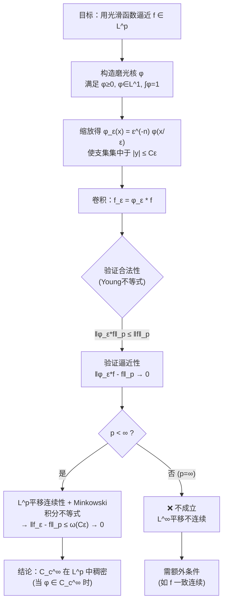

# 磨光算子应用法

## 适用场景

需要用光滑函数逼近 $L^p$ 中的一般函数时使用磨光算子法——包括构造逼近恒等、证明稠密性（如 $C_c^\infty(\mathbb{R}^n)$ 在 $L^p(\mathbb{R}^n)$ 中稠密）、偏微分方程中的正则化。核心思想是用积分为 $1$ 的非负光滑核与目标函数做卷积，通过缩放核的支集使卷积后的光滑函数逼近原函数。

## 核心公式/步骤

**磨光算子定义**（取磨光核 $\varphi$，缩放为 $\varphi_\varepsilon$，卷积得光滑逼近）：

$$\boxed{\varphi_\varepsilon * f(x) = \int_{\mathbb{R}^n} \varepsilon^{-n}\,\varphi\!\left(\frac{x-y}{\varepsilon}\right) f(y)\,dy}$$

**操作步骤**：

1. **构造磨光核** $\varphi$：选 $\varphi \in L^1(\mathbb{R}^n)$ 满足 $\varphi \geq 0$，$\displaystyle\int_{\mathbb{R}^n} \varphi(x)\,dx = 1$，且 $\operatorname{supp}\varphi$ 紧支集（或速降）
2. **缩放**：令 $\displaystyle\varphi_\varepsilon(x) := \varepsilon^{-n}\,\varphi\!\left(\frac{x}{\varepsilon}\right)$，使 $\displaystyle\int \varphi_\varepsilon = 1$，$\operatorname{supp}\varphi_\varepsilon \subseteq B(0, C\varepsilon)$
3. **验证 $L^p$ 合法性**：由 Young 不等式（卷积版），$\|\varphi_\varepsilon * f\|_p \leq \|\varphi_\varepsilon\|_1 \|f\|_p = \|f\|_p$，即磨光不放大 $L^p$ 范数
4. **证明 $L^p$ 逼近**：$\|\varphi_\varepsilon * f - f\|_p \to 0$（$\varepsilon \to 0^+$），核心依赖 $L^p$ 平移连续性 + Minkowski 积分不等式交换次序

> [!warning] 关键前提与易错点
> - **磨光核积分为 $1$ 是不可或缺的条件**——它保证恒等算子嵌入在卷积族中（$f(x) = f(x) \cdot 1 = f(x) \int \varphi_\varepsilon$），从而逼近的是 $f$ 本身而非 $cf$（$c \neq 1$）。积分为 $1$ 同时保证 Young 不等式给出 $\|f\|_p$ 的系数恰好为 $1$（不放大）。
> - **$p = \infty$ 时逼近不成立**：$L^\infty$ 中平移不连续，光滑化后无法按一致范数逼近跳跃间断函数。反例：$f = \chi_{[0,\infty)}$，任何磨光后函数在 $x=0$ 附近是光滑过渡的，$\|\varphi_\varepsilon * f - f\|_\infty \geq 1/2$ 恒成立。
> - **Young 不等式只管"合法性"不管"逼近性"**：$\|\varphi_\varepsilon * f\|_p \leq \|f\|_p$ 只能保证磨光后仍在 $L^p$ 中，$\|\varphi_\varepsilon * f - f\|_p \to 0$ 的证明需要额外的 $L^p$ 平移连续性。

**常见磨光核**：

| 磨光核 | 表达式 | 适用范围 |
|:-------|:-------|:---------|
| 标准磨光核 | $\displaystyle\varphi(x) = \begin{cases} c \exp\!\left(\dfrac{1}{\|x\|^2 - 1}\right), & \|x\| < 1 \\ 0, & \|x\| \geq 1 \end{cases}$ | $C_c^\infty$，紧支集，通用构造 |
| 热核 | $\displaystyle p_t(x) = (4\pi t)^{-n/2}\, e^{-\|x\|^2/4t}$ | 速降非紧支，PDE 热方程基本解 |

## 流程图

## 典型例题

> **题目 1**：利用磨光算子证明 $C_c^\infty(\mathbb{R}^n)$ 在 $L^p(\mathbb{R}^n)$ 中稠密（$1 \leq p < \infty$）。

> [!example]- 解答 1
> **证明思路**：对任意 $f \in L^p(\mathbb{R}^n)$，用"先截断再磨光"的策略构造 $C_c^\infty$ 逼近列。
>
> **第 1 步（截断）**：取 $\chi_R$ 为 $B(0,R)$ 的特征函数，令 $f_R = f \cdot \chi_R$。由控制收敛定理，$\|f - f_R\|_p \to 0$（$R \to \infty$）。
>
> **第 2 步（磨光）**：取标准磨光核 $\varphi \in C_c^\infty(\mathbb{R}^n)$（$\operatorname{supp}\varphi \subseteq \overline{B(0,1)}$，$\int \varphi = 1$）。令 $\varphi_\varepsilon(x) = \varepsilon^{-n} \varphi(x/\varepsilon)$，则：
> - $\varphi_\varepsilon \in C_c^\infty$，$\int \varphi_\varepsilon = 1$
> - $\operatorname{supp}(\varphi_\varepsilon * f_R) \subseteq \overline{B(0, R+\varepsilon)}$（紧支集）
> - $\varphi_\varepsilon * f_R \in C^\infty$（卷积保持光滑性）
>
> 故 $\varphi_\varepsilon * f_R \in C_c^\infty(\mathbb{R}^n)$。
>
> **第 3 步（逼近估计）**：由磨光算子逼近定理，$\|\varphi_\varepsilon * f_R - f_R\|_p \to 0$（$\varepsilon \to 0$）。
>
> **第 4 步（三角不等式）**：
> $$
> \|\varphi_\varepsilon * f_R - f\|_p \leq \|\varphi_\varepsilon * f_R - f_R\|_p + \|f_R - f\|_p
> $$
> 对任意 $\delta > 0$，先取 $R$ 足够大使 $\|f_R - f\|_p < \delta/2$，再取 $\varepsilon$ 足够小使 $\|\varphi_\varepsilon * f_R - f_R\|_p < \delta/2$。故 $\|\varphi_\varepsilon * f_R - f\|_p < \delta$。
>
> 因此 $C_c^\infty(\mathbb{R}^n)$ 在 $L^p(\mathbb{R}^n)$ 中稠密。$\square$
>
> **点评**：截断 + 磨光是分析中的经典组合——截断把问题限制在紧集上（获得紧支集），磨光在紧集上发挥 $C^\infty$ 化作用。两者互不干扰：先截断保证了磨光后支集仍然紧，先磨光则需担心支集扩散。

> **题目 2**：构造标准磨光核 $\varphi(x) = \begin{cases} c \exp\!\left(\dfrac{1}{|x|^2 - 1}\right), & |x| < 1 \\ 0, & |x| \geq 1 \end{cases}$，验证 $\varphi \in C_c^\infty(\mathbb{R}^n)$ 且 $\int_{\mathbb{R}^n} \varphi = 1$（通过选择 $c$）。

> [!example]- 解答 2
> **（1）$\varphi \in C_c^\infty$ 的验证**：
> - $\operatorname{supp}\varphi = \overline{B(0,1)}$，紧支集。
> - 在 $|x| < 1$ 内，$g(r) = \exp(1/(r^2-1))$（$r = |x|$）是 $r$ 的 $C^\infty$ 函数。关键在于验证各阶导数在 $|x| \nearrow 1$（即 $r \nearrow 1^-$）时趋于 $0$：
>   - 令 $t = 1 - r^2 \to 0^+$，则 $r^2 - 1 = -t$，$\exp(1/(r^2-1)) = e^{-1/t}$
>   - $e^{-1/t}$ 的各阶导数在 $t \to 0^+$ 时均为 $0$（指数衰减压倒任何 $t^{-k}$ 多项式增长）
>   - 故 $\varphi$ 在 $|x| = 1$ 处各阶导数连续地等于 $0$，$\varphi \in C^\infty$
>
> **（2）归一化**：选取 $c = \left(\int_{B(0,1)} \exp\!\left(\dfrac{1}{|x|^2-1}\right) dx\right)^{-1}$，则 $\int_{\mathbb{R}^n} \varphi = 1$。此 $c$ 的具体值不关键，存在性由 $\exp(1/(|x|^2-1)) \in L^1(B(0,1))$ 保证（在 $|x|=1$ 附近趋于 $0$ 极快，无奇性）。
>
> **点评**：标准磨光核的巧妙之处在于 $\exp(1/(|x|^2-1))$ 在边界处所有导数均为 $0$——指数函数在分母趋于 $0^-$ 时"杀死"所有多项式增长，使核函数完美地从内部正区域光滑过渡到外部零区域。这是构造 $C_c^\infty$ 非平凡函数的经典范例。

## 知识链接

- [[知识点/磨光算子逼近定理]] — 磨光算子逼近的完整定理陈述、推导（Young + 平移连续性）与关键性质
- [[知识点/Young不等式(卷积版)]] — $\|\varphi_\varepsilon * f\|_p \leq \|\varphi_\varepsilon\|_1 \|f\|_p = \|f\|_p$，磨光算子一致有界性的直接来源
- [[知识点/Hölder不等式]] — Young 不等式证明的核心工具（逐点拆分 $|g|^{1/p}$ 与 $|g|^{1/q}$）
- [[知识点/Minkowski不等式]] — Minkowski 积分不等式用于交换 $\|\cdot\|_p$ 与 $\int \varphi_\varepsilon(y) dy$ 的次序
- [[概念/卷积]] — 磨光算子的底层运算：$f \mapsto \varphi_\varepsilon * f$ 是卷积的特殊情形
- [[概念/L^p空间]] — 逼近发生的空间；$p < \infty$ 是平移连续性成立的前提

## 习题链接

- [[课程/归档/实变函数/习题库/05-重积分与Lp空间/习题5.3-卷积的定义与可积性（定理3.3.7）-习题]] — 卷积在 $L^1$ 中的可积性，磨光算子的可积性基础
- [[课程/归档/实变函数/习题库/05-重积分与Lp空间/习题5.13-简单可测函数在L^p中稠密（定理4.1.15）-习题]] — 简单函数在 $L^p$ 中稠密（逼近链：简单函数 $\to$ 连续函数 $\to$ 光滑函数）
- [[课程/归档/实变函数/习题库/05-重积分与Lp空间/习题5.14-C_c(R^n)在L^p(E)中稠密（定理4.1.16）-习题]] — $C_c(\mathbb{R}^n)$ 在 $L^p$ 中稠密，磨光算子的核心推论
