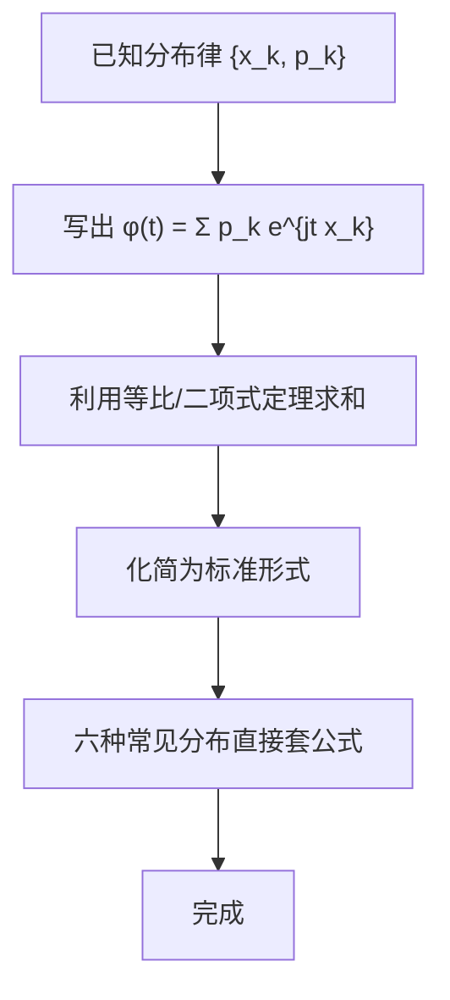

# 离散型特征函数计算

## 适用场景

给定离散随机变量的分布律 $\{x_k, p_k\}$，求其特征函数 $\varphi(t) = E(e^{jt\xi})$。

## 核心步骤

### 公式

$$\boxed{\varphi(t) = E(e^{jt\xi}) = \sum_k e^{jtx_k} \, p_k}$$

连续型对比（仅形式上不同，本质相同）：

$$\varphi(t) = \int_{-\infty}^{+\infty} e^{jtx} f(x) \, dx$$

### 常用六个必记特征函数

| 分布 | 特征函数 $\varphi(t)$ |
|:--|:--|
| 单点分布 $P\{\xi=c\}=1$ | $e^{jtc}$ |
| 0-1 分布 $B(1,p)$ | $q + pe^{jt}$ |
| 二项分布 $B(n,p)$ | $(q + pe^{jt})^n$ |
| 泊松分布 $P(\lambda)$ | $e^{\lambda(e^{jt}-1)}$ |
| 指数分布 $\text{Exp}(\lambda)$ | $\frac{\lambda}{\lambda - jt}$ |
| 正态分布 $N(\mu,\sigma^2)$ | $e^{j\mu t - \frac{1}{2}\sigma^2 t^2}$ |

> [!warning] 关键点
> - 离散型的特征函数是级数求和，常用等比级数或二项式定理化简。
> - 利用欧拉公式 $e^{jt} = \cos t + j\sin t$ 可将特征函数拆为实部与虚部。
> - 独立和的特征函数 = 各特征函数的乘积（**卷积变乘积，这是特征函数的核心价值**）。

## 流程图

## 典型例题

> **题目 1**：$\xi \sim B(1,p)$，即 $P(\xi=1)=p$，$P(\xi=0)=1-p=q$，求 $\varphi(t)$。

> [!example]- 解答
> $\varphi(t) = q \cdot e^{jt\cdot 0} + p \cdot e^{jt\cdot 1} = q + pe^{jt}$。
>
> 推广至 $B(n,p)$：由独立和的性质，$\varphi(t) = (q + pe^{jt})^n$。

---

> **题目 2**：$\xi$ 服从几何分布 $P(\xi=k) = p(1-p)^{k-1}$，$k=1,2,\ldots$，求 $\varphi(t)$。

> [!example]- 解答
> $$\varphi(t) = \sum_{k=1}^{\infty} p(1-p)^{k-1} e^{jtk} = pe^{jt} \sum_{k=1}^{\infty} [(1-p)e^{jt}]^{k-1} = \frac{pe^{jt}}{1 - (1-p)e^{jt}}$$
>
> 用等比级数求和公式 $\sum_{m=0}^{\infty} r^m = \frac{1}{1-r}$（$|r|<1$）。

---

> **题目 3**：$\xi \sim P(\lambda)$，求 $\varphi(t)$。

> [!example]- 解答
> $$\varphi(t) = \sum_{k=0}^{\infty} \frac{\lambda^k}{k!} e^{-\lambda} e^{jtk} = e^{-\lambda} \sum_{k=0}^{\infty} \frac{(\lambda e^{jt})^k}{k!} = e^{-\lambda} \cdot e^{\lambda e^{jt}} = e^{\lambda(e^{jt}-1)}$$
>
> 用指数级数 $\sum_{k=0}^{\infty} \frac{x^k}{k!} = e^x$。

## 知识链接

- [[知识点/常见分布的特征函数]]
- [[知识点/反演公式与唯一性定理]]
- [[知识点/常见离散型分布]]

## 习题链接

- [[课程/概率论/习题库/05-极限定理/习题5.1]] — 特征函数法求复合泊松分布律
- [[课程/概率论/习题库/05-极限定理/习题5.4]] — $X = a\cos(\omega+\Theta)$，特征函数法求密度
