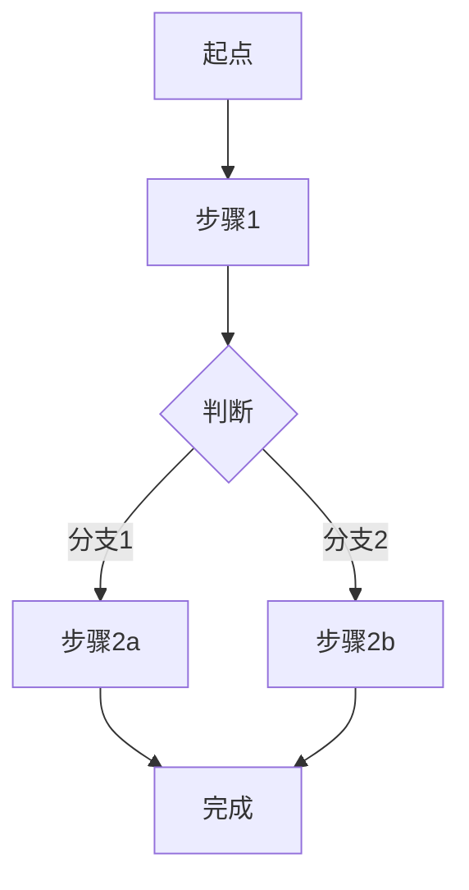

# 方法卡规范

## 目的

**方法卡**从解题方法角度组织知识，将分散在多个章节的解题套路归纳成独立可检索的学习单元。每条方法包含核心公式、操作流程、典型例题和双向知识链接——让读者通过"怎么解"找到对应的知识点和习题。

四层体系的职责边界：

| 层级 | 目录 | 粒度 | 用途 |
|------|------|------|------|
| **概念卡** | `概念/概率论/` | 跨章节复用概念 | 严格定义 + 由来作用 + 关系网 |
| **知识点卡** | `知识点/概率论/` | 章节内方法/定理 | 严格定义 + 推导 + 例题 + 易错点 |
| **方法卡** | `方法/概率论/` | 解题方法/流程 | 适用场景 + 核心公式 + 流程图 + 典型例题 + 知识/习题双链 |
| **习题** | `课程/概率论/习题库/` | 单道题目 | 题目 + 提示 + 解析 + 知识/方法双标签 |

## 哪些内容适合做方法卡

- 有清晰操作步骤的解题套路（标准化法、分布函数法、卷积法）
- 跨章节通用的计算流程（边缘分布计算、协方差计算流程）
- 特定题型的固定解法（全概率公式法、对立事件法、夹逼法）
- 近似/极限方法（正态近似 CLT、泊松近似、特征函数法）

**不适合**做方法卡的内容：纯概念定义（属于概念卡）、定理推导证明（属于知识点卡）、单道习题的详细解析（属于习题库）。

## 内容结构（8 板块，顺序固定）

| 序号 | 板块 | 标题 | 格式要求 |
|------|------|------|----------|
| 1 | **适用场景** | `## 适用场景` | 1-2 句话，说清什么时候用这个方法 |
| 2 | **核心公式/步骤** | `## 核心公式/步骤`（或 `## 核心步骤`） | 用 `\boxed{}` 框出关键公式；步骤用编号列表或表格；`> [!warning]` 高亮关键前提或易错点 |
| 3 | **流程图** | `## 流程图` | Mermaid `flowchart TD`，节点标签用 `"..."` 包裹 |
| 4 | **典型例题** | `## 典型例题` | 题目文本可见；解答用 `> [!example]- 解答` 折叠；至少 1 道，推荐 2 道（覆盖不同变体）；含完整手算步骤和点评 |
| 5 | **知识链接** | `## 知识链接`（或 `## 链接的知识点`） | Wiki-link 到 `知识点/概率论/`，列出本方法依赖的知识点 |
| 6 | **习题链接** | `## 习题链接`（或 `## 链接的习题`） | Wiki-link 到 `课程/概率论/习题库/`，列出本方法可解的典型习题 |

**板块顺序固定**：适用场景 → 核心公式/步骤 → 流程图 → 典型例题 → 知识链接 → 习题链接。

**反模式**：
- 方法卡里放定义推导 → 推导属于知识点卡
- 题目不折叠，占据过大空间
- 缺少流程图 → 方法卡的核心价值在于可视化操作流程
- 知识链接缺漏 → 读者无法通过方法反向定位知识点
- 习题链接只链 README → 应链到具体习题文件
- 核心公式未用 `\boxed{}` 突出

## Frontmatter 模板

### 基础版（简洁）
```yaml
---
title: 方法名
type: 方法
subject: 概率论
method_type: 基础方法
topics:
  - 关键词1
  - 关键词2
---
```

### 完整版（含知识链接）
```yaml
---
title: 方法名
type: 方法
subject: 概率论
method_type: 基础方法
methods: [[方法名]]
linked_knowledge:
  - 知识点/概率论/依赖知识点1
  - 知识点/概率论/依赖知识点2
topics:
  - 关键词1
  - 关键词2
---
```

**字段说明**：

| 字段 | 必须 | 说明 |
|------|------|------|
| `title` | 是 | 方法名称，简洁准确 |
| `type` | 是 | 固定为 `方法` |
| `subject` | 是 | 所属课程，如 `概率论` |
| `method_type` | 否 | 方法分类：`基础方法` / `补操作型` / `近似方法` / `验证方法` |
| `methods` | 否 | 自引用 Wiki-link，用于 Graph View 枢纽节点识别 |
| `linked_knowledge` | 否 | 链接的依赖知识点列表，用于自动关联和双向导航 |
| `topics` | 是 | 关键词标签，用于检索和分类 |

## 文件命名与路径

- 文件名：`方法名.md`（中/英文均可，准确表达即可）
- 路径：`方法/概率论/方法名.md`

## 模板

```markdown
---
title: 方法名
type: 方法
subject: 概率论
method_type: 基础方法
methods: [[方法名]]
linked_knowledge:
  - 知识点/概率论/依赖知识点1
  - 知识点/概率论/依赖知识点2
topics:
  - 关键词1
  - 关键词2
---

# 方法名

## 适用场景

1-2 句话说明何时使用此方法。

## 核心公式/步骤

核心公式，用 `\boxed{}` 框出：

$$\boxed{\text{关键公式}}$$

操作步骤：
1. 步骤一
2. 步骤二
3. 步骤三

> [!warning] 关键前提或易错点

## 流程图



## 典型例题

> **题目**：题目描述（题目文本可见，不折叠）。

> [!example]- 解答
> 完整手算步骤，含点评。

## 知识链接

- [[知识点/概率论/相关知识点1]]
- [[知识点/概率论/相关知识点2]]

## 习题链接

- [[课程/概率论/习题库/XX-章节/习题X.Y]] — 简要说明题目内容
- [[课程/概率论/习题库/XX-章节/习题X.Z]] — 简要说明题目内容
```

## 生成流程

```
确定方法是否跨题型/跨章节 → 从知识点和习题中归纳核心公式和操作步骤 →
绘制 Mermaid 流程图 → 选取典型例题（至少 1 道，覆盖不同变体） →
补知识链接和习题链接 → 写入方法/概率论/
```

## 质量检查清单

- 适用场景是否用 1-2 句话说清？
- 核心公式是否用 `\boxed{}` 框出？
- 流程图是否清晰展示了操作分支？
- 典型例题解答是否折叠（`> [!example]-`）？
- 知识链接是否完整（覆盖方法依赖的主要知识点）？
- 习题链接是否精准（链到具体习题文件，非仅 README）？
- 板块顺序是否正确（场景 → 公式 → 流程图 → 例题 → 知识链接 → 习题链接）？
- 有无泄露概念定义或定理推导（应属于概念卡/知识点卡）？
