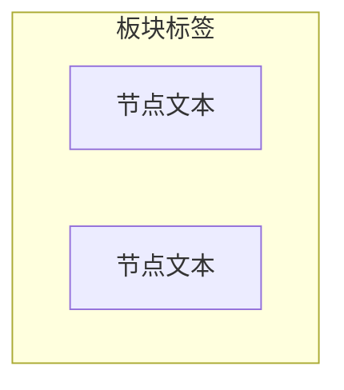

# 考试纲要与图谱规范

## 适用场景

老师不直接给出书面复习纲要，而是通过以下方式透露考点：

| 场景      | 输入                        | 提取方式             |
| :------ | :------------------------ | :--------------- |
| 口述串讲    | 录音 → 转写文本（飞书妙记/Whisper 等） | 从口语化表述中提取考点      |
| 复习 PPT | 一个老师整合的复习PPT（只有出现的知识点会考察） | 文档转MD（MinerU / xparse） |
| 手写图谱拍照  | 图片（PNG/JPG）               | xparse-parse OCR |
| 混合      | 以上组合                      | 综合提取 + 交叉验证      |

## 处理流程

```
录音/PPT/图片 → 转文本 → 提取考点 → 对照知识图谱 → 标注 考/不考/仅了解 → 写纲要 + 画图谱
```

### 步骤 1：获取原始材料

- 口述录音：用飞书妙记（`lark-minutes` skill）上传 → 获取逐字稿 + AI 总结
- 复习 PPT：用 MinerU / xparse-parse 将 PPTX/PDF 转为 MD
- 手写图谱：`xparse-cli parse` OCR 图片

### 步骤 2：提取考点信息

从原始文本中识别以下三类信息：

**明确考的**：
- "考"、"会考"、"主要考"、"重点是"、"考点集中在"
- "让你证明"、"让你判断"、"设计"、"涉及"
- 老师明确列举的知识点名称

**明确不考的**：
- "不考"、"不会考那么多"、"这个就不用了"
- "仅作了解"、"看一看就行"、"知道就可以"
- "跳过"、"没有讲"

**隐含信息**：
- 老师说"只考X" → X 以外的同章内容不考
- 老师说"主要就这几块" → 未提及的章节不考
- 老师说"第五章跳过了" → 整章不考

### 步骤 3：对照知识图谱裁剪

将提取的考点映射到课程知识图谱上：

1. 读取已有的 `知识图谱.png` 或 `课程-知识图谱.md`
2. 对知识图谱中的每个节点标注：🟢 考 / 🟡 仅了解 / 🔴 不考
3. 如果老师说了"只考X"，则同分支的其它节点标记为 🔴
4. 如果老师没提到某个分支，默认标记为 🔴（宁可多标不考，不能漏标考）

### 步骤 4：交叉验证

1. 同一信息在录音中是否出现多次？→ 大概率是考点
2. 老师是否加重语气/重复强调？→ 标记 ★★★
3. 复习 PPT 和口述是否一致？→ 如果矛盾，**以复习 PPT 为准**（PPT 是老师精心准备的，比即兴口述更可靠）
4. 如果只有口述没有复习 PPT → 按口述提取规则处理（默认未提及 = 不考）

---

## 考点分类标准

| 标记 | 老师原话特征 | 复习要求 |
|:--|:--|:--|
| 🟢★★★ | "主要考"、"重点是"、反复强调 | 完整掌握定义+证明+典型题 |
| 🟢 | "会考"、"涉及"、"设计" | 掌握定义、理解关系、会应用 |
| 🟡 | "仅作了解"、"看一看"、"知道就可以" | 知道概念，不深究证明 |
| 🔴 | "不考"、"跳过"、"没讲"、未提及 | 完全不看 |

---

## 输出产物

每个课程在 `课程/{课程名}/` 下产生两个文件：

### 1. 考试纲要.md

```yaml
---
title: {课程名} 考试纲要
subject: {课程名}
type: 考试纲要
source: {原始材料列表}
---
```

**内容结构**：
- 一句话概述（来源 + 课程范围）
- 链接到可视化图谱
- 分块列出（每块 = 一个考试板块）：
  - **考/不考对照表**（表格，一目了然）
  - **必须掌握**（核心定义 + 定理 + 典型题）
- 可能考察的证明（汇总列表，注明证法关键词）
- 相关链接（→ 复习文件夹、知识梳理、课件 MD）

### 2. 考试图谱-重点标注.md

```yaml
---
title: {课程名} 考试图谱（重点标注版）
subject: {课程名}
type: 知识图谱
source: {原始图谱}, {考试纲要}
---
```

**内容结构**：
- Mermaid `flowchart TD` 图，用 `subgraph` 分板块
- 三种 CSS class 标注：
  - `examStar`（深绿）：★★★ 最核心
  - `exam`（浅绿）：考试内容
  - `understand`（黄色）：仅了解
  - `noExam`（灰色）：不考
- 图例表
- 各板块考点速览（文字版）

---

## 口述文本 → 考点提取规则

老师的口语化表述需要转换为精确考点：

| 老师原话（示例） | 提取结果 |
|:--|:--|
| "只考虑这个基数，什么是可数集，什么是不可数集，让你证明一个集合可数/不可数" | 考：可数集定义、不可数集定义、可数性证明（含 Cantor 对角线法）；不考：开闭集、完备性等 |
| "只考一个，就是这个收敛，不同种的收敛到底是什么" | 考：四种收敛（a.e./a.u./依测度/一致）的定义和关系、Egorov、Riesz；不考：测度定义、可列可加性 |
| "主要考积分跟极限交换顺序" | 考：Levi / Fatou / DCT / 有界收敛定理；DCT 标记 ★★★ |
| "重积分这个联系不好找，这个就不用了，看一看就行了" | 🟡 仅了解：重积分、Fubini/Tonelli |
| "这个内容比较杂，考的点比较多比较零散" | 该板块全部标记 🟢，逐项列出 |
| "第五章我们跳过了，没有讲" | 整章不考（🔴） |

**常见歧义处理**：
- "简单了解" → 🟡（不是完全不考，但不用深入）
- "这个我们会设计" → 🟢（老师明确要出题）
- "顶多做个判断或稍微说明一下" → 🟢 但降低优先级
- 老师列举时语速变慢/重复 → 标记 ★★★

---

## 复习 PPT → 考点提取规则

复习 PPT 是老师专门整合的考试范围文件。**核心原则：只有 PPT 中出现的知识点才会考，未出现的不考。**

### 提取流程

1. **文档转 MD**：用 MinerU / xparse-parse 将 PPTX/PDF 转为 Markdown
2. **提取所有知识点**：PPT 中的每个条目（标题、列表项、公式、定义块）都是考点
3. **分级标注**：
   - PPT 中**单独成页**或**加粗/着色**的内容 → 🟢★★★
   - PPT 中的普通列表项 → 🟢
   - PPT 中标注"了解""*选读"的内容 → 🟡
4. **反向排除**：对照课程完整知识图谱，PPT 中**未出现的分支全部标记 🔴**

### 与口述串讲的差异

| | 口述串讲 | 复习 PPT |
|:--|:--|:--|
| 考什么 | 从口语中模糊提取 | PPT 条目即考点，精确无歧义 |
| 不考什么 | 老师说"不考"或未提及 | **PPT 中没有 = 不考**（最强信号） |
| 优先级 | 靠语气/重复判断 | 靠排版（独立页>列表项>小字） |
| 准确性 | 依赖转写质量 | 高，文字精确 |

### 注意事项

- 复习 PPT ≠ 平时课件。课件覆盖全章，复习 PPT 只含考点。
- **缺失 = 不考**。不需要像口述串讲那样担心"老师忘了说"。
- 如果同时有口述录音和复习 PPT，**以复习 PPT 为准**（PPT 是老师精心准备的，比即兴口述更可靠）。

---

## 图谱绘制规范

### Mermaid 结构



### 节点命名

- 每个节点：简短描述（≤20 字），可 `<br>` 换行
- 核心定理标注在节点文本中（如 `★★★ DCT控制收敛`）
- 不考的内容也要画出来（灰化），保持图谱完整性

### 颜色方案

```css
classDef examStar fill:#155724,stroke:#28a745,color:#fff,font-weight:bold
classDef exam     fill:#d4edda,stroke:#28a745,color:#155724
classDef understand fill:#fff3cd,stroke:#ffc107,color:#856404
classDef noExam   fill:#f8f9fa,stroke:#ccc,color:#999
```

### 连线

- 仅画主要逻辑连线（知识依赖关系）
- 不需要把所有节点都连起来——保持可读性
- 用 `-->` 表示"导出/依赖"关系

---

## 准确性验证清单

纲要完成后，逐项确认：

- [ ] 每个"考"的条目在原始材料中有明确依据
- [ ] 每个"不考"的条目在原始材料中有明确依据（或老师未提及 + 同章其它内容被标注为"只考X"）
- [ ] 图谱中的标注与纲要正文一致
- [ ] ★★★ 标记对应老师在口述中强调/重复的内容
- [ ] 纲要中的证明列表与图谱中的定理节点一一对应
- [ ] 所有 🟡 项在原始材料中有"了解/看一看/知道就行"等表述支撑

---

## 与复习文件夹的关系

```
考试纲要.md ──→ 复习/README.md ──→ 复习/I-板块.md
    │                                 复习/II-板块.md
    │                                 复习/常考查的证明.md
    │
    └──→ 考试图谱-重点标注.md（可视化）
```

- **纲要**是总入口：给出考点边界 + 复习优先级
- **复习文件夹**是详细版：每板块独立文件，含定义速查、定理详解、易错点、作业
- **图谱**是可视化：一图看清考什么不考什么

---

## 参考案例

实变函数是一个完整的参考案例：

| 文件 | 说明 |
|:--|:--|
| [[课程/归档/实变函数/考试纲要]] | 从口述录音文本 + 手写图谱 OCR 提取的纲要 |
| [[课程/归档/实变函数/考试图谱-重点标注]] | Mermaid 三色标注图谱 |
| [[课程/归档/实变函数/复习/README]] | 分板块复习文件夹索引 |
