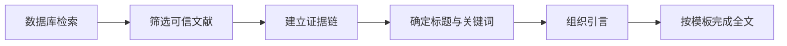
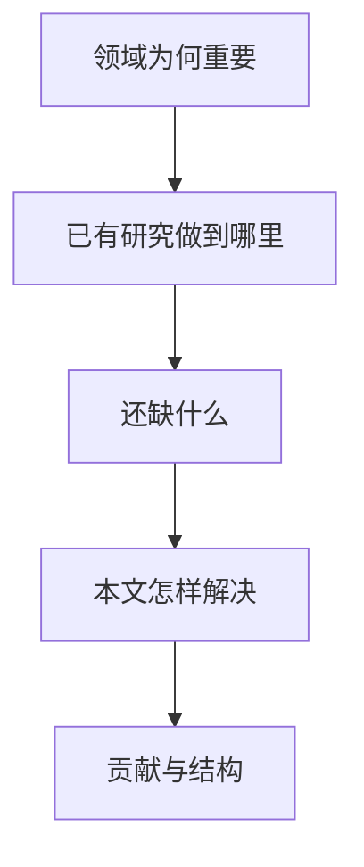

# 2026-09-08 第2节 文献检索与科技论文写作

## 资料来源

- 原始逐字稿：[[raw/2026-09-08-文献检索与科技论文写作授课-230016-逐字稿.md]]
- 智能纪要：[[raw/2026-09-08-文献检索与科技论文写作授课-230016-纪要.md]]
- 开始时间：2026-09-08 10:21

## 一、本节课核心脉络

本节课把“查得到文献”推进到“会判断、会引用、会组织论文”。重点包括数据库选择、参考文献格式、标题与关键词、署名原则、引言逻辑，以及期末文献综述的具体要求。

## 二、从检索到筛选

### 1. 数据库各自解决什么问题

- **中国知网（CNKI）**：用于检索中文期刊、学位论文等，适合掌握国内研究现状。
- **EI**：侧重工程技术文献，适合工程与应用型主题。
- **SCI / Web of Science**：可追踪引证关系，用于发现领域中的关键论文、研究脉络与高影响成果。

“被数据库收录”只是初筛条件，不等于论文结论必然正确。阅读时仍需检查研究问题是否相关、方法是否合理、数据是否充分、结论是否超出证据边界。

### 2. 核心期刊与单位分类

课堂区分了北大核心、CSSCI（南大核心）与各单位自行制定的 A/B/C 分类。它们服务于不同评价体系，不能混为一谈。实际写作和投稿应以课程、学院或目标期刊的明确要求为准。

## 三、参考文献著录与正文引用

### 1. 常见文献类型标识

| 类型 | 标识 | 示例用途 |
|:--|:--:|:--|
| 期刊论文 | J | 正式发表的连续出版物论文 |
| 会议论文 | C | 会议论文集中的文章 |
| 学位论文 | D | 硕士、博士学位论文 |
| 专著 | M | 正式出版的图书 |
| 专利 | P | 已公开的专利文献 |

具体标点、作者列示数量、卷期页码格式必须以指定模板或引用标准为准。课堂示例采用“卷号在括号外、期号在括号内、随后列页码”的结构；英文标点后通常留空格，连接词内部的连字符前后不加空格。

> [!warning] 不要只在文末堆文献
> 正文引用负责说明“这句话从哪里来”，文末参考文献负责给出“怎样找到原文”。两者必须一一对应。

### 2. 引用的三重作用

1. 尊重原作者并避免把他人成果冒充为自己的贡献。
2. 给关键事实和结论提供可核验的证据。
3. 把观点责任准确地归属给原作者，便于读者判断与追溯。

## 四、标题与关键词

### 1. 标题：用核心名词限定研究边界

可先列出“研究对象—问题—方法—场景”四类词，再选取三至四个最关键的名词组织成简洁标题。题目过大时，应增加限定条件，例如具体对象、数据范围、算法或应用场景。

> [!example] 从宽泛到具体
> “图像去噪研究”范围过大；“面向低照度医学图像的自适应去噪方法”交代了对象、场景与方法方向，更便于读者判断论文内容。

### 2. 关键词：兼顾内容概括与可检索性

关键词通常来自研究对象、核心方法、关键任务与应用场景。它们既帮助数据库建立索引，也帮助编辑或投稿系统匹配审稿人。AI 可以辅助统计高频词，但最终选择应由作者根据论文贡献人工确认。

## 五、作者署名与责任

- 署名应依据实质性学术贡献，而不是单纯按耗时或身份排序。
- 第一作者通常承担主要研究与写作工作。
- 通讯作者负责与期刊沟通，并对论文真实性、完整性承担重要责任。
- 仅提供一般事务性帮助但未作出实质学术贡献者，更适合在致谢中说明。

不同学科对作者顺序和通讯作者的惯例可能不同，应遵循本领域规范，并在合作开始时尽早明确贡献与署名预期。

## 六、引言的四段逻辑

1. **研究背景**：说明这个问题为什么重要。
2. **已有研究与不足**：概括别人做了什么，以及仍存在哪个具体缺口。
3. **本文方案与贡献**：说明本文怎样解决上述缺口，贡献是什么。
4. **文章结构**：简要交代各部分安排。

> 一句话来说：引言不是“背景知识大全”，而是一条从现实问题通向本文贡献的论证链。

文献综述要围绕研究问题组织，不宜逐篇罗列。课堂提出应保持一定比例的近年文献；具体比例属于本课程要求，写作时同时要保留奠基性经典文献，不能为了“新”而舍弃关键来源。

## 七、期末文献综述要求

| 项目 | 课堂要求 |
|:--|:--|
| 类型 | 文献综述 |
| 字数 | 4000—4500 字，含参考文献 |
| 模板 | 电子科技大学学报 Word 模板 |
| 第一版截止 | 2026-10-20 前 |
| 第二版截止 | 2026-11-03 前 |

可结合已有大创项目或研究积累改写，也可从教师给出的研究方向中选题。无论材料从何而来，都应重新核对事实、引用和贡献边界，并严格使用课程指定模板。

## 八、写作执行清单

- [ ] 选题已限定对象、问题与范围。
- [ ] 核心文献来自课程认可的数据库，并已阅读全文或关键部分。
- [ ] 引言明确写出研究缺口，而非只罗列背景。
- [ ] 标题、摘要和关键词指向同一个核心问题。
- [ ] 每个外部观点、数据和图表均有正文引用。
- [ ] 作者署名与实际贡献一致。
- [ ] 字数、模板和两个提交节点已纳入计划。

## 课堂导航

- 上一节：[[2026-09-01-第1节-转写_电子科大王君豪的快速会议|第1节 科技论文写作与学术规范]]
- 上级索引：[[README|专业写作基础课堂笔记]]
