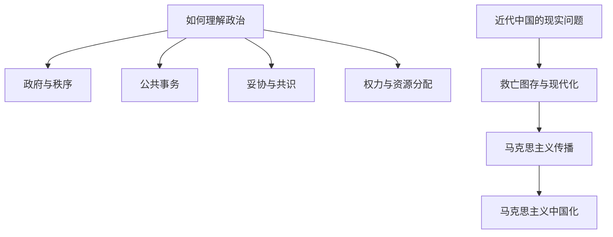
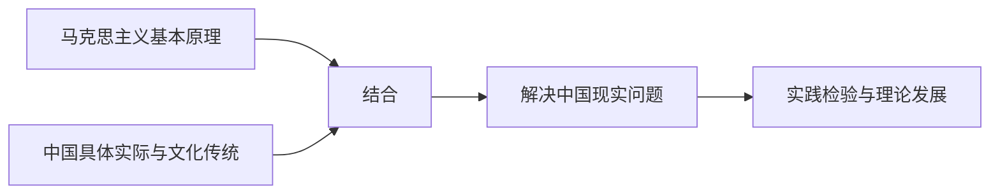

# 2026-09-03 第2节 政治的多维理解与马克思主义中国化

## 资料来源

- 原始逐字稿：[[raw/2026-09-03-政治学概论与马克思主义中国化讲座-954048-逐字稿.md]]
- 智能纪要：[[raw/2026-09-03-政治学概论与马克思主义中国化讲座-954048-纪要.md]]
- 开始时间：2026-09-03 14:37

## 一、本节课核心脉络

本节课分为两条主线：第一条从政府、公共事务、协商和权力分配四个角度理解“政治”；第二条回到近代中国的历史处境，解释马克思主义为何能够在中国传播、被选择并不断本土化。

## 二、政治的四个理解维度

### 1. 政治作为政府的艺术

社会契约论试图回答国家和政府为何必要：人在共同生活中让渡部分权利，以换取安全、秩序和公共规则。霍布斯、洛克、卢梭对自然状态、权利让渡和政府正当性的理解不同，但共同指出政府权力需要某种正当性基础。

政府不可缺少，并不意味着权力可以不受约束。制度设计的重要任务，是在公共行动能力与防止权力滥用之间建立平衡。

### 2. 政治作为公共事务

当一个问题影响多人利益，需要共同制定规则、分配成本或协调行动时，它就具有公共性。垃圾分类、社区治理、老旧小区加装电梯等问题，看似源于日常生活，实质上都包含利益分配和集体决策。

课堂还比较了不同文化对政治人物公德与私德关系的理解。这里需要区分：不同社会的历史传统和制度环境会影响“私人行为何时成为公共议题”的边界，不能把某个个案简单推广为整个社会的固定特征。

### 3. 政治作为妥协与共识

政治可以被理解为用谈判、协商和制度程序处理冲突，而非直接诉诸暴力。协商的结果往往不是任何一方的绝对最优，而是各方能够接受并持续执行的方案。

老旧小区加装电梯的例子说明：高层住户收益较大，低层住户可能承担噪声、采光等成本，因此仅靠多数表决未必能化解矛盾；还需要信息公开、利益补偿和持续协商。

> 一句话来说：政治协商的价值，不在于消灭分歧，而在于让分歧能够通过规则被表达、协调和约束。

### 4. 政治作为权力与资源分配

拉斯韦尔用“谁得到什么、何时以及如何得到”概括政治中的分配问题。资源有限、需求多元时，规则由谁制定、议题由谁提出、成本由谁承担，都会体现权力关系。

权力并不只存在于政府机构，也可能出现在组织、职场、社区和家庭关系中。分析权力时，既要观察正式职位和制度，也要观察信息、话语、资源依赖等非正式影响。

## 三、民主与效率的辩证关系

课堂用公共工程和地区政治案例讨论决策效率。可将问题拆成三个维度：

- **决策速度**：从提出问题到作出决定需要多久。
- **执行能力**：决定能否转化为稳定行动。
- **程序与权利保障**：利益相关者是否有表达、申诉和监督渠道。

快速决策不必然等于高质量决策，程序充分也不意味着结果自动正确。评价制度时，应同时考察效率、公平、合法性、纠错能力和长期后果，避免只用单一案例得出绝对结论。

## 四、马克思主义的理论关切与世界影响

课堂强调，马克思主义对资本主义生产关系、劳动、阶级、不平等和全球化的分析，改变了现代社会理解自身的方式。它把劳动者置于历史和社会生产的中心，并以追求人的解放与平等为重要价值关切。

马克思主义产生于西方，同时又对资本主义现代性展开系统批判。正是这种“源于现代世界、又批判现代世界”的双重性质，使其既具有世界性，也为不同国家结合自身历史条件进行理论转化留下空间。

> [!note] 对课堂例证的使用
> 课堂提到若干媒体评选和国家政治实践，用于说明马克思主义的持续影响。这些例证适合帮助理解，不应替代理论文本、历史材料和正式统计资料。

## 五、马克思主义传入中国

### 1. 传播与译介

近代以来，朱执信、李大钊、陈望道等知识分子参与了马克思主义及《共产党宣言》的介绍、翻译和传播。概念跨语言传播并不是简单换词：阶级、生产关系、历史唯物主义等范畴，需要在中国思想传统和现实经验中重新解释。

### 2. 近代中国为何需要新的理论方案

从洋务运动、戊戌变法、辛亥革命到新文化运动，中国持续探索救亡图存和国家转型道路。单纯引进器物、局部制度改革或更换政权形式，都未能彻底解决民族独立、社会动员和现代国家建设等问题。

马克思主义提供了分析社会结构、阶级关系和历史动力的系统框架，也把民族解放与社会改造联系起来，因此能回应当时中国知识分子“学习现代文明”与“反对帝国主义压迫”的双重诉求。

## 六、从传播到中国化

马克思主义中国化不是把现成结论机械套用到中国，而是把基本原理同中国具体实际、历史文化和时代任务相结合。其逻辑可以概括为：

1. 从中国现实问题出发，而不是从抽象公式出发。
2. 用马克思主义立场、观点和方法分析具体矛盾。
3. 在实践中检验理论判断，并根据新经验继续发展理论。
4. 形成能够解释中国道路、指导中国实践的理论成果。

## 七、易混点与思考

> [!warning] 易混点
> - “政治涉及公共事务”不等于所有私人生活都自动政治化。
> - “协商需要妥协”不等于放弃原则，而是寻找可执行的共同方案。
> - “效率重要”不等于可以忽略程序、公平和权利保障。
> - “理论中国化”不等于随意改变理论，而是坚持基本立场并回应具体实践。

思考题：

1. 一个私人问题在什么条件下会转化为公共政治问题？
2. 怎样同时评价一项公共决策的效率、公平与合法性？
3. 为什么一种外来理论只有经过本土化，才能稳定地解释并指导本国实践？

## 课堂导航

- 上级索引：[[README|习近平新时代中国特色社会主义思想概论课堂笔记]]
