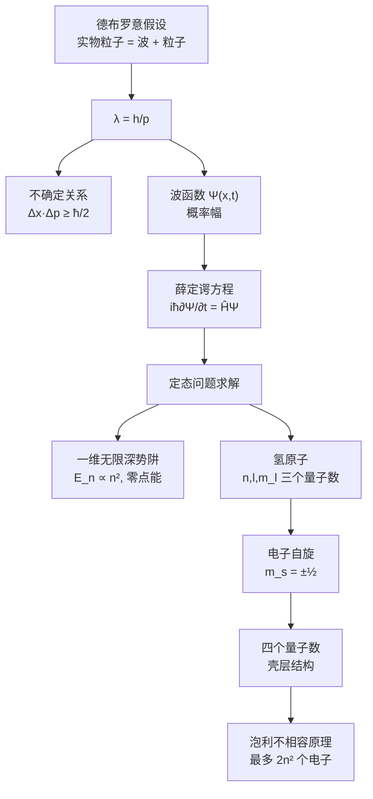
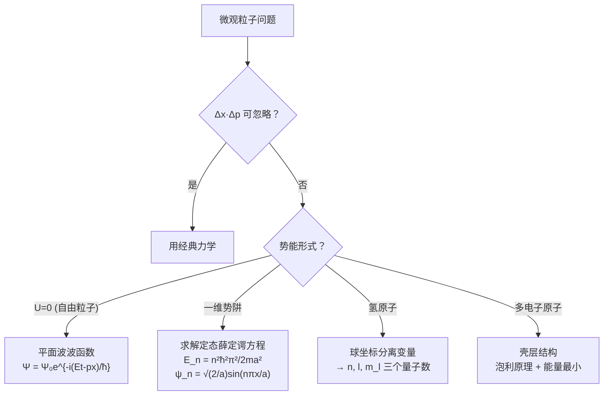

# 第17章 量子力学基础 — 知识点梳理

## 一、本章核心脉络

从"光有粒子性"（第16章）→ **"实物粒子也有波动性"**（德布罗意）→ **建立描述微观粒子的完整理论**（量子力学）。

> 逻辑链：波粒二象性 → 不能用经典坐标+动量描述 → 用波函数描述状态 → 薛定谔方程决定波函数 → 解得量子化能级 → 解释原子结构。

---

## 二、微观粒子的波粒二象性（核心）

### 2.1 德布罗意假设 (1924)

> 一切实物粒子都具有**波粒二象性**。

**德布罗意关系**：

$$\lambda = \frac{h}{p} = \frac{h}{mv}, \quad \nu = \frac{E}{h}$$

> 一句话来说：电子不只是一个粒子，它也像波一样有波长——波长越短，动量越大。

### 2.2 实验验证

戴维逊-革末电子衍射实验、电子双缝干涉实验 → 证实电子的波动性。

### 2.3 德布罗意波长的计算

- 非相对论（低速）：$\lambda = \frac{h}{\sqrt{2mE_k}}$
- 相对论（高速）：$\lambda = \frac{h}{p}$，$p$ 需用相对论动量

> [!hint]
> 宏观物体的 $\lambda$ 极小（如子弹 $\lambda \sim 10^{-40}$m），波动性不可观测。只有微观粒子（电子 $\lambda \sim 1\text{Å}$）波动性才显著。

---

## 三、不确定关系（核心）

### 3.1 海森堡不确定关系

$$\Delta x \cdot \Delta p_x \geq \frac{\hbar}{2} \quad \left(\text{或} \ \Delta x \cdot \Delta p_x \geq h \ \text{用于估算}\right)$$

其中 $\hbar = h/2\pi$。

### 3.2 物理含义

> **坐标和动量不能同时具有确定值。** 这不是测量技术的问题，而是微观粒子**波粒二象性的必然结果**。

| | 微观粒子 | 宏观物体 |
|------|----------|----------|
| 不确定关系 | 不可忽略 → 必须用量子力学 | 可忽略 → 可用经典力学 |

> 一句话来说：你想把电子的位置量得越准，它的速度就变得越不确定——就像要把一团雾压缩在一个点上，雾的动势就变大。

### 3.3 应用判据

- $\Delta x \cdot \Delta p \ll$ 经典尺度 → 可用经典力学
- $\Delta x \cdot \Delta p \sim h$ → 必须用量子力学

---

## 四、波函数（难点）

### 4.1 波函数的引入

微观粒子的状态用**复函数 $\Psi(x, y, z, t)$（波函数）** 来描述。

### 4.2 玻恩统计解释

> $|\Psi(x, y, z, t)|^2$ = 粒子在 $(x, y, z)$ 处**单位体积**内出现的概率（概率密度）。

$|\Psi|^2 dx\,dy\,dz$ = 粒子在体积元内出现的概率。

> 一句话来说：波函数本身不是任何"真实的波"，但它的模的平方告诉你粒子"最可能在哪里"。

### 4.3 波函数的条件

1. **归一化**：$\iiint |\Psi|^2 dx\,dy\,dz = 1$（粒子总概率为1）
2. **标准条件**：单值、有限、连续

---

## 五、薛定谔方程（核心）

### 5.1 一般形式

$$i\hbar \frac{\partial \Psi}{\partial t} = \hat{H} \Psi = \left[-\frac{\hbar^2}{2m}\nabla^2 + U\right] \Psi$$

### 5.2 定态薛定谔方程

当势能 $U$ 不显含时间时，$\Psi(\vec{r}, t) = \psi(\vec{r}) e^{-iEt/\hbar}$，得：

$$-\frac{\hbar^2}{2m} \nabla^2 \psi + U \psi = E \psi$$

或简写为：$\hat{H}\psi = E\psi$

> 一句话来说：薛定谔方程在量子力学中的地位，相当于 $F=ma$ 在经典力学中的地位——它是描述微观粒子运动的基本方程。

---

## 六、一维无限深方势阱（核心应用）

### 6.1 模型

质量为 $m$ 的粒子在 $0 < x < a$ 内自由运动，阱外势能 $\infty$：

$$U(x) = \begin{cases} 0 & 0 < x < a \\ \infty & x \leq 0, \, x \geq a \end{cases}$$

### 6.2 求解结果

由定态薛定谔方程 + 边界条件 $\psi(0) = \psi(a) = 0$：

**能级**：
$$E_n = n^2 \frac{\hbar^2 \pi^2}{2ma^2}, \quad n = 1, 2, 3, \ldots$$

**波函数**：
$$\psi_n(x) = \sqrt{\frac{2}{a}} \sin\left(\frac{n\pi}{a}x\right)$$

**概率密度**：
$$|\psi_n(x)|^2 = \frac{2}{a} \sin^2\left(\frac{n\pi}{a}x\right)$$

### 6.3 重要结论

1. **能量量子化**：$E_n \propto n^2$（来自边界条件）
2. **零点能**：$E_1 = \frac{\hbar^2\pi^2}{2ma^2} > 0$（经典最低能量为0！）
3. 概率分布不均匀，与经典均匀分布完全不同
4. $n$ 越大，量子 → 经典的过渡

> 一句话来说：关在盒子里的粒子不能随意取能量——只能取某些"允许值"。最神奇的是：粒子永远不能"完全停下来"（零点能 > 0）。

---

## 七、量子力学对氢原子的描述（难点）

### 7.1 球坐标薛定谔方程

氢原子势能 $U = -\frac{e^2}{4\pi\varepsilon_0 r}$ 呈球对称，取球坐标 $(r, \theta, \varphi)$，定态薛定谔方程为：

$$\frac{1}{r^2}\frac{\partial}{\partial r}\!\left(r^2\frac{\partial\psi}{\partial r}\right) + \frac{1}{r^2\sin\theta}\frac{\partial}{\partial\theta}\!\left(\sin\theta\frac{\partial\psi}{\partial\theta}\right) + \frac{1}{r^2\sin^2\theta}\frac{\partial^2\psi}{\partial\varphi^2} + \frac{2m}{\hbar^2}\!\left(E + \frac{e^2}{4\pi\varepsilon_0 r}\right)\psi = 0$$

**分离变量**：$\Psi(r,\theta,\varphi) = R(r)\,\Theta(\theta)\,\Phi(\varphi)$，代入后在 $E < 0$（束缚态）条件下求解，波函数必须满足单值、有限、连续。
    
### 7.2 自然导出的量子化

无需像玻尔那样人为假设——薛定谔方程加边界条件**自动**给出量子化：

| 量子数 | 符号 | 取值 | 决定 |
|--------|------|------|------|
| **主量子数** | $n$ | $1, 2, 3, \ldots$ | 能量 $E_n = -\frac{13.6}{n^2} \text{ eV}$（与玻尔结果一致） |
| **角量子数** | $l$ | $0, 1, \ldots, n-1$ | 角动量 $L = \sqrt{l(l+1)}\hbar$ |
| **磁量子数** | $m_l$ | $0, \pm 1, \ldots, \pm l$ | $L_z = m_l \hbar$（空间量子化） |

> [!important] 对比玻尔理论
> 玻尔 $L = n\hbar$ 是近似，量子力学给出 $L = \sqrt{l(l+1)}\hbar$。量子化来自边界条件而非人为假设。

### 7.3 电子云与概率分布

波函数 $\Psi_{nlm_l}(r,\theta,\varphi) = R_{nl}(r)\,\Theta_{lm_l}(\theta)\,\Phi_{m_l}(\varphi)$，概率密度 $|\Psi|^2$ 分布在核周围——即**电子云**。

以 **1S 态**（$n=1, l=0, m_l=0$）为例：

$$p_{1s}(r) = \frac{4}{a_0^3} r^2 e^{-2r/a_0}, \quad a_0 = \frac{\varepsilon_0 h^2}{\pi m e^2} \text{（玻尔半径）}$$

- $p_{1s}$ 是 $r$ 的连续函数，电子在核外**每一点都有一定概率**
- $a_0$ 是**概率最大的位置**，不是确定的轨道
- 这与玻尔的固定轨道概念**完全不同**

> 一句话来说：量子力学告诉我们，电子不是绕着核在"轨道"上跑，而是像一团"云"一样弥漫在核周围——玻尔半径只是云最密的地方。

---

## 八、电子自旋与四个量子数

### 8.1 电子自旋

斯特恩-盖拉赫实验 → 电子还有**内禀角动量（自旋）**。

- 自旋角动量：$S = \sqrt{s(s+1)}\hbar = \frac{\sqrt{3}}{2}\hbar$（$s = \frac{1}{2}$）
- $z$ 分量：$S_z = m_s \hbar$，$m_s = \pm \frac{1}{2}$

> [!warning] 自旋不是机械转动！是纯粹的量子力学效应。

### 8.2 四个量子数汇总

| 量子数    | 符号    | 取值                    | 物理意义      |     |
| ------ | ----- | --------------------- | --------- | --- |
| 主量子数   | $n$   | $1,2,3,\ldots$        | 决定能量      |     |
| 角量子数   | $l$   | $0,1,\ldots,n-1$      | 决定角动量大小   |     |
| 磁量子数   | $m_l$ | $0,\pm1,\ldots,\pm l$ | 决定角动量空间取向 |     |
| 自旋磁量子数 | $m_s$ | $\pm\frac{1}{2}$      | 决定自旋取向    |     |

---

## 九、原子的壳层结构

### 9.1 壳层与分壳层

| $n$ | 壳层 | $l$ | 分壳层 |
|:---:|------|:---:|--------|
| 1 | K | 0 | 1s |
| 2 | L | 0, 1 | 2s, 2p |
| 3 | M | 0, 1, 2 | 3s, 3p, 3d |
| 4 | N | 0, 1, 2, 3 | 4s, 4p, 4d, 4f |

### 9.2 泡利不相容原理

> 原子中**不能有两个电子**具有完全相同的四个量子数 $(n, l, m_l, m_s)$。

→ 每壳层最多电子数：$2n^2$（K: 2, L: 8, M: 18, N: 32, ...）

→ 每分壳层最多电子数：$2(2l+1)$（s: 2, p: 6, d: 10, f: 14, ...）

### 9.3 能量最小原理

正常状态下，电子总是优先占据**最低能级**。

---

## 判定/决策流程

---

## 核心公式速查表

| 公式 | 含义 |
|------|------|
| $\lambda = h/p$ | 德布罗意波长 |
| $\Delta x \cdot \Delta p_x \geq \hbar/2$ | 不确定关系 |
| $|\Psi|^2$ | 概率密度 |
| $\iiint |\Psi|^2 dV = 1$ | 归一化条件 |
| $i\hbar\frac{\partial\Psi}{\partial t} = \hat{H}\Psi$ | 薛定谔方程（一般形式） |
| $-\frac{\hbar^2}{2m}\nabla^2\psi + U\psi = E\psi$ | 定态薛定谔方程 |
| $E_n = n^2\frac{\hbar^2\pi^2}{2ma^2}$ | 一维势阱能级 |
| $\psi_n = \sqrt{2/a}\sin(n\pi x/a)$ | 一维势阱波函数 |
| $E_n = -13.6/n^2 \text{ eV}$ | 氢原子能级 |
| $L = \sqrt{l(l+1)}\hbar$ | 轨道角动量 |
| $L_z = m_l\hbar$ | 角动量 z 分量 |
| $S_z = m_s\hbar, m_s = \pm\frac{1}{2}$ | 自旋 z 分量 |
| $2n^2$ | 每壳层最多电子数 |

---

## 易错点与注意事项

> [!warning]
> 1. **德布罗意波是概率波**，不是机械波或电磁波
> 2. 不确定关系是**内禀性质**，不是测量误差
> 3. 波函数本身**不可测量**，$|\Psi|^2$ 才是可观测量（概率密度）
> 4. **零点能 ≠ 0**：量子力学中束缚态的最低能量总是大于经典最小值
> 5. 角动量量子化：$L = \sqrt{l(l+1)}\hbar$（**不是** $L = l\hbar$！玻尔理论的 $L=n\hbar$ 是近似）
> 6. 自旋磁量子数只有 $\pm 1/2$，不是整数
> 7. 泡利原理中的"四个量子数完全相同"→ 至少有一个不同

---

## 相关知识点链接

- [[../课件/MD/大学物理_16量子光学基础]] — 早期量子论（黑体辐射、光电效应、玻尔理论）
- [[../../知识点汇集/17-量子力学基础-知识汇集]] — 复习用清单式汇集

---

## 作业与练习

- [[../习题库/17-量子力学基础/习题17-1|习题17-1]] 电子和子弹的德布罗意波长
- [[../习题库/17-量子力学基础/习题17-2|习题17-2]] 高压加速电子的相对论德布罗意波长
- [[../习题库/17-量子力学基础/习题17-3|习题17-3]] 给定德布罗意波长求加速电压
- [[../习题库/17-量子力学基础/习题17-4|习题17-4]] 氢原子中电子速度的不确定量
- [[../习题库/17-量子力学基础/习题17-5|习题17-5]] 子弹坐标的不确定量
- [[../习题库/17-量子力学基础/习题17-6a|习题17-6a]] 光子的坐标不确定量
- [[../习题库/17-量子力学基础/习题17-6b|习题17-6b]] 一维无限深方势阱中粒子的能量和概率密度
- [[../习题库/17-量子力学基础/习题17-7|习题17-7]] 氩原子的电子组态
- [[../习题库/17-量子力学基础/习题17-8|习题17-8]] 钴原子的3d电子数和电子组态
- [[../习题库/17-量子力学基础/习题17-9|习题17-9]] 氢原子L壳层电子的量子数
- [[../习题库/17-量子力学基础/习题17-10|习题17-10]] n=3时电子动量矩的可能值
