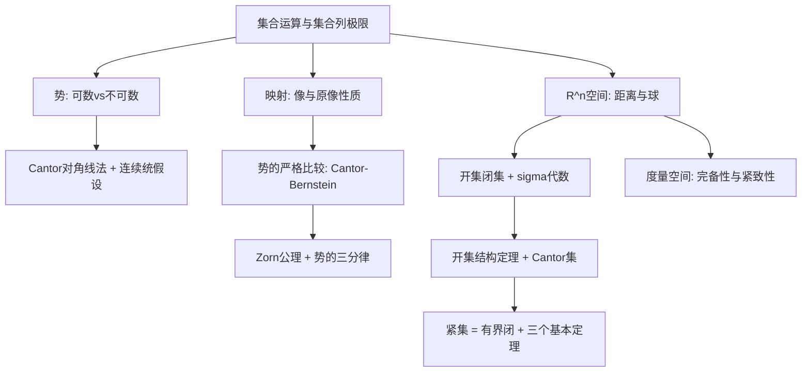
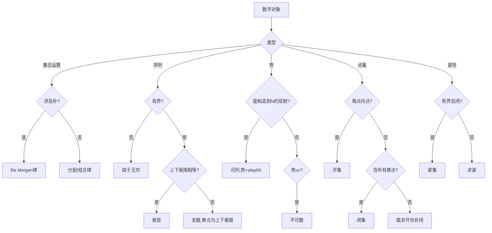

# 第1章 集合论与点集拓扑基础 — 知识点汇集

## 一、本章核心脉络

本章是实变函数的**语言基础**。两条主线：(1) 集合的"大小"——从集合运算到序列极限到势的比较；(2) 空间的"远近"——从 $\mathbb{R}^n$ 距离到开闭集到度量空间。最终在 Zorn 公理框架下统一。

---

## 二、基础定义

| 术语 | 记号 | 定义 |
|------|------|------|
| 交 | $A \cap B$ | $\{x \mid x \in A \text{ 且 } x \in B\}$ |
| 并 | $A \cup B$ | $\{x \mid x \in A \text{ 或 } x \in B\}$ |
| 补 | $A^c$ | $\{x \in X \mid x \notin A\}$ |
| 差 | $A \setminus B$ | $\{x \mid x \in A \text{ 且 } x \notin B\}$ |
| 幂集 | $2^X$ | $X$ 的所有子集的集合 |
| 直积 | $X \times Y$ | $\{(x,y) \mid x \in X, y \in Y\}$ |
| 升列 | $A_1 \subset A_2 \subset \cdots$ | 单调递增集合列 |
| 降列 | $A_1 \supset A_2 \supset \cdots$ | 单调递减集合列 |
| 上极限(集) | $\varlimsup A_n$ | $\bigcap_{n=1}^{\infty}\bigcup_{k=n}^{\infty}A_k$（属于无穷多个） |
| 下极限(集) | $\varliminf A_n$ | $\bigcup_{n=1}^{\infty}\bigcap_{k=n}^{\infty}A_k$（最终属于） |
| 映射 | $f: X \to Y$ | $\forall x \in X, \exists! f(x) \in Y$ |
| 单射 | — | $x_1 \neq x_2 \Rightarrow f(x_1) \neq f(x_2)$ |
| 满射 | — | $f(X) = Y$ |
| 双射 | — | 同时单射+满射，存在逆映射 |
| 对等 | $A \sim B$ | 存在 $A$ 到 $B$ 的双射 |
| 势 | $\lvert A\rvert$ | 对等关系下的等价类 |
| 可列集 | — | 与 $\mathbb{N}$ 对等的集合，势 $\aleph_0$ |
| 连续统 | $c$ | $\lvert\mathbb{R}\rvert = 2^{\aleph_0} = c$ |
| 内积 | $x \cdot y$ | $\sum x_i y_i$ |
| 模 | $\lVert x\rVert$ | $(x_1^2 + \cdots + x_n^2)^{1/2}$ |
| 距离 | $d(x,y)$ | $\lVert x - y\rVert$ |
| 球邻域 | $B(x,r)$ | $\{y \mid d(x,y) < r\}$ |
| 内点 | $A^\circ$ | $\exists \varepsilon > 0, B_\varepsilon(x) \subset A$ |
| 聚点 | $A'$（导集） | $\forall \varepsilon > 0, B_\varepsilon(x) \cap (A \setminus \{x\}) \neq \varnothing$ |
| 边界点 | $\partial A$ | $\forall \varepsilon, B_\varepsilon \cap A \neq \varnothing$ 且 $B_\varepsilon \cap A^c \neq \varnothing$ |
| 闭包 | $\overline{A}$ | $A \cup A'$ |
| 开集 | $O$ | $O = O^\circ$；每点都是内点 |
| 闭集 | $F$ | $F = \overline{F}$；包含所有聚点 |
| 集合代数 | $\mathfrak{A}$ | 对有限并+取补封闭的集族 |
| $\sigma$ 代数 | — | 代数 + 对可数并封闭 |
| $F_\sigma$ 集 | — | 可数个闭集的并 |
| $G_\delta$ 集 | — | 可数个开集的交 |
| Borel 集 | $\mathcal{B}^n$ | 由开集族生成的 $\sigma$ 代数中的元素 |
| 紧集 | — | 任意开覆盖有有限子覆盖 |
| 柯西列 | — | $\lim_{k,l \to \infty} \lVert x_k - x_l\rVert = 0$ |
| 度量空间 | $(X,d)$ | 距离满足正定性、对称性、三角不等式 |
| 完备性 | — | 每个柯西列收敛 |
| 偏序 | $\preceq$ | 自反+反对称+传递 |
| 全序 | — | 偏序 + 任意两元素可比 |

---

## 三、核心方法/定理

### 集合运算

- **De Morgan 法则**：$(A \cup B)^c = A^c \cap B^c$，$(A \cap B)^c = A^c \cup B^c$（对任意族也成立）
- **分配律**：$A \cap (\bigcup B_\lambda) = \bigcup (A \cap B_\lambda)$，$A \cup (\bigcap B_\lambda) = \bigcap (A \cup B_\lambda)$

### 序列极限

- **$\varepsilon$-$N$ 定义**：$\lim x_n = x \Leftrightarrow \forall \varepsilon > 0, \exists N, |x_n - x| < \varepsilon \; (\forall n \geq N)$
- **上极限**：$\varlimsup x_n = \inf_n \sup_{k \geq n} x_k$（子列极限的最大值）
- **下极限**：$\varliminf x_n = \sup_n \inf_{k \geq n} x_k$（子列极限的最小值）
- **收敛充要**：$\lim x_n = l \Leftrightarrow \varlimsup x_n = \varliminf x_n = l$
- **上极限 $\varepsilon$ 刻画**：(1) $\forall \varepsilon, \exists n$ s.t. $x_k < l + \varepsilon \; (\forall k \geq n)$；(2) $\forall \varepsilon, \forall n, \exists k \geq n$ s.t. $x_k > l - \varepsilon$
- **特征函数联系**：$\varliminf \chi_{A_n}(x) = \chi_{\varliminf A_n}(x)$，$\varlimsup \chi_{A_n}(x) = \chi_{\varlimsup A_n}(x)$
- **实数完备性公理**：每个有上（下）界的实数集必有上（下）确界

### 势与可数性

- **定理 1.2.9**：任何无穷集合包含可列子集
- **定理 1.2.10**：可列集的无穷子集仍是可列的
- **定理 1.2.12**（对角线法）：可数个可列集的并仍是可列集
- **定理 1.2.13**：有限个可列集的直积仍是可列集
- **定理 1.2.15**：$A$ 无限，$B$ 可数 $\Rightarrow |A \cup B| = |A|$
- **定理 1.2.16**：$A$ 无限 $\Leftrightarrow$ $A$ 与自身某真子集对等
- **定理 1.2.17**（Cantor 对角线法）：$(0,1)$ 不是可列集
- **定理 1.2.18**：$|2^{\mathbb{N}}| = |\mathbb{R}| = c$，即 $2^{\aleph_0} = c$
- **定理 1.2.19**（无最大基数）：$|A| < |2^A|$
- **Cantor-Bernstein 定理**：$|X| \leq |Y|$ 且 $|Y| \leq |X| \Rightarrow |X| = |Y|$
- **势的三分律**：任意 $X, Y$，$|X| < |Y|$，$|X| = |Y|$，$|Y| < |X|$ 有且仅有一个成立
- $\aleph_0 + \aleph_0 = \aleph_0$，$\aleph_0 \times \aleph_0 = \aleph_0$，$\sum_{i=1}^{\infty}\aleph_0 = \aleph_0$

### $\mathbb{R}^n$ 空间

- **Cauchy-Schwarz 不等式**：$x \cdot y \leq \lVert x\rVert \lVert y\rVert$
- **三角不等式**：$\lVert x + y\rVert \leq \lVert x\rVert + \lVert y\rVert$
- **收敛等价**：$\lim \lVert x_k - x\rVert = 0 \Leftrightarrow$ 各坐标分别收敛
- **导集性质**：$(A \cup B)' = A' \cup B'$；$A \subset B \Rightarrow A' \subset B'$

### 开集/闭集/拓扑

- **开集运算**：任意并、有限交仍是开集
- **闭集运算**：任意交、有限并仍是闭集
- **对偶性**：$O$ 开 $\Leftrightarrow$ $O^c$ 闭
- **定理 1.3.16**（$\mathbb{R}$ 中开集结构）：每个开集 = 可数个互不相交开区间的并
- **Cantor 集**：$C = \bigcap F_n$，$F_n$ 为 $2^n$ 个长 $1/3^n$ 的闭区间。$|C| = c$，完备（无孤立点），三进制表示仅含 0 和 2
- **定理 1.3.20**（连续性开集刻画）：$f$ 连续 $\Leftrightarrow$ $\{f < \lambda\}, \{f > \lambda\}$ 开集 $\Leftrightarrow$ $\{f \leq \lambda\}, \{f \geq \lambda\}$ 闭集

### 三个基本定理（相互等价）

- **定理 1.3.23**（柯西收敛）：$\{x_n\}$ 收敛 $\Leftrightarrow$ $\lim_{k,l} \lVert x_k - x_l\rVert = 0$
- **定理 1.3.24**（Heine-Borel 有限覆盖）：有界闭集的开覆盖有有限子覆盖
- **定理 1.3.25**（闭区间套）：非空有界闭集降列 $\{F_k\}$ 满足 $\bigcap F_k \neq \varnothing$
- **定理 1.3.26**（Bolzano-Weierstrass）：有界无限点集必有聚点
- **定理 1.3.28**（紧集等价）：$\mathbb{R}^n$ 中紧集 $=$ 有界闭集

### 度量空间

- 距离满足正定性、对称性、三角不等式
- 开集/闭集依赖度量和环绕空间
- **完备性**：每个柯西列收敛。$\mathbb{R}^n$ 完备，$\mathbb{Q}^n$ 不完备
- **紧致性**：每个序列有收敛子列（度量空间中等价于有限覆盖）
- 完备性、紧致性、有界性与度量有关，但与环绕空间无关

### Zorn 公理与势的序关系

- **Zorn 引理**：偏序集中每个全序子集有上界 $\Rightarrow$ 存在极大元
- **选择公理**：$\prod_{\alpha \in I} X_\alpha \neq \varnothing$（$X_\alpha \neq \varnothing$）
- Zorn 引理、选择公理、良序定理在 ZF 下相互等价
- **连续统假设（CH）**：不存在 $\aleph_0 < |A| < c$ 的集合（在 ZFC 中不可判定）

---

## 四、计算/应用

### 典型例题速查

| 题目 | 关键方法 |
|------|----------|
| 自然数集与偶数集一一对应 | 构造双射 $f(n) = 2n$ |
| 线段与正方形上点一一对应 | 小数交错编码 |
| $(0,1)$ 上有理数集的"长度" | 有理数可列，用区间覆盖估算 |
| 集合列 $\{A_n\}$ 的交与并 | 分析单调性，使用上下极限 |
| 升列交与并的分配律 | 直接验证，利用升列性质 |
| $\{x_n = n \sin(1/n)\}$ 有界性与极限 | 用 $\sin t/t \to 1$，极限为 1 |
| $\{x_n = n \bmod 7\}$ 的性质 | 有界，有限个聚点，有收敛子列 |
| 集合列特征函数的上下极限 | $\varliminf \chi_{A_n} = \chi_{\varliminf A_n}$ |
| $\sin(1/x)$ 在 $x=0$ 处上下极限 | 上极限 1，下极限 -1 |
| 映射下像/原像的交并关系 | $f(\bigcap A_\lambda) \subset \bigcap f(A_\lambda)$，可能真包含 |
| 不相交开区间族可数 | 每个区间含一有理数 |
| 单调函数不连续点可数 | 每个不连续点对应非退化开区间 |
| 区间与单位圆周的对等 | 用 $\tan$ 或类似函数构造 |
| 可列集的有限子集全体可列 | 对角线排列法 |
| 求导集、闭包等 | 逐个判定点类型 |
| 模收敛等价于坐标收敛 | $\lVert x_k - x\rVert \le C\sum |x_{k,i}-x_i|$ |

### 常见可列/不可列判断

| 集合 | 势 | 理由 |
|------|-----|------|
| $\mathbb{Z}$ | $\aleph_0$ | $f(2k)=k$, $f(2k-1)=-(k-1)$ |
| $\mathbb{Q}$ | $\aleph_0$ | $f: \mathbb{Z}\times\mathbb{Z}\to\mathbb{Q}$ 为满射 |
| $\mathbb{N}$ 的有限子集全体 | $\aleph_0$ | 对角线法排列 |
| 有理系数多项式全体 | $\aleph_0$ | 有限个有理系数决定 |
| $(0,1)$ | $c$ | Cantor 对角线法 |
| $\mathbb{R}$ | $c$ | $\tan(\pi(x-1/2))$ 给出双射 |
| $\{0,1\}^{\mathbb{N}}$ | $c$ | 定理 1.2.18 |
| Cantor 集 $C$ | $c$ | 三进制表示，与 $\{0,1\}^{\mathbb{N}}$ 等势 |

---

## 五、判定/决策流程

---

## 六、核心公式速查表

| 类别 | 公式 | 备注 |
|------|------|------|
| De Morgan | $(A \cup B)^c = A^c \cap B^c$ | 任意族也成立 |
| 差与补 | $A \setminus B = A \cap B^c$ | |
| 上极限(集) | $\varlimsup A_n = \bigcap_n \bigcup_{k \ge n} A_k$ | 属于无穷多个 |
| 下极限(集) | $\varliminf A_n = \bigcup_n \bigcap_{k \ge n} A_k$ | 最终属于 |
| 极限 $\varepsilon$-$N$ | $\lim x_n = x \Leftrightarrow \forall\varepsilon>0,\exists N,\forall n\ge N: |x_n-x|<\varepsilon$ | |
| 上极限(序列) | $\varlimsup x_n = \inf_n \sup_{k\ge n} x_k$ | |
| 下极限(序列) | $\varliminf x_n = \sup_n \inf_{k\ge n} x_k$ | |
| 上下极限不等式 | $\underline{\lim}x_n+\underline{\lim}y_n \le \underline{\lim}(x_n+y_n) \le \overline{\lim}x_n+\underline{\lim}y_n$ | 避免 $\infty-\infty$ |
| Cauchy-Schwarz | $x\cdot y \le \|x\|\|y\|$ | |
| 三角不等式 | $\|x+y\| \le \|x\|+\|y\|$ | |
| 模收敛 | $\lim \|x_k-x\|=0 \Leftrightarrow$ 各坐标收敛 | |
| 内点充要 | $x \in A^\circ \Leftrightarrow \exists\varepsilon: B_\varepsilon(x) \subset A$ | |
| 聚点充要 | $x \in A' \Leftrightarrow \exists\{x_k\}\subset A\setminus\{x\}, x_k\to x$ | |
| 开集充要 | $O=O^\circ$ | |
| 闭集充要 | $F=\overline{F}$ 或 $F \supset F'$ | |
| $\mathbb{R}$ 开集结构 | $O = \bigcup$ (可数个不交开区间) | 定理 1.3.16 |
| Cantor 集 | $C=\{x=\sum a_i/3^i \mid a_i\in\{0,2\}\}$ | $|C|=c$, 完备 |
| 柯西收敛 | $\lim_{k,l}\|x_k-x_l\|=0 \Leftrightarrow$ 收敛 | |
| 有限覆盖 | 有界闭集的开覆盖有有限子覆盖 | Heine-Borel |
| 紧集 = 有界闭 | $\mathbb{R}^n$ 中 | 定理 1.3.28 |
| 连续等价 | $f$ 连续 $\Leftrightarrow$ $\{f<\lambda\},\{f>\lambda\}$ 开 | 定理 1.3.20 |
| Cantor-Bernstein | $|X|\le|Y|,|Y|\le|X| \Rightarrow |X|=|Y|$ | |
| Zorn 引理 | 全序子集有上界 $\Rightarrow$ 存在极大元 | |
| $2^{\aleph_0}=c$ | $|2^{\mathbb{N}}|=|\mathbb{R}|=c$ | 定理 1.2.18 |

---

## 七、易错点与注意事项

> [!warning] 1. $\infty - \infty$ 无定义
> 扩充实数集中 $\infty - \infty$ 未定义。上下极限运算需确保不出现此形式。

> [!warning] 2. 无限个开集的交不一定是开集
> 反例：$\bigcap (-1/n, 1/n) = \{0\}$。同理无限个闭集的并不一定是闭集。

> [!warning] 3. $F_\sigma$ vs $G_\delta$ 方向
> $F_\sigma$ = 可数个闭集(F)的并($\sigma$)；$G_\delta$ = 可数个开集(G)的交($\delta$)。

> [!warning] 4. 内点 ≠ 聚点
> 内点一定在集合内且是聚点；聚点不一定在集合内。

> [!warning] 5. 势的 $\leq$ 反对称性需 Cantor-Bernstein 证明
> $|X|\le|Y|$ 且 $|Y|\le|X| \Rightarrow |X|=|Y|$ 不是显然的！

> [!warning] 6. 开集/闭集依赖度量和环绕空间
> 同一集合在不同度量下可开可闭；在不同环绕空间中开闭性也不同。

> [!warning] 7. 可列集运算注意"可数个"限制
> 可数个可列集的并 → 可列（对）；有限个可列集的直积 → 可列（对）；可数个可列集的直积 → 不一定（$\{0,1\}^{\mathbb{N}}$ 势为 $c$）。

> [!warning] 8. $\varepsilon$-$N$ 与聚点量词顺序不同
> 极限：$\forall\varepsilon>0, \exists N, \forall n\ge N$；聚点：$\forall\varepsilon>0, \forall N, \exists n\ge N$。

---

## 八、相关知识点链接

| 后续章节 | 依赖知识 | 
|----------|----------|
| [[02-Lebesgue测度-知识梳理\|第2章 测度论]] | $\sigma$ 代数、Borel 集、可数集、开集结构 |
| [[03-可测函数-知识梳理\|第3章 可测函数]] | 连续性开集刻画、原像运算 |
| [[04-Lebesgue积分-知识梳理\|第4章 Lebesgue积分]] | 映射、特征函数、集合运算 |
| [[05-重积分与Lp空间-知识梳理\|第5章 重积分与Lp空间]] | 度量空间完备性、紧致性 |

---

## 九、作业与练习

- [[习题库/01-集合论与点集拓扑基础/README\|习题库索引（共44题）]]
- 重点：RA-01 的集合运算证明题、RA-03 的像/原像性质证明、RA-02 的上下极限计算题
- 学习报告主题：类Cantor集、可数/不可数集例、Zorn公理
