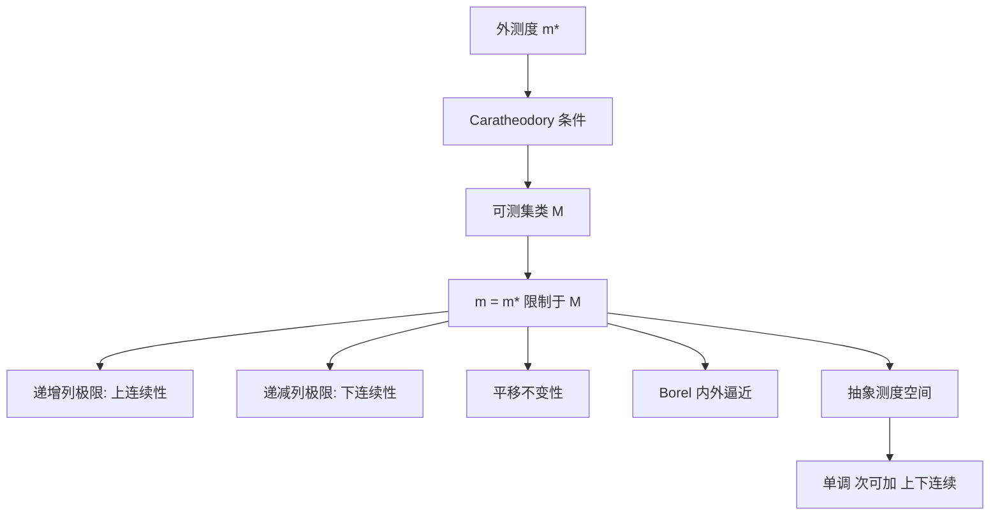
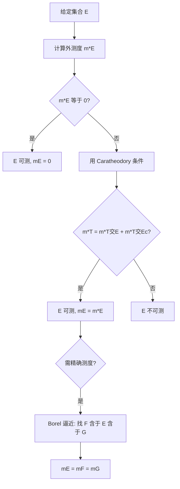

# 第2章 Lebesgue测度 — 知识点汇集

---

## 一、本章核心脉络

核心问题：给 $\mathbb{R}^n$ 中每个子集赋予"体积"，但 Vitali 悖论表明不可能对所有集合同时满足可列可加性、平移不变性和归一性。解决思路：用外测度对所有集合给出"外包估计"，再通过 Carathéodory 条件筛选可测集，在其上限制外测度得到真正测度，最后抽象为一般测度空间。

---

## 二、基础定义

| 术语 | 记号 | 定义 |
|------|------|------|
| 开矩体 | $I = (a_1,b_1)\times\cdots\times(a_n,b_n)$ | 各边为开区间的 $n$ 维长方体 |
| 矩体体积 | $\lvert I\rvert = \prod_{i=1}^n (b_i - a_i)$ | 各边长的乘积 |
| 外测度 | $m^*(E)$ | $m^*(E) = \inf\left\{\sum_{j=1}^{\infty} \lvert I_j\rvert \mid E \subset \bigcup_{j=1}^{\infty} I_j,\ I_j \text{ 开矩体}\right\}$ |
| Carathéodory 条件 | — | $m^*(T) = m^*(T \cap E) + m^*(T \cap E^c),\ \forall T \subset \mathbb{R}^n$ |
| Lebesgue 可测集 | $E \in \mathfrak{M}$ | 满足 Carathéodory 条件的集合 |
| Lebesgue 测度 | $m(E)$ | $m(E) := m^*(E)$，其中 $E \in \mathfrak{M}$ |
| $\sigma$-代数 | $\mathcal{F} \subset 2^X$ | 含空集，对补集、可列并封闭的集合族 |
| 可测空间 | $(X, \mathcal{F})$ | 非空集 $X$ 配上 $\sigma$-代数 $\mathcal{F}$ |
| 测度 | $\mu: \mathcal{F} \to [0,\infty]$ | $\mu(\varnothing)=0$，且满足可列可加性 |
| 测度空间 | $(X, \mathcal{F}, \mu)$ | 可测空间配上一个测度 |
| 完备测度 | — | 若 $B \subset A \in \mathcal{F}$ 且 $\mu(A)=0$，则 $B \in \mathcal{F}$ |
| 有限测度 | — | $\mu(X) < \infty$ |
| 概率测度 | — | $\mu(X) = 1$ |
| $\sigma$-有限测度 | — | $X = \bigcup_n A_n$，且 $\mu(A_n) < \infty$ |
| 计数测度 | $\mu(A) = \lvert A\rvert$（有限集）；$\infty$（无限集） | 定义在 $2^X$ 上 |
| Dirac 测度 | $\delta_x(A) = \chi_A(x)$ | 质量集中于单点 $x$ |

---

## 三、核心方法/定理

### 外测度的基本性质

**性质 1（非负性）**：$m^*(E) \geq 0$，且 $m^*(\varnothing) = 0$。

**性质 2（单调性）**：若 $A \subset B$，则 $m^*(A) \leq m^*(B)$。

**性质 3（可列次可加性）**：对任意集合列 $\{E_k\}_{k=1}^{\infty}$，
$$m^*\left(\bigcup_{k=1}^{\infty} E_k\right) \leq \sum_{k=1}^{\infty} m^*(E_k)$$

**性质 4（平移不变性）**：$m^*(E + x) = m^*(E)$。

### 可测集类 $\mathfrak{M}$ 的结构

**零外测度集必可测**：若 $m^*(E) = 0$，则 $E \in \mathfrak{M}$。

**定理 2.1.6（$\mathfrak{M}$ 是 $\sigma$-代数）**：
1. $\varnothing \in \mathfrak{M}$，$\mathbb{R}^n \in \mathfrak{M}$
2. $E \in \mathfrak{M} \Rightarrow E^c \in \mathfrak{M}$
3. $E_1, E_2, \ldots \in \mathfrak{M} \Rightarrow \bigcup_{k=1}^{\infty} E_k \in \mathfrak{M}$

**定理 2.1.6 续（可列可加性）**：若 $\{E_k\} \subset \mathfrak{M}$ 互不相交，则
$$m\left(\bigcup_{k=1}^{\infty} E_k\right) = \sum_{k=1}^{\infty} m(E_k)$$

### 可测集列的极限

**定理 2.1.8（上连续性 / 递增列）**：若 $\{E_k\} \subset \mathfrak{M}$ 递增（$E_1 \subset E_2 \subset \cdots$），则
$$m\left(\lim_{k \to \infty} E_k\right) = \lim_{k \to \infty} m(E_k)$$
其中 $\lim_{k \to \infty} E_k = \bigcup_{k=1}^{\infty} E_k$。

**推论 2.1.9（下连续性 / 递减列）**：若 $\{E_k\} \subset \mathfrak{M}$ 递减（$E_1 \supset E_2 \supset \cdots$），且 **$m(E_1) < \infty$**，则
$$m\left(\lim_{k \to \infty} E_k\right) = \lim_{k \to \infty} m(E_k)$$
其中 $\lim_{k \to \infty} E_k = \bigcap_{k=1}^{\infty} E_k$。

### 平移不变性与 Borel 逼近

**定理 2.1.10（平移不变性）**：若 $E \in \mathfrak{M}$，则 $\forall x \in \mathbb{R}^n$，$E + x \in \mathfrak{M}$。

**定理 2.1.11（Borel 内外逼近）**：对任意 $E \in \mathfrak{M}$，存在 Borel 集 $F, G$ 使得
$$F \subset E \subset G,\quad m(F) = m(E) = m(G)$$

### 抽象测度空间

**定义 2.1.12**：$(X, \mathcal{F}, \mu)$ 为测度空间，其中 $\mathcal{F}$ 是 $X$ 上的 $\sigma$-代数，$\mu: \mathcal{F} \to [0,\infty]$ 满足 $\mu(\varnothing) = 0$ 和可列可加性。

**定理 2.1.13（抽象测度的性质）**：设 $(X, \mathcal{F}, \mu)$ 是测度空间，则
1. 单调性：$A_1 \subset A_2 \Rightarrow \mu(A_1) \leq \mu(A_2)$
2. 次可加性：$\mu\left(\bigcup_{k=1}^{\infty} A_k\right) \leq \sum_{k=1}^{\infty} \mu(A_k)$
3. 上连续性（升列）：$\mu\left(\bigcup_{k=1}^{\infty} A_k\right) = \lim_{n\to\infty} \mu(A_n)$
4. 下连续性（降列，$\mu(A_1) < \infty$）：$\mu\left(\bigcap_{k=1}^{\infty} A_k\right) = \lim_{n\to\infty} \mu(A_n)$

---

## 四、计算/应用

### 五个典型测度空间（Ex1-Ex5）

| 例子 | 测度空间 | 测度定义 | 关键性质 |
|------|----------|----------|----------|
| Ex1 | $(\mathbb{R}^n, \mathfrak{M}, m)$ | $m(E) = m^*(E)$（$E \in \mathfrak{M}$） | 最核心范例，完备 |
| Ex2 | $(\mathbb{R}^n, \mathfrak{M}, p)$ | $p(A) = \frac{1}{(2\pi)^{n/2}} \int_A e^{-\frac{1}{2}\sum x_j^2} dx_1\cdots dx_n$ | 标准正态导出的概率测度 |
| Ex3 | $(X, 2^X, \mu)$ | $\mu(A) = \lvert A\rvert$（有限）或 $\infty$（无限） | 计数测度；完备；$\sigma$-有限 $\Leftrightarrow$ $X$ 可列 |
| Ex4 | $(X, 2^X, \delta_x)$ | $\delta_x(A) = \chi_A(x)$ | Dirac 测度，完备 |
| Ex5 | $(Y, \mathcal{G}, \nu)$ | $\nu(B) = \mu(f^{-1}(B))$，$f: X \to Y$ 一一满射 | 推前测度，$\mathcal{G} = \{f(A) \mid A \in \mathcal{F}\}$ |

### 关键计算/验证方法

| 方法 | 要点 |
|------|------|
| 验证 $m^*(E)=0 \Rightarrow E$ 可测 | 利用单调性：$m^*(T\cap E) \leq m^*(E) = 0$，次可加性自动给出 $\leq$ 方向 |
| 验证 Carathéodory 条件 | 验证反向不等式 $m^*(T) \geq m^*(T\cap E) + m^*(T\cap E^c)$ |
| Borel 逼近构造 | $E$ 有限测度时：开矩体覆盖取 $G_\delta$ 外逼近，取补得 $F_\sigma$ 内逼近；无界时分片截断 |
| 递减列下连续性反例 | $E_k = (k, \infty)$，每个 $m(E_k) = \infty$，但 $\bigcap E_k = \varnothing$，$m(\varnothing) = 0$ |

---

## 五、判定/决策流程

---

## 六、核心公式速查表

| 序号 | 公式 | 条件 | 含义 |
|:--:|------|------|------|
| 1 | $m^*(E) = \inf\{\sum \lvert I_j\rvert \mid \bigcup I_j \supset E\}$ | 定义 | 外测度 = 最小外包体积 |
| 2 | $m^*(\bigcup E_k) \leq \sum m^*(E_k)$ | 任意 $E_k$ | 可列次可加性 |
| 3 | $m^*(T) = m^*(T \cap E) + m^*(T \cap E^c)$ | $E \in \mathfrak{M}$，$\forall T$ | Carathéodory 可测条件 |
| 4 | $m(\bigcup E_k) = \sum m(E_k)$ | $E_k \in \mathfrak{M}$ 互不相交 | 可列可加性 |
| 5 | $m(\lim_{k\to\infty} E_k) = \lim_{k\to\infty} m(E_k)$ | $\{E_k\} \uparrow$（递增） | 上连续性 |
| 6 | $m(\lim_{k\to\infty} E_k) = \lim_{k\to\infty} m(E_k)$ | $\{E_k\} \downarrow$ 且 $m(E_1) < \infty$ | 下连续性 |
| 7 | $m(E + x) = m(E)$ | $E \in \mathfrak{M}$ | 平移不变性 |
| 8 | $F \subset E \subset G,\; m(F) = m(E) = m(G)$ | $E \in \mathfrak{M}$，$F,G$ Borel | Borel 内外逼近 |
| 9 | $\mu(\bigcup A_k) \leq \sum \mu(A_k)$ | 测度空间 | 抽象测度的次可加性 |
| 10 | $\mu(\bigcup_{k=1}^{\infty} A_k) = \lim_{n\to\infty} \mu(A_n)$ | $\{A_k\} \uparrow$ | 抽象上连续性 |
| 11 | $\mu(\bigcap_{k=1}^{\infty} A_k) = \lim_{n\to\infty} \mu(A_n)$ | $\{A_k\} \downarrow$，$\mu(A_1)<\infty$ | 抽象下连续性 |
| 12 | $m^*(E)=0 \Rightarrow E \in \mathfrak{M}$ | — | 零外测度集可测 |
| 13 | $p(A) = \frac{1}{(2\pi)^{n/2}} \int_A e^{-\frac{1}{2}\sum x_j^2} dx_1\cdots dx_n$ | Ex2 | Gauss 概率测度 |
| 14 | $\delta_x(A) = \chi_A(x)$ | Ex4 | Dirac 测度 |

---

## 七、易错点与注意事项

> [!warning] 易错点 1：外测度不等于测度
> $m^*$ 定义在所有子集上但只满足次可加性；$m$ 只在 $\mathfrak{M}$ 上定义且满足可列可加性。外测度是外包估计，测度才是真正的体积。

> [!warning] 易错点 2：Carathéodory 条件要对所有测试集 T 成立
> 验证可测性时不能只取特殊 $T$（如开集），必须对任意 $T \subset \mathbb{R}^n$ 验证。由于次可加性自动保证 $\leq$ 方向，实际只需验证 $\geq$ 方向。

> [!warning] 易错点 3：递减集列下连续性必须 $m(E_1) < \infty$
> 推论 2.1.9 和定理 2.1.13(4) 的关键前提。反例：$E_k = (k, \infty)$，每个 $m(E_k) = \infty$，但 $\lim E_k = \varnothing$ 测度为 $0$，结论不成立。

> [!warning] 易错点 4：不可测集存在
> Vitali 集是 $\mathbb{R}^n$ 的不可测子集（依赖选择公理构造），$\mathfrak{M} \subsetneq 2^{\mathbb{R}^n}$。

> [!warning] 易错点 5：计数测度的 $\sigma$-有限性
> 计数测度 $\mu(A) = 0 \Leftrightarrow A = \varnothing$，是完备的。但它 $\sigma$-有限当且仅当 $X$ 可列——不可列空间上的计数测度不是 $\sigma$-有限的。

---

## 八、相关知识点链接

| 链接 | 关联内容 |
|------|----------|
| [[01-集合论与点集拓扑基础-知识汇集]] | $\sigma$-代数和集合运算；Cantor 集是零测集重要例子 |
| [[03-可测函数-知识汇集]] | 可测集是定义可测函数的载体 |
| [[04-Lebesgue积分-知识汇集]] | Lebesgue 测度是积分的测度基础 |

---

## 九、作业与练习

本章习题对应第11讲"Lebesgue可测集"，所有题目来源于课件 `2023-RA-11.md`。详见 [[课程/实变函数/习题库/02-Lebesgue测度/README|第2章习题库]]。

| 题号 | 题目简述 | 类型 |
|------|----------|------|
| 2.1 | 递减可测集列中 $m(E_1)<\infty$ 条件的必要性（反例构造） | 思考题 |
| 2.2 | Lebesgue 测度空间 $(\mathbb{R}^n, \mathfrak{M}, m)$ 的验证 | 例题 |
| 2.3 | 概率测度空间（Gauss 密度）验证 | 例题 |
| 2.4 | 计数测度的完备性与 $\sigma$-有限性 | 例题 |
| 2.5 | Dirac 测度的完备性 | 例题 |
| 2.6 | 推前测度空间的构造验证 | 例题 |

**复习重点**：
1. 用 Carathéodory 条件验证简单集合（区间、单点集）的可测性
2. 外测度到测度的过渡逻辑（次可加性 $\to$ 可列可加性）
3. 递减集列时永远先检查 $m(E_1) < \infty$ 是否满足
4. Borel 逼近定理的构造性证明（$G_\delta$ 外逼近 + $F_\sigma$ 内逼近）
