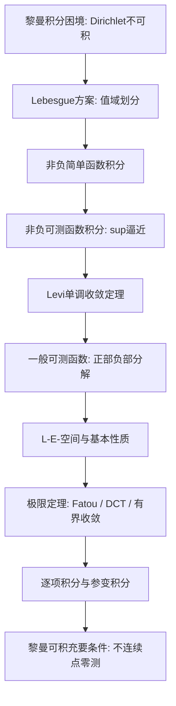
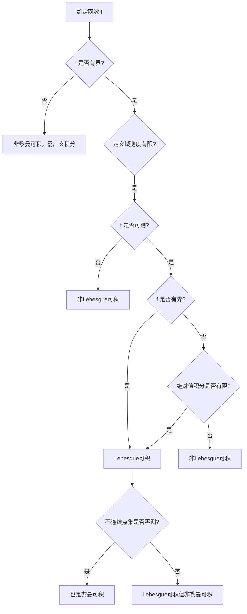

# 第4章 Lebesgue积分 — 知识点汇集

---

## 一、本章核心脉络

本章核心问题：**黎曼积分因定义域划分无法处理"极度不连续"函数，Lebesgue 积分通过值域划分+简单函数逼近推广积分概念，并以极限定理（Levi/Fatou/DCT）为核心武器，最终用"不连续点零测"刻画黎曼可积性。**

---

## 二、基础定义

| 术语 | 符号 | 定义 |
|:--|:--|:--|
| 非负简单函数积分 | $\int_E h$ | $h = \sum a_j \chi_{E_j}$，$\int_E h = \sum a_j \cdot m(E_j)$ |
| 非负可测函数积分 | $\int_E f$ | $\sup\{\int_E h : 0 \leq h \leq f,\;h\text{ 简单}\}$ |
| 正部 / 负部 | $f^+,\,f^-$ | $f^+ = \max(0,f)$，$f^- = \max(-f,0)$ |
| 一般可测函数积分 | $\int_E f$ | $\int_E f^+ - \int_E f^-$（至少一个有限） |
| Lebesgue 可积 | $f \in L(E)$ | $f^+,f^- \in L(E)$，即 $\int_E \vert f\vert < \infty$ |
| 振幅函数 | $\omega_f(x)$ | $\lim_{\delta\to0}\sup\{|f(x')-f(x'')| : x',x''\in B(x,\delta)\cap I\}$ |
| 黎曼上/下积分 | $\overline{\int}_a^b f,\ \underline{\int}_a^b f$ | $\inf S,\ \sup s$（$S$为大和，$s$为小和） |
| 黎曼可积 | — | $\overline{\int}_a^b f = \underline{\int}_a^b f$ |
| a.e. 收敛 | $f_n\to f$ a.e. | 不收敛点集为零测集 |
| 依测度收敛 | $f_n \xrightarrow{m} f$ | $\forall\varepsilon>0,\ m(\{|f_n-f|\geq\varepsilon\})\to0$ |
| 控制函数 | $F(x)$ | $\forall n,\ |f_n(x)|\leq F(x)$ a.e.，且 $F \in L(E)$ |

---

## 三、核心方法/定理

### 积分定义体系

| 编号 | 名称 | 公式/结论 |
|:--|:--|:--|
| 3.1.1 | 简单函数积分 | $\int_E \sum a_j \chi_{E_j} = \sum a_j \cdot m(E_j)$ |
| 3.1.2 | 非负可测函数积分 | $\displaystyle\int_E f = \sup\{\int_E h : 0 \leq h \leq f,\;h\text{ 简单}\}$ |
| 3.1.7 | 一般函数积分 | $\displaystyle\int_E f = \int_E f^+ - \int_E f^-$ |

### 非负可测函数性质

| 编号 | 名称 | 公式/结论 |
|:--|:--|:--|
| 3.1.3 | **Levi 单调收敛定理** | $0 \leq f_n \uparrow f \ \Rightarrow\ \lim\int_E f_n = \int_E f$ |
| 3.1.4 | 积分线性（非负） | $\int_E (\alpha f + \beta g) = \alpha\int_E f + \beta\int_E g$（$\alpha,\beta\geq 0$） |
| 3.1.5 | 推论 | (1) $f=g$ a.e. $\Rightarrow$ $\int f = \int g$；(2) $\int f<\infty \Rightarrow f<\infty$ a.e. |
| 3.1.6 | 积分为零 | $\int_E f = 0,\ f\geq 0 \ \Rightarrow\ f=0$ a.e. |

### $L(E)$ 空间性质

| 编号 | 名称 | 公式/结论 |
|:--|:--|:--|
| — | 可积即绝对可积 | $f \in L(E) \ \Longleftrightarrow\ |f| \in L(E)$ |
| 3.1.9 | 积分线性 | $\alpha f,\,f+g \in L(E)$；$\int(\alpha f+g) = \alpha\int f + \int g$ |
| 3.1.10 | 值域划分等价定义 | $\lim_{\delta\to0} \sum \xi_j \cdot m(E(\alpha_{j-1}\leq f<\alpha_j)) = \int_E f$ |
| 3.1.11 | 积分绝对连续性 | $\forall\varepsilon>0,\ \exists\delta>0,\ m(A)<\delta \Rightarrow |\int_A f| < \varepsilon$ |
| 3.1.12 | 平移不变性 | $\int_{\mathbb{R}^n} f(x+y)\,dx = \int_{\mathbb{R}^n} f(x)\,dx$ |
| 3.1.13 | 连续函数逼近 | $\forall\varepsilon>0,\ \exists g\in C_c,\ \int_E |f-g| < \varepsilon$ |

### 黎曼积分与 Lebesgue 积分的关系

| 编号 | 名称 | 公式/结论 |
|:--|:--|:--|
| 3.1.15 | 黎曼可积 $\Rightarrow$ Lebesgue 可积 | $\displaystyle\int_{[a,b]} f\,dx = \int_a^b f(x)\,dx$（左Lebesgue，右黎曼） |

### 极限定理

| 编号 | 名称 | 条件 | 结论 |
|:--|:--|:--|:--|
| 3.2.1 | **Lebesgue 基本定理** | $f_n \geq 0$ | $\displaystyle\int_E \sum_{n=1}^\infty f_n = \sum_{n=1}^\infty \int_E f_n$ |
| 3.2.2 | 集合可数可加性 | $E = \bigsqcup E_n$ | $\displaystyle\int_E f = \sum_{n=1}^\infty \int_{E_n} f$ |
| 3.2.3 | **Fatou 引理** | $f_n \geq 0$ | $\displaystyle\int_E \varliminf f_n \leq \varliminf \int_E f_n$ |
| 3.2.4 | **Lebesgue 控制收敛定理 (DCT)** | $\vert f_n\vert \leq F \in L(E)$，$f_n \to f$ a.e. | $\displaystyle\lim\int_E f_n = \int_E f$ |
| 3.2.5 | 依测度收敛 DCT | $\vert f_n\vert \leq F \in L(E)$，$f_n\xrightarrow{m} f$ | $\displaystyle\lim\int_E f_n = \int_E f$ |
| 3.2.6 | **有界收敛定理** | $m(E)<\infty$，$\vert f_n\vert \leq M$，$f_n \to f$ a.e. | $\displaystyle\lim\int_E f_n = \int_E f$ |

### 逐项积分与参变积分

| 编号 | 名称 | 公式/结论 |
|:--|:--|:--|
| 3.2.7 | 逐项积分定理 | 若 $\sum\int_E \vert f_n\vert < \infty$，则 $\int_E \sum f_n = \sum \int_E f_n$ |
| 3.2.8 | 参变积分 | 存在控制函数 $F$时，极限/连续性/求导可穿过积分号 |

### 黎曼可积性刻画

| 编号 | 名称 | 公式/结论 |
|:--|:--|:--|
| 3.2.9 | 振幅函数引理 | $\displaystyle\int_I \omega_f = \overline{\int_a^b} f - \underline{\int_a^b} f$ |
| 3.2.10 | **黎曼可积充要条件** | $f$ 在 $[a,b]$ 上有界黎曼可积 $\Longleftrightarrow$ $f$ 的不连续点集为零测集 |

---

## 四、计算/应用

### 典型题型

| 类型 | 方法 | 例题 |
|:--|:--|:--|
| Fatou 反例 | 验证 $\int\varliminf f_n < \varliminf\int f_n$ | $f_n(x)=\frac{\sqrt{n}}{\sqrt{2\pi}}e^{-nx^2/2}$，$\int f_n=1$，$\lim f_n=0$ |
| DCT 控制函数构造 | 找 $F\in L(E)$ 使 $\vert f_n\vert \leq F$ | $\lim\int_0^\infty e^{-x}\cos(x\frac{\ln(n+x)}{n})\,dx$，用 $e^{-x}\cdot e^{-1}\cdot(1+x)$ 控制 |
| DCT 有界收敛 | $m(E)<\infty$，$\vert f_n\vert\leq M$ | $\lim\int_0^1 \frac{n^{3/2}x}{1+n^2x^2}\,dx$，用 $x^{-1/2}$ 控制 |
| 黎曼可积性判断 | 分析不连续点集的测度 | $f(x)=1/n$（$x=m/n$互质），不连续点集可数 $\Rightarrow$ 零测 $\Rightarrow$ 黎曼可积 |

### 关键方法速查

| 方法 | 适用场景 | 操作要点 |
|:--|:--|:--|
| 控制函数构造 | DCT 解题 | 放缩 $\vert f_n\vert$ 至与 $n$ 无关的可积函数 |
| Fatou 下界估计 | 无法保证等号时 | 构造 $g_n = \inf_{j\geq n} f_j$，$g_n \uparrow \varliminf f_n$ |
| DCT 验证三步骤 | 一般极限交换 | (1) 找逐点极限 $f$；(2) 构造 $F\in L(E)$；(3) 验证 $\vert f_n\vert \leq F$ |
| 黎曼可积判断 | 不连续点测度 | (1) 确定不连续点集合；(2) 计算其测度；(3) 判定是否零测 |

---

## 五、判定/决策流程

---

## 六、核心公式速查表

| 编号 | 名称 | 公式 |
|:--|:--|:--|
| 3.1.1 | 简单函数积分 | $\int_E \sum a_j \chi_{E_j} = \sum a_j \cdot m(E_j)$ |
| 3.1.2 | 非负可测函数积分 | $\int_E f = \sup\{\int_E h : 0 \leq h \leq f,\;h\text{ 简单}\}$ |
| 3.1.3 | Levi 定理 | $f_n \uparrow f \geq 0 \ \Rightarrow\ \lim\int f_n = \int f$ |
| 3.1.4 | 积分线性（非负） | $\int (\alpha f + \beta g) = \alpha\int f + \beta\int g$ |
| 3.1.6 | 积分为零 | $\int_E f = 0,\ f\geq 0 \ \Rightarrow\ f=0$ a.e. |
| 3.1.7 | 一般函数积分 | $\int_E f = \int_E f^+ - \int_E f^-$ |
| — | 可积 = 绝对可积 | $f \in L(E) \ \Longleftrightarrow\ \vert f\vert \in L(E)$ |
| 3.1.9 | 积分线性（一般） | $\int(\alpha f + g) = \alpha\int f + \int g$，$L(E)$ 是线性空间 |
| 3.1.11 | 绝对连续性 | $m(A) < \delta \ \Rightarrow\ \vert\int_A f\vert < \varepsilon$ |
| 3.1.12 | 平移不变性 | $\int_{\mathbb{R}^n} f(x+y) = \int_{\mathbb{R}^n} f(x)$ |
| 3.1.13 | 连续函数逼近 | $\exists g_k \in C_c,\ \int\vert f - g_k\vert \to 0$ |
| 3.1.15 | 黎曼可积 $\Rightarrow$ Lebesgue | $\int_I f\,dx = \int_a^b f(x)\,dx$ |
| 3.2.1 | Lebesgue 基本定理 | $\int\sum f_n = \sum\int f_n$（$f_n \geq 0$） |
| 3.2.2 | 集合可数可加性 | $\int_{\bigcup E_n} f = \sum\int_{E_n} f$ |
| 3.2.3 | Fatou 引理 | $\int\varliminf f_n \leq \varliminf\int f_n$ |
| 3.2.4 | DCT | $\vert f_n\vert \leq F \in L \ \Rightarrow\ \lim\int f_n = \int\lim f_n$ |
| 3.2.6 | 有界收敛定理 | $m(E) < \infty,\ \vert f_n\vert \leq M \ \Rightarrow\ \lim\int f_n = \int f$ |
| 3.2.7 | 逐项积分 | $\sum\int\vert f_n\vert < \infty \ \Rightarrow\ \int\sum f_n = \sum\int f_n$ |
| 3.2.8 | 参变积分 | 控制函数条件下极限/求导可穿过积分号 |
| 3.2.9 | 振幅函数引理 | $\int_I \omega_f = \overline{\int_a^b} f - \underline{\int_a^b} f$ |
| 3.2.10 | 黎曼可积充要条件 | 不连续点集为零测集 |

---

## 七、易错点与注意事项

> [!warning] **1. Lebesgue 可积 = 绝对可积**
> $f \in L(E) \Longleftrightarrow |f| \in L(E)$。黎曼广义积分可条件收敛（如 $\int_0^1 \frac{1}{x}\sin(\frac{1}{x})\,dx$），但这些函数不是 Lebesgue 可积。

> [!warning] **2. Fatou 引理不等号方向**
> $\int\varliminf f_n \leq \varliminf\int f_n$。极限跑进积分号里面，积分值"缩水"。只有加控制函数（DCT）才能保证等号。

> [!warning] **3. DCT 要求控制函数 $F \in L(E)$**
> 不仅需要 $|f_n| \leq F$，更关键的是 $F$ 积分有限。$F$ 仅逐点有限但不满足 $\int F < \infty$ 则 DCT 不适用。

> [!warning] **4. 黎曼可积 $\Rightarrow$ Lebesgue 可积，反之不成立**
> Dirichlet 函数是 Lebesgue 可积（积分为 0）但非黎曼可积的经典反例。

> [!warning] **5. 黎曼可积充要条件的前提**
> 定理 3.2.10 仅适用于有界区间上的有界函数。无界区间或无界函数需广义积分概念。

> [!warning] **6. a.e. 相等不影响积分值**
> $f = g$ a.e. 则 $\int f = \int g$。Lebesgue 积分对零测集上的行为完全不敏感。

> [!warning] **7. 逐项积分需绝对可积条件**
> 定理 3.2.7 要求 $\sum\int|f_n| < \infty$（绝对收敛）。仅条件收敛不能保证逐项积分。

---

## 八、相关知识点链接

| 前置知识 | 关联内容 |
|:--|:--|
| [[02-测度论-知识梳理]] | 测度 $m(E_j)$ 是简单函数积分的基础；零测集贯穿始终；可测函数概念；简单函数逼近定理（2.2.5）；Lusin 定理；Riesz 定理 |
| [[03-可测函数-知识梳理]] | 可测函数列收敛性（a.e.收敛、依测度收敛、Riesz 定理） |

| 后续知识 | 关联内容 |
|:--|:--|
| [[05-Lp空间-知识梳理]] | $L^1(E) = L(E)$；极限定理是 $L^p$ 完备性证明的基础 |

---

## 九、作业与练习

> [!hint] 练习重点：(1) 直接用定义计算简单函数的 Lebesgue 积分；(2) 应用极限定理（Levi / Fatou / DCT / 有界收敛）验证极限与积分交换；(3) 用定理 3.2.10（不连续点零测）判断黎曼可积性。建议重点练习控制函数构造和振幅函数分析。

- 习题库入口：[[实变函数习题库-README]]
- 重点关注：DCT 控制函数构造题、黎曼可积性判断题
