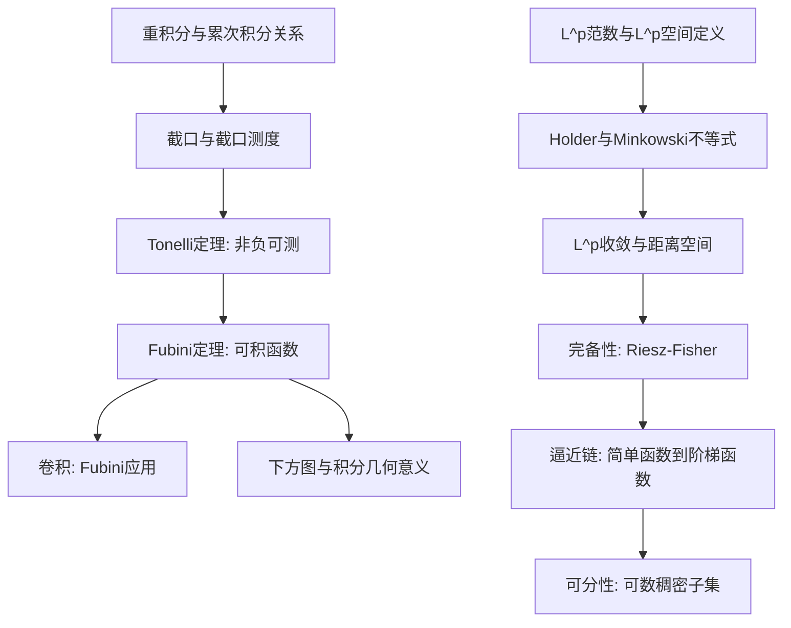
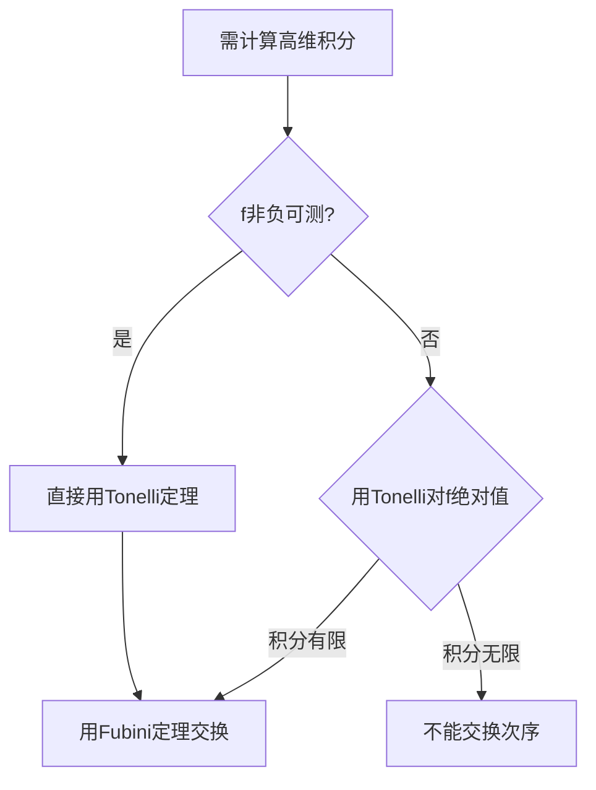

# 第5章 重积分与L^p空间 — 知识点汇集

## 一、本章核心脉络

本章解决两个主线问题：(1) 多重积分能否化为累次积分？（Tonelli/Fubini 定理）；(2) $L^p$ 空间具有怎样的完备性与可分性结构？二者通过 Fubini 定理串联。



---

## 二、基础定义

| 术语 | 记号 | 定义 |
|------|------|------|
| $x$ 截口 | $E_x$ | $\{y\in\mathbb{R}^q \mid (x,y)\in E\}$，$E\subset\mathbb{R}^{p+q}$ |
| $y$ 截口 | $E^y$ | $\{x\in\mathbb{R}^p \mid (x,y)\in E\}$ |
| 截口特征函数关系 | — | $\chi_E(x,y)=\chi_{E_x}(y)=\chi_{E^y}(x)$ |
| 乘积测度 | $m(E_1\times E_2)$ | $m(E_1)\,m(E_2)$，$E_1\in\mathfrak{M}_p,E_2\in\mathfrak{M}_q$ |
| 卷积 | $f*g(x)$ | $\int_{\mathbb{R}^n}f(x-y)g(y)dy$ |
| 图像 | $\Gamma_E(f)$ | $\{(x,y)\in\mathbb{R}^{n+1}\mid x\in E, y=f(x)\}$ |
| 下方图 | $G(f)$ | $\{(x,y)\in\mathbb{R}^{n+1}\mid x\in E, 0\leq y\leq f(x)\}$ |
| $L^p$ 范数 ($1\leq p<\infty$) | $\|f\|_p$ | $(\int_E|f|^p dx)^{1/p}$ |
| $L^p$ 空间 ($1\leq p<\infty$) | $L^p(E)$ | $\{f\in\mathfrak{M}(E)\mid \|f\|_p<\infty\}$ |
| 本性上界 | $\|f\|_\infty$ | $\inf\{M>0\mid |f(x)|\leq M \text{ a.e.}[E]\}$ |
| $L^\infty$ 空间 | $L^\infty(E)$ | $\{f\in\mathfrak{M}(E)\mid \|f\|_\infty<\infty\}$ |
| 共轭指数 | $p,q$ | $1\leq p,q\leq\infty$，$p^{-1}+q^{-1}=1$ |
| $L^p$ 收敛 | $f_m\xrightarrow{L^p}f$ | $\lim_{m\to\infty}\|f_m-f\|_p=0$ |
| 基本列 (柯西列) | — | $\lim_{k,m\to\infty}\|f_k-f_m\|_p=0$ |
| 稠密 | $\mathcal{F}\subset L^p(E)$ | $\forall f\in L^p,\forall\varepsilon>0,\exists g\in\mathcal{F}:\|f-g\|_p<\varepsilon$ |
| 可分空间 | — | 存在可数稠密子集 |

---

## 三、核心方法/定理

### 重积分与累次积分

- **截口测度定理 (定理 3.3.2)**：设 $E\in\mathfrak{M}_n$（$n=p+q$），则
  - 对 a.e. $x\in\mathbb{R}^p$，$E_x\in\mathfrak{M}_q$；
  - $m(E_x)$ 在 $\mathbb{R}^p$ 上 a.e. 有定义且非负可测；
  - $m(E)=\int_{\mathbb{R}^p}m(E_x)dx=\int_{\mathbb{R}^q}m(E^y)dy$.

- **乘积测度 (定理 3.3.4)**：$E_1\in\mathfrak{M}_p,E_2\in\mathfrak{M}_q \Rightarrow E_1\times E_2\in\mathfrak{M}_n$，且 $m(E_1\times E_2)=m(E_1)\,m(E_2)$.

- **Tonelli 定理 (定理 3.3.5)**：$f(x,y)\geq 0$ 可测 $\Rightarrow$
  $$\int_{\mathbb{R}^{p+q}}f(x,y)dxdy = \int_{\mathbb{R}^p}\!dx\int_{\mathbb{R}^q}\!f\,dy = \int_{\mathbb{R}^q}\!dy\int_{\mathbb{R}^p}\!f\,dx.$$
  （无条件相等，无需事先验证可积性）

- **Fubini 定理 (定理 3.3.6)**：$f\in L(\mathbb{R}^n)$（可积）$\Rightarrow$ 上述等式同样成立，且积分顺序可交换。

- **Tonelli vs Fubini 使用策略**：
  | | Tonelli | Fubini |
  |---|---|---|
  | 条件 | $f\geq 0$ 可测 | $f$ 可积（$\int|f|<\infty$） |
  | 需验证可积性 | 否 | 是 |
  | 典型用法 | 对 $|f|$ 用 Tonelli 验证可积性 | 验证后交换积分次序 |

### 卷积

- **卷积可积性 (定理 3.3.7)**：$f,g\in L(\mathbb{R}^n)$ $\Rightarrow$
  - $f*g(x)$ 对 a.e. $x$ 存在；
  - $f*g\in L(\mathbb{R}^n)$；
  - $\|f*g\|_1 \leq \|f\|_1\|g\|_1$.

- **交换性**：$f*g=g*f$（平移变换 $x-y=z$）。

### 积分的几何意义

- **下方图定理 (定理 3.3.7 几何形式)**：$f(x)\geq 0$ 是 $E$ 上函数：
  - $f$ 可测 $\Leftrightarrow$ $G(f)\in\mathfrak{M}_{n+1}$；
  - $m(\Gamma_E(f))=0$；
  - $m(G(f))=\int_E f(x)dx$.

### Holder 与 Minkowski 不等式

- **Holder 不等式 (定理 4.1.2)**：$p^{-1}+q^{-1}=1$，$f\in L^p,g\in L^q$ $\Rightarrow$
  $$\|fg\|_1 \leq \|f\|_p\|g\|_q,\quad \int_E|fg|dx \leq \left(\int_E|f|^p\right)^{1/p}\!\left(\int_E|g|^q\right)^{1/q}.$$

- **Schwarz 不等式**（$p=q=2$ 特例）：$\left|\int_E fg\,dx\right| \leq \|f\|_2\|g\|_2$.

- **Minkowski 不等式 (定理 4.1.4)**：$L^p$ 范数满足：
  - 齐次性：$\|\alpha f\|_p=|\alpha|\|f\|_p$；
  - 三角不等式：$\|f+g\|_p \leq \|f\|_p+\|g\|_p$；
  - 正定性：$\|f\|_p\geq 0$，且 $\|f\|_p=0 \iff f=0\text{ a.e.}$.

### $L^p$ 空间的性质

- **有限测度集上包含关系 (命题 4.1.3)**：$m(E)<\infty$，$p_1<p_2$ $\Rightarrow$
  $$L^{p_2}(E)\subset L^{p_1}(E),\quad \|f\|_{p_1} \leq m(E)^{\frac{1}{p_1}-\frac{1}{p_2}}\|f\|_{p_2}.$$

- **$p\to\infty$ 极限 (命题 4.1.3(2))**：$f\in L^\infty(E)$，$m(E)<\infty$ $\Rightarrow$ $\lim_{p\to\infty}\|f\|_p=\|f\|_\infty$.

- **$L^p$ 范数对偶刻画 (定理 4.1.5)**：$1\leq p<\infty$，$p^{-1}+q^{-1}=1$，则
  $$\|f\|_p = \sup_{\|g\|_q=1}\int_E fg\,dx = \sup_{g\in L^q,g\neq 0}\frac{\int_E fg\,dx}{\|g\|_q}.$$

- **$L^\infty$ 对偶刻画**：$\|f\|_\infty = \sup_{\|g\|_1=1}\int_E fg\,dx$（等号不一定取到）。

- **$L^p$ 是距离空间 (定理 4.1.7)**：$d(f,g)=\|f-g\|_p$ 满足正定性、对称性、三角不等式。

### $L^p$ 收敛

- **$L^p$ 收敛蕴含依测度收敛 (定理 4.1.9)**：$f_m\xrightarrow{L^p}f$ $\Rightarrow$ $f_m\xrightarrow{m}f$.

- **$L^p$ 控制收敛定理 (定理 4.1.10)**：$f_m\to f$ a.e.（或依测度），且 $|f_m|\leq g\in L^p(E)$ $\Rightarrow$ $f_m\xrightarrow{L^p}f$.

### 完备性与可分性

- **Riesz-Fisher 定理 (定理 4.1.12)**：$L^p(E)$ 对 $\forall 1\leq p\leq\infty$ 是完备的。（基本列必收敛）

- **推论 4.1.13**：$f_m\xrightarrow{L^p}f$（$1\leq p<\infty$）$\Rightarrow$ 存在子列 a.e. 收敛于 $f$.

- **黎曼可积空间 $\mathcal{R}[a,b]$ 在 $L^1$ 范数下不完备**：存在 $\mathcal{R}$ 中 $L^1$ 基本列，其极限不属于 $\mathcal{R}$.

- **逼近链**：
  - **定理 4.1.15**：$\forall f\in L^p(E)$，可用简单可测函数列 $L^p$ 逼近。
  - **定理 4.1.16**：$\forall f\in L^p(E)$，可用 $C_c(\mathbb{R}^n)$（紧支集连续函数）$L^p$ 逼近。
  - **定理 4.1.17**：$\forall f\in L^p(E)$，可用紧支集阶梯函数 $L^p$ 逼近。

- **$L^p$ 可分性 (定理 4.1.18)**：$\forall 1\leq p<\infty$，$L^p(E)$ 可分（存在可数稠密子集：有理系数二进方体阶梯函数）。

- **$L^\infty$ 不可分**：$\{\chi_{[0,t]}\mid 0\leq t\leq 1\}\subset L^\infty[0,1]$ 不可数且两两距离为 1.

- **$L^p$ 范数积分测试刻画 (定理 4.1.19)**：若 $\left|\int_E f\phi\,dx\right| \leq M\|\phi\|_q$ 对一切可积简单函数 $\phi$ 成立，则 $f\in L^p(E)$ 且 $\|f\|_p\leq M$（$p^{-1}+q^{-1}=1$）。

---

## 四、计算/应用

### Fubini/Tonelli 应用要点

| 步骤 | 操作 |
|------|------|
| 1. 判断 $f$ 符号 | 若非负可测，直接用 Tonelli |
| 2. 验证可积性 | 对 $|f|$ 用 Tonelli 验证 $\iint|f|<\infty$ |
| 3. 交换次序 | 用 Fubini 定理交换积分顺序 |
| 4. 计算累次积分 | 逐次计算一维积分 |

### 判断 $f\in L^p(E)$ 的典型例题

| 函数 | 区域 $E$ | $L^p$ 条件 |
|------|----------|-----------|
| $f(x)=1$ | $(0,1)$ | 属于所有 $L^p$ |
| $f(x)=\sin x$ | $(0,1)$ | 有界，属于所有 $L^p$ |
| $f(x)=x^{-3/2}$ | $(0,1)$ | 需 $p\cdot 3/2<1$，即 $p<2/3$ |
| $f(x)=\log x$ | $(0,1)$ | 对数奇性弱于幂函数，属于所有 $L^p$ |
| $f(x)=\chi_{(0,n)}(x)$ | $(0,1)$ | 属于所有 $L^p$ |
| $f(x)=x^{-1/2}(1+x^{3/2})^{-1}$ | $(0,1)$ | $0$ 附近 $x^{-1/2}$，需 $p/2<1$ 即 $p<2$ |
| $f(x)=e^{-x}$ | $(0,1)$ | 有限区间上有界，属于所有 $L^p$ |
| $f(x)=x^{-3/2}$ | $(0,\infty)$ | 需 $p\cdot 3/2>1$（无界）且 $p\cdot 3/2<1$（原点），无解 |

### $L^p$ 包含方向记忆

| 条件 | 包含方向 |
|------|----------|
| $m(E)<\infty$，$p_1<p_2$ | $L^{p_2}\subset L^{p_1}$（高指数空间更小） |
| $m(E)=\infty$ | 无一般包含关系 |

---

## 五、判定/决策流程

### 重积分化为累次积分的判定



### 判断函数是否属于 L^p

```mermaid
flowchart TD
    A[函数f与区域E] --> B{f可测?}
    B -->|否| C[f不属于L^p]
    B -->|是| D[计算积分 of |f|^p]
    D --> E{积分有限?}
    E -->|是| F[f属于L^p]
    E -->|否| C
    G[检查奇点和无穷远衰减] --> D
```

---

## 六、核心公式速查表

| 名称 | 公式 | 条件 |
|------|------|------|
| 截口测度 | $m(E)=\int_{\mathbb{R}^p}m(E_x)dx$ | $E\in\mathfrak{M}_{p+q}$ |
| 乘积测度 | $m(E_1\times E_2)=m(E_1)m(E_2)$ | $E_1,E_2$ 可测 |
| Tonelli 定理 | $\iint f = \int dx\int f dy = \int dy\int f dx$ | $f\geq 0$ 可测 |
| Fubini 定理 | $\iint f = \int dx\int f dy = \int dy\int f dx$ | $f\in L(\mathbb{R}^n)$ |
| 卷积定义 | $f*g(x)=\int f(x-y)g(y)dy$ | 积分存在 |
| 卷积不等式 | $\|f*g\|_1 \leq \|f\|_1\|g\|_1$ | $f,g\in L^1$ |
| 下方图测度 | $m(G(f))=\int_E f(x)dx$ | $f$ 非负可测 |
| 图像测度 | $m(\Gamma_E(f))=0$ | $f$ 可测 |
| 共轭指数 | $p^{-1}+q^{-1}=1$ | $1\leq p,q\leq\infty$ |
| $L^p$ 范数 | $\|f\|_p=(\int_E|f|^p)^{1/p}$ | $1\leq p<\infty$ |
| $L^\infty$ 范数 | $\|f\|_\infty=\inf\{M\mid |f|\leq M\text{ a.e.}\}$ | — |
| Holder 不等式 | $\|fg\|_1 \leq \|f\|_p\|g\|_q$ | $f\in L^p,g\in L^q$ |
| Schwarz 不等式 | $|\int fg| \leq \|f\|_2\|g\|_2$ | $p=q=2$ |
| Minkowski 不等式 | $\|f+g\|_p \leq \|f\|_p+\|g\|_p$ | $f,g\in L^p$ |
| $L^p$ 包含关系 | $\|f\|_{p_1} \leq m(E)^{\frac{1}{p_1}-\frac{1}{p_2}}\|f\|_{p_2}$ | $p_1<p_2$，$m(E)<\infty$ |
| $p\to\infty$ 极限 | $\lim_{p\to\infty}\|f\|_p=\|f\|_\infty$ | $f\in L^\infty$，$m(E)<\infty$ |
| $L^p$ 对偶刻画 | $\|f\|_p = \sup_{\|g\|_q=1}\int fg$ | $1\leq p<\infty$ |
| $L^\infty$ 对偶 | $\|f\|_\infty = \sup_{\|g\|_1=1}\int fg$ | — |
| $L^p$ 距离 | $d(f,g)=\|f-g\|_p$ | $1\leq p\leq\infty$ |
| $L^p$ 收敛 | $\lim\|f_m-f\|_p=0$ | $f_m,f\in L^p$ |
| $L^p$ 含依测度收敛 | $f_m\xrightarrow{L^p}f \Rightarrow f_m\xrightarrow{m}f$ | $1\leq p<\infty$ |
| $L^p$ 控制收敛 | $|f_m|\leq g\in L^p,\;f_m\to f\text{ a.e.} \Rightarrow f_m\xrightarrow{L^p}f$ | $1\leq p<\infty$ |
| Riesz-Fisher 完备性 | $L^p$ 中基本列必收敛 | $1\leq p\leq\infty$ |
| $L^p$ 可分性 | $L^p$ 存在可数稠密子集 | $1\leq p<\infty$ |
| 范数积分测试 | $|\int f\phi| \leq M\|\phi\|_q \Rightarrow f\in L^p,\|f\|_p\leq M$ | $p^{-1}+q^{-1}=1$ |
| 卷积交换性 | $f*g = g*f$ | — |

---

## 七、易错点与注意事项

> [!warning] 1. Tonelli vs Fubini 条件区别
> Tonelli 要求 $f\geq 0$ 可测（无需验证可积），Fubini 要求 $f$ 可积（$\int|f|<\infty$）。常见错误：对非绝对可积函数直接用 Fubini 交换次序。正确做法：先用 Tonelli 对 $|f|$ 验可积，再用 Fubini 换序。

> [!warning] 2. 累次积分存在不等于重积分存在
> 两个累次积分均存在且相等，重积分（Lebesgue 积分）仍可能不存在。必须验证 $f$ 的可积性或非负可测性。

> [!warning] 3. $L^p$ 中元素是等价类
> $\|f\|_p=0 \iff f=0\text{ a.e.}$，非逐点为零。$L^p$ 收敛极限在 a.e. 意义下唯一。

> [!warning] 4. $L^p$ 收敛不蕴含 a.e. 收敛
> 只能保证存在子列 a.e. 收敛（推论 4.1.13）。反之，a.e. 收敛需加控制函数才能推出 $L^p$ 收敛。

> [!warning] 5. 有限测度集上 $L^p$ 包含方向
> $m(E)<\infty$ 时 $p_1<p_2 \Rightarrow L^{p_2}\subset L^{p_1}$（高指数空间更小）。在无限测度集上此关系一般不成立。

> [!warning] 6. $L^\infty$ 不可分
> $1\leq p<\infty$ 时 $L^p$ 可分，但 $L^\infty$ 不可分。原因：$\{\chi_{[0,t]}\mid 0\leq t\leq 1\}$ 不可数且两两 $L^\infty$ 距离为 1。

> [!warning] 7. 卷积的交换性依赖平移不变性
> 做变量代换 $x-y=z$ 时注意 Lebesgue 积分的平移不变性。$f*g$ 定义中积分变量是 $y$。

> [!warning] 8. Minkowski 不等式 $p=1$ 和 $p=\infty$
> $p=1$ 退化为积分三角不等式；$p=\infty$ 退化为上确界三角不等式。一般 $1<p<\infty$ 的证明依赖 Holder 和拆分 $|f+g|^p=|f+g|^{p-1}|f+g|$。

---

## 八、相关知识点链接

| 章节 | 依赖知识 |
|------|----------|
| [[01-集合论与点集拓扑基础-知识梳理\|第1章 集合论]] | 可数/不可数集概念用于理解 $L^p$ 可分性与 $L^\infty$ 不可分性 |
| [[02-Lebesgue测度-知识梳理\|第2章 测度论]] | Lebesgue 测度是截口测度定理的基础；Levi 定理和 Fatou 引理是 Tonelli/Fubini 证明核心工具 |
| [[03-可测函数-知识梳理\|第3章 可测函数]] | 可测函数定义是 $L^p$ 空间前提（$L^p$ 中函数必可测）；依测度收敛、Riesz 定理用于完备性证明 |
| [[04-Lebesgue积分-知识梳理\|第4章 Lebesgue积分]] | 控制收敛定理推广到 $L^p$ 版本（定理 4.1.10） |
| 泛函分析 | $L^p$ 完备性、对偶刻画、可分性均为 Banach 空间理论核心内容 |

---

## 九、作业与练习

- [[习题库/05-重积分与Lp空间/README\|第5章 习题库]]
- **Fubini/Tonelli 练习**：先对 $|f|$ 用 Tonelli 验证可积，再用 Fubini 交换次序；注意两个累次积分可能不相等的情形。
- **$L^p$ 范数计算**：判断幂函数 $x^{-\alpha}$ 在不同区域上的 $L^p$ 性质。
- **Holder/Minkowski 不等式**：应用不等式证明积分估计；Schwarz 不等式 ($p=2$) 是最常用特例。
- **完备性论证**：基本列 $\to$ 测度基本列 $\to$ 依测度收敛 $\to$ Riesz 子列 $\to$ Fatou 引理。
- **可分性逼近链**：简单函数 $\to$ $C_c$ $\to$ 阶梯函数（有理系数）$\to$ 可数稠密子集。
