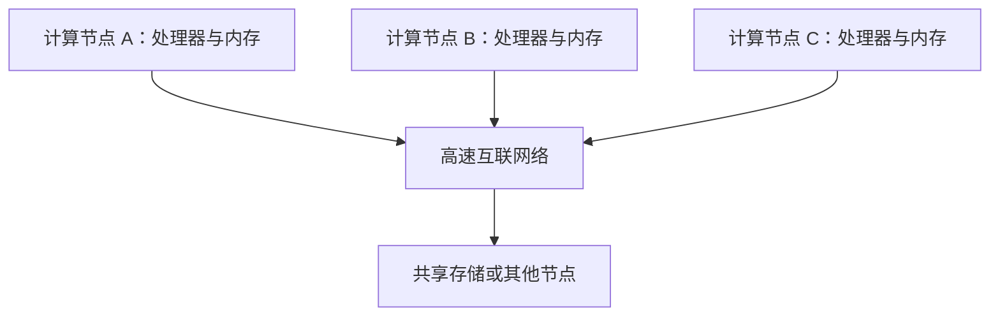

# 2026-09-02 第2节：高性能计算应用与系统架构导论

> [!info] 课程信息
> - **课程**：并行与分布式计算
> - **主题**：高性能计算的应用价值、算力需求与系统组成
> - **主讲人**：王君豪老师
> - **原始素材**：[[raw/2026-09-02-高性能计算原理与应用培训-437952-逐字稿|逐字稿]]、[[raw/2026-09-02-高性能计算原理与应用培训-437952-纪要|智能纪要]]
> - **配套课件**：[[课程/并行与分布式计算/PPT/并行与分布式计算1-背景介绍/并行与分布式计算1-背景介绍|并行与分布式计算 1：背景介绍]]

> [!note] 整理说明
> 本节逐字稿存在较多识别错误，尤其是专有名词、模型参数、性能数字和作业题号。以下笔记保留能够由上下文确认的课堂主线；对无法可靠还原的数字不作强行补全。

## 一、本节课核心脉络

本节课从科学发现和工程设计中的大规模计算需求出发，进一步说明：高性能计算不仅需要更快的处理器，还需要合理的节点组织、存储系统和互联网络。

> 一句话来说：**高性能计算的核心不是简单堆叠处理器，而是让模型、算法、计算节点、存储和网络形成一个高效协同的系统。**

## 二、计算科学为什么重要

### 1. 科学研究的三种基本路径

课堂把计算科学放在理论研究和实验研究之间理解：

1. **理论方法**：从公理、定律或方程出发进行分析与推导；
2. **实验方法**：通过测量和实验观察真实系统；
3. **计算方法**：把模型转化为算法，在计算机上进行数值求解、模拟或验证。

当问题过于复杂，难以获得解析解；或者真实实验成本高、周期长、风险大时，计算就成为连接理论与现实的重要工具。

> 一句话来说：**计算不能取代理论与实验，但可以帮助我们筛选方案、发现规律，并把难以直接研究的问题转化为可执行的数值过程。**

### 2. 计算结论的边界

- 有限范围内的计算验证，可以排除大量错误方案或反例；
- 计算结果是否可信，取决于模型、算法、数据和实现是否正确；
- 对无限对象进行有限次验证，通常不能自动等价于严格数学证明；
- 科学计算应与理论分析、误差评估和实验验证互相印证。

## 三、数学中的计算机辅助发现与证明

### 1. 四色定理

课堂以四色定理说明“理论归约与机器验证”的结合：先由数学推理把无限多种地图结构归约为有限组不可避免构形，再由计算机逐一检查。

课堂材料给出的历史口径为：归约到约 $1936$ 种构形，计算约 $1200$ 小时并完成大量判断。这里最重要的不是记忆具体数字，而是理解证明结构：

### 2. 黎曼猜想的零点检验

对黎曼 ζ 函数的非平凡零点进行大规模计算，可以检验大量零点是否位于临界线上。

- 若检验范围内均成立，只能增加猜想可信度，不能覆盖无限情形；
- 若找到一个不满足条件的零点，则可以立即否定猜想；
- 计算结果还能帮助数学家寻找规律，指导理论证明。

> [!warning] 计算验证不等于无限情形的证明
> “已经验证了很多个样本”不能直接推出“对所有对象都成立”。计算证明需要明确有限归约为何完整，数值验证还需要考虑误差与实现可靠性。

## 四、工程与自然科学中的数值模拟

### 1. 航天器与高温材料

航天器再入大气层时会面临极端气动加热。直接制造大量候选材料并逐一试验，成本高且风险大。计算模拟可以先对材料结构与热响应进行筛选，再把更有希望的方案交给实验验证。

这一过程体现了典型的计算工程流程：

$$
\text{物理问题}\rightarrow\text{数学模型}\rightarrow\text{数值模拟}\rightarrow\text{候选方案}\rightarrow\text{实验验证}.
$$

### 2. 飞行器设计与计算流体力学

飞机和火箭周围的流场涉及复杂的偏微分方程。风洞实验仍然重要，但存在设备规模、试验条件和成本限制。计算流体力学可以：

- 在制造原型前比较不同外形；
- 观察压力、速度和温度等场量；
- 模拟部分难以安全复现的极端状态；
- 减少无效设计和重复试验。

模拟并不能完全替代实验，因为离散误差、湍流模型和边界条件都会影响结果。可靠工程设计应采用“模拟与实验相互校验”的方式。

![[课程/并行与分布式计算/PPT/并行与分布式计算1-背景介绍/images/454a9f969b5a9e1bd5ea69cca3cb0a23443b6ffaef48f6307c050e952920ae1e.png|720]]

*图：课件以飞行器设计展示高性能计算的应用范围；不同部位对应不同的流体、结构、热与控制问题。*

### 3. 生命科学与药物研发

基因测序、结构分析和候选药物筛选会产生海量数据。课堂强调了两个特点：

- 工作可以由不同机构协作完成，具有天然的分布式特征；
- 计算结果可以缩小实验搜索范围，提升药物研发效率。

### 4. 天气与气候模拟

天气模型把连续的大气空间离散成网格，并在每个网格上求解温度、气压、湿度和风场等变量。课堂以约 $10\text{--}25\,\mathrm{km}$ 的网格分辨率说明：分辨率越高，网格越密，计算量和节点间交换的数据量都会快速增加。

此外，大气系统对初始条件敏感。微小观测误差可能随时间放大，因此：

- 短期天气预报通常比长期确定性预测更可靠；
- 提升算力能够提高分辨率和集合模拟规模，但不能消除系统本身的混沌性；
- 模型质量、观测数据和算法精度与硬件算力同样重要。

## 五、人工智能时代的算力需求

### 1. 模型规模与计算成本共同增长

课堂通过大模型参数规模的快速增长说明：模型越大，通常意味着更多的训练数据、更长的训练时间、更大的显存与通信需求。具体参数数字会随模型和统计口径变化，本节需要掌握的是增长趋势，而不是转写中不稳定的数值。

大模型训练的主要资源约束包括：

- 计算芯片数量与单芯片吞吐量；
- 芯片之间的通信带宽和延迟；
- 显存容量与存储访问速度；
- 数据中心供电、散热与能效；
- 训练算法能否保持较高并行效率。

### 2. 算力基础设施与电力系统

高性能计算和 AI 训练都需要持续消耗电力，并把大量电能转化为热量。因此，未来算力中心的建设必须同时考虑供电能力、冷却方式和单位能耗下的有效计算量。

### 3. AI 与科学计算的融合

生成式 AI 和数据驱动模型可以辅助发现候选规律、近似复杂算子或加快部分模拟过程；科学计算则为 AI 提供物理约束、可靠数据和验证手段。两者的结合可能改变科学研究的流程，但仍需重视可解释性、误差和验证。

## 六、高性能计算机的系统组成

### 1. 单机的基本结构

经典计算机包括输入、输出、存储、控制和运算等功能模块。处理器内部负责取指、控制和运算，存储器保存程序与数据，输入输出设备负责与外部交换信息。

### 2. 总线的三类信息

| 总线类型 | 传递的信息 | 典型作用 |
|:--|:--|:--|
| 地址总线 | 数据所在位置 | 指明访问哪个存储单元或设备 |
| 数据总线 | 实际数据 | 在处理器、内存和设备之间传输内容 |
| 控制总线 | 读写和时序等控制信号 | 协调一次访问如何执行 |

以读取内存为例：处理器先给出地址和读控制信号，内存再通过数据总线返回相应内容。只提高处理器运算速度而不提高数据供给速度，会使处理器等待数据。

### 3. 从单机扩展到计算节点集群

高性能计算机通常由大量计算节点构成。每个节点可以理解为一台具有处理器和存储器的独立计算机，节点之间依靠高速互联网络交换数据，共同完成一个大任务。

系统域互联主要服务于超算内部的高频通信；局域网、城域网和广域网则面向更大空间范围。距离增大时，传播延迟和网络环境更难控制，不能简单用普通互联网替代超算内部互联。

## 七、计算与通信的平衡

一个并行程序的总运行时间可以近似分解为

$$
T_{\mathrm{total}}\approx T_{\mathrm{comp}}+T_{\mathrm{comm}}+T_{\mathrm{sync}}+T_{\mathrm{I/O}}.
$$

- $T_{\mathrm{comp}}$：处理器真正执行运算的时间；
- $T_{\mathrm{comm}}$：节点间传输数据的时间；
- $T_{\mathrm{sync}}$：等待其他节点到达同步点的时间；
- $T_{\mathrm{I/O}}$：读取输入与写出结果的时间。

课堂反复强调：CPU 很快不代表整个系统就快。若处理器经常等待内存或其他节点，通信和数据访问就会成为瓶颈。

> 一句话来说：**并行程序需要让每次通信之间包含足够多的有效计算，否则增加节点只会增加等待与协调开销。**

### 编程时应优先关注

- 合理划分子任务，避免严重负载不均衡；
- 尽量让数据靠近使用它的计算单元；
- 减少小而频繁的消息，必要时合并通信；
- 降低全局同步次数；
- 同时分析计算、内存、通信和输入输出瓶颈。

## 八、静态与动态互联的初步分类

- **静态互联网络**：节点之间的物理连接关系在运行期间保持不变，路由在固定拓扑上完成。
- **动态互联网络**：借助开关和仲裁逻辑，在不同时间建立不同的通信连接。

静态网络通常结构清晰，但新增物理连线会增加成本；动态网络可以复用线路，但需要解决开关控制、资源竞争和阻塞问题。具体性能指标与典型拓扑将在 [[2026-09-07-第3节-并行计算机互联网络]] 中展开。

## 九、本节课内容速查

| 主题 | 核心问题 | 本节结论 |
|:--|:--|:--|
| 计算机辅助证明 | 机器能否参与数学证明 | 可以承担有限归约后的大规模检查，但必须说明完备性 |
| 工程仿真 | 为何不只依赖真实实验 | 模拟可降低成本、筛选方案并覆盖部分极端条件 |
| 天气预测 | 算力为何仍不能无限延长预报期 | 初值敏感性、模型误差和观测误差共同限制结果 |
| AI 大模型 | 参数规模增长带来什么 | 计算、存储、网络、电力和散热压力同步增长 |
| 计算节点 | 超算如何获得更高性能 | 多个带本地计算与存储能力的节点协同工作 |
| 系统互联 | 为什么网络与 CPU 同样重要 | 节点必须交换中间结果，通信可能成为主要瓶颈 |

## 十、疑问与待查

- [ ] 核对课堂提到的“几何非线性过程”相关作业题号与提交要求；逐字稿未能可靠识别页码或题号。
- [ ] 思考四色定理的计算机辅助证明与普通数值检验有什么本质区别。
- [ ] 比较计算流体力学结果与风洞实验结果时，需要检查哪些误差来源？
- [ ] 对一个实际并行程序，分别测量计算、通信、同步和输入输出时间。
- [ ] 进一步学习互联网络的节点度、直径、对剖宽度与拓扑结构。

## 十一、前后课程联系

- 前置动机见 [[2026-08-31-第1节-计算科学演进与高性能计算导论]]。
- 本节从应用需求过渡到节点与互联架构。
- 下一节将系统比较静态拓扑、动态开关网络和标准高速互联，见 [[2026-09-07-第3节-并行计算机互联网络]]。
