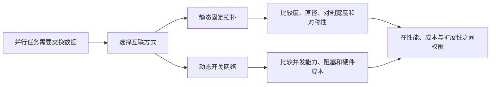
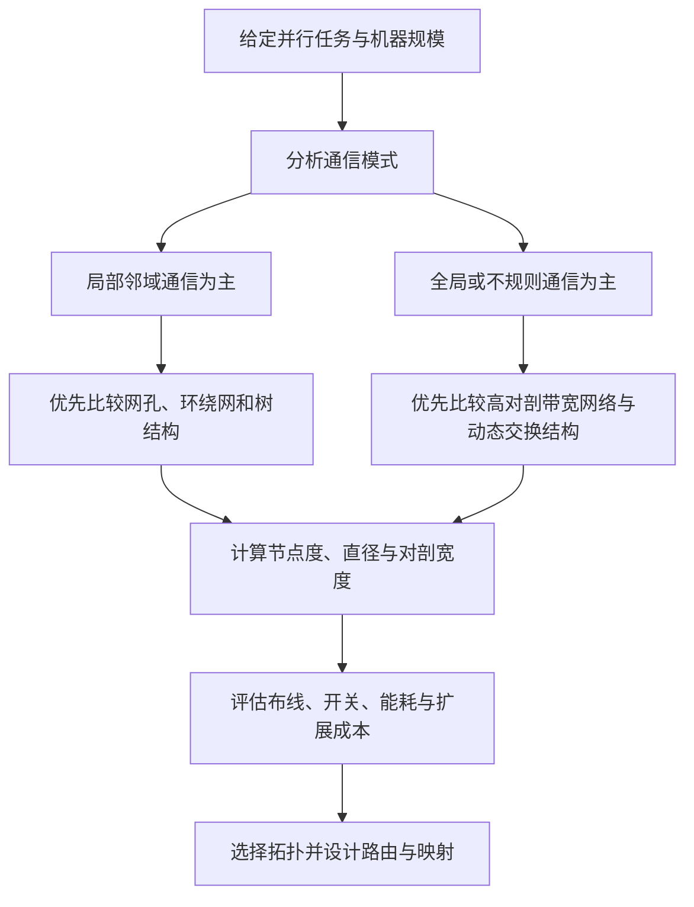

# 2026-09-07 第3节：并行计算机互联网络

> [!info] 课程信息
> - **课程**：并行与分布式计算
> - **主题**：互联网络的性能指标、典型拓扑与高速互联技术
> - **主讲人**：王君豪老师
> - **原始素材**：[[raw/2026-09-07-并行计算机互联网络讲座-500352-逐字稿|逐字稿]]、[[raw/2026-09-07-并行计算机互联网络讲座-500352-纪要|智能纪要]]
> - **配套课件**：[[课程/并行与分布式计算/PPT/并行与分布式计算2-硬件基础/并行与分布式计算2-硬件基础|并行与分布式计算 2：硬件基础]]

> [!note] 记号约定
> 为避免逐字稿中 $N$ 同时表示“边长”“节点数”和“维数”的混淆，本笔记统一用 $P$ 表示总节点数、$k$ 表示二维网络每一维的节点数、$d$ 表示超立方体维数。

## 一、本节课核心脉络

并行计算机由多个计算节点组成。节点可以计算得很快，但只要任务之间存在依赖，就必须交换数据，因此互联网络会直接影响整个系统的并行效率。

> 一句话来说：**互联网络设计的本质，是在更短通信路径、更强全局吞吐、更低硬件成本和更好扩展性之间取得平衡。**

## 二、并行计算机中的网络层次

### 1. 计算节点

一个计算节点通常包含处理器、本地内存和输入输出接口。并行计算机通过高速网络把大量节点连接起来，使它们能够交换中间数据并协同完成同一个任务。

### 2. 系统域网与普通网络

- **系统域网**：服务于超算或数据中心内部，强调低延迟、高带宽和可预测性；
- **局域网**：连接较小地理范围内的普通计算机与服务；
- **广域网**：覆盖更远距离，传播延迟和中间转发开销更大。

高性能计算中的节点通信通常发生得非常频繁，因此不能只看“网络能否连通”，还要看每次通信要等待多久、能同时传输多少数据。

## 三、静态网络与动态网络

### 1. 静态互联网络

节点之间的物理连接在运行期间保持不变。线性阵列、环网、二维网孔、环绕网、树和超立方体都属于典型静态拓扑。

优点：结构明确、路由规律相对容易分析。  
代价：为了降低直径或提高对剖带宽，往往需要增加物理链路和端口。

### 2. 动态互联网络

物理线路可以被多个通信请求复用，由开关或仲裁器在运行时决定哪些端点建立连接。系统总线、交叉开关和多级互联网络属于这一类。

优点：可以通过逻辑控制复用硬件资源。  
代价：需要处理竞争、仲裁和阻塞，而且更强的并发能力通常意味着更多开关与更高成本。

## 四、网络性能的四个核心指标

设网络表示为图 $G=(V,E)$。

### 1. 节点度

节点 $v$ 的度 $\deg(v)$ 是与它直接相连的边数。课堂中谈到整个网络的“节点度”时，通常指最大节点度

$$
\Delta(G)=\max_{v\in V}\deg(v).
$$

- 度越高，单个节点可直接连接的邻居越多，路由选择更灵活；
- 度越高，也意味着更多端口、线路和布线成本；
- 大规模系统通常希望节点度不要随节点总数增长得过快。

### 2. 网络直径

任意两点间最短路径长度的最大值称为网络直径：

$$
D(G)=\max_{u,v\in V}\operatorname{dist}_G(u,v).
$$

直径描述最坏情况下至少要经过多少跳。其他条件相同时，直径越小，最坏通信延迟通常越低。

### 3. 对剖宽度与对剖带宽

把节点尽量平均地分成两组，使两组之间完全断开所必须删除的最少边数，称为**对剖宽度**。

若所有跨剖链路的带宽相同且均为 $b$，可用

$$
B_{\mathrm{bisect}}=w_{\mathrm{bisect}}b
$$

估计对剖带宽。它反映网络在大规模跨区通信时的最坏全局吞吐能力。即使单条链路很快，对剖宽度过小仍会形成集中拥塞。

### 4. 对称性

若从不同节点观察到的网络连接结构相同，则网络具有较好的对称性。高对称性通常有利于统一路由规则、均衡通信压力和扩展系统。

> [!warning] 指标之间存在代价关系
> 降低直径、提高对剖宽度往往需要增加节点度和链路数，因此不能只优化某一个指标。实际系统还必须考虑布线、交换芯片端口数、功耗与故障恢复。

## 五、典型静态互联拓扑

### 1. 线性阵列

$P$ 个节点按链式连接：

- 边数为 $P-1$；
- 内部节点度为 $2$，两个端点的度为 $1$；
- 最大节点度为 $2$；
- 直径为 $P-1$；
- 对剖宽度为 $1$。

线性阵列成本低、结构简单，但节点数增长时直径线性增大，两端之间通信较慢。

![[课程/并行与分布式计算/PPT/并行与分布式计算2-硬件基础/images/a68030bb06c5081c749e6658b0c0bc7de0d3201b2bd4a0f93e7875b68cc96af3.jpg|700]]

*图：线性阵列拓扑。结构简单，但端点之间的最短路径会随节点数线性增长。*

### 2. 环网

在线性阵列基础上连接首尾即可得到环网：

- 每个节点的度恒为 $2$；
- 直径为 $\lfloor P/2\rfloor$；
- 对剖宽度为 $2$；
- 结构具有对称性。

只增加一条首尾连接，就能把最坏路径长度大约减半，并消除端点的特殊性。

### 3. 二维网孔

设节点按 $k\times k$ 方格排列，因此 $P=k^2$：

- 内部节点度为 $4$，边界节点度较低；
- 最大节点度为 $4$；
- 直径为 $2(k-1)$；
- 对剖宽度为 $k$。

二维网孔容易布局和扩展，但边界节点与内部节点不完全对称。

### 4. 二维环绕网

把二维网孔每一行和每一列的两端分别连接起来，得到二维环绕网，也称二维 Torus：

- 一般情况下每个节点度为 $4$；
- 直径为 $2\lfloor k/2\rfloor$；
- 对剖宽度在常见偶数 $k$ 情形下为 $2k$；
- 边界消失，拓扑对称性更好。

与二维网孔相比，环绕连接降低了最坏路径长度并提高了跨剖通信能力，但增加了布线复杂度。

### 5. 完全二叉树与胖树

若完全二叉树的高度为 $h$，根节点深度记为 $0$，则：

- 节点数为 $P=2^{h+1}-1$；
- 最大节点度为 $3$；
- 直径为 $2h$；
- 对剖宽度约为 $1$。

树结构的主要问题是靠近根节点的链路要承载大量跨子树通信，容易成为瓶颈。

**胖树**的改进思想是：越靠近根部，汇聚流量越大，就配置更多并行链路或更高带宽，使上层通信能力与聚合流量相匹配。

### 6. $d$ 维超立方体

$d$ 维超立方体记为 $Q_d$。每个节点可以用一个 $d$ 位二进制串编号，两个编号只相差一位时，相应节点相连。

- 节点数为 $P=2^d$；
- 每个节点度为 $d=\log_2P$；
- 直径为 $d=\log_2P$；
- 对剖宽度为 $2^{d-1}=P/2$；
- 结构高度对称。

高维超立方体能在较小直径下保持很强的全局通信能力，但节点度会随维数增长，硬件连接复杂度也随之提高。

### 7. 典型拓扑速查表

| 拓扑 | 总节点数 | 最大节点度 | 直径 | 对剖宽度 |
|:--|:--|:--|:--|:--|
| 线性阵列 | $P$ | $2$ | $P-1$ | $1$ |
| 环网 | $P$ | $2$ | $\lfloor P/2\rfloor$ | $2$ |
| 二维网孔 | $P=k^2$ | $4$ | $2(k-1)$ | $k$ |
| 二维环绕网 | $P=k^2$ | $4$ | $2\lfloor k/2\rfloor$ | $2k$ |
| 完全二叉树 | $P=2^{h+1}-1$ | $3$ | $2h$ | $1$ |
| $d$ 维超立方体 | $P=2^d$ | $d$ | $d$ | $2^{d-1}$ |

> [!note] 特殊规模说明
> 表中节点度和对剖宽度按一般规模给出；节点数很小时可能出现退化情形。使用公式前要先确认符号表示总节点数、边长还是维数。

## 六、网络嵌入

### 1. 客网络与宿主网络

当算法天然适合某种通信图，但实际机器使用另一种拓扑时，需要把算法通信图映射到物理网络：

- **客网络**：希望实现的逻辑通信结构；
- **宿主网络**：实际提供连接的物理拓扑。

设映射为 $\phi:V_G\to V_H$。客网络的一条边可能对应宿主网络中的一条路径。

### 2. 膨胀系数

按本节课采用的简化定义，嵌入的膨胀系数为

$$
\operatorname{dil}(\phi)=
\max_{(u,v)\in E_G}
\operatorname{dist}_H\bigl(\phi(u),\phi(v)\bigr).
$$

- 膨胀系数为 $1$：客网络每条边都能映射为宿主网络中的一条边；
- 膨胀系数大于 $1$：至少有一条逻辑边需要经过多跳物理路径；
- 本节把一一映射且膨胀系数为 $1$ 的情形称为**完美嵌入**。

### 3. 课堂例子

- 环网可以沿二维环绕网中的某一圈进行嵌入；
- 低维超立方体可以借助二进制或 Gray 码排列映射到环绕结构；
- 完全二叉树嵌入二维网孔时，随树高增长可能需要让某些逻辑边对应多条物理边，因此膨胀系数大于 $1$；
- H-tree 式布局通过规律地预留空间，改善树结构在二维网格上的映射。

> 一句话来说：**网络嵌入研究的是“算法想怎样通信”与“机器实际怎样连接”之间的匹配代价。**

## 七、典型动态互联网络

### 1. 系统总线

总线的物理线路固定但由多个设备共享。三态门控制设备是否接入，仲裁器决定当前由谁使用总线。

- 优点：线路少、成本低、实现简单；
- 缺点：同一时刻通常只能完成一次总线事务，设备增多后竞争严重；
- 适用：低频控制与输入输出，不适合作为大规模节点间的高并发通信核心。

### 2. 单级交叉开关

交叉开关在输入和输出交叉点处设置可控开关。对于 $N$ 个输入和 $N$ 个输出：

- 需要 $N^2$ 个交叉点；
- 只要目标端口不冲突，就能建立多组并行连接；
- 并发能力强，但硬件成本按平方增长。

### 3. 多级互联与 Omega 网络

多级互联使用大量小规模开关级联，降低大交叉开关的成本。对采用 $2\times2$ 开关的 $N$ 路 Omega 网络：

- 级数为 $\log_2N$；
- 每级包含 $N/2$ 个 $2\times2$ 开关；
- 开关总数为 $(N/2)\log_2N$；
- 硬件复杂度从 $O(N^2)$ 降为 $O(N\log N)$。

代价是 Omega 网络属于**阻塞网络**：某些输入输出连接组合会争用同一内部链路，不能保证所有置换都能同时建立。

### 4. 动态网络对比

| 结构 | 并发能力 | 硬件成本 | 主要限制 |
|:--|:--|:--|:--|
| 共享总线 | 低 | 低 | 所有设备竞争同一通信资源 |
| 单级交叉开关 | 高 | $O(N^2)$ | 开关数量平方增长 |
| Omega 网络 | 中等 | $O(N\log N)$ | 可能发生内部阻塞 |

## 八、高性能互联技术

课堂按发展脉络介绍了若干标准和产品。具体速率会随标准版本变化，应重点掌握它们解决的问题。

| 技术 | 课堂定位 | 关键特点 |
|:--|:--|:--|
| HIPPI | 早期高性能并行接口 | 面向大型机和超算的短距离高速连接，现以历史意义为主 |
| Fibre Channel | 光纤通道技术 | 支持较远距离、双向通信与较高可靠性 |
| Ethernet | 通用以太网 | 生态成熟、成本较低，速率持续演进 |
| InfiniBand | HPC 与 AI 高速互联 | 高带宽、低延迟，支持 RDMA |
| RoCE | 融合以太网上的 RDMA | 利用以太网生态提供低延迟直接内存访问 |
| Slingshot | 面向超算的大规模互联 | 强调大规模系统的吞吐、路由与拥塞控制 |
| NVLink | GPU 间高速互联 | 用于多 GPU 之间的高带宽数据交换 |

### RDMA 为什么能降低开销

传统网络通信通常需要操作系统和 CPU 多次参与数据复制与协议处理。远程直接内存访问允许一个节点在受控条件下直接读写另一节点的已注册内存区域，从而减少软件栈参与、数据复制和 CPU 占用。

> [!warning] 课堂性能数字的使用方式
> 课堂材料提到了数百 Gb/s 至 Tb/s 级带宽和微秒级单跳延迟，但逐字稿对个别数字识别不一致。复习时掌握数量级和趋势即可；引用具体设备参数时应查对应标准或厂商资料。

## 九、通信为何容易成为并行程序瓶颈

现代处理器一个时钟周期处于纳秒量级，而节点间通信通常包含微秒量级的启动与传播延迟。即使网络带宽很高，频繁发送小消息仍可能让处理器长时间等待。

经典的延迟—带宽模型可写为

$$
T_{\mathrm{msg}}\approx \alpha+\frac{m}{\beta},
$$

其中 $\alpha$ 是一次通信的固定启动延迟，$m$ 是消息大小，$\beta$ 是有效带宽。

由此得到几条直接的编程策略：

1. 减少通信次数，避免大量细碎消息；
2. 在可行时合并数据，摊薄固定启动延迟；
3. 增大每次通信之间的本地计算量；
4. 改善数据局部性，减少远程访问；
5. 降低全局同步和热点链路竞争；
6. 在算法允许时重叠计算与通信。

> 一句话来说：**高带宽解决“大消息传得快”，低延迟解决“每次通信启动得快”；高效并行程序需要同时减少通信量和通信次数。**

## 十、判定与分析流程

## 十一、易错点与注意事项

> [!warning] 易错点
> - 线性阵列只有内部节点度为 $2$，端点的度为 $1$。
> - 二维网孔若共有 $P=k^2$ 个节点，直径是 $2(k-1)$，不能把 $P$ 与边长 $k$ 混用。
> - $d$ 维超立方体有 $2^d$ 个节点，而不是 $d$ 个节点。
> - 对剖宽度是跨越某个最小对剖的边数，对剖带宽还要考虑每条边的容量。
> - 单条链路带宽高，不代表全局通信一定快；热点和对剖瓶颈仍可能限制性能。
> - Omega 网络降低了成本，但并不具备交叉开关的全部无阻塞能力。
> - 网络图描述的是逻辑连接关系，不要求机器在物理空间中按图形外观摆放。

## 十二、课堂练习与待查

- [ ] 分别计算 $16$ 节点线性阵列、环网和 $4\times4$ 网孔的最大节点度、直径与对剖宽度。
- [ ] 用二进制编号画出 $Q_3$，验证相邻节点编号只相差一位。
- [ ] 为一个 $8$ 路 Omega 网络标出级数、每级开关数和一组发生阻塞的连接请求。
- [ ] 解释为什么树的根部链路容易拥塞，以及胖树如何改善该问题。
- [ ] 尝试用 Gray 码解释超立方体到环绕网络的嵌入思路。
- [ ] 区分 InfiniBand、RoCE 与 NVLink 的使用范围。

## 十三、前后课程联系

- 单机结构与高性能计算应用背景见 [[2026-09-02-第2节-高性能计算应用与系统架构导论]]。
- 本节的网络指标将用于解释后续并行算法的通信复杂度与可扩展性。
- 在程序性能分析中，需要把本节通信成本与 [[2026-08-31-第1节-计算科学演进与高性能计算导论#七、为什么处理器数量增加不等于等比例加速|Amdahl 定律]] 结合起来。
