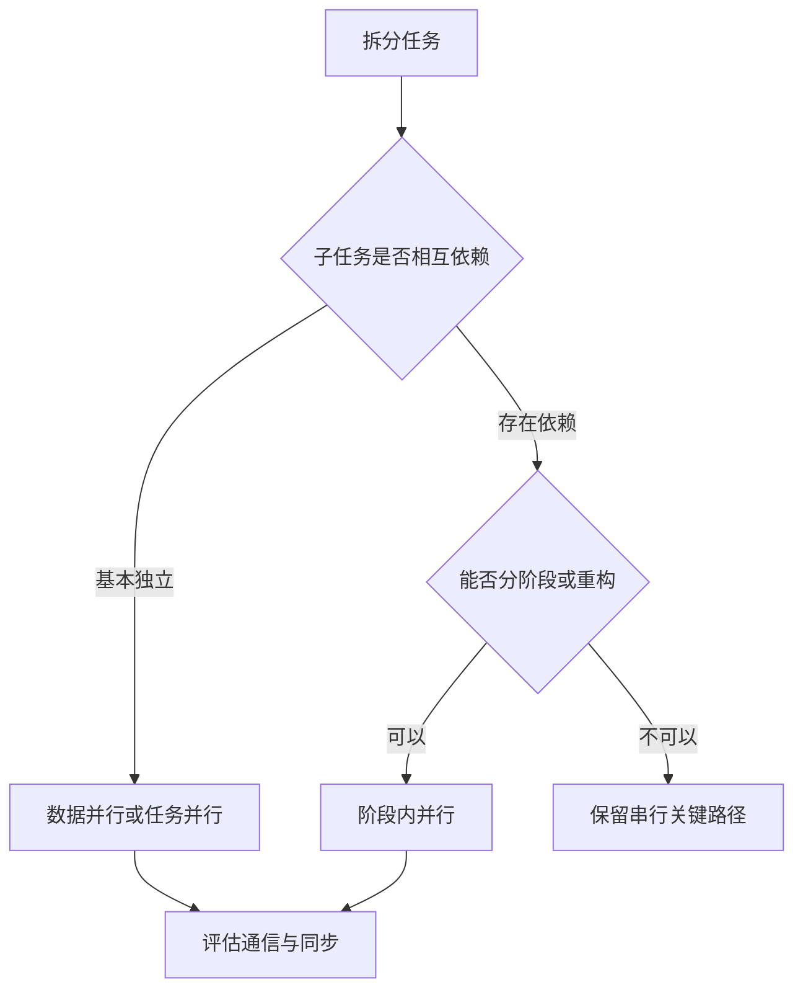

# 2026-09-09 第4节 并行体系结构、缓存与并行算法

## 资料来源

- 配套课件：[[课程/并行与分布式计算/PPT/并行与分布式计算2-硬件基础/并行与分布式计算2-硬件基础|硬件基础]]、[[课程/并行与分布式计算/PPT/并行与分布式计算3-性能评测标准/并行与分布式计算3-性能评测标准|性能评测标准]]
- 原始逐字稿：[[raw/2026-09-09-并行计算与超算架构授课-275008-逐字稿.md]]
- 智能纪要：[[raw/2026-09-09-并行计算与超算架构授课-275008-纪要.md]]
- 开始时间：2026-09-09 14:30

## 一、本节课核心脉络

本节课从“硬件怎样并行”转向“程序怎样利用硬件”：先用 Flynn 分类理解指令流与数据流，再比较共享内存、分布式内存等并行机结构，接着分析内存墙与缓存局部性，最后判断哪些数值算法容易并行，并引出性能评测。

## 二、Flynn 分类

Flynn 分类依据同时存在的指令流和数据流数量划分体系结构。

| 类型 | 含义 | 典型理解 |
|:--|:--|:--|
| SISD | 单指令流、单数据流 | 传统顺序处理器 |
| SIMD | 单指令流、多数据流 | 同一操作同时作用于多个数据，如向量单元和 GPU 线程束 |
| MISD | 多指令流、单数据流 | 较少见，可用于容错或流水处理的特定抽象 |
| MIMD | 多指令流、多数据流 | 多核 CPU、集群和多数现代超级计算机 |

> 一句话来说：Flynn 分类关注的是“有多少套指令在处理多少组数据”，不是简单按处理器数量分类。

## 三、并行计算机的主要结构

### 1. 并行向量机

早期向量机以专用向量处理器和高带宽共享存储实现低延迟计算，适合规则的数值向量操作，但专用硬件成本高、扩展受限。

### 2. 对称多处理机（SMP）

多个处理器共享同一主存和地址空间，编程相对方便。随着处理器增多，共享总线、内存带宽和缓存一致性开销会成为瓶颈。

### 3. 大规模并行处理机（MPP）

每个节点拥有自己的处理器和内存，节点通过高速网络通信。其扩展性较好，但程序必须显式考虑数据分布和通信代价。

### 4. 分布共享存储（DSM）

物理内存分布在多个节点，软件或硬件向程序提供逻辑统一地址空间。它降低了编程门槛，但远程访问仍比本地访问昂贵，不能忽略数据位置。

### 5. 工作站或计算节点集群

由相对通用的计算节点和高速网络组成，性价比与扩展性较好，是现代大型并行系统的常见组织方式。

![[课程/并行与分布式计算/PPT/并行与分布式计算2-硬件基础/images/62d53a6b0c1e0adf7d3d19c99e7771c340786d15184cd5b82a02d2f8dc736670.jpg|620]]

*图：课件中的集群节点结构示意。每个节点包含处理器、内存和网络接口，节点间通过互联网络协作。*

## 四、访存模型：数据在哪里

| 模型 | 地址空间 | 通信方式 | 常见编程模型 |
|:--|:--|:--|:--|
| 共享内存 | 线程看到同一地址空间 | 读写共享变量 | OpenMP、线程库 |
| 分布式内存 | 每个进程拥有独立地址空间 | 显式消息传递 | MPI |
| 混合模型 | 节点内共享，节点间分布 | 共享变量 + 消息传递 | MPI + OpenMP/CUDA |

共享内存易于共享数据，但要处理竞争、锁和缓存一致性；分布式内存具有更清楚的数据所有权和更好的扩展性，但程序必须显式发送数据。

## 五、内存墙与分级缓存

处理器计算速度的增长快于主存访问速度，形成“内存墙”。现代系统用寄存器、L1、L2、L3 缓存和主存组成分级存储：越靠近处理器越快、越小、越昂贵。

CPU 通常按**缓存行**搬运连续数据，而不是只读取当前一个元素。程序性能因此高度依赖局部性：

- **时间局部性**：刚访问过的数据很快再次被访问。
- **空间局部性**：访问一个地址后，很快访问相邻地址。

### 行优先遍历

在 C、C++、NumPy 默认连续数组中，二维数组通常按行优先存储。逐行访问能连续使用缓存行；逐列访问步长较大，缓存命中率更低。矩阵足够大时，两者性能差异会非常明显。

> [!warning] 语言与存储布局有关
> “行遍历更快”不是无条件规律。Fortran、MATLAB 等常采用列优先布局；NumPy 数组也可能因转置或切片而不连续。应检查实际内存布局。

### 多核缓存一致性

多个核心各有私有缓存时，同一内存位置可能出现多个副本。缓存一致性协议负责协调读写。写直达与写回是缓存写策略：前者同步更新下层存储，后者先改缓存、在替换或一致性需要时写回。它们不能简单等同于完整的一致性协议。

## 六、并发、并行与异构计算

- **并发**：多个任务在时间上交错推进，不要求同一时刻真的运行。
- **并行**：多个任务在同一时间使用多个计算资源执行。
- **异构并行**：CPU、GPU 或其他加速器按各自优势协作。

CPU 擅长复杂控制、分支和任务调度；GPU 拥有大量计算单元，适合结构规则、数据并行度高的矩阵与张量操作。把任务放到 GPU 并不自动加速，还要计算数据传输、核函数启动和并行规模的成本。

## 七、怎样判断算法是否容易并行

判断关键不是“循环很多”，而是循环迭代之间是否独立。

### 容易并行的例子

- 矩阵加法：各元素计算相互独立。
- 矩阵乘法：输出元素可分块计算，但需组织数据复用与归约。
- 高斯消元中同一主元下对多行的更新：各行在读取主元行后可并行。
- Jacobi 迭代：新一轮各分量只依赖上一轮结果。

### 并行受限的例子

- Newton 迭代：第 $k+1$ 步依赖第 $k$ 步结果，时间方向存在强依赖。
- Gauss–Seidel 迭代：同一轮后续分量会立即使用已经更新的前序分量。
- 含频繁全局同步或顺序 I/O 的算法。

## 八、性能评测的起点

机器峰值性能不能直接代表程序性能。至少应同时观察：

- 核心或加速器规模。
- 时钟频率与每周期可执行操作数。
- 内存带宽、网络延迟与通信带宽。
- 工作负载规模和浮点运算量。
- 实际运行时间、加速比与并行效率。

设串行时间为 $T_1$，使用 $p$ 个处理单元的时间为 $T_p$，则

$$
S_p=\frac{T_1}{T_p},\qquad E_p=\frac{S_p}{p}.
$$

理想情况下 $S_p=p$、$E_p=1$，实际系统会受到串行部分、通信、同步、负载不均衡和存储瓶颈影响。

## 九、易错点与实验准备

> [!warning] 易错点
> - 多核不一定属于 SIMD；现代多核处理器通常能同时包含 MIMD 与 SIMD 能力。
> - 共享地址空间不等于访问代价相同，NUMA 系统中远程内存更慢。
> - 任务能拆分不等于值得并行，开销可能超过节省的时间。
> - 峰值 FLOPS 高不等于真实应用一定快。

- 下次课将进入实验，提前熟悉编译、运行和计时方法。
- 实验中同时记录问题规模、线程或进程数、运行时间和硬件环境。
- 对矩阵行遍历与列遍历做对照实验，解释性能差异。

## 课堂导航

- 上一节：[[2026-09-07-第3节-并行计算机互联网络|第3节 并行计算机互联网络]]
- 上级索引：[[README|并行与分布式计算课堂笔记]]
