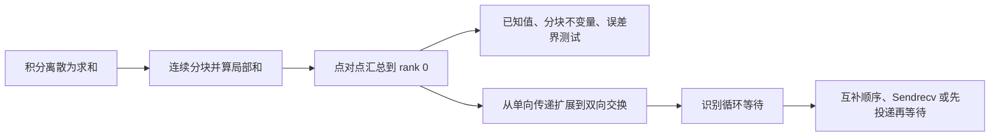
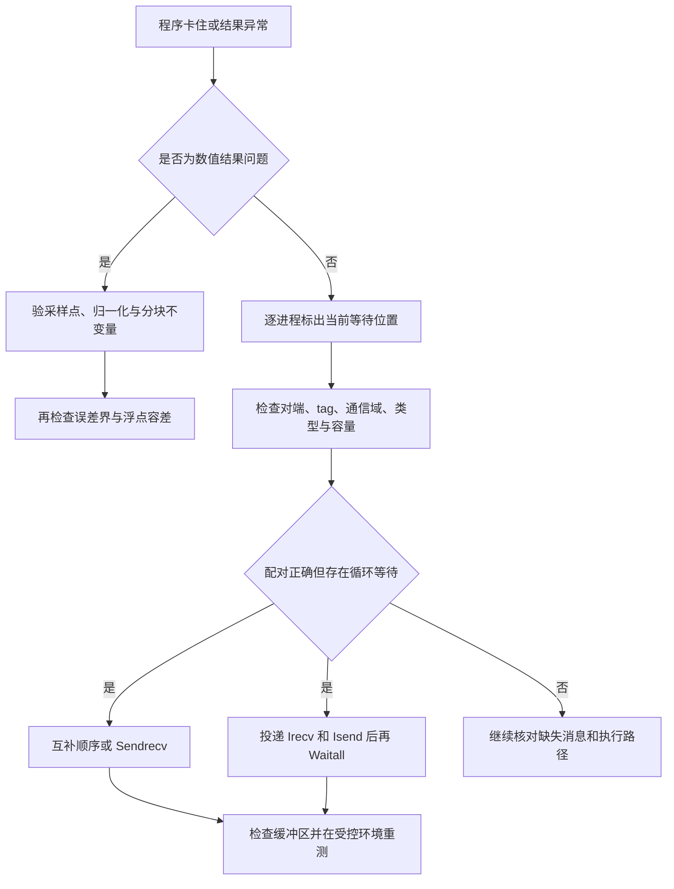

# 2026-10-21 第15节 MPI数值积分、测试与死锁

> [!info] 来源、课件与处理范围
> 主体依据[[课程/并行与分布式计算/课堂笔记/raw/2026-10-21-MPI并行计算与死锁课程-008000-逐字稿|本课逐字稿]]和[[课程/并行与分布式计算/课堂笔记/raw/2026-10-21-MPI并行计算与死锁课程-008000-纪要|智能纪要]]；有效授课约至01:35，之后的闲聊不纳入课程内容。新上传的[[课程/并行与分布式计算/PPT/mpi/README|MPI讲义导览]]及[[课程/并行与分布式计算/PPT/mpi/02-程序结构与通信域/讲义|第二讲讲义]]用于补先修，未发现本次第05／06示例的配套源码及专用课件。文中代码为依据课堂思路整理的示意，不声称与教师源码逐行一致或已在 MPI 环境运行。接口细节另用文末官方资料校验。

课次承接10月19日第14节，沿用已核对的假期、10月10日补课和停课口径，本次为第15节；自动归档的第16节已修正。

## 一、本节核心脉络

今天要解决两个相连的问题：

1. 多个进程共同求一个和，怎样保证不漏算、不重复，并验证数值精度？
2. 两个进程互换数据，为什么“都先发送，再接收”可能永远等下去？

先修最小提醒：

- MPI 进程拥有各自的普通变量；rank 是通信域内编号，不等于线程编号或固定 CPU 核心。
- `MPI_Comm_rank`、`MPI_Comm_size` 取得本进程编号及成员数；`MPI_COMM_WORLD` 不会让变量自动共享。补先修见[[课程/并行与分布式计算/PPT/mpi/02-程序结构与通信域/讲义|程序结构与通信域]]。
- `MPI_Send`／`MPI_Recv` 的来源、目标、tag、通信域和数据类型必须匹配。回看[[课程/并行与分布式计算/课堂笔记/2026-10-19-第14节-MPI通信与并行计算培训|上一课]]。
- 浮点加法受舍入影响；测试时不应把结果逐位相同当成唯一正确标准。

阅读路线：积分模型 → 分块与汇总 → 分层测试 → 死锁依赖 → 三种修正 → CMake 构建。



## 二、复合中点公式：并行前先确定数学对象

课堂延续

$$
\pi=\int_0^1\frac4{1+x^2}\,dx.
$$

取正整数 $N$ 个等长小区间，步长 $h=1/N$，第 $i$ 个中点为 $x_i=(i+\tfrac12)/N$，$i=0,\ldots,N-1$：

$$
\pi_N=\frac1N\sum_{i=0}^{N-1}f(x_i),\qquad
f(x)=\frac4{1+x^2}.
$$

这是**中点公式**，不是右端点公式。索引区间约定为半开区间 $[b,e)$，循环写 `i < e`。

两个可手算的测试基准：

$$
\pi_1=f(1/2)=3.2,\qquad
\pi_2=\frac12\left(\frac{64}{17}+\frac{64}{25}\right)
=\frac{1344}{425}.
$$

> 一句话来说：并行只改变求和如何分工，不应偷偷改变采样点、项数或最后的归一化因子。

## 三、连续分块：余数怎样分配？【核心】

设进程数 $P\ge1$，rank 为 $r\in\{0,\ldots,P-1\}$。带余除法给出

$$
N=qP+s,\qquad q=\lfloor N/P\rfloor,\quad 0\le s<P.
$$

先每人分 $q$ 项，再把余下 $s$ 项分给前 $s$ 个进程：

$$
\begin{aligned}
\operatorname{count}_r&=q+\boldsymbol1_{\{r<s\}},\\
\operatorname{begin}_r&=rq+\min(r,s),\\
\operatorname{end}_r&=\operatorname{begin}_r+\operatorname{count}_r.
\end{aligned}
$$

为什么起点要加 $\min(r,s)$？因为前面 $r$ 个进程中，恰有这么多个多领了一项。它保证相邻分块正好首尾相接。

| $N,P$ | 各 rank 的索引范围 | 工作量 |
|---|---|---|
| $10,3$ | $[0,4),[4,7),[7,10)$ | $4,3,3$ |
| $3,4$ | $[0,1),[1,2),[2,3),[3,3)$ | $1,1,1,0$ |
| $N,1$ | $[0,N)$ | $N$ |

空块 $[3,3)$ 合法：局部和为0，该进程仍按通信协议参与，不应擅自提前退出。

### 3.1 分块实现示意【整理代码】

```c
typedef struct {
    int begin;
    int end;
} Range;

/* 前提：N > 0, P > 0, 0 <= rank < P；
   索引采用 int，超出其范围时需另行设计大整数接口。 */
Range block_range(int N, int P, int rank)
{
    int q = N / P;
    int s = N % P;
    int extra_before = (rank < s) ? rank : s;
    Range out;
    out.begin = rank * q + extra_before;
    out.end = out.begin + q + (rank < s);
    return out;
}
```

### 3.2 测试的不只是某三个端点

教师提出防御性检查：

- 覆盖：第一块从0开始，最后一块到 $N$ 结束。
- 连续：$\operatorname{end}_r=\operatorname{begin}_{r+1}$。
- 合法：$0\le\operatorname{begin}_r\le\operatorname{end}_r\le N$。
- 总量：$\sum_r\operatorname{count}_r=N$。
- 均衡：最大工作量减最小工作量不超过1。

这些性质也说明“不重复且无遗漏”：相邻块只共享端点，而右端点不参与计算。

> 一句话来说：具体样例能发现明显错误，不变量则能保护后续修改时仍不破坏分工。

## 四、局部和怎样汇总？【课堂实现思路】

每个进程先算

$$
S_r=\sum_{i=\operatorname{begin}_r}^{\operatorname{end}_r-1}f(x_i).
$$

rank 0 把自身的 $S_0$ 作为总和初值，再按来源1到 $P-1$ 接收其他进程的局部和，最后输出 $\sum_rS_r/N$。

以下是调用片段，须放在已初始化 MPI、已验证 $N>0$ 的程序中；所有进程须使用相同的 $N$ 与通信域。

```c
int rank, P;
MPI_Comm_rank(MPI_COMM_WORLD, &rank);
MPI_Comm_size(MPI_COMM_WORLD, &P);
Range work = block_range(N, P, rank);

double local = 0.0;
for (int i = work.begin; i < work.end; ++i) {
    double x = (i + 0.5) / (double)N;
    local += 4.0 / (1.0 + x * x);
}

if (rank == 0) {
    double total = local;
    for (int src = 1; src < P; ++src) {
        double part;
        MPI_Recv(&part, 1, MPI_DOUBLE, src, 10,
                 MPI_COMM_WORLD, MPI_STATUS_IGNORE);
        total += part;
    }
    double pi_estimate = total / (double)N;
    /* 在此输出 pi_estimate。 */
} else {
    MPI_Send(&local, 1, MPI_DOUBLE, 0, 10, MPI_COMM_WORLD);
}
```

这里 root 仍参与计算，但**不需要向自身发送消息**。录音约00:35的“自己传自己相当于不做事”不能泛化：真正的 MPI 自发送仍需匹配接收，错误顺序也可能阻塞。保留上述互斥分支最清楚。

课堂强调本例用于实现分工和通信，未证明它是最优可扩展的方案。root 按来源顺序接收，会形成汇总瓶颈；能运行、能并行、获得加速，是三个不同层次，不能互相替代。

> 一句话来说：先保证每一项恰好贡献一次，再考虑怎样降低汇总通信的代价。

## 五、GoogleTest 与数值正确性【重点】

### 5.1 模块分开，测试也分层

课堂第05示例把积分核心、串行入口、MPI 入口及测试分开，用头文件声明接口。C++ 测试调用 C 接口时可用

```cpp
extern "C" {
#include "pi_core.h"
}
```

`extern "C"` 指定 C 语言链接约定，**不是让 C++ 编译器把包围内容自动交给 C 编译器**。通常 C 源文件与 C++ 测试分别编译后链接；具体目标与文件名以实际工程为准。

GoogleTest 用 `TEST(测试套件, 测试名)` 组织测试。`EXPECT_*` 记录非致命失败并继续；`ASSERT_*` 失败时退出**当前函数**，通常是当前测试体，不等于杀掉整个进程。这是对录音口语表述的细化，依据 [GoogleTest Primer](https://google.github.io/googletest/primer.html)。

课堂要求增加 $N=2$ 的测试。下面示意假设已有 `double pi_serial(int N)`：

```cpp
TEST(PiSerial, TwoPanels)
{
    EXPECT_NEAR(pi_serial(2), 1344.0 / 425.0, 1e-14);
}
```

`1344 / 425` 若两边都是整数，会先发生整数除法，不能作为正确参考值。容差 `1e-14` 是此小规模示例的选择，不是所有数值测试的通用阈值。

只运行一组测试，可对实际测试可执行文件传入：

```bash
./test_core --gtest_filter='PiSerial.*'
```

这是 [GoogleTest 的筛选参数](https://google.github.io/googletest/advanced.html#running-a-subset-of-the-tests)。课堂也用 Makefile 将 flag 转发给测试程序，但当前没有配套 Makefile，不能保证仓库变量的具体拼写。课堂展示了 `make test`、MPI 测试与 `make check` 等目标，应取得源码后按实际规则运行，不把它们当成任意项目都自带的命令。

> 一句话来说：自动测试把预期写成可重复执行的约束，但测试名、参考值与容差本身也要正确。

### 5.2 为什么串行与并行的最后几位可能不同？

串行依次累加所有项；并行先局部累加，再相加局部和。实数加法满足结合律，但浮点运算一般不满足

$$
\operatorname{fl}(\operatorname{fl}(a+b)+c)
=\operatorname{fl}(a+\operatorname{fl}(b+c)).
$$

所以相同 $N$ 在不同 $P$ 下可能出现末位差异，也可能恰好一致。这里应区分：

1. 离散误差：积分变成有限中点和；
2. 浮点误差：表示和累加过程的舍入；
3. 实现错误：漏块、重复块、采样点错误或未除 $N$。

不能把任何差异都解释为舍入，也不能要求任何 $N$ 下绝对误差都小于一个机器 epsilon。

### 5.3 理论误差界比“看起来像 π”更有力

复合中点公式要求 $f\in C^2[0,1]$，有

$$
\left|\int_0^1f(x)\,dx-\pi_N\right|
\le\frac{\max_{[0,1]}|f''(x)|}{24N^2}.
$$

对本题（以下导数与界为补充推导）

$$
f''(x)=\frac{8(3x^2-1)}{(1+x^2)^3},\qquad
\max_{[0,1]}|f''(x)|=8,
$$

故精确算术下

$$
\boxed{|\pi-\pi_N|\le\frac1{3N^2}.}
$$

课堂用参考值（如 `acos(-1.0)`）及额外的小容差检查该界。实现时应先把 $N$ 转成浮点数再乘方，避免整数除法或整数平方溢出；大 $N$ 下还要留出舍入余量。

**补充解释：为什么有 $1/24$？** 在每个中点处 Taylor 展开，常数项产生中点近似，线性项在对称小区间积分为零；余项积分的绝对值不超过 $Mh^3/24$。$N$ 段相加得 $M/(24N^2)$。$N$ 翻倍时误差通常按二阶规律下降，但理论上界不是每次实际误差必须恰好缩小四倍的断言。

> 一句话来说：验证数值算法要同时检查已知小例、分工结构和理论误差行为，而不是只看输出前几位。

## 六、死锁：问题不是“发不出去”，而是循环等待

### 6.1 阻塞返回意味着什么？

- `MPI_Recv` 返回后，匹配消息已进入接收缓冲区，程序才能使用该结果。
- 标准阻塞 `MPI_Send` 返回意味着发送缓冲区可安全复用，**不保证对方已经完成接收**；也不保证一定借助内部缓冲立即返回。
- `MPI_Ssend` 是同步发送，其完成要求匹配接收已经开始接收该消息；它不是“对方业务处理完成”的确认。

这些边界按 [MPI 通信模式](https://www.mpi-forum.org/docs/mpi-5.0/mpi50-report/node69.htm)校验。课堂以快递“下单／确认”类比，帮助理解等待关系；不能把类比当成精确接口定义。

### 6.2 两个进程都先发送，为什么有风险？

假设恰有两个进程，`peer = 1 - rank`，各自持有独立发送、接收数组。两边均执行

```c
MPI_Send(sendbuf, count, MPI_INT, peer, 20, comm);
MPI_Recv(recvbuf, count, MPI_INT, peer, 20, comm,
         MPI_STATUS_IGNORE);
```

若发送完成需要对方先投递接收，双方都卡在第一行，谁也到不了第二行：

- rank 0 等 rank 1 接收；
- rank 1 也等 rank 0 接收。

小消息有时因实现缓冲而“碰巧成功”，大消息更容易暴露问题，但大小不是正确性的保障，**不可依赖标准发送的内部缓冲**。课堂提出把两个发送换成 `MPI_Ssend`，以在上述对称顺序下明确暴露循环等待；不要在缺少超时控制的日常环境中直接运行死锁例子。

> 一句话来说：检查程序能否继续前进，要问“当前等待由谁解除，而那个人是否又在等我”。

## 七、三种修正与非阻塞缓冲区纪律

以下均假设两个进程、互相匹配的来源／目标、tag、通信域和类型，且接收容量足够。扩大为环或其他拓扑时须重新分析，不能照搬两进程结论。

### 7.1 互补顺序：一边先发，另一边先收

rank 0：Send → Recv；rank 1：Recv → Send。第一步已有配对，完成后再反向配对，打破循环依赖。课堂称其为互补的阻塞收发。

### 7.2 MPI_Sendrecv：一次表达配对收发

```c
MPI_Sendrecv(sendbuf, count, MPI_INT, peer, 20,
             recvbuf, count, MPI_INT, peer, 20,
             comm, MPI_STATUS_IGNORE);
```

`sendbuf` 与 `recvbuf` 应为不重叠的缓冲区；原地交换需另选接口。MPI 负责处理这种配对收发中的调度依赖，但它不能修复错误 tag、缺少对端或容量不足。[MPI_Sendrecv 文档](https://docs.open-mpi.org/en/main/man-openmpi/man3/MPI_Sendrecv.3.html)

### 7.3 非阻塞：先投递全部相关操作，再等待

```c
MPI_Request requests[2];
MPI_Irecv(recvbuf, count, MPI_INT, peer, 20,
          comm, &requests[0]);
MPI_Isend(sendbuf, count, MPI_INT, peer, 20,
          comm, &requests[1]);

/* 此处只能做不依赖接收数据、也不修改发送缓冲区的工作。 */

MPI_Waitall(2, requests, MPI_STATUSES_IGNORE);
/* 成功完成后才能使用接收结果、复用发送缓冲区。 */
```

`MPI_Request` 是跟踪操作的请求句柄，不是消息数据。`MPI_Irecv`／`MPI_Isend` 返回说明已发起操作，不能据此宣称传输完成。实际能否隐藏通信开销取决于实现、硬件及工作安排，不保证自动加速。

| 未完成的操作 | 缓冲区纪律 |
|---|---|
| 非阻塞发送 | 保持缓冲区有效；完成前不能修改，可读取 |
| 非阻塞接收 | 保持缓冲区有效；完成前不能读取或修改 |
| 成功完成请求后 | 才能使用接收数据、修改或复用相关缓冲区 |

依据：[MPI_Isend](https://docs.open-mpi.org/en/main/man-openmpi/man3/MPI_Isend.3.html)、[MPI_Irecv](https://docs.open-mpi.org/en/main/man-openmpi/man3/MPI_Irecv.3.html)。

### 7.4 加了 I 也仍可能死锁

若双方都写 `Isend → Wait(发送请求) → Irecv`，接收仍可能来不及投递；`Wait` 将等待点提前，可能重新形成相同的循环依赖。关键不是函数名前有没有 `I`，而是**解除依赖所需的操作是否已投递**。

> 一句话来说：非阻塞把“发起”和“确认完成”分开，但不会免除正确配对、正确顺序和缓冲区保护的责任。

## 八、CMake：配置生成与真正编译分开

课堂最后在第06示例中介绍源码外构建：

```bash
mkdir build
cd build
cmake ..
make
```

`cmake ..` 从上一层读取 `CMakeLists.txt`，进行配置和生成；选用 Makefile 生成器时，再由 `make` 构建。CMake 也支持其他生成器，并非只能依赖 Make。

**补充用法：** 同样可以写成

```bash
cmake -S . -B build
cmake --build build
```

后一条按实际生成器调用构建工具。这里是 [CMake 官方说明](https://cmake.org/cmake/help/latest/manual/cmake.1.html)对应的通用命令，不代表本地已有教师工程。本次未执行构建或 MPI 测试，待补入第05／06例子的源码、Makefile／CMakeLists 后再验证。

> 一句话来说：CMake 描述并生成构建规则，构建工具按规则产生可执行文件，MPI 启动器才负责启动多进程。

## 九、判定与排查流程



## 十、核心公式与接口速查

| 对象 | 公式／要点 |
|---|---|
| 中点采样 | $x_i=(i+\tfrac12)/N,\ 0\le i<N$ |
| 结果归一化 | $\pi_N=\sum_rS_r/N$，不是除以进程数 |
| 分块起点 | $rq+\min(r,s)$，$N=qP+s$ |
| 分块长度 | $q+\boldsymbol1_{\{r<s\}}$ |
| 中点误差界 | $\vert\pi-\pi_N\vert\le1/(3N^2)$，精确算术；实现须考虑舍入 |
| 标准阻塞发送 | 返回可复用发送缓冲区，不等于接收端完成 |
| 非阻塞通信 | 发起返回请求，完成须由 Wait／Test 等确认 |
| 请求等待 | 先投递解除依赖所需操作，避免过早等待造成循环 |

## 十一、易错点与注意事项

> [!warning] 课堂强调与整理校验
> 1. $N=2$ 的期望值要写浮点除法，不能用整数截断后的3。
> 2. 空块仍参与通信；否则 root 可能一直等待一个“消失”的进程。
> 3. root 的本地和只加入一次，不应多发一条无人接收的自消息。
> 4. ASSERT 是当前函数的致命断言，不是整个 MPI 作业的统一退出方案；分布式测试还须协调各进程路径。
> 5. 输出看似正确不等于算法正确；误差界、不变量和边界例都需检查。
> 6. 小消息不死锁不代表程序可移植；Sendrecv 及非阻塞也要求消息可靠匹配。
> 7. 非阻塞请求未完成时，缓冲区不能失效；接收区尤其不能提前读取。
> 8. 没有配套源码时，课堂展示“测试通过”不能写成本地复现成功。

## 十二、课堂疑惑与解答

本次未找到当日日计划“每日疑惑/2026-10-21.md”，未追加用户疑问或虚构回答。文中 ASSERT、自发送和缓冲区语义的说明属于来源核对与补充解释。

## 十三、相关知识点链接

- [[课程/并行与分布式计算/课堂笔记/2026-10-19-第14节-MPI通信与并行计算培训|上一课的中点积分与点对点通信]]：补被积函数、数据类型和通信配对的先修。
- [[课程/并行与分布式计算/PPT/mpi/02-程序结构与通信域/讲义|MPI程序结构与通信域讲义]]：澄清每个进程的私有变量、rank和size，不替代本课第05／06示例。
- [[课程/并行与分布式计算/课堂笔记/README|课堂索引]]：查看修正后的课次。
- 本课程9月28日缺失课已补全；本次未发现同课程仍待回填的“缺少逐字稿”占位课，不重复追加旧补全。

## 十四、作业与练习

课堂练习线索（约00:54—01:04）：增加 $N=2$ 的 GoogleTest，检查连续分块和空块参与，比较串行／MPI结果，验证误差界，熟悉测试文件与算法文件分工。课程最后只初步演示 CMake，后续继续讲解；不编造额外作业截止时间。

### 自测一（新编）：独立算一组分块

$N=11,P=4$。求每块端点，验证连续性、总项数及均衡性。

> [!hint]- 提示
> 先算整商与余数，再计算每个 rank 前面额外分出了几项。

> [!solution]- 解析
> $q=2,s=3$；四块为 $[0,3),[3,6),[6,9),[9,11)$，长度 $3,3,3,2$，和为11，最大差1。

### 自测二（新编）：从误差约束反推规模

忽略舍入，为让理论绝对误差上界不超过 $10^{-6}$，$N$ 至少取多少？这能否证明程序没有漏算？

> [!hint]- 提示
> 解 $1/(3N^2)\le10^{-6}$，再区分数学公式与实现正确性。

> [!solution]- 解析
> $N\ge\sqrt{10^6/3}\approx577.35$，整数至少578。该界只适用于正确实现的中点公式，不能替代对分块和通信的检查。

### 自测三（新编）：不看函数名，画依赖

双方均“发起 Isend → 等待该发送 → 发起 Irecv”。为什么仍不安全？只调整顺序怎样改正？

> [!hint]- 提示
> 如果发送完成依赖匹配接收，等待时对端是否已投递接收？

> [!solution]- 解析
> 双方都可能在等待发送完成，而匹配接收尚未发起。改成先投递 Irecv 与 Isend，再统一 Waitall；不能只是把 Send 改名为 Isend。

### 自测四（新编）：选择真正安全的工作

在 Irecv 返回而 Waitall 尚未完成时，能否求 recvbuf 的和？能否修改 sendbuf？能否计算另一个不重叠数组的和？

> [!hint]- 提示
> 分别检查数据是否可能正被 MPI 写入／读取，以及计算是否依赖未完成消息。

> [!solution]- 解析
> 不能读取 recvbuf，也不能修改未完成发送所用的 sendbuf；可以计算不重叠、无依赖的另一数组。还需保证所有相关缓冲区一直有效。
