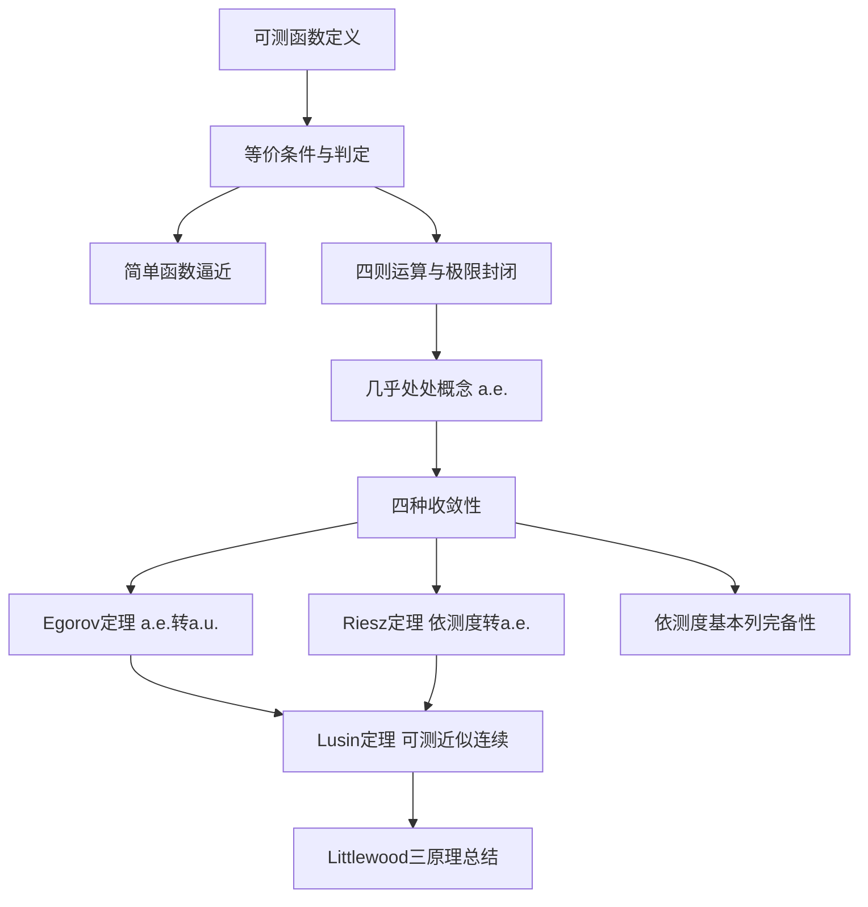
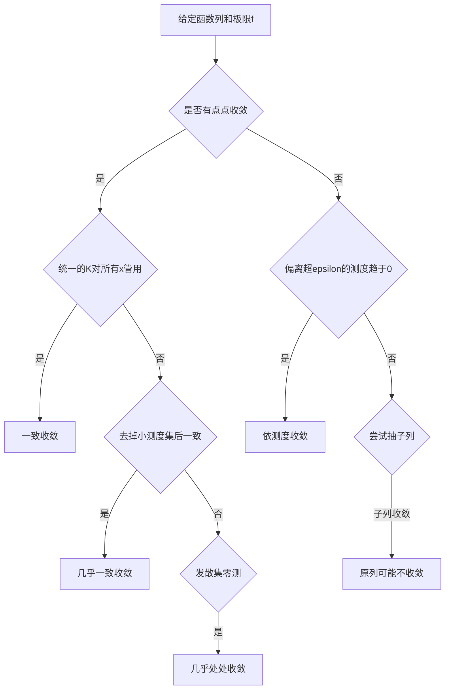

# 第3章 Lebesgue可测函数

## 一、本章核心脉络

本章围绕一个中心问题展开：**什么样的函数足够"好"，使得极限运算可以自由进出？**

黎曼可积函数类对极限运算不封闭（连续函数列的极限可以不连续，甚至不可积），这严重限制了分析工具的使用。Lebesgue 可测函数类正是为解决这一问题而引入——它**大得足够容纳极限运算，又小得足以支撑积分理论**。

本章的概念演进遵循如下逻辑：



**为什么是这个顺序？** 先定义可测函数并建立判定工具（等价条件），然后用简单函数和四则运算证明其"好性质"（封闭性）。有了封闭性，才能讨论函数列的收敛——四种收敛性是本章核心难点，Egorov 和 Riesz 定理揭示了它们之间的深层联系。最终，Lusin 定理回扣到连续函数，说明可测函数与连续函数"本质上差不多"——这就是 Littlewood 三原理给出的全景图。

---

## 二、可测函数的定义与等价条件（核心）

### 2.1 为什么需要可测函数？

黎曼可积函数类有两个致命缺陷：

1. **太小**：Dirichlet 函数
   $$f(x)=\begin{cases}1,&x\in\mathbb{R}\setminus\mathbb{Q},\\0,&x\in\mathbb{Q}\end{cases}$$
   不是黎曼可积的，但它本质上只是一个简单的特征函数。
2. **对极限不封闭**：连续函数列的极限可以不是连续函数（例如
   $$f_n(x)=\begin{cases}0,&x<0\\ x/n,&0\leq x\leq 1/n\\ 1,&x>1/n\end{cases}$$
   的极限是一个不连续函数）。

Lebesgue 可测函数类一举解决了这两个问题——它包含 Dirichlet 函数，且对极限运算封闭。

### 2.2 可测函数的定义

> **定义 2.2.1** 设 $E\subset\mathbb{R}^n$，$E\in\mathfrak{M}$，$f:E\to\overline{\mathbb{R}}$（广义实值函数）。若
> $$\forall t\in\mathbb{R},\quad E(f>t):=\{x\in E\mid f(x)>t\}\in\mathfrak{M},$$
> 则称 $f$ 是 $E$ 上的 **Lebesgue 可测函数**，简称为 $E$ 上的可测函数。记 $\mathfrak{M}(E)$ 为 $E$ 上可测函数的全体。

> 一句话来说：**只要函数在任意水平线以上的部分是一个可测集，这个函数就是可测的。** 这相当于说：用水平线"切"函数的图像，切出来的横截面必须是可测集。

**例 3（常数函数）** $f(x)=c$。因为
$$E(f>t)=\begin{cases}E,&t<c\\\emptyset,&t\geq c\end{cases}$$
而 $E$ 和 $\emptyset$ 都是可测集，故常数函数可测。

**例 4（特征函数）** $f(x)=\chi_A(x)$，其中 $A\subset E$。因为
$$E(f>t)=\begin{cases}E,&t<0\\A,&0\leq t\leq 1\\\emptyset,&t\geq 1\end{cases}$$
故 $\chi_A\in\mathfrak{M}(E)\Leftrightarrow A\in\mathfrak{M}$。这说明**集合的可测性与特征函数的可测性是一一对应的**。

### 2.3 可测函数的等价条件

> **定理 2.2.2** 设 $E\subset\mathbb{R}^n$，$E\in\mathfrak{M}$，$f:E\to\overline{\mathbb{R}}$。以下四个条件等价：
>
> (1) $f\in\mathfrak{M}(E)$（即 $\forall t\in\mathbb{R}$，$E(f>t)\in\mathfrak{M}$）；
>
> (2) $\forall t\in\mathbb{R}$，$E(f\geq t)\in\mathfrak{M}$；
>
> (3) $\forall t\in\mathbb{R}$，$E(f<t)\in\mathfrak{M}$；
>
> (4) $\forall t\in\mathbb{R}$，$E(f\leq t)\in\mathfrak{M}$。

**证明核心洞察**：四个条件通过两条路径互相转换：
- 用交集逼近边界：$E(f\geq t)=\bigcap_{k=1}^{\infty}E(f>t-\frac{1}{k})$
- 用补集翻转方向：$E(f<t)=E\setminus E(f\geq t)$，$E(f>t)=E\setminus E(f\leq t)$

循环链：$(1)\Rightarrow(2)\Rightarrow(3)\Rightarrow(4)\Rightarrow(1)$。

> 一句话来说：**判定可测性时，用 $>$、$\geq$、$<$、$\leq$ 哪一种都可以——它们本质上说的是同一件事，只是集合边界处理不同。**

此外，由这些等价条件还可以推出：
$$E(f=\infty)=\bigcap_{n=1}^{\infty}E(f>n)\in\mathfrak{M},\quad E(f=-\infty)=\bigcap_{n=1}^{\infty}E(f<-n)\in\mathfrak{M}$$
以及 $E(f<\infty),E(f>-\infty),E(f=t)\in\mathfrak{M}$。

**判定可测性的另一个视角**：
$$f\in\mathfrak{M}(E)\Leftrightarrow \text{对任意开集 }O\subset\mathbb{R},\; f^{-1}(O)\in\mathfrak{M}$$

对比：$f\in C(E)\Leftrightarrow$ 对任意开集 $O\subset\mathbb{R}$，$f^{-1}(O)$ 也是开集。可测函数把"开集的原像是开集"换成了"开集的原像是可测集"——这是两者关系的核心纽带。

---

## 三、简单函数与可测函数的逼近（核心）

### 3.1 简单函数

> **定义** 设 $E_1,E_2,\ldots,E_m$ 是 $E$ 的互不相交的可测子集，且 $\bigcup_{j=1}^{m}E_j=E$，$\alpha_1,\alpha_2,\ldots,\alpha_m\in\mathbb{R}$。称
> $$\phi(x)=\sum_{i=1}^{m}\alpha_i\chi_{E_i}(x)$$
> 为**简单函数**。若每个 $E_j$ 是矩体，则 $\phi$ 是**阶梯函数**。

> 一句话来说：**简单函数就是只取有限个值的函数——在每个可测"块"上取常值。** 它是可测函数世界的"砖块"，类似于阶梯函数是黎曼积分世界的"砖块"。

> **定理 2.2.4** $E$ 上的简单函数是可测的。

**证明核心**：对简单函数 $\phi(x)=\sum_{i=1}^{m}\alpha_i\chi_{E_i}(x)$（不妨设 $\alpha_1<\alpha_2<\cdots<\alpha_m$），有
$$E(\phi>t)=\begin{cases}E,&t<\alpha_1\\\bigcup_{j=i+1}^{m}E_j,&\alpha_i\leq t<\alpha_{i+1}\\\emptyset,&t\geq\alpha_m\end{cases}$$
每个情况都是可测集（有限个可测集的并仍是可测的）。

### 3.2 非负可测函数的简单函数逼近定理

> **定理 2.2.5**（本章最重要的逼近定理）设 $E\subset\mathbb{R}^n$，$E\in\mathfrak{M}$，$f\geq 0$。则
> $$f\in\mathfrak{M}(E)\;\Leftrightarrow\; \text{存在非负简单函数列 }\{\varphi_k(x)\}_{k=1}^{\infty}$$
> 满足 $0\leq\varphi_1(x)\leq\varphi_2(x)\leq\cdots\leq\varphi_k(x)\leq\cdots$，且 $\lim_{k\to\infty}\varphi_k(x)=f(x)\;\;(\forall x\in E)$。

> 一句话来说：**任何非负可测函数都可以用一列单调递增的简单函数从下往上逼近——反过来，能被这样逼近的函数也一定是可测的。** 这是联系简单函数和一般可测函数的桥梁。

**证明核心（$\Rightarrow$ 方向）**（本章最精彩的构造性证明）：

对每个 $k\in\mathbb{N}$，将值域 $[0,k)$ 等分为 $k\cdot 2^k$ 份，每份长度为 $1/2^k$。定义
$$E_{k,j}=E\left(\frac{j}{2^k}\leq f<\frac{j+1}{2^k}\right),\quad j=0,1,\ldots,k2^k-1,$$
$$E_{k,k2^k}=E(f\geq k).$$

构造简单函数
$$\varphi_k(x)=\sum_{j=0}^{k2^k}\frac{j}{2^k}\chi_{E_{k,j}}(x).$$

直观理解：$\varphi_k$ 把 $f$ 的值"向下取整"到最近的 $1/2^k$ 精度——类似于用 $k$ 位二进制小数来近似 $f$ 的值。$k$ 越大，网格越密，逼近越精确。

当 $f(x_0)=\infty$ 时，$\varphi_k(x_0)=k\to\infty=f(x_0)$。
当 $f(x_0)<\infty$ 时，存在 $k_0>f(x_0)$，当 $k\geq k_0$ 时，
$$|f(x_0)-\varphi_k(x_0)|=f(x_0)-\varphi_k(x_0)<\frac{1}{2^k}\to 0\quad (k\to\infty).$$

**$\Leftarrow$ 方向**：若 $\{\varphi_k\}$ 是非负简单函数升列且 $\lim\varphi_k=f$，则
$$E(f>t)=\bigcup_{k=1}^{\infty}E(\varphi_k>t)\in\mathfrak{M},$$
因为每个 $\varphi_k$ 可测（定理 2.2.4），可测集的可数并仍是可测的。

**这个构造的一个推论**：$f\in\mathfrak{M}(E)\Leftrightarrow f$ 是某一简单函数列的极限（将 $f$ 分解为正负部，分别用定理 2.2.5，再利用推论 2.2.9）。

---

## 四、可测函数的运算性质（核心）

### 4.1 四则运算封闭性

> **定理 2.2.6** 若 $f,g\in\mathfrak{M}(E)$，则 $cf,f+g,fg,f/g\;(c\in\mathbb{R})$ 在其有定义的集合上是可测函数。

**需处理的细节**：
- $f+g$ 在 $E(f=\infty)\cap E(g=-\infty)$ 和 $E(f=-\infty)\cap E(g=\infty)$ 上无定义，但这两个集合都是可测的（可去掉）。
- $f/g$ 在 $E(g=0)$ 上无定义，$E(g=0)\in\mathfrak{M}$ 也可去掉。

**证明核心**（以 $f+g$ 为例，使用了有理数的可数稠密性）：
$$E(f+g>t)=\bigcup_{r\in\mathbb{Q}}E(f>r)\cap E(g>t-r)\in\mathfrak{M}.$$

> 一句话来说：**两个可测函数的和是否超过 $t$，等价于是否存在一个有理数 $r$，使得 $f>r$ 且 $g>t-r$。** 利用有理数的可数性，把不可数的分界问题转化为可数个可测集的并。

对于 $f^2$：当 $t<0$ 时 $E(f^2>t)=E\in\mathfrak{M}$；当 $t\geq 0$ 时 $E(f^2>t)=E(f>\sqrt{t})\cup E(f<-\sqrt{t})\in\mathfrak{M}$。由此得 $fg=\frac{1}{4}[(f+g)^2-(f-g)^2]\in\mathfrak{M}(E)$。

对于 $1/g$：分 $t=0$、$t>0$、$t<0$ 三种情况讨论，利用 $g$ 的可测性分别验证。

### 4.2 极限运算封闭性

> **定理 2.2.8** $E\subset\mathbb{R}^n$，$E\in\mathfrak{M}$，$\{f_k(x)\}_{k=1}^{\infty}\subset\mathfrak{M}(E)$。则以下函数均是可测的：
> (1) $\sup_{k\geq 1}\{f_k(x)\}$；(2) $\inf_{k\geq 1}\{f_k(x)\}$；
> (3) $\varlimsup_{k\to\infty}f_k(x)$；(4) $\lim_{k\to\infty}f_k(x)$（当极限存在时）。

**证明核心**：
- 上确界：$E(\sup_k f_k>t)=\bigcup_{k=1}^{\infty}E(f_k>t)\in\mathfrak{M}$（利用了定理 2.2.2 的等价条件）
- 下确界：$\inf_k f_k=-\sup_k(-f_k)$
- 上极限：$\varlimsup_{k\to\infty}f_k=\inf_{j\geq 1}\sup_{k\geq j}f_k$（逐层使用 (1)(2)）
- 极限：$\lim_{k\to\infty}f_k=-\varlimsup_{k\to\infty}(-f_k)$（当极限存在时）

> **推论 2.2.9** 若 $\{f_k\}\subset\mathfrak{M}(E)$ 且 $\lim_{k\to\infty}f_k(x)=f(x)$，则 $f(x)\in\mathfrak{M}(E)$。

> 一句话来说：**可测函数列的上确界、下确界、上极限、下极限和极限（若存在）都是可测的。** 这是可测函数类比黎曼可积函数类最核心的优势。

### 4.3 正部、负部和绝对值

> **定理 2.2.10** $f\in\mathfrak{M}(E)\Leftrightarrow f^+,f^-\in\mathfrak{M}(E)$。且 $f\in\mathfrak{M}(E)\Rightarrow |f|\in\mathfrak{M}(E)$。

其中：
$$f^+(x)=\max(f(x),0),\quad f^-(x)=-\min(f(x),0)=\max(-f(x),0),$$
$$f=f^+-f^-,\quad |f|=f^++f^-.$$

> 一句话来说：**$f$ 可测等价于它的"正半部分"和"负半部分"都可测——把一个函数拆成两半来分别处理。** 注意 $|f|$ 可测推不回 $f$ 可测（反例：任取不可测集的特征函数调整正负值即可构造）。

### 4.4 连续函数与可测函数

> **推论 2.2.7** $C(E)\subset\mathfrak{M}(E)$。即可测集上的连续函数都是可测函数。

原因：对连续函数 $f$，$f$ 可测 $\Leftrightarrow$ 对任意开集 $O$，$f^{-1}(O)$ 可测。而连续函数下开集的原像是开集，开集自然是可测的。

> **定理 2.2.11** $f\in C(\mathbb{R})$，$g\in\mathfrak{M}(E)\;\Rightarrow\; h=f\circ g\in\mathfrak{M}(E)$。

**证明**：对任意开集 $O$，$h^{-1}(O)=g^{-1}(f^{-1}(O))$。$f^{-1}(O)$ 是开集，故其关于 $g$ 的原像是可测集。

> 一句话来说：**连续函数套在可测函数外面，结果还是可测的。** 但要注意方向——可测函数套在连续函数外面不一定可测。

---

## 五、几乎处处的概念（基础）

### 5.1 几乎处处相等的函数可测性相同

> **定理 2.2.12** 若 $f$ 与 $g$ 在 $E$ 上几乎处处相等（即存在零测集 $E_0\subset E$，$m(E_0)=0$，使得 $f=g$ 在 $E\setminus E_0$ 上成立），则当其中一个可测时，另一个也可测。

**证明核心**：
$$E(g>t)=(E(f>t)\cap E(f=g))\;\cup\;(E(g>t)\cap E(f\neq g))$$
第一项可测（因为 $f$ 可测），第二项是零测集的子集，故也可测。

> 一句话来说：**函数的可测性与其在零测集上的取值无关——随便修改零测集上的值，不会改变函数的可测性。** 例如 Dirichlet 函数在有理数集（零测集）上取 0，与常数 1 处处不相等，但它与常数 1 几乎处处相等，因此可测。

### 5.2 几乎处处的定义

> **定义 2.2.13** 若对于除了 $E$ 中一个零测集以外的每个 $x$，命题 $S(x)$ 皆为真，则称命题 $S(x)$ 在 $E$ 上**几乎处处成立**（为真），简记为 $S(x),\;a.e.\;[E]$。当 $E=\mathbb{R}^n$ 时简记为 $S(x),\;a.e.$。

**常用形式**：
- $f=g\;a.e.$ —— 几乎处处相等
- $f\geq 0\;a.e.$ —— 几乎处处非负
- $|f|<\infty\;a.e.$ —— 几乎处处有限（在 Lebesgue 积分中这是标准假设）

> 一句话来说：**"几乎处处"意味着除了一个"可以忽略不计"的零测集外，命题处处成立。** 在测度论中，零测集就是"可以忽略"的东西。

---

## 六、可测函数列的收敛性（本章核心 / 难点）

### 6.1 四种收敛性的定义

#### 6.1.1 一致收敛

> **定义 2.3.1** 若 $\forall\varepsilon>0$，$\exists K\in\mathbb{N}$，使得 $\forall k\geq K$，$\forall x\in E$，有
> $$|f_k(x)-f(x)|<\varepsilon,$$
> 则称 $\{f_k(x)\}$ 在 $E$ 上**一致收敛**于 $f$，记作 $f_k\rightrightarrows f$ 或 $f_k\xrightarrow{u}f$。

> 一句话来说：**存在一个统一的 $K$，对于 $E$ 上所有 $x$ 同时管用——不依赖于具体的 $x$。**

**例** $f_k(x)=\sqrt{x^2+\frac{1}{k}}$ 在 $(-1,1)$ 上一致收敛到 $f(x)=|x|$。

**反例** $f_k(x)=\frac{k}{kx+1}$ 在 $(0,1)$ 上逐点收敛到 $f(x)=x^{-1}$，但不一致收敛；$f_k(x)=\begin{cases}1,&x\geq 1/n\\ nx,&0<x<1/n\end{cases}$ 在 $(0,1)$ 上也逐点收敛但不一致收敛。

**注**：一致收敛 $\Rightarrow$ 逐点收敛（也称点点收敛）；若每个 $f_k$ 可测，则极限函数也可测（推论 2.2.9）。

#### 6.1.2 几乎一致收敛

> **定义** 设 $E$ 是可测集。若 $\forall\delta>0$，$\exists E_\delta\subset E$，使得 $m(E\setminus E_\delta)<\delta$，且在 $E_\delta$ 上有 $f_k\rightrightarrows f$，则称 $\{f_k(x)\}$ 在 $E$ 上**几乎一致收敛**于 $f$，记作 $f_k\xrightarrow{a.u.}f$。

> 一句话来说：**去掉一个测度可以任意小的集合后，剩下的部分上就是一致收敛。** 换句话说，一致收敛的"坏点"可以被控制在一个任意小的测度内。

**例** $f_k(x)=x_{(0,k)}(x)$ 在 $(0,\infty)$ 上逐点收敛但不几乎一致收敛（因为无论去掉多大测度的集合，在无穷远处收敛速度总是不够快）。

#### 6.1.3 几乎处处收敛

> **定义 2.3.2** 若存在 $Z\subset E$，$m(Z)=0$，使得
> $$\lim_{k\to\infty}f_k(x)=f(x)\quad(\forall x\in E\setminus Z),$$
> 则称 $\{f_k(x)\}$ 在 $E$ 上**几乎处处收敛**于 $f$，记作 $f_k\xrightarrow{a.e.}f$。

> 一句话来说：**除了一个零测集外，处处逐点收敛。** 这是逐点收敛的"零测放松版"。

**注**：若 $\{f_k\}\subset\mathfrak{M}(E)$ 且 $f_k\xrightarrow{a.e.}f$，则 $f\in\mathfrak{M}(E)$（这与几乎处处相等的定理 2.2.12 一致）。

**基本蕴含**：$f_k\xrightarrow{a.u.}f\;\Rightarrow\; f_k\xrightarrow{a.e.}f$。（为什么？对每个 $\delta=1/n$ 取出 $E_{1/n}$，令 $Z=E\setminus\bigcup_n E_{1/n}$，则 $m(Z)=0$，在 $E\setminus Z$ 上处处收敛。）

#### 6.1.4 依测度收敛

**动机**：课件中给出了一个关键例子——$E=[0,1)$，定义
$$f_k(x)=\chi_{\left[\frac{j}{2^i},\frac{j+1}{2^i}\right)}(x),\quad k=2^i+j,\;0\leq j<2^i.$$

这个函数列在任何点处都不收敛（每个点都有无穷多次取 1，也有无穷多次取 0），但是当 $k$ 越来越大时，$f_k$ 取 1 的区间长度越来越小：$m(\{x:|f_k(x)-0|\geq\varepsilon\})=1/2^i\to 0$。这引发了一种比几乎处处收敛更弱的收敛方式。

> **定义 2.3.4** 设 $E\in\mathfrak{M}$，$|f|,|f_k|<\infty\;a.e.\;[E]$。若
> $$\forall\varepsilon>0,\quad \lim_{k\to\infty}m\Big(E\big(|f_k-f|>\varepsilon\big)\Big)=0,$$
> 则称 $\{f_k(x)\}$ 在 $E$ 上**依测度收敛**于 $f$，简记为 $f_k\xrightarrow{m}f$。

> 一句话来说：**函数值偏离 $f$ 超过任意给定误差 $\varepsilon$ 的那些点，其测度随着 $k$ 增大而趋于零。** 这关注的不是"每个点的值是否逼近"，而是"不逼近的点的规模是否趋于零"。

### 6.2 四种收敛性对比

| 收敛类型 | 关注什么 | 控制对象 | 记号 |
|:--------|:--------|:--------|:----:|
| 一致收敛 | 最坏点的误差 | 所有点统一的 $K$ | $f_k\rightrightarrows f$ |
| 几乎一致收敛 | 切除小测度集后一致收敛 | 坏集的测度 $<\delta$ | $f_k\xrightarrow{a.u.}f$ |
| 几乎处处收敛 | 除零测集外逐点收敛 | 发散集测度为 0 | $f_k\xrightarrow{a.e.}f$ |
| 依测度收敛 | 偏离超 $\varepsilon$ 的测度 $\to 0$ | $m(\{有偏差\}\to 0)$ | $f_k\xrightarrow{m}f$ |

**基础蕴含关系**（在 $m(E)<\infty$ 且函数几乎处处有限的条件下）：

```
一致收敛 --> 几乎一致收敛 --> 几乎处处收敛
                |                  |
                v                  v
            依测度收敛 <-----------
```

---

## 七、收敛性之间的关系——三大定理（核心 / 难点）

### 7.1 Egorov 定理：几乎处处 + 有限测度 $\Rightarrow$ 几乎一致

> **定理 2.3.3（Egorov 定理）** 设 $E\in\mathfrak{M}$，$|f|,|f_k|<\infty\;a.e.\;[E]$，$m(E)<\infty$。若
> $$f_k\xrightarrow{a.e.}f\quad[E],$$
> 则 $f_k\xrightarrow{a.u.}f$。

> 一句话来说：**在测度有限的集合上，几乎处处收敛"几乎"就是一致收敛——只要愿意丢掉一个测度任意小的集合。**

**证明核心**（体现了测度论中经典的分析论证模式）：

第一步，刻画收敛点集：
$$\{x\in E\mid f_k(x)\to f(x)\}=\bigcap_{k=1}^{\infty}\bigcup_{J=1}^{\infty}\bigcap_{j=J}^{\infty}E\left(|f_j-f|<\frac{1}{k}\right).$$

第二步，发散点集可表为：
$$E(f_k\not\to f)=\bigcup_{k=1}^{\infty}\varlimsup_{j\to\infty}E\left(|f_j-f|\geq\frac{1}{k}\right).$$

由于 $f_k\xrightarrow{a.e.}f$，发散点集测度为零。

第三步，利用测度的上连续性（推论 2.1.9）：令 $A_J=\bigcup_{j\geq J}E(|f_j-f|\geq 1/k)$，这是降列且 $m(A_1)\leq m(E)<\infty$，故
$$\lim_{J\to\infty}m(A_J)=m\left(\bigcap_{J=1}^{\infty}A_J\right)=m\left(\varlimsup_{j\to\infty}E(|f_j-f|\geq 1/k)\right)=0.$$

第四步，给定任意 $\delta>0$，对每个 $k$ 取出 $J_k$ 使得 $m(\bigcup_{j=J_k}^{\infty}E(|f_j-f|\geq 1/k))<\delta/2^k$。令
$$E_\delta=\bigcap_{k=1}^{\infty}\bigcap_{j=J_k}^{\infty}E\left(|f_j-f|<\frac{1}{k}\right),$$
则 $m(E\setminus E_\delta)\leq\sum_k\delta/2^k\leq\delta$，且在 $E_\delta$ 上 $f_k\rightrightarrows f$。

**Egorov 定理的反例**：当 $m(E)=\infty$ 时结论不成立。例如 $E=(0,\infty)$，$f_k=\chi_{(0,k)}$，处处收敛到 $f\equiv 1$，但不几乎一致收敛——因为不论丢掉多大测度的集合，在无穷远处收敛速度仍然"慢"。

### 7.2 有限测度下几乎处处收敛推出依测度收敛

> **定理 2.3.6** 设 $E\in\mathfrak{M}$，$\{f_k\}\subset\mathfrak{M}(E)$，$|f_k|<\infty\;a.e.\;[E]$，$m(E)<\infty$。若 $f_k\xrightarrow{a.e.}f$，则 $f_k\xrightarrow{m}f$。

**证明**：由 Egorov 定理，$f_k\xrightarrow{a.u.}f$。而几乎一致收敛显然蕴含依测度收敛：$\forall\delta>0$，$\exists E_\delta$ 满足 $m(E\setminus E_\delta)<\delta$ 且在 $E_\delta$ 上一致收敛，故当 $k$ 充分大时 $E(|f_k-f|\geq\varepsilon)\subset E\setminus E_\delta$，其测度 $<\delta$。令 $\delta\to 0$ 即得。

> 一句话来说：**在测度有限的集合上，几乎处处收敛强于依测度收敛。** 结合后面的 Riesz 定理可以知道：依测度收敛实质上"等价于"某个子列几乎处处收敛。

### 7.3 Riesz 定理：依测度收敛 $\Rightarrow$ 存在子列几乎处处收敛

> **定理 2.3.7（Riesz 定理）** 设 $f,\{f_k\}\subset\mathfrak{M}(E)$ 几乎处处有限。若 $f_k\xrightarrow{m}f$，则存在子列 $\{f_{k_i}\}$，使得
> $$\lim_{i\to\infty}f_{k_i}(x)=f(x)\quad a.e.\;[E].$$

> 一句话来说：**依测度收敛虽然比几乎处处收敛弱，但"本质上"不弱太多——总可以从中抽出一个几乎处处收敛的子列。**

**证明核心**：由 $f_k\xrightarrow{m}f$，可取 $k_1<k_2<\cdots$ 使得
$$m\left(E\left(|f_{k_i}-f|\geq\frac{1}{2^i}\right)\right)<\frac{1}{2^i}.$$
记 $E_i=E(|f_{k_i}-f|\geq 1/2^i)$。令 $S=\bigcap_{j=1}^{\infty}\bigcup_{i=j}^{\infty}E_i=\varlimsup E_i$，由 Borel-Cantelli 型论证有 $m(S)=0$。

任取 $x\in E\setminus S$，存在 $j$ 使得 $x\notin\bigcup_{i=j}^{\infty}E_i$，即 $\forall i\geq j$，$x\notin E_i$，故 $|f_{k_i}(x)-f(x)|<1/2^i\to 0$。因此子列在 $E\setminus S$ 上处处收敛，即几乎处处收敛。

### 7.4 依测度极限的唯一性

> **定理 2.3.5** 若 $\{f_k\}$ 在 $E$ 上依测度收敛于 $f$ 和 $g$，则 $f=g\;a.e.\;[E]$。

**证明核心**：由 $|f-g|\leq|f-f_k|+|f_k-g|$（a.e.）得，对任意 $\varepsilon>0$：
$$E(|f-g|>\varepsilon)\subset E\left(|f-f_k|>\frac{\varepsilon}{2}\right)\cup E\left(|g-f_k|>\frac{\varepsilon}{2}\right).$$
两边取测度，令 $k\to\infty$，右边两项都 $\to 0$，故 $m(E(|f-g|>\varepsilon))=0$。由 $\varepsilon$ 的任意性得 $m(f\neq g)=0$。

> 一句话来说：**在几乎处处相等的意义下，依测度收敛的极限是唯一的。**

### 7.5 依测度基本列与完备性

> **定义 2.3.8** 若 $\forall\varepsilon>0$，有
> $$\lim_{k,j\to\infty}m\Big(E\big(|f_j-f_k|>\varepsilon\big)\Big)=0,$$
> 则称 $\{f_k\}$ 是 $E$ 上的**依测度基本列**（Cauchy 列）。

> **定理 2.3.9** $\{f_k\}\subset\mathfrak{M}(E)$ 几乎处处有限。则
> $$f_k\xrightarrow{m}f\;\Longleftrightarrow\; \{f_k\}\text{ 是依测度基本列}.$$

> 一句话来说：**依测度收敛等价于依测度 Cauchy——依测度收敛具有"完备性"。** 与实数完备性（Cauchy 列必有极限）类似，这是依测度收敛理论的基础。

**证明核心（$\Leftarrow$ 方向——最具技巧性的部分）**：

从依测度基本列中，依次取出 $k_1<k_2<\cdots$ 满足
$$m\left(E\left(|f_{k_i}-f_{k_{i+1}}|\geq\frac{1}{2^i}\right)\right)<\frac{1}{2^i}.$$

令 $E_i=E(|f_{k_i}-f_{k_{i+1}}|\geq 1/2^i)$，$S=\varlimsup E_i$，则 $m(S)=0$。在 $E\setminus S$ 上：
$$\sum_{i=l}^{\infty}|f_{k_{i+1}}(x)-f_{k_i}(x)|\leq\frac{1}{2^{l-1}},$$

即级数 $f_{k_1}(x)+\sum_{i=1}^{\infty}(f_{k_{i+1}}(x)-f_{k_i}(x))$ 在 $E\setminus S$ 上绝对收敛于某个极限函数 $f(x)$。由此子列 $\{f_{k_i}\}$ 在 $E\setminus S$ 上处处收敛于 $f$（且几乎一致收敛）。再利用三角不等式证明原列依测度收敛于 $f$。

---

## 八、可测函数与连续函数——Lusin 定理（核心 / 难点）

### 8.1 Lusin 定理

> **定理 2.3.10（Lusin 定理）** 设 $E\in\mathfrak{M}$，$f\in\mathfrak{M}(E)$，$|f|<\infty\;a.e.\;[E]$。对任意的 $\delta>0$，存在 $E$ 中的一个闭集 $F$，满足 $m(E\setminus F)<\delta$，使得 $f(x)$ 是 $F$ 上的连续函数。

> 一句话来说：**任何可测函数，只要丢掉一个测度任意小的集合，在剩下的闭集上就是连续的。** 可测函数"接近于"连续函数——这就是 Lusin 定理的核心信息。

**证明分两步**：

**第一步——简单函数情形**：设 $f(x)=\sum_{i=1}^{l}c_i\chi_{E_i}(x)$。对每个 $E_i$，可构造闭集 $F_i\subset E_i$ 使得 $m(E_i\setminus F_i)<\delta/l$（这利用了可测集的逼近性质——每个可测集可以用闭集从内部逼近）。由于简单函数在每个 $F_i$ 上是常数，在互不相交的闭集的并 $F=\bigcup_i F_i$ 上是连续的。且 $m(E\setminus F)=\sum_i m(E_i\setminus F_i)<\delta$。

**第二步——一般可测函数情形**：先通过变换 $g(x)=\frac{f(x)}{1+|f(x)|}$（其逆为 $f=\frac{g}{1-|g|}$），可假设 $|f|\leq M<\infty$。然后利用定理 2.2.5 构造简单函数列 $\{\varphi_k\}$ 在 $E$ 上一致收敛于 $f$。对每个 $\varphi_k$，存在闭集 $F_k$ 满足 $m(E\setminus F_k)<\delta/2^k$ 且 $\varphi_k$ 在 $F_k$ 上连续。令 $F=\bigcap_{k=1}^{\infty}F_k$，则 $m(E\setminus F)<\delta$，每个 $\varphi_k$ 在 $F$ 上连续，又因为一致收敛保持连续性，极限 $f=\lim\varphi_k$ 在 $F$ 上也连续。

### 8.2 用连续函数列逼近可测函数

> **推论 2.3.11（推论 2.3.13）** 若 $f(x)$ 是可测集 $E$ 上几乎处处有限的可测函数，则存在 $\mathbb{R}^n$ 上的连续函数列 $\{g_k(x)\}$，使得 $\{g_k(x)\}$ 在 $E$ 上几乎处处收敛到 $f(x)$。

**证明依赖于引理 2.3.12（扩张定理）**：设 $F\subset\mathbb{R}^n$ 是非空闭集，$f\in C(F)$。则存在 $g\in C(\mathbb{R}^n)$ 使得 $g|_F=f$ 且 $\sup_{x\in\mathbb{R}^n}|g(x)|=\sup_{x\in F}|f(x)|$。（这是拓扑学中 Tietze 扩张定理的特例。）

> 一句话来说：**任何可测函数都可以由一列连续函数几乎处处逼近。** 结合定理 2.2.5（简单函数逼近），可测函数有了两种标准的逼近方式：离散的（简单函数）和连续的（连续函数）。

### 8.3 Littlewood 三原理

本章的内容可以归结为 J. E. Littlewood 提出的三个原理：

| 原理 | 核心思想 | 对应定理 |
|:-----|:--------|:---------|
| **第一原理** | 每个测度有限的可测集接近于有限个区间/矩体的并 | 第 2 章可测集的逼近定理 |
| **第二原理** | 每个可测函数接近于连续函数 | Lusin 定理（定理 2.3.10） |
| **第三原理** | 测度有限的可测集上的收敛的可测函数列接近于一致收敛的函数列 | Egorov 定理（定理 2.3.3） |

> 一句话来说：**测度论中的一切"坏"的东西，都可以被控制在任意小的测度内——这就是 Littlewood 三原理的根本洞察。**

---

## 九、测度空间上的推广（了解即可）

### 9.1 一般测度空间上的可测函数

> **定义 2.2.14** 设 $(X,\mathcal{F},\mu)$ 为测度空间。$f:X\to\overline{\mathbb{R}}$。若 $\forall t\in\mathbb{R}$，$X(f>t)\in\mathcal{F}$（即 $\mathcal{F}$-可测），则称 $f$ 为 $X$ 上的 **$\mathcal{F}$-可测函数**。记 $\mathfrak{M}(X,\mathcal{F})$ 为全体可测函数。

> **定理 2.2.15** 在测度空间上，可测函数也有七个等价条件（比 $\mathbb{R}^n$ 情形多了三个）：
> (1)-(4) 与 $\mathbb{R}^n$ 情形一致（$>$、$\geq$、$<$、$\leq$）；
> (5) 对任意开集 $G\subset\mathbb{R}$，$f^{-1}(G),X(f=\infty)\in\mathcal{F}$；
> (6) 对任意闭集 $F\subset\mathbb{R}$，$f^{-1}(F),X(f=\infty)\in\mathcal{F}$；
> (7) $f^+,f^-\in\mathfrak{M}(X)$。

**定理 2.2.16**（四则运算）和**定理 2.2.17**（极限运算）均直接推广到测度空间。

**定义 2.2.19** 几乎处处的概念也推广到测度空间：命题 $S(x)$ 在 $(X,\mathcal{F},\mu)$ 上几乎处处成立，当且仅当除了一个 $\mu$-零测集外处处为真，记作 $S(x)\;a.e.$ 或 $S(x)\;\mu\;a.e.$。

### 9.2 一般测度空间上的收敛性

> **定义 2.3.14** 在测度空间 $(X,\mathcal{F},\mu)$ 上定义四种收敛：
> - 一致收敛（同前）
> - 几乎一致收敛：$f_n\to f,\;\mu\;a.u.$
> - 几乎处处收敛：$f_n\to f,\;\mu\;a.e.$
> - 依测度收敛：$f_n\xrightarrow{\mu}f$

> **定理 2.3.15** 总结了测度空间上的收敛性关系：
> - $f_n\to f,\;\mu\;a.u.\;\Rightarrow\; f_n\to f,\;\mu\;a.e.$
> - $f_n\to f,\;\mu\;a.u.\;\Rightarrow\; f_n\xrightarrow{\mu}f$
> - $f_n\xrightarrow{\mu}f\;\Rightarrow\; \exists\{f_{k_i}\}\subset\{f_n\}$ 使得 $f_{k_i}\to f,\;\mu\;a.u.$（和 $\mu\;a.e.$）
> - 当 $\mu(X)<\infty$ 时，$\mu\;a.e.\;\Rightarrow\;\mu\;a.u.$（即 Egorov 定理的推广）
> - 当 $\mu(X)<\infty$ 时，$\mu\;a.e.\;\Rightarrow\;\mu$（即有限测度下 a.e. 蕴含依测度）

### 9.3 拓扑空间与连续函数

当 $X$ 同时是拓扑空间，$\mathcal{F}$ 是由全体开集生成的 $\sigma$-代数（Borel $\sigma$-代数）时：

- $f$ 在 $a\in X$ 连续 $\Leftrightarrow$ $\forall\varepsilon>0$，存在开集 $G$ 包含 $a$，使得 $\forall x\in G$，$|f(x)-f(a)|<\varepsilon$
- $f\in C(X)\subset\mathfrak{M}(X)$（连续函数一定是可测的）

> 一句话来说：**测度空间上的理论是整个 Lebesgue 理论的"公理化"版本——$\mathbb{R}^n$ 上的所有结论都可以搬到一般的测度空间上。**

---

## 判定 / 决策流程

```mermaid
graph TD
    A[给定函数f和可测集E] --> B{f有定义吗}
    B -->|是| C[用定义:E(f>t)可测?]
    B -->|否| D[去掉无定义点:该集合是否零测或可测]
    D --> C
    C --> E{可测?}
    E -->|是| F[f是可测函数]
    E -->|否| G[尝试等价条件:>=,<,<=]
    G --> H{等价条件成立?}
    H -->|是| F
    H -->|否| I[f是否a.e.等于某可测函数]
    I -->|是| F
    I -->|否| J[f是否简单函数或连续函数]
    J -->|是| F
    J -->|否| K{需其他方法}
```

**收敛性判定流程**：



---

## 核心公式速查表

| 类别 | 内容 | 公式 |
|:----|:-----|:-----|
| **可测函数定义** | 定义 2.2.1 | $f\in\mathfrak{M}(E)\Leftrightarrow\forall t,E(f>t)\in\mathfrak{M}$ |
| **等价条件** | 定理 2.2.2 | $E(f\geq t)=\bigcap_{k=1}^{\infty}E(f>t-\frac{1}{k})$ |
| **无穷处可测性** | L12 补充 | $E(f=\infty)=\bigcap_{n=1}^{\infty}E(f>n)$ |
| **简单函数逼近** | 定理 2.2.5 | $\varphi_k(x)=\sum_{j=0}^{k2^k}\frac{j}{2^k}\chi_{E_{k,j}}(x)$ |
| **和的可测性** | 定理 2.2.6 | $E(f+g>t)=\bigcup_{r\in\mathbb{Q}}E(f>r)\cap E(g>t-r)$ |
| **平方的可测性** | 定理 2.2.6 | $E(f^2>t)=E(f>\sqrt{t})\cup E(f<-\sqrt{t})\;(t\geq 0)$ |
| **乘积的可测性** | 定理 2.2.6 | $fg=\frac{1}{4}[(f+g)^2-(f-g)^2]$ |
| **上确界可测** | 定理 2.2.8 | $E(\sup_k f_k>t)=\bigcup_{k=1}^{\infty}E(f_k>t)$ |
| **上极限可测** | 定理 2.2.8 | $\varlimsup f_k=\inf_{j\geq 1}\sup_{k\geq j}f_k$ |
| **正负部关系** | 定理 2.2.10 | $f=f^+-f^-,\;|f|=f^++f^-$ |
| **几乎一致收敛** | L13 | $\forall\delta>0,\exists E_\delta,m(E\setminus E_\delta)<\delta,f_k\rightrightarrows f$ 在 $E_\delta$ 上 |
| **几乎处处收敛** | 定义 2.3.2 | $\exists Z,m(Z)=0,\lim f_k=f$ 在 $E\setminus Z$ 上 |
| **依测度收敛** | 定义 2.3.4 | $\forall\varepsilon>0,\lim_k m(E(|f_k-f|>\varepsilon))=0$ |
| **依测度基本列** | 定义 2.3.8 | $\lim_{k,j\to\infty}m(E(|f_j-f_k|>\varepsilon))=0$ |
| **收敛点集刻画** | Egorov 证明 | $\{f_k\to f\}=\bigcap_{k=1}^{\infty}\bigcup_{J=1}^{\infty}\bigcap_{j=J}^{\infty}E(|f_j-f|<\frac{1}{k})$ |
| **正负部变换** | Lusin 证明 | $g=\frac{f}{1+|f|},\;f=\frac{g}{1-|g|}$ |
| **Lusin 定理** | 定理 2.3.10 | $\forall\delta>0,\exists F\text{ 闭集},m(E\setminus F)<\delta,f$ 在 $F$ 上连续 |
| **复合函数** | 定理 2.2.11 | $f\in C(\mathbb{R}),g\in\mathfrak{M}(E)\Rightarrow f\circ g\in\mathfrak{M}(E)$ |

---

## 易错点与注意事项

> [!warning] 易错点 1：$|f|$ 可测 $\not\Rightarrow$ $f$ 可测
> 定理 2.2.10 指出 $f\in\mathfrak{M}(E)\Rightarrow|f|\in\mathfrak{M}(E)$，但反向不成立。反例：取 $E$ 中一个不可测集 $A$，定义 $f(x)=1$ 当 $x\in A$，$f(x)=-1$ 当 $x\notin A$。则 $|f|\equiv 1$ 可测，但 $f$ 不可测（因为 $E(f>0)=A$ 不可测）。

> [!warning] 易错点 2：复合函数的方向
> 定理 2.2.11 说的是**连续函数套可测函数**得到可测函数（$f$ 连续在外面，$g$ 可测在里面）。反过来的顺序不成立：$g$ 可测在外面，$f$ 连续在里面，$g\circ f$ 不一定可测。

> [!warning] 易错点 3：Egorov 定理需要 $m(E)<\infty$
> 当 $m(E)=\infty$ 时，几乎处处收敛不一定推出几乎一致收敛。反例：$E=(0,\infty)$，$f_k=\chi_{(0,k)}$，处处收敛到 $f\equiv 1$，但不几乎一致收敛。这是因为在无穷远处"一致收敛的速度"不够快——这是本质性的障碍，不是技术细节。

> [!warning] 易错点 4：依测度收敛不一定蕴含几乎处处收敛
> 课件中的经典反例：$E=[0,1)$，$f_k=\chi_{[j/2^i,(j+1)/2^i)}$（$k=2^i+j$）。这个函数列依测度收敛于 0，但在任何点处都不收敛。Riesz 定理告诉我们虽然原列可能不收敛，但一定可以抽出几乎处处收敛的子列。

> [!warning] 易错点 5：区分必要条件和充分条件
> - $f_k\rightrightarrows f\;\Rightarrow\; f_k\xrightarrow{a.u.}f$（充分，但反之需要 $m(E)<\infty$ + a.e. 条件，这是 Egorov）
> - $f_k\xrightarrow{a.u.}f\;\Rightarrow\; f_k\xrightarrow{a.e.}f$（充分，反之需要 $m(E)<\infty$，Egorov）
> - $m(E)<\infty$ 时 $f_k\xrightarrow{a.e.}f\;\Rightarrow\; f_k\xrightarrow{m}f$（定理 2.3.6）
> - $f_k\xrightarrow{m}f\;\Rightarrow\; \exists$ 子列 $\xrightarrow{a.e.}f$（Riesz，定理 2.3.7），但不能说原列 a.e. 收敛

> [!warning] 易错点 6：Lusin 定理中的闭集 $F$ 不一定等于 $E$
> Lusin 定理只说存在一个闭集 $F$ 使得 $m(E\setminus F)<\delta$ 且在 $F$ 上 $f$ 连续，**不是说 $f$ 在 $E$ 自身上连续**。$E$ 上可测的函数在 $E$ 上可以不连续（例如 Dirichlet 函数在任何点都不连续）。

> [!warning] 易错点 7：可测函数的四则运算在其有定义的集合上封闭
> 需要注意 $f+g$ 在 $\infty-\infty$ 型不确定处没有定义，$f/g$ 在分母为零处没有定义。但这些无定义点的集合总是可测的，可以安全地排除。

---

## 相关知识点链接

| 前置知识 | 本章如何使用 | 链接 |
|:--------|:-----------|:-----|
| **可测集的定义与性质** | 可测函数用"水平集的可测性"来定义，所有判定都依赖于集合的可测性 | [[../课件/MD/2023-RA-11]] |
| **零测集** | "几乎处处"概念的基础——零测集就是"可以忽略"的东西 | [[../课件/MD/2023-RA-11]] |
| **开集与闭集** | 连续函数的刻画、Lusin 定理中闭集的构造、推论 2.2.7 | 数学分析基础 |
| **测度的上/下连续性** | Egorov 定理证明中降列测度取极限的关键工具 | [[../课件/MD/2023-RA-11]] |
| **可测集的逼近（内外逼近）** | Lusin 定理中构造闭集 $F_i\subset E_i$ 的依据 | [[../课件/MD/2023-RA-11]] |

| 后继知识 | 为什么需要本章 | 链接 |
|:--------|:------------|:-----|
| **Lebesgue 积分** | 可测函数是 Lebesgue 积分的对象——只有可测函数才谈得上 Lebesgue 积分 | 第 4 章 |
| **控制收敛定理** | 几乎处处收敛 + 控制函数 $\Rightarrow$ 积分号下取极限——a.e. 收敛性是核心前提 | 第 4 章 |

---

## 作业与练习

本章对应课件第 12、13、14 讲的习题和例题。建议按以下顺序练习：

1. **基础题**：验证常见函数（常值函数、特征函数、简单函数、连续函数）的可测性
2. **运算题**：利用四则运算和极限封闭性证明复合函数的可测性
3. **收敛性判断题**：给定具体的函数列，判断属于哪种收敛性，并给出证明
4. **反例构造题**：构造反例说明四种收敛性之间的不可逆蕴含关系
5. **定理应用题**：在适当条件下使用 Egorov、Riesz、Lusin 定理

做题建议：
- 第 12-14 讲课件中的例题（Ex1-Ex5 等）覆盖了典型题类型，务必独立做一遍
- 重点掌握四种收敛性的定义及其关系，能用定义直接验证一个函数列是否依测度收敛
- Lusin 定理的证明思路（先简单函数再一般函数）是测度论的标准范式，值得反复体会

- [[课程/归档/实变函数/习题库/03-可测函数/README|第3章习题库]]：3.1—3.14 覆盖可测性与运算；3.15—3.23 覆盖四种收敛性、Egorov、Riesz 和依测度完备性；3.24—3.26 覆盖 Lusin、连续函数逼近和收敛性关系总图。

## 可复用知识条目

本章涉及以下独立条目；后续补充与跨课程应用统一维护在条目中。

### 概念入口

- [[概念/一致收敛|一致收敛]]
- [[概念/依测度收敛|依测度收敛]]
- [[概念/几乎一致收敛|几乎一致收敛]]
- [[概念/几乎处处|几乎处处]]
- [[概念/几乎处处收敛|几乎处处收敛]]
- [[概念/可测函数|可测函数]]
- [[概念/简单函数|简单函数]]

### 知识点入口

- [[知识点/Egorov定理|Egorov定理]]
- [[知识点/Lusin定理|Lusin定理]]
- [[知识点/Riesz定理|Riesz定理]]
