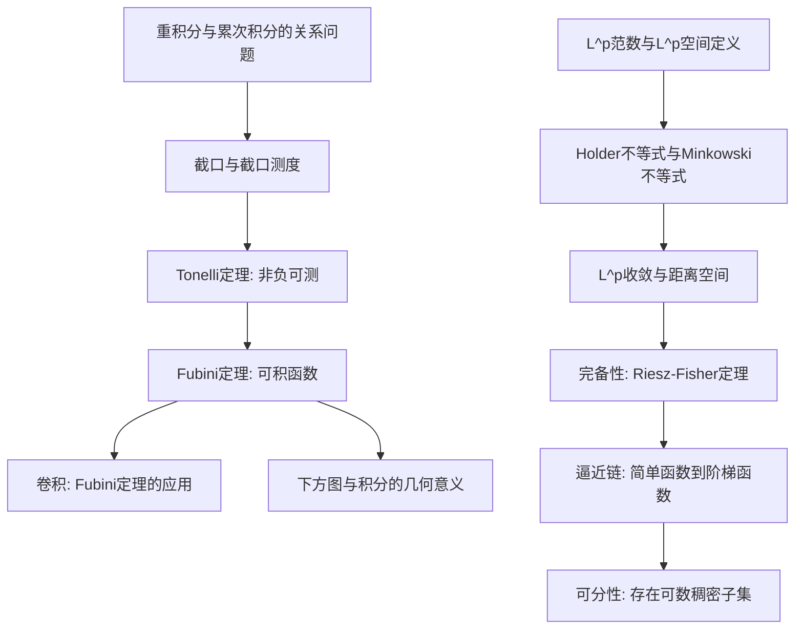
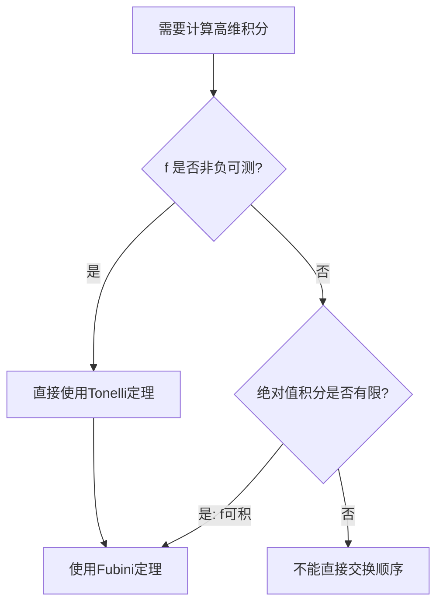
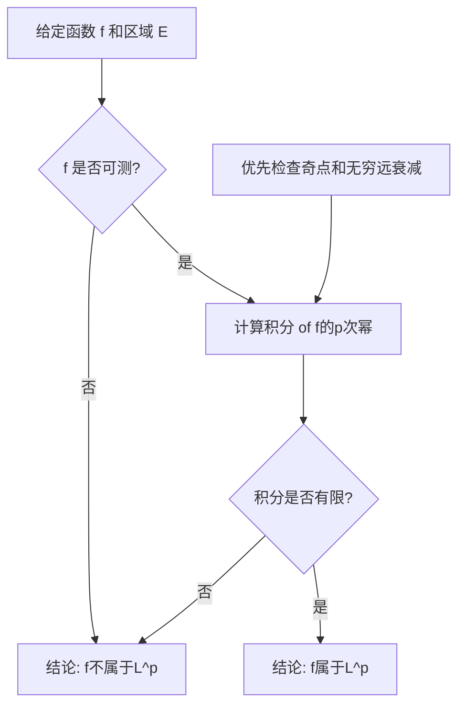

# 第5章 重积分与L^p空间 — 知识点梳理

---

## 一、本章核心脉络

本章解决两个主线问题，二者由 Fubini 定理串联：

1. **多重积分能不能拆成逐次的一重积分来计算？**（重积分与累次积分的关系）
2. **可积函数按 p-范数构成的空间具有怎样的结构？**（$L^p$ 空间的完备性与可分性）

下图展示概念之间的演进关系（自顶向下为逻辑推进方向）：

> 为什么是这个顺序：先通过截口将高维可测集"切片"为低维可测集，建立截口测度定理；然后用"特征函数 → 简单函数 → 非负可测函数上升列 → 一般可积函数"的标准论证路径，得到 Tonelli 和 Fubini 定理。卷积作为 Fubini 定理的直接应用自然引入。之后转入 $L^p$ 空间：先定义范数和空间，再建立 Holder / Minkowski 不等式使 $L^p$ 成为赋范空间，进而讨论距离、收敛、完备性和可分性——这是泛函分析的基本范式。

---

## 二、截口与乘积测度（基础准备）

### 2.1 重积分与累次积分的区别

> 一句话来说：**重积分**是在高维空间上直接定义的整体积分；**累次积分**是先对一个变量积分、再对另一个变量积分，是逐次降维的计算方式。两者的相等不是定义，而是需要定理保证的结论。

在 Riemann 积分框架下，若 $f(x,y): D=[a,b]\times[c,d]\to\mathbb{R}$ 连续（从而 Riemann 可积），且固定任意 $x$ 后关于 $y$ 的函数可积，则有

$$\int_D f(x,y)\,dxdy = \int_a^b \left(\int_c^d f(x,y)\,dy\right)dx.$$

但在 Lebesgue 框架下，问题更为深刻：设 $\mathbb{R}^n = \mathbb{R}^p \times \mathbb{R}^q$（$n=p+q$），$f(x,y)$ 是 $\mathbb{R}^n$ 上的可测函数，需要考虑：

- 重积分 $\int_{\mathbb{R}^n} f(x,y)\,dxdy$ 是否等于累次积分 $\int_{\mathbb{R}^p}dx\int_{\mathbb{R}^q}f(x,y)\,dy$？
- 两个累次积分顺序是否可以交换？

### 2.2 截口的定义

> 一句话来说：截口就是把高维集合沿某个方向"切片"，得到低维截面；特征函数在截口上的行为完美对应。

**定义 3.3.1** 设 $E\subset\mathbb{R}^{p+q}$：

- 对于任意固定的 $x\in\mathbb{R}^p$，称 $E_x = \{y\in\mathbb{R}^q \mid (x,y)\in E\}$ 为 $E$ 的 **$x$ 截口**。
- 对于任意固定的 $y\in\mathbb{R}^q$，称 $E^y = \{x\in\mathbb{R}^p \mid (x,y)\in E\}$ 为 $E$ 的 **$y$ 截口**。

核心观察：$\chi_E(x,y) = \chi_{E_x}(y) = \chi_{E^y}(x)$。这意味着高维特征函数可以拆成低维特征函数的嵌套。

### 2.3 截口测度定理

> 一句话来说：可测集的截口几乎处处可测，截口的测度作为函数可测，且原集合的测度等于截口测度的积分——这是"面积 = 截面长度积分"的精确表述。

**定理 3.3.2** 设 $n=p+q$，$E\in\mathfrak{M}_n$，则：

1. 对几乎处处的 $x\in\mathbb{R}^p$，$E_x\in\mathfrak{M}_q$；
2. $m(E_x)$ 在 $\mathbb{R}^p$ 上几乎处处有定义，且是非负可测函数；
3. $m(E) = \int_{\mathbb{R}^p} m(E_x)\,dx$。

对称地，$m(E) = \int_{\mathbb{R}^q} m(E^y)\,dy$ 也成立。

**证明核心洞察**：证明策略是定义一个满足定理结论的集合类 $\mathfrak{U}$，证明 $\mathfrak{U}=\mathfrak{M}_n$。从矩体出发，逐次扩展到开集、有界闭集、递减可测集列的交、零测集，最后利用"可测集 = Borel 集 + 零测集"的分解得到一般情况。关键的引理是：

**引理 3.3.3** $\mathfrak{U}$ 对以下运算封闭：
1. 有限不交并；
2. 差集（被减集合测度有限）；
3. 上升列的并。

其中 (3) 的证明使用 Levi 定理实现极限与积分的换序：

$$m(E)=\lim m(E_k)=\lim\int_{\mathbb{R}^p}m((E_k)_x)dx \xrightarrow{\text{Levi}}\int_{\mathbb{R}^p}\lim m((E_k)_x)dx=\int_{\mathbb{R}^p}m(E_x)dx.$$

### 2.4 乘积测度

> 一句话来说：两个可测集的笛卡尔积是可测集，其测度等于各自测度的乘积。

**定理 3.3.4** 若 $E_1\in\mathfrak{M}_p$，$E_2\in\mathfrak{M}_q$，则

$$E_1\times E_2\in\mathfrak{M}_n,\quad m(E_1\times E_2)=m(E_1)\,m(E_2).$$

证明利用截口：$(E_1\times E_2)_x$ 当 $x\in E_1$ 时为 $E_2$，否则为空集，再应用定理 3.3.2 即得。

---

## 三、Tonelli 定理与 Fubini 定理（本章核心一）

### 3.1 Tonelli 定理（非负可测情形）

> 一句话来说：对于非负可测函数，重积分和累次积分无条件相等，且积分顺序可任意交换——不需要事先验证可积性。

**定理 3.3.5 (Tonelli 定理)** 设 $n=p+q$，$f(x,y)$ 是 $\mathbb{R}^n$ 上的非负可测函数，则：

1. 对几乎处处的 $x\in\mathbb{R}^p$，$f(x,\cdot)$ 是 $\mathbb{R}^q$ 上的非负可测函数；
2. $F_f(x)=\int_{\mathbb{R}^q}f(x,y)dy$ 在 $\mathbb{R}^p$ 上几乎处处有定义，是非负可测函数；
3. 重积分与累次积分相等：

$$\int_{\mathbb{R}^{p+q}}f(x,y)dxdy = \int_{\mathbb{R}^p}dx\int_{\mathbb{R}^q}f(x,y)dy = \int_{\mathbb{R}^q}dy\int_{\mathbb{R}^p}f(x,y)dx.$$

**证明核心洞察**：用经典的"三部曲"论证：
- 特征函数：由定理 3.3.2，$\chi_E$ 满足结论；
- 非负可测简单函数：由积分的线性性，结论仍成立；
- 一般非负可测函数：将 $f$ 表为非负可测简单函数上升列的极限，用 Levi 定理取极限即得。

事实上，Tonelli 定理与定理 3.3.2 是等价的——取 $f=\chi_E$ 即可互推。

### 3.2 Fubini 定理（可积情形）

> 一句话来说：如果函数 Lebesgue 可积，重积分同样等于累次积分且可交换顺序——把函数拆成正部和负部分别用 Tonelli 定理处理。

**定理 3.3.6 (Fubini 定理)** 若 $f\in L(\mathbb{R}^n)$（即 $f$ 在 $\mathbb{R}^n$ 上 Lebesgue 可积），则：

1. 对几乎处处的 $x\in\mathbb{R}^p$，$f(x,\cdot)$ 是 $\mathbb{R}^q$ 上的可测函数；
2. $F_f(x)=\int_{\mathbb{R}^q}f(x,y)dy$ 在 $\mathbb{R}^p$ 上几乎处处有定义，且可积；
3. 重积分与累次积分相等，且可交换顺序：

$$\int_{\mathbb{R}^{p+q}}f(x,y)dxdy = \int_{\mathbb{R}^p}dx\int_{\mathbb{R}^q}f(x,y)dy = \int_{\mathbb{R}^q}dy\int_{\mathbb{R}^p}f(x,y)dx.$$

**证明核心洞察**：令 $f=f^+-f^-$，$f^+$ 和 $f^-$ 都是非负可测函数。由 Tonelli 定理，$f^+$ 和 $f^-$ 各自满足定理中的 (1)(2)(3)，且积分均为有限（因为 $f$ 可积）。将对应的等式相减，即得 $f$ 也满足结论。

**[!warning] Tonelli vs Fubini 的使用策略**

| | Tonelli 定理 | Fubini 定理 |
|---|---|---|
| 条件 | $f\geq 0$ 且可测 | $f$ 可积（$|f|$ 积分有限） |
| 是否需要先验证可积性 | **不需要** | **需要** |
| 典型用法 | 先对 $|f|$ 用 Tonelli 验证可积性 | 验证可积后用以交换积分次序 |

> 实用口诀：**先用 Tonelli 验可积，再用 Fubini 换顺序。**

---

## 四、卷积——Fubini 定理的应用

### 4.1 卷积的定义

> 一句话来说：卷积是两个函数在平移和加权下的"重叠积分"，是信号处理、微分方程和概率论中最核心的运算之一。

**定义** 设 $f(x)$ 和 $g(x)$ 是 $\mathbb{R}^n$ 上的可测函数，若积分

$$\int_{\mathbb{R}^n}f(x-y)g(y)dy$$

存在，则称该积分为 $f$ 和 $g$ 的**卷积**，记为 $f*g(x)$：

$$f*g(x)=\int_{\mathbb{R}^n}f(x-y)g(y)dy.$$

**交换性**：通过平移变换 $x-y=z$ 可得

$$f*g(x)=\int_{\mathbb{R}^n}f(x-y)g(y)dy=\int_{\mathbb{R}^n}f(z)g(x-z)dz=g*f(x).$$

### 4.2 卷积的可积性

> 一句话来说：两个可积函数的卷积不仅几乎处处存在，而且也是可积函数，其 $L^1$ 范数不超过各自 $L^1$ 范数的乘积。

**定理 3.3.7** 设 $f,g\in L(\mathbb{R}^n)$，则：

1. 卷积 $f*g(x)$ 对几乎处处的 $x\in\mathbb{R}^n$ 存在；
2. $f*g\in L(\mathbb{R}^n)$；
3. $\int_{\mathbb{R}^n}|f*g(x)|dx \leq \int_{\mathbb{R}^n}|f(x)|dx \cdot \int_{\mathbb{R}^n}|g(x)|dx.$

**证明核心洞察**：先考虑 $f,g\geq 0$ 的情形。$f(x-t)g(t)$ 是 $\mathbb{R}^n\times\mathbb{R}^n$ 上的非负可测函数，由 Tonelli 定理：

$$\begin{aligned}
\int_{\mathbb{R}^n}dx\int_{\mathbb{R}^n}f(x-t)g(t)dt
&= \int_{\mathbb{R}^n}dt\int_{\mathbb{R}^n}f(x-t)g(t)dx \\
&= \int_{\mathbb{R}^n}g(t)dt\int_{\mathbb{R}^n}f(x-t)dx \\
&= \int_{\mathbb{R}^n}g(t)dt\int_{\mathbb{R}^n}f(x)dx < \infty.
\end{aligned}$$

对于一般可积函数，利用 $|f*g|\leq |f|*|g|$ 归约到非负情形。

---

## 五、积分的几何意义：下方图

### 5.1 图像与下方图

> 一句话来说：积分就是函数图像下方区域的"体积"——下方图的可测性等价于函数的可测性，下方图的测度等于函数的积分。

**定义** 给定 $E\in\mathfrak{M}_n$，$f(x)$ 是 $E$ 上的非负实值函数：

- **图像**：$\Gamma_E(f)=\{(x,y)\in\mathbb{R}^{n+1}\mid x\in E,\;y=f(x)\}$（$n+1$ 维空间中的曲面）
- **下方图**：$G(f)=\{(x,y)\in\mathbb{R}^{n+1}\mid x\in E,\;0\leq y\leq f(x)\}$（曲面下方与 $E$ 围成的柱体）

### 5.2 下方图定理

**定理 3.3.7（几何形式）** 给定 $E\in\mathfrak{M}_n$，$f(x)$ 是 $E$ 上的非负实值函数：

1. 若 $f(x)$ 可测，则 $\Gamma_E(f), G(f)\in\mathfrak{M}_{n+1}$，$m(\Gamma_E(f))=0$，$m(G(f))=\int_E f(x)dx$。
2. 若 $G(f)\in\mathfrak{M}_{n+1}$，则 $f(x)$ 可测，且 $m(G(f))=\int_E f(x)dx$。

> 这一定理揭示了**集合的可测性与函数的可测/可积性之间的深刻联系**。

**证明核心洞察**：
- 证明 $m(\Gamma_E(f))=0$：用分层逼近。令 $E_k=\{x\in E\mid k\delta\leq f(x)<(k+1)\delta\}$，则 $m^*(\Gamma_E(f))\leq\delta\cdot m(E)$。令 $\delta\to 0$ 得证。
- 对特征函数结论显然成立，进而对简单函数成立；一般可测函数用简单函数上升列和 Levi 定理取极限。
- 逆方向利用截口定理：$H=G(f)$ 的 $x$ 截口 $H(x)=[0,f(x)]$，故 $m(H(x))=f(x)$；由 $H$ 的可测性和定理 3.3.2 得 $f$ 可测。

---

## 六、$L^p$ 空间的定义与基本概念

### 6.1 $L^p$ 范数与 $L^p$ 空间

> 一句话来说：$L^p$ 范数衡量一个函数的"p 次平均大小"，$L^p$ 空间就是所有 p 次幂可积函数的集合。

**定义 4.1.1** 设 $E$ 是 $\mathbb{R}^n$ 中的可测集。

(1) 对 $1\leq p<\infty$，设 $f$ 是 $E$ 上的可测函数，定义

$$\|f\|_p = \left(\int_E |f(x)|^p dx\right)^{1/p},$$

称 $\|f\|_p$ 为 $f$ 的 **$L^p$ 范数**。令

$$L^p(E) = \{f\in\mathfrak{M}(E)\mid \|f\|_p<\infty\},$$

称 $L^p(E)$ 为 $E$ 上的 **$L^p$ 空间**。

(2) 设 $f\in\mathfrak{M}(E)$，若存在 $M>0$ 使得 $|f(x)|\leq M\text{ a.e. }[E]$，则称 $f$ **本性有界**。对所有这样的 $M$ 取下确界，记为 $\|f\|_\infty$，称为 $f$ 的**本性上界**。定义

$$L^\infty(E) = \{f\in\mathfrak{M}(E)\mid \|f\|_\infty<\infty\}.$$

> **关联**：$L(E)=L^1(E)$ 即之前学习的 Lebesgue 可积函数空间。$L^p$ 空间是 $L^1$ 的自然推广。

### 6.2 共轭指数

> 一句话来说：共轭指数对 $(p,q)$ 满足 $1/p+1/q=1$，是 Holder 不等式中的天然配对。

**定义**：$1\leq p,q\leq\infty$ 满足 $p^{-1}+q^{-1}=1$，则称 $p,q$ 为**共轭指数**。

| $p$ | $q$ | 备注 |
|---|---|---|
| $1$ | $\infty$ | 极端情形 |
| $2$ | $2$ | 自共轭（Hilbert 空间情形） |
| $3$ | $3/2$ | — |
| $p\in(1,\infty)$ | $q=p/(p-1)$ | 一般公式 |

### 6.3 判断函数是否属于 $L^p$ 的典型例题

课件中给出了三组例题，要求判断函数是否属于 $L^p(E)$ 以及 $p$ 的取值范围。

**例 1**：$E=(0,1)$，考察以下函数是否属于 $L^p(E)$：

| 函数 | 分析思路 |
|---|---|
| $f(x)=1$ | $\|f\|_p=1$，属于所有 $L^p$ |
| $f(x)=\sin x$ | 有界，属于所有 $L^p$ |
| $f(x)=x^{-3/2}$ | 在 $0$ 附近爆炸，需要 $p\cdot 3/2<1$ 即 $p<2/3$ |
| $f(x)=\log x$ | 对数奇性比幂函数弱，属于所有 $L^p$ |
| $f(x)=\chi_{(0,n)}(x)$ | 特征函数，属于所有 $L^p$ |
| $f(x)=\frac{1}{\sqrt{x}(1+x^{3/2})}$ | 在 $0$ 附近行为像 $x^{-1/2}$，需 $p/2<1$ 即 $p<2$ |
| $f(x)=\chi_{(0,n)}(x)\sin x$ | 有界且紧支，属于所有 $L^p$ |
| $f(x)=e^{-x}$ | 在有限区间上有界，属于所有 $L^p$ |

**例 2**：$E=(0,\infty)$，同样的函数，此时需同时考虑 $0$ 和 $\infty$ 处的行为。

对 $f(x)=x^{-3/2}$，$E=(0,\infty)$，需同时检查原点和无穷远：无穷远处要求 $\frac{3p}{2}>1$，原点附近要求 $\frac{3p}{2}<1$，两者不可能同时满足，故不存在使其属于 $L^p(0,\infty)$ 的有限指数 $p\geq1$。

**例 3**：$E=(0,\infty)\times(0,\infty)$，$x=(x_1,x_2)$，$|x|=\sqrt{x_1^2+x_2^2}$，考察类似函数在二维区域上的 $L^p$ 性质。高维时需用极坐标变换判断。

> **判定要领**：判断 $f\in L^p(E)$，核心是检查 $\int_E|f|^p$ 是否有限。需关注奇点（如 $0$）和无穷远处的衰减速度。

---

## 七、Holder 不等式与 Minkowski 不等式（本章核心二）

### 7.1 Holder 不等式

> 一句话来说：乘积的 $L^1$ 范数不超过各自 $L^p$ 和 $L^q$ 范数的乘积——这是 $L^p$ 空间理论的基石不等式。

**定理 4.1.2 (Holder 不等式)** 设 $E\in\mathfrak{M}_n$，$1\leq p,q\leq\infty$，$p^{-1}+q^{-1}=1$。若 $f\in L^p(E)$，$g\in L^q(E)$，则

$$\|fg\|_1 \leq \|f\|_p\|g\|_q.$$

等价形式：

$$\int_E |f(x)g(x)|dx \leq \left(\int_E |f(x)|^p dx\right)^{1/p}\left(\int_E |g(x)|^q dx\right)^{1/q}.$$

积分形式：

$$\left|\int_E f(x)g(x)dx\right| \leq \int_E |f(x)g(x)|dx \leq \|f\|_p\|g\|_q.$$

**证明核心洞察**：
- $p=1,q=\infty$ 时显然成立：$\|fg\|_1\leq\|g\|_\infty\|f\|_1$。
- $1<p,q<\infty$ 时，当 $\|f\|_p=0$ 或 $\|g\|_q=0$ 时平凡。否则利用 **Young 不等式**（由 $\ln x$ 的上凸性导出）：

$$a^{1/p}b^{1/q} \leq \frac{a}{p}+\frac{b}{q}\quad(a,b>0).$$

取 $a=\frac{|f(x)|^p}{\|f\|_p^p}$，$b=\frac{|g(x)|^q}{\|g\|_q^q}$，代入积分即得：

$$\frac{1}{\|f\|_p^p\|g\|_q^q}\int_E |fg|dx \leq \frac{1}{p}+\frac{1}{q}=1.$$

### 7.2 Schwarz 不等式（特殊情形）

> 一句话来说：$p=q=2$ 时的 Holder 不等式就是 Cauchy-Schwarz 不等式的积分版本。

当 $p=q=2$ 时，Holder 不等式退化为 **Schwarz 不等式**：

$$\left|\int_E f(x)g(x)dx\right| \leq \left(\int_E |f(x)|^2 dx\right)^{1/2}\left(\int_E |g(x)|^2 dx\right)^{1/2} = \|f\|_2\|g\|_2.$$

### 7.3 Minkowski 不等式（$L^p$ 范数的三角不等式）

> 一句话来说：和的 $L^p$ 范数不超过各自 $L^p$ 范数之和——这就是积分形式的三角不等式。

**定理 4.1.4** $L^p$ 范数满足以下"范数公理"：对任意 $\alpha\in\mathbb{R}$，$f,g\in L^p(E)$，

1. **齐次性**：$\|\alpha f\|_p = |\alpha|\|f\|_p$；
2. **三角不等式（Minkowski 不等式）**：$\|f+g\|_p \leq \|f\|_p+\|g\|_p$；
3. **正定性**：$\|f\|_p\geq 0$，且 $\|f\|_p=0 \iff f=0\text{ a.e.}[E]$。

**Minkowski 不等式的证明核心洞察**（以 $1<p<\infty$ 为例）：

$$\begin{aligned}
\|f+g\|_p^p &= \int_E |f+g|^p dx = \int_E |f+g|^{p-1}|f+g|dx \\
&\leq \int_E |f+g|^{p-1}|f|dx + \int_E |f+g|^{p-1}|g|dx.
\end{aligned}$$

对第一项用 Holder 不等式（注意 $(p-1)q=p$，因为 $q=p/(p-1)$）：

$$\int_E |f+g|^{p-1}|f|dx \leq \left(\int_E |f+g|^{(p-1)q}\right)^{1/q}\left(\int_E |f|^p\right)^{1/p} = \|f+g\|_p^{p-1}\|f\|_p.$$

同理处理第二项，合并即得 $\|f+g\|_p^p \leq \|f+g\|_p^{p-1}(\|f\|_p+\|g\|_p)$，约去公因子即证。

---

## 八、$L^p$ 范数的对偶刻画与范数性质

### 8.1 有限测度集上 $L^p$ 空间的包含关系

> 一句话来说：在测度有限的集合上，高指数 $L^p$ 空间"更小"——p 越大，对函数的限制越强。

**命题 4.1.3** 若 $m(E)<\infty$，则：

1. 当 $p_1<p_2$ 时，$L^{p_2}(E)\subset L^{p_1}(E)$。且有不等式：

$$\|f\|_{p_1} \leq m(E)^{\frac{1}{p_1}-\frac{1}{p_2}}\|f\|_{p_2}.$$

2. $\lim_{p\to\infty}\|f\|_p = \|f\|_\infty$（对任意 $f\in L^\infty(E)$）。

**证明核心洞察**：
- (1) 令 $r=p_2/p_1>1$，用 Holder 不等式：$\int|f|^{p_1}\cdot 1 \leq (\int|f|^{p_1 r})^{1/r}(\int 1^{r'})^{1/r'}$。
- (2) 一方面 $\|f\|_p\leq M\cdot m(E)^{1/p}$（$M=\|f\|_\infty$），取上极限 $\leq M$。另一方面，对任意 $M'<M$，集合 $A=\{|f|>M'\}$ 有正测度，$\|f\|_p\geq M'\cdot m(A)^{1/p}$，取下极限 $\geq M'$。由 $M'$ 的任意性得 $\lim\|f\|_p=M$。

### 8.2 $L^p$ 范数的对偶刻画

> 一句话来说：$L^p$ 范数可以通过与 $L^q$ 函数（共轭指数）的内积来定义——这是泛函分析中对偶理论的起点。

**定理 4.1.5** 设 $f\in L^p(E)$（$1\leq p<\infty$），$p^{-1}+q^{-1}=1$，则存在 $g\in L^q(E)$，$\|g\|_q=1$，使得

$$\|f\|_p = \int_E f(x)g(x)dx.$$

从而有对偶刻画：

$$\|f\|_p = \sup_{\|g\|_q=1}\left\{\int_E f(x)g(x)dx\right\} = \sup_{g\in L^q(E), g\neq 0}\frac{\int_E f(x)g(x)dx}{\|g\|_q}.$$

**证明核心洞察**：
- $p=1$ 时取 $g(x)=\operatorname{sign}f(x)$，则 $\|g\|_\infty=1$，$\int fg=\int|f|=\|f\|_1$。
- $1<p<\infty$ 时取 $g(x)=\frac{|f(x)|^{p-1}}{\|f\|_p^{p-1}}\operatorname{sign}f(x)$，可验证 $\|g\|_q=1$ 且 $\int fg=\|f\|_p$（关键：$q(p-1)=p$）。

**$L^\infty$ 的对偶刻画**：对任意 $f\in L^\infty(E)$，

$$\|f\|_\infty = \sup_{\|g\|_1=1}\left\{\int_E f(x)g(x)dx\right\}.$$

> **注意**：$L^\infty$ 情形下等号不一定能取到。例如 $E=[0,1]$，$f(x)=x$，$\|f\|_\infty=1$，但对任意 $g\in L^1$，$\int_0^1 x|g|dx < \int_0^1|g|dx=\|g\|_1$（严格小于）。

---

## 九、$L^p$ 收敛与距离结构

### 9.1 $L^p$ 空间是距离空间

> 一句话来说：用 $\|f-g\|_p$ 作为两个函数之间的距离，$L^p$ 空间就成为一个距离空间——可以讨论极限和收敛了。

**定理 4.1.7** 对任意 $f,g\in L^p(E)$，定义 $d(f,g)=\|f-g\|_p$（$1\leq p\leq\infty$），则 $(L^p(E), d)$ 是一个**距离空间**。

验证距离的三条公理：
1. **正定性**：$d(f,g)=0 \iff f=g\text{ a.e.}[E]$；
2. **对称性**：$d(f,g)=d(g,f)$ 显然成立；
3. **三角不等式**：由 Minkowski 不等式，$\|f-g\|_p=\|(f-h)+(h-g)\|_p\leq\|f-h\|_p+\|h-g\|_p$。

> **概念辨析**：范数是向量"长度"的推广（满足齐次性、三角不等式、正定性）；距离是两点间"远近"的度量（满足正定性、对称性、三角不等式）。范数可以导出距离（$d(f,g)=\|f-g\|$），但距离不一定来自范数。在 $\mathbb{R}^n$ 中，向量的模是范数，两点间欧氏距离由范数导出。

### 9.2 $L^p$ 收敛

> 一句话来说：函数列按 p 次平均意义下逼近极限函数。

**定义 4.1.8** 设 $f_m\in L^p(E)$（$m=1,2,\cdots$）。若存在 $f\in L^p(E)$ 使得

$$\lim_{m\to\infty}d(f_m,f)=\lim_{m\to\infty}\|f_m-f\|_p=0,$$

则称 $\{f_m\}$ 依 $L^p$ 意义收敛于 $f$，记作

$$f_m\xrightarrow{L^p}f \quad\text{或}\quad L^p\text{-}\lim_{m\to\infty}f_m=f.$$

**特例**：
- $p=1$：**平均收敛**
- $p=2$：**均方收敛**
- 一般 $1\leq p<\infty$：**p 次平均收敛**

### 9.3 $L^p$ 收敛的基本性质

1. **极限唯一**：若 $f_m\xrightarrow{L^p}f$ 且 $f_m\xrightarrow{L^p}g$，则 $f=g\text{ a.e.}[E]$。
2. **范数收敛**：若 $f_m\xrightarrow{L^p}f$，则 $\{\|f_m\|_p\}$ 有界且 $\lim\|f_m\|_p=\|f\|_p$。
3. **线性性**：若 $f_m\xrightarrow{L^p}f$，$g_m\xrightarrow{L^p}g$，则 $f_m\pm g_m\xrightarrow{L^p}f\pm g$，$\alpha g_m\xrightarrow{L^p}\alpha g$。

### 9.4 $L^p$ 收敛与依测度收敛的关系

> 一句话来说：$L^p$ 收敛蕴含依测度收敛——平均意义上的逼近比测度意义上的逼近更强。

**定理 4.1.9** 设 $f_m,f\in L^p(E)$（$1\leq p<\infty$）。若 $f_m\xrightarrow{L^p}f$，则 $\{f_m\}$ 依测度收敛于 $f$。

**证明核心洞察**：对任意 $\varepsilon>0$，令 $E_m(\varepsilon)=\{x\in E\mid |f_m(x)-f(x)|>\varepsilon\}$，则

$$\varepsilon\cdot m(E_m(\varepsilon))^{1/p} = \left(\int_{E_m(\varepsilon)}\varepsilon^p dx\right)^{1/p} \leq \left(\int_{E_m(\varepsilon)}|f_m-f|^p dx\right)^{1/p} \leq \|f_m-f\|_p\to 0.$$

### 9.5 $L^p$ 控制收敛定理

> 一句话来说：如果有可积的控制函数，那么几乎处处收敛（或依测度收敛）就能推出 $L^p$ 收敛。

**定理 4.1.10 ($L^p$ 控制收敛定理)** 设 $E\in\mathfrak{M}_n$，$f,f_m\in\mathfrak{M}(E)$，且 $f_m\to f\text{ a.e.}[E]$ 或 $f_m\xrightarrow{m}f$（依测度收敛）。若存在 $g\in L^p(E)$（$1\leq p<\infty$）使得

$$|f_m(x)|\leq g(x)\text{ a.e.}[E],\quad m=1,2,\cdots,$$

则 $f_m\xrightarrow{L^p}f$。

**证明核心洞察**：令 $h_m=|f_m-f|^p$，则 $h_m\to 0$ a.e.（或依测度），且 $|h_m|\leq(|f_m|+|f|)^p\leq 2^p g^p\in L^1$。由 Lebesgue 积分控制收敛定理：

$$\lim_{m\to\infty}\|f-f_m\|_p^p = \lim_{m\to\infty}\int_E h_m dx = \int_E \lim_{m\to\infty} h_m dx = 0.$$

---

## 十、$L^p$ 空间的完备性（难点）

### 10.1 完备性的意义

> 一句话来说：完备意味着每一个"看起来应收敛"的序列（基本列/柯西列）确实收敛到空间内的某个元素——没有"缺失的极限点"。

**类比**：
- $\mathbb{R}^n$ 是完备的（柯西列必收敛）
- $\mathbb{Q}$（有理数）不完备：有理数的柯西列可能收敛于无理数，$\overline{\mathbb{Q}}=\mathbb{R}$（实数是 $\mathbb{Q}$ 的完备化）
- $\mathcal{R}[a,b]$（黎曼可积函数空间）在 $L^1$ 范数下不完备：课件中构造了黎曼可积函数的基本列，其极限函数在每个小区间上无界、黎曼上积分为无穷，不属于 $\mathcal{R}$

### 10.2 基本列

**定义 4.1.11** 设 $\{f_m\}\subset L^p(E)$（$1\leq p\leq\infty$）。若

$$\lim_{k,m\to\infty}\|f_k-f_m\|_p = 0,$$

则称 $\{f_m\}$ 是 $L^p(E)$ 中的**基本列**（柯西列）。

> 收敛列必是基本列：$\|f_k-f_m\|_p\leq\|f_k-f\|_p+\|f_m-f\|_p\to 0$。

### 10.3 Riesz-Fisher 定理（$L^p$ 完备性）

> 一句话来说：$L^p$ 空间对任何 $1\leq p\leq\infty$ 都是完备的——这是 $L^p$ 空间最重要的结构性质。

**定理 4.1.12** 设 $E\in\mathfrak{M}$，$\{f_m\}$ 是 $L^p(E)$ 中的基本列，则 $\{f_m\}$ 必是收敛列（即存在 $f\in L^p(E)$ 使得 $f_m\xrightarrow{L^p}f$）。

**证明核心洞察**：

**情形一：$1\leq p<\infty$**

1. 由 $\|f_m-f_k\|_p\to 0$，可证 $\{f_m\}$ 是**测度基本列**（定义 2.3.8：$\lim_{k,m\to\infty}m(\{|f_m-f_k|>\varepsilon\})=0$）。
2. 由定理 2.3.9，$\{f_m\}$ 依测度收敛于某几乎处处有限的函数 $f$。
3. 由 **Riesz 定理**（定理 2.3.7），存在子列 $\{f_{m_i}\}$ 几乎处处收敛于 $f$。
4. 用 **Fatou 引理**（定理 3.2.3）：

$$\int_E |f_m-f|^p dx = \int_E \lim_{i\to\infty}|f_m-f_{m_i}|^p dx \leq \varliminf_{i\to\infty}\int_E |f_m-f_{m_i}|^p dx.$$

两边对 $m\to\infty$ 取极限即得 $\|f_m-f\|_p\to 0$。由 $\|f\|_p\leq\|f-f_m\|_p+\|f_m\|_p$ 知 $f\in L^p(E)$。

**情形二：$p=\infty$**

1. 由 $\|f_k-f_m\|_\infty\to 0$，存在零测集 $Z$ 使得对所有 $x\in E\setminus Z$，$|f_k(x)-f_m(x)|\leq\|f_k-f_m\|_\infty$。
2. 对每个 $x\in E\setminus Z$，$\{f_k(x)\}$ 是实数柯西列，故收敛，记极限为 $f(x)$。
3. 可证 $f_m$ 依 $L^\infty$ 收敛于 $f$：对任意 $\varepsilon>0$，当 $k,m>K$ 时 $\|f_k-f_m\|_\infty<\varepsilon$；固定 $k>K$，$|f_k(x)-f(x)|=\lim_m|f_k(x)-f_m(x)|\leq\varepsilon$。

**推论 4.1.13** 若 $f_m\xrightarrow{L^p}f$（$1\leq p<\infty$），则 $\{f_m\}$ 存在子列几乎处处收敛于 $f$。

### 10.4 黎曼可积函数空间的不完备性（补充说明）

课件中给出了一个反例：设 $\mathcal{Q}=\{r_n\}_{n=1}^\infty$ 是 $[a,b]$ 中的有理数集。取开区间 $\delta_n\ni r_n$ 使得 $\sum m(\delta_n)<\infty$。令

$$f_n(x)=\sum_{i=1}^n \chi_{\delta_i}(x),\quad f(x)=\sum_{i=1}^\infty \chi_{\delta_i}(x).$$

- 每个 $f_n\in\mathcal{R}$（有限个特征函数之和，黎曼可积）
- $\|f_n-f\|_{L^1}\to 0$，故 $\{f_n\}$ 是 $\mathcal{R}$ 中的 $L^1$ 基本列
- 但 $f\notin\mathcal{R}$：在每个 $\delta_i$ 的交集中 $f$ 无界（可以构造让 $f(r_n)\geq n$），黎曼上积分无穷

> 这说明了 $L^p$ 完备性理论的必要性：$\mathcal{R}$ 不完备，需要更大的 $L^p$ 空间来容纳所有极限。

---

## 十一、$L^p$ 空间的逼近链与可分性（难点）

### 11.1 可分空间的概念

> 一句话来说：可分空间就是存在一个可数的"骨架"（稠密子集），空间中每个元素都可以用骨架中的元素任意逼近。

**动机**：工程计算中（如有限元方法）用分片多项式逼近连续函数。自然的问题：$L^p(E)$ 中是否存在可数的稠密子集？

**定义 4.1.14** 设 $\mathcal{F}\subset L^p(E)$。若对任意 $f\in L^p(E)$ 和 $\varepsilon>0$，总存在 $g\in\mathcal{F}$ 使得 $\|f-g\|_p<\varepsilon$，则称 $\mathcal{F}$ 在 $L^p(E)$ 中**稠密**（每个 $f\in L^p(E)$ 可用 $\mathcal{F}$ 中的函数 **$L^p$ 逼近**）。

等价表述：$\mathcal{F}$ 稠密 $\iff$ $\forall f\in L^p(E)$，$\exists\{f_n\}\subset\mathcal{F}$ 使得 $f_n\xrightarrow{L^p}f$。

若 $L^p(E)$ 中存在**可数**稠密子集，则称 $L^p(E)$ 是**可分的**。

**经典例子**：

1. **$\mathbb{Q}$ 在 $\mathbb{R}$ 中稠密**：任意实数都可用有理数列逼近。例如 $\sqrt{2}$ 的有理逼近：
   - 牛顿迭代：$x_1=1$，$x_{n+1}=x_n/2+1/x_n$，可证 $x_n\to\sqrt{2}$
   - 十进制展开：$1.4, 1.41, 1.414, 1.4142, \cdots$

2. **有理多项式在连续函数空间中稠密**（Weierstrass 逼近定理）：对任意 $f\in C[0,1]$，存在有理系数多项式列 $\{p_n\}\subset\mathcal{P}[0,1]$ 一致逼近 $f$。如 $e^x$ 的 Taylor 展开：

$$e^x = \sum_{n=0}^\infty \frac{x^n}{n!} = 1+x+\frac{x^2}{2!}+\frac{x^3}{3!}+\cdots$$

### 11.2 三层逼近链

课件建立了 $L^p$ 空间中一条完整的逼近链，逐步"缩减"逼近函数的复杂度。

> **注 4**（逼近的传递性）：设 $\mathcal{F},\mathcal{G}\subset L^p(E)$。记由 $\mathcal{G}$ 中元素的有限线性组合全体构成的向量空间为 $H$。若 $H$ 在 $L^p(E)$ 中稠密，且 $\mathcal{G}$ 中每个元可用 $\mathcal{F}$ 中的函数 $L^p$ 逼近，当 $\mathcal{F}$ 是向量空间时，$\mathcal{F}$ 也在 $L^p(E)$ 中稠密。

#### 第一层：简单可测函数逼近

**定理 4.1.15** 每个 $f\in L^p(E)$ 可用简单可测函数列 $L^p$ 逼近。

> 对任意 $f\in L^p(E)$，存在可测简单函数列 $\{\psi_n\}$ 使得 $\psi_n\to f$ 且 $|\psi_n|\leq|f|$，由 $L^p$ 控制收敛定理得 $\psi_n\xrightarrow{L^p}f$。

**但简单可测函数集本身不可数**（可测集太多），不能直接用来证明可分性。

#### 第二层：紧支集连续函数逼近

**定理 4.1.16** 设 $E\subset\mathbb{R}^n$ 可测，则每个 $f\in L^p(E)$ 可用 $C_c(\mathbb{R}^n)$（具有紧支集的连续函数）中的函数 $L^p$ 逼近。

其中 $C_c(\mathbb{R}^n) = \{f\in C(\mathbb{R}^n)\mid \exists\text{紧集}A\subset\mathbb{R}^n,\; f|_{\mathbb{R}^n\setminus A}=0\}$。

**证明核心洞察**：由定理 4.1.15 和注 4，只需对 $f=\chi_A$（$m(A)<\infty$）的情形证明。对任意 $\varepsilon>0$，存在紧集 $F$ 和开集 $G$ 满足 $F\subset A\subset G$，$m(G\setminus F)<\varepsilon$。构造连续函数

$$g(x)=\frac{d(x,K)}{d(x,F)+d(x,K)},$$

其中 $K=(B\cap G)^c$（$B$ 是包含 $F$ 的开球）。则 $0\leq g\leq 1$，$g|_K=0$，$g|_F=1$，$g\in C_c(\mathbb{R}^n)$，且

$$\int_E|\chi_A(x)-g(x)|^p dx \leq m(G\setminus F) < \varepsilon.$$

> 关键技巧：用**点与集合的距离函数** $d(x,M)=\inf\{\|x-y\|\mid y\in M\}$ 来构造平滑的"过渡函数"。当 $M$ 是闭集时，$d(x,M)=0\iff x\in M$。

#### 第三层：紧支集阶梯函数逼近

**定理 4.1.17** 设 $E\subset\mathbb{R}^n$ 可测，则每个 $f\in L^p(E)$ 可用 $\mathbb{R}^n$ 上具有紧支集的**阶梯函数** $L^p$ 逼近。

阶梯函数形如 $\phi(x)=\sum_{i=1}^N c_i\chi_{I_i}(x)$，其中 $I_i$ 是长方体。

**证明核心洞察**：由定理 4.1.16，存在 $g\in C_c(\mathbb{R}^n)$ 使 $\|f-g\|_p<\varepsilon/2$。设 $\operatorname{supp}g$ 包含在闭方体 $I$ 内（边长为 $2k$）。$g$ 在紧集 $I$ 上**一致连续**，因此可用二进方体划分 $I$，在每个小方体 $I_i$ 上取 $g$ 在中心 $x_i$ 的值 $c_i=g(x_i)$，构造阶梯函数

$$\phi(x)=\sum_{i=1}^N c_i\chi_{I_i}(x).$$

由一致连续性，可取足够细的划分使得 $|g(x)-\phi(x)|<\frac{1}{(2k)^{n/p}}\frac{\varepsilon}{2}$，从而 $\|g-\phi\|_p<\varepsilon/2$。最终 $\|f-\phi\|_p<\varepsilon$。

### 11.3 $L^p$ 空间的可分性

**定理 4.1.18** 设 $E\subset\mathbb{R}^n$ 可测。对任意 $1\leq p<\infty$，$L^p(E)$ 是**可分空间**。

**证明核心洞察**：逼近链 $"$阶梯函数 $\to$ 连续函数 $\to$ 简单函数 $\to$ $L^p$"$ 已经建立了逼近关系，但阶梯函数集本身并不可数（系数可取任意实数）。关键一步是**将系数限制为有理数**：

设 $\phi(x)=\sum_{i=1}^N c_i\chi_{I_i}(x)$ 是逼近 $f$ 的阶梯函数。不妨设 $|c_i|<M$，$m(I_i)<M^p$。取有理数 $r_i$ 满足 $|r_i|<M$ 且 $|c_i-r_i|<\frac{\varepsilon}{2NM}$。令

$$\psi(x)=\sum_{i=1}^N r_i\chi_{I_i}(x).$$

则

$$\|\phi-\psi\|_p \leq \sum_{i=1}^N |r_i-c_i|\|\chi_{I_i}\|_p < \frac{\varepsilon}{2NM}\sum_{i=1}^N m(I_i)^{1/p} < \frac{\varepsilon}{2}.$$

于是 $\|f-\psi\|_p<\varepsilon$。形如 $\psi(x)=\sum_{i=1}^N r_i\chi_{I_i}(x)$（$r_i$ 为有理数，$I_i$ 为二进方体）的阶梯函数全体 $\Gamma$ 是**可数集**，且 $\Gamma$（限制在 $E$ 上）是 $L^p(E)$ 的可数稠密子集。

### 11.4 $L^\infty$ 的不可分性

**注 6**：$L^\infty[0,1]$ 是**不可分的**。

**证明**：令 $\phi_t=\chi_{[0,t]}$（$0\leq t\leq 1$），则集合 $\mathcal{A}=\{\phi_t\mid 0\leq t\leq 1\}$ 不可数，且

$$\|\phi_t-\phi_s\|_\infty = 1\quad(\forall s\neq t).$$

对任意稠密子集 $B$，取 $f_t\in B$ 满足 $\|f_t-\phi_t\|_\infty<1/2$。当 $t\neq s$ 时，

$$\|f_t-f_s\|_\infty \geq \|\phi_t-\phi_s\|_\infty - \|f_t-\phi_t\|_\infty - \|f_s-\phi_s\|_\infty > 1-1/2-1/2=0,$$

故 $f_t\neq f_s$。因此 $B$ 不可数——不存在可数稠密子集。

### 11.5 $L^p$ 范数的积分测试刻画（补充定理）

**定理 4.1.19** 设 $f(x)$ 是 $E$ 上的可测函数。若存在常数 $M>0$，使得对一切 $E$ 上的可积简单函数 $\phi(x)$，都有

$$\left|\int_E f(x)\phi(x)dx\right| \leq M\|\phi\|_q,$$

则 $f\in L^p(E)$ 且 $\|f\|_p\leq M$（其中 $p^{-1}+q^{-1}=1$）。

**证明核心洞察**：
- $q>1$ 时：构造非负可测简单函数上升列 $\{\phi_k\}$ 收敛于 $|f|^p$。令 $\psi_k=(\phi_k)^{1/q}\operatorname{sign}f(x)$，则 $0\leq\phi_k\leq\psi_k f$。由假设条件可导出 $\int\phi_k\leq M^p$，用 Levi 定理取极限得 $\int|f|^p\leq M^p$。
- $q=1$（$p=\infty$）时用反证法：若 $f\notin L^\infty$，可取 $\Lambda_k=\{x\mid f(x)\geq k\}$ 满足 $m(\Lambda_k)>0$，取 $\phi_k=\chi_{\Lambda_k}$ 导致矛盾。

---

## 判定/决策流程

### 重积分化为累次积分的判定

### 判断函数是否属于 L^p 的流程

---

## 核心公式速查表

| 名称 | 公式 | 条件 |
|---|---|---|
| 截口测度 | $m(E)=\int_{\mathbb{R}^p}m(E_x)dx$ | $E\in\mathfrak{M}_{p+q}$ |
| 乘积测度 | $m(E_1\times E_2)=m(E_1)m(E_2)$ | $E_1,E_2$ 可测 |
| Tonelli 定理 | $\iint f=\int dx\int f dy$ | $f\geq 0$ 可测 |
| Fubini 定理 | $\iint f=\int dx\int f dy$ | $f\in L(\mathbb{R}^n)$ |
| 卷积定义 | $f*g(x)=\int f(x-y)g(y)dy$ | 积分存在 |
| 卷积不等式 | $\|f*g\|_1\leq\|f\|_1\|g\|_1$ | $f,g\in L^1$ |
| $L^p$ 范数 | $\|f\|_p=(\int_E|f|^p)^{1/p}$ | $1\leq p<\infty$ |
| $L^\infty$ 范数 | $\|f\|_\infty=\inf\{M\mid |f|\leq M\text{ a.e.}\}$ | — |
| 共轭指数 | $p^{-1}+q^{-1}=1$ | $1\leq p,q\leq\infty$ |
| Holder 不等式 | $\|fg\|_1\leq\|f\|_p\|g\|_q$ | $f\in L^p,g\in L^q$ |
| Schwarz 不等式 | $|\int fg|\leq\|f\|_2\|g\|_2$ | $p=q=2$ |
| Minkowski 不等式 | $\|f+g\|_p\leq\|f\|_p+\|g\|_p$ | $f,g\in L^p$ |
| $L^p$ 包含关系 | $\|f\|_{p_1}\leq m(E)^{1/p_1-1/p_2}\|f\|_{p_2}$ | $p_1<p_2$，$m(E)<\infty$ |
| $L^p$ 极限 | $\lim_{p\to\infty}\|f\|_p=\|f\|_\infty$ | $f\in L^\infty$ |
| 对偶刻画 | $\|f\|_p=\sup_{\|g\|_q=1}\int fg$ | $1\leq p<\infty$ |
| $L^p$ 距离 | $d(f,g)=\|f-g\|_p$ | $1\leq p\leq\infty$ |
| $L^p$ 收敛 | $\lim\|f_m-f\|_p=0$ | $f_m,f\in L^p$ |
| $L^p$ 控制收敛 | 若 $|f_m|\leq g\in L^p$ 且 $f_m\to f$ a.e. 则 $f_m\xrightarrow{L^p}f$ | $1\leq p<\infty$ |
| 完备性 | $L^p$ 中基本列必收敛 | $1\leq p\leq\infty$ |
| 可分性 | $L^p$ 存在可数稠密子集 | $1\leq p<\infty$ |
| 下方图测度 | $m(G(f))=\int_E f(x)dx$ | $f$ 非负可测 |
| 图像测度 | $m(\Gamma_E(f))=0$ | $f$ 可测 |

---

## 易错点与注意事项

> [!warning] **1. Tonelli 定理 vs Fubini 定理的条件区别**
> - Tonelli 要求 $f\geq 0$ 且可测（不需要事先验证可积性）
> - Fubini 要求 $f$ 可积（即 $\int|f|<\infty$）
> - 常见的错误：对非绝对可积函数直接使用 Fubini 定理交换积分次序
>
> 正确做法：**先用 Tonelli 对 $|f|$ 验证可积性，再用 Fubini 对 $f$ 交换次序**。

> [!warning] **2. 累次积分的存在性不等于重积分的存在性**
> - 即使两个累次积分都存在且相等，重积分（Lebesgue 积分）也可能不存在
> - 必须验证 $f$ 的可积性（或非负可测性）

> [!warning] **3. $L^p$ 空间中的元素是"函数的等价类"**
> - $\|f\|_p=0 \iff f=0\text{ a.e.}$，不是逐点为零
> - $L^p$ 收敛的极限在几乎处处意义下唯一

> [!warning] **4. $L^p$ 收敛不蕴含几乎处处收敛**
> - 只能保证存在子列几乎处处收敛（推论 4.1.13）
> - 反过来，几乎处处收敛也不能直接推出 $L^p$ 收敛（需要控制函数）

> [!warning] **5. 有限测度集上 $L^p$ 的包含方向**
> - $m(E)<\infty$ 时，$p_1<p_2$ 推出 $L^{p_2}\subset L^{p_1}$（高指数空间"更小"）
> - 在无限测度集上（如 $\mathbb{R}$），此包含关系一般不成立

> [!warning] **6. $L^\infty$ 的不可分性**
> - $1\leq p<\infty$ 时 $L^p$ 可分，但 $L^\infty$ **不可分**
> - 原因：存在不可数个相互距离为 1 的特征函数 $\chi_{[0,t]}$

> [!warning] **7. 卷积的交换性依赖于平移变换**
> - 做变量代换 $x-y=z$ 时，注意 Lebesgue 积分的平移不变性
> - $f*g$ 的定义中积分变量是 $y$，$x$ 是参数

> [!warning] **8. Minkowski 不等式中 $p=1$ 和 $p=\infty$ 的情形**
> - $p=1$ 时退化为积分的三角不等式
> - $p=\infty$ 时退化为上确界的三角不等式
> - 一般 $1<p<\infty$ 的证明依赖 Holder 不等式和巧妙的拆分 $|f+g|^p=|f+g|^{p-1}|f+g|$

---

## 相关知识点链接

- [[04-可测函数-知识梳理]]：可测函数的定义与性质是 $L^p$ 空间的前提（$L^p$ 空间中的函数首先必须是可测的）
- [[03-测度论-知识梳理]]：Lebesgue 测度的定义和性质是截口测度定理的基础；Levi 定理和 Fatou 引理是 Tonelli/Fubini 定理证明的核心工具
- [[02-集合论基础-知识梳理]]：可数集与不可数集的概念用于理解可分性——$L^p$（$p<\infty$）存在可数稠密子集，$L^\infty$ 不存在
- 第2章依测度收敛：$L^p$ 收敛蕴含依测度收敛，完备性证明中用到测度基本列和 Riesz 定理
- 第3章 Lebesgue 积分：控制收敛定理推广到 $L^p$ 版本（定理 4.1.10）
- 泛函分析：$L^p$ 完备性、对偶刻画、可分性都是泛函分析中 Banach 空间理论的核心内容

---

## 作业与练习

相关习题参见习题库 [[实变函数习题-README]]。

**做题建议**：

1. **Fubini/Tonelli 定理的练习**：重点练习先验证 $|f|$ 可积（用 Tonelli），再交换积分次序（用 Fubini）。注意两个累次积分可能不相等的情形。
2. **$L^p$ 范数计算**：练习判断具体函数是否属于 $L^p$，特别是幂函数 $x^{-\alpha}$ 在不同区域上的 $L^p$ 性质。
3. **Holder/Minkowski 不等式**：练习应用不等式证明各种积分估计。Schwarz 不等式（$p=2$）是最常用的特殊情形。
4. **完备性证明思路**：理解从基本列到收敛列的论证链（测度基本列 → 依测度收敛 → Riesz 子列 → Fatou 引理），这是实变函数中最重要的论证技巧之一。
5. **可分性逼近链**：掌握"简单函数 → $C_c$ → 阶梯函数（有理系数）→ 可数稠密子集"的构造逻辑，这是理解 $L^p$ 可分性的关键。

- [[课程/归档/实变函数/习题库/05-重积分与Lp空间/README|第5章习题库]]

