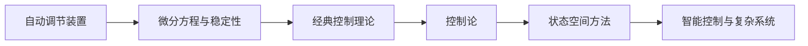
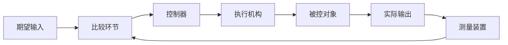

# 2026-09-02 第2节 控制理论发展历程与基本原理

## 资料来源

- 原始逐字稿：[[raw/2026-09-02-控制理论发展历程与基本原理教学培训-385088-逐字稿.md]]
- 智能纪要：[[raw/2026-09-02-控制理论发展历程与基本原理教学培训-385088-纪要.md]]
- 开始时间：2026-09-02 19:33

## 一、本节课核心脉络

本节课从控制思想的历史演进出发，串起经典控制、控制论与现代控制的形成，最后落到自动控制系统的基本组成和反馈闭环。主线是：先有装置和工程问题，再有数学模型与稳定性分析，随后形成能够处理多变量系统的状态空间方法。

## 二、控制理论的学科定位

控制理论研究怎样让动态系统按照预期方式运行。它一端连接微分方程、线性代数、概率统计和优化等数学工具，另一端连接自动化、航天、电力、通信和人工智能等工程问题。

课堂把控制理论大致分为两个阶段：

- **经典控制理论**：主要研究单输入单输出线性定常系统，常以传递函数和频域方法分析稳定性与动态性能。
- **现代控制理论**：用状态变量描述系统内部动态，适合多输入多输出、时变和更复杂的系统。

> 一句话来说：经典控制更像从“输入—输出”观察系统，现代控制则进一步打开黑箱，研究系统内部状态如何演化。

## 三、从控制装置到控制理论

### 1. 早期控制思想

指南车、自动计时或水位调节装置体现了根据状态变化自动修正行为的思想。它们说明反馈实践早于现代数学理论，但尚未形成统一模型。

工业革命时期的蒸汽机调速需求，使自动调节成为关键工程问题。瓦特飞球调速器根据转速变化调整蒸汽阀门：转速偏高时减小动力输入，偏低时增大动力输入，构成典型负反馈。

### 2. 从经验调节到稳定性分析

自动调节并不保证系统一定平稳。增益过大、延迟存在或参数选择不当，都可能导致振荡甚至发散。麦克斯韦把调速器写成微分方程，并研究参数与稳定性的关系，标志着控制问题开始进入数学分析阶段。随后，劳斯、赫尔维茨等稳定性判据进一步发展了经典控制理论。

## 四、三位代表人物与理论转折

### 1. 维纳：控制与通信的统一视角

维纳在《控制论》中把机器、动物和社会系统中的控制与通信问题放入统一框架，强调信息、反馈和目的性行为。这一视角使控制不再局限于某种机械装置，而成为跨学科问题。

### 2. 钱学森：从一般控制思想到工程方法

课堂强调《工程控制论》对控制理论工程化和系统化的推动。其意义在于把抽象原理转化为能够用于实际系统分析与设计的方法，并推动控制方法在航天等复杂工程中的应用。

### 3. 卡尔曼：状态空间与现代控制

面对航天器等多变量动态系统，只看单一输入输出关系已经不够。卡尔曼发展的状态空间方法用一组最小状态变量描述系统内部动态，并由此引出能控性、能观性和卡尔曼滤波等核心概念。

## 五、自动控制系统的基本结构

闭环控制通常包含：给定输入、比较环节、控制器、执行机构、被控对象和测量装置。设期望输入为 $r(t)$，实际输出为 $y(t)$，则误差信号为

$$
e(t)=r(t)-y(t).
$$

控制器根据 $e(t)$ 生成控制作用，使输出逐渐接近期望值。

冰箱温控是直观例子：设定温度是参考输入，温度传感器测量实际输出，控制器根据温差决定压缩机是否工作。外界温度或开门行为形成扰动，反馈使系统能够自动补偿。

## 六、当代方向：复杂系统与智能控制

当控制对象从单台设备扩展到电网、物流网络、机器人集群或社会技术系统时，会出现规模大、不确定性强、交互复杂等问题。由此形成大系统控制、网络化控制、智能控制和信息物理社会系统等方向。

神经网络和强化学习可以帮助处理难以精确建模的问题，但数据驱动方法仍需考虑稳定性、安全性、鲁棒性和可解释性。控制理论的价值，正是在性能之外提供可分析、可验证的约束。

## 七、易错点与待查

> [!warning] 易错点
> - 有反馈不等于系统必然稳定，反馈符号、增益和延迟都会影响结果。
> - “状态”不是任意中间变量，而是能完整决定后续运动的最小信息集合。
> - 经典控制与现代控制不是简单的新旧替代关系，应根据模型和任务选择工具。

- 待查：课堂涉及的部分历史评价与年份，正式引用时需回到原始文献核验。
- 后续重点：开环与闭环分类、状态变量选择、状态方程与输出方程。

## 课堂导航

- 上级索引：[[README|控制理论基础课堂笔记]]
- 后续课程：[[2026-09-07-第3节-控制系统理论授课|第3节 控制系统分类与状态空间模型]]
