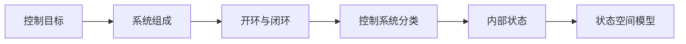

# 2026-09-07 第3节 控制系统分类与状态空间模型

## 资料来源

- 原始逐字稿：[[raw/2026-09-07-控制系统理论授课-830848-逐字稿.md]]
- 智能纪要：[[raw/2026-09-07-控制系统理论授课-830848-纪要.md]]
- 开始时间：2026-09-07 14:40

## 一、本节课核心脉络

本节课先从控制系统的基本组成出发，比较开环与闭环控制，再按输入、模型、时间和输入输出数量建立分类框架；随后用 RLC 电路说明为什么要引入状态变量，以及怎样从微分方程写出状态空间模型。

## 二、控制系统的组成

一个控制系统至少要回答四个问题：希望系统达到什么状态、系统当前处于什么状态、怎样施加作用、作用之后产生了什么结果。相应地，可识别出输入、控制器、执行机构、被控对象、输出与测量装置。

### 开环与闭环

| 类型 | 信息流 | 优点 | 局限 | 例子 |
|:--|:--|:--|:--|:--|
| 开环控制 | 输入单向作用于对象 | 结构简单、成本低 | 无法根据实际输出自动补偿扰动 | 定时电风扇、按固定程序运行的设备 |
| 闭环控制 | 输出经测量后反馈到比较环节 | 精度和抗扰能力通常更好 | 设计复杂，参数不当可能振荡 | 恒温系统、自动驾驶速度控制 |

> 一句话来说：开环系统只“发命令”，闭环系统还会“看结果并纠偏”。

闭环控制的关键变量是误差 $e(t)=r(t)-y(t)$。负反馈根据误差反向修正控制量，目标是使误差足够小，而不是盲目把控制作用加大。

## 三、控制系统的分类框架

### 1. 按参考输入变化方式

- **恒值调节系统**：参考输入基本不变，如恒温、恒压。
- **随动系统**：参考输入随时间变化，系统要跟踪它，如雷达跟踪。
- **程序控制系统**：输入按预设程序变化，如数控机床加工轨迹。

### 2. 按数学模型

- 线性系统与非线性系统。
- 定常系统与时变系统。
- 连续时间系统与离散时间系统。

### 3. 按输入输出数量

- 单输入单输出系统（SISO）。
- 多输入单输出或单输入多输出系统。
- 多输入多输出系统（MIMO）。

这些分类可以叠加。例如，一个系统可以同时是“线性、定常、连续时间、多输入多输出、闭环”系统。

## 四、强化学习与反馈控制

强化学习中，智能体观察环境状态，选择动作，接收新的状态和奖励，再调整后续策略。这与反馈控制都具有“基于结果修正行为”的闭环结构。

两者并不完全等同：传统控制通常从明确的动力学模型、稳定性和性能指标出发；强化学习更强调通过交互数据学习策略。把二者结合时，需要同时考虑学习效率、约束、安全性与闭环稳定性。

## 五、为什么需要状态变量

仅知道输入 $u(t)$ 与输出 $y(t)$，有时无法判断系统内部哪个环节发生变化。状态变量 $x(t)$ 用来保存“决定系统未来演化所需的最小内部信息”。给定当前状态和未来输入，理论上即可确定系统后续运动。

连续时间线性系统的标准形式为

$$
\dot{x}(t)=A(t)x(t)+B(t)u(t),
$$

$$
y(t)=C(t)x(t)+D(t)u(t).
$$

若矩阵 $A,B,C,D$ 不随时间变化，则为线性定常系统。

> 一句话来说：状态空间模型把“系统内部怎样变化”和“内部状态怎样形成输出”分成两条方程来描述。

## 六、RLC 电路示例

对于由电阻 $R$、电感 $L$ 和电容 $C$ 构成的电路，可选取电感电流 $i_L(t)$ 与电容电压 $u_C(t)$ 为状态：

$$
x(t)=\begin{bmatrix}i_L(t)\\u_C(t)\end{bmatrix}.
$$

选择状态变量时要满足两个条件：

1. 它们彼此独立，不应能由其他状态变量直接代替。
2. 数量足以完整描述系统动态，但不重复保存信息。

建立模型的一般步骤：

1. 根据储能元件或独立动态关系选择状态变量。
2. 用基尔霍夫定律等物理规律写出微分方程。
3. 整理为一阶矩阵形式 $\dot{x}=Ax+Bu$。
4. 根据观测量写出输出方程 $y=Cx+Du$。
5. 检查矩阵维度和初始条件。

## 七、线性化的意义

实际系统往往是非线性的，可写成

$$
\dot{x}=f(x,u),\qquad y=g(x,u).
$$

在某个工作点附近，可以用泰勒展开保留一阶项，得到局部线性模型。线性化降低了分析难度，但结论通常只在工作点附近有效；状态偏离过大时，需要回到原非线性模型。

## 八、易错点与课程事项

> [!warning] 易错点
> - 闭环控制通常抗扰性更好，但并非天然稳定。
> - 状态变量不是所有可测量量；有些状态无法直接测量，需要通过观测器估计。
> - 线性化模型是局部近似，不能无条件外推。
> - 矩阵 $D$ 描述输入对输出的直接作用，没有直接通道时可为零。

课堂同时通报了选课人数可能影响开课安排。该信息具有时效性，应以教务系统和教师后续通知为准，不作为课程知识点。

## 课堂导航

- 上一节：[[2026-09-02-第2节-控制理论发展历程与基本原理教学培训|第2节 控制理论发展历程与基本原理]]
- 后续课程：[[2026-09-09-第4节-状态空间模型与群体智能讲座|第4节 状态空间模型与群体智能]]
- 上级索引：[[README|控制理论基础课堂笔记]]
