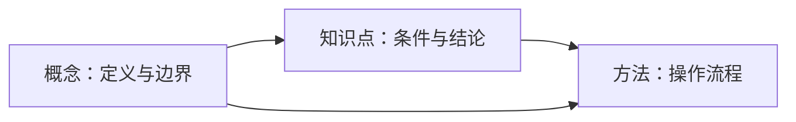

# 数值分析 — 三层体系总索引

> 这里按数值分析中的实际应用，组织全库共享的概念、知识点与方法入口。条目直接存放在各自根目录，不归属于本课程，也不重复创建课程专用版本。

---

## 三层入口

| 类型 | 应用或浏览入口 | 共享目录 | 职责 |
|:--|:--|:--|:--|
| **概念** | [[课程/归档/数值分析/数值分析-概念图谱]] | `概念/` | 对象的定义、含义、范围与边界 |
| **知识点** | [[课程/归档/数值分析/数值分析-知识点图谱]] | `知识点/` | 条件、结论、关系及必要依据 |
| **方法** | [[方法/README\|共享方法条目]] | `方法/` | 适用条件、操作步骤、结果检查与失败条件 |

## 概念 → 知识点 → 方法 的关系

- **概念条目**（`概念/`）：说明定义与边界，按实际关系链接其他共享条目。
- **知识点条目**（`知识点/`）：说明条件与结论，保留必要推理、依据或案例。
- **方法条目**（`方法/`）：围绕任务给出操作步骤、检查方式与失败条件。

共享条目不填写课程归属 `subject`；课程资料只用于 `source` 溯源或正文实际应用链接。推导、例题、习题与流程图按内容需要添加，不要求每个条目都配齐。课程知识点图谱保留为应用索引，可混合引用三类共享条目。

## 相关文件

| 文件 | 用途 |
|------|------|
| [[数值分析-知识图谱]] | 课程结构总览、章节依赖、方法演进 |
| [[课程/归档/数值分析/复习/README\|复习索引]] | 期末复习资料汇总 |
| [[课程/归档/数值分析/习题库/README\|习题库总索引]] | 27 道非编程题 |
