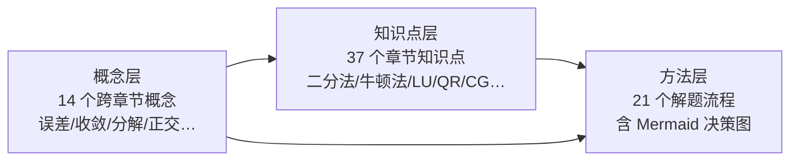

# 数值分析 — 三层体系总索引

> 数值分析课程已按「概念 → 知识点 → 方法」三层体系重新组织为独立卡片文件，适合总复习建立全局视野。

---

## 三层入口

| 层级 | MOC | 目录 | 文件数 | 用途 |
|:--|:--|:--|:--:|:--|
| **概念层** | [[概念/数值分析/数值分析-概念图谱]] | `概念/数值分析/` | 14 | 跨章节复用概念的严格定义、由来与作用、概念关系网 |
| **知识点层** | [[知识点/数值分析/数值分析-知识点图谱]] | `知识点/数值分析/` | 37 | 章节内方法/定理的完整学习单元（推导+例题+易错点） |
| **方法层** | `方法/数值分析/` | `方法/数值分析/` | 21 | 解题决策流程（Mermaid 流程图+典型例题） |

## 概念 → 知识点 → 方法 的关系

- **概念卡**（`概念/数值分析/`）：只链概念层，不链章节笔记
- **知识点卡**（`知识点/数值分析/`）：同时链概念层 + 知识点层 + 方法层 + 习题库
- **方法文件**（`方法/数值分析/`）：链知识点层 + 习题库，含 Mermaid 流程图

## 相关文件

| 文件 | 用途 |
|------|------|
| [[数值分析-知识图谱]] | 课程结构总览、章节依赖、方法演进 |
| [[课程/数值分析/复习/README\|复习索引]] | 期末复习资料汇总 |
| [[课程/数值分析/习题库/README\|习题库总索引]] | 27 道非编程题 |
