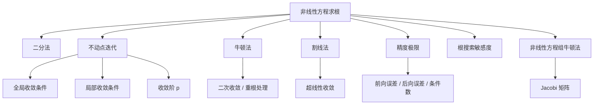
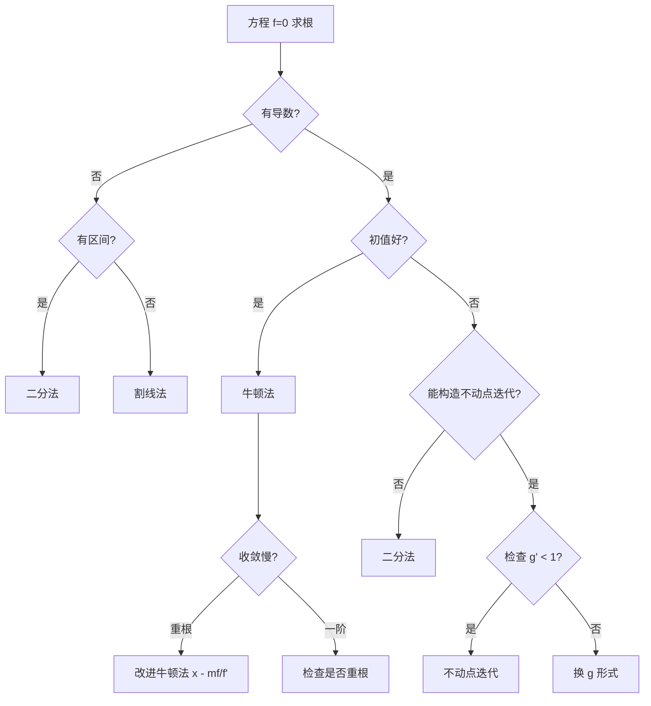

# 第2章 非线性方程求根 — 知识点汇集

## 一、本章核心脉络

**核心问题**：给定 $f(x)=0$，如何数值求根？从最简单的二分法出发，逐步提升收敛速度：不动点迭代（线性收敛）→ 牛顿法（二次收敛）→ 割线法（超线性收敛），最后推广到非线性方程组。

## 二、基础定义

| 术语 | 符号/表述 | 含义 |
|:--|:--|:--|
| 不动点 | $g(r)=r$ | $r$ 为 $g(x)$ 的不动点 |
| 不动点与根的关系 | $g(r)=r \iff f(r)=g(r)-r=0$ | 求根可转化为不动点问题 |
| 不动点迭代 | $x_{i+1}=g(x_i)$ | 从初值出发反复代入 $g$ |
| 全局收敛 | $\forall x_0 \in I$, $x_k \to x^*$ | 区间内任意初值都收敛 |
| 局部收敛 | $\exists$ 邻域 $N$, $\forall x_0 \in N$, $x_k \to x^*$ | 只在不动点附近收敛 |
| Lipschitz 条件 | $\vert f(x_1)-f(x_2)\vert \le L\vert x_1-x_2\vert$ | $L$ 为 Lipschitz 常数 |
| 前向误差 | $\vert x_n - r\vert$ | 近似解与真解的距离 |
| 后向误差 | $\vert f(x_n)\vert$ | 近似解代入方程的残差 |
| 误差放大因子 | 相对前向误差 / 相对后向误差 | 衡量问题对误差的敏感度 |
| 条件数 | — | 问题本身决定的误差放大 |
| 收敛阶 $p$ | $\lim_{i\to\infty} \frac{e_{i+1}}{e_i^p}=C$ | $p=1$ 线性收敛，$p=2$ 平方收敛 |
| Jacobi 矩阵 | $J(X)=F'(X)$ | 非线性方程组的一阶导数矩阵 |

## 三、核心方法/定理

### 3.1 二分法

- 伪代码给出，误差与计算量由区间长度决定。

### 3.2 不动点迭代

**不动点存在唯一与全局收敛定理**：设 $g(x)\in C[a,b]$ 连续，
1. 若 $\forall x\in[a,b]$ 有 $a\le g(x)\le b$，则 $g(x)$ 在 $[a,b]$ 上存在不动点；
2. 若存在 $L\in(0,1)$ 使 $\vert g(x_1)-g(x_2)\vert \le L\vert x_1-x_2\vert$（$\forall x_1,x_2\in[a,b]$），则存在唯一不动点 $x^*$，且对 $\forall x_0\in[a,b]$ 收敛到 $x^*$（全局收敛）。误差满足：

$$
\vert x_k-x^*\vert \le \frac{L}{1-L}\vert x_k-x_{k-1}\vert \le \cdots \le \frac{L^k}{1-L}\vert x_1-x_0\vert
$$

**推论**：若 $g(x)$ 在 $[a,b]$ 连续，在 $(a,b)$ 可微，$\forall x\in(a,b)$ 有 $a\le g(x)\le b$，且 $\vert g'(x)\vert\le L<1$，则存在唯一不动点且全局收敛。

**局部收敛定理**：设 $x^*$ 为不动点，$g'(x)$ 在 $I$ 连续且 $\vert g'(x^*)\vert<1$，则不动点迭代局部收敛。

**收敛阶定理**：设 $g\in C^p[a,b]$，$g(x^*)=x^*\in(a,b)$，且 $g'(x^*)=g''(x^*)=\cdots=g^{(p-1)}(x^*)=0$，$g^{(p)}(x^*)\neq 0$（$p\ge 1$），则不动点迭代 $p$ 阶局部收敛，且

$$
\lim_{i\to\infty}\frac{e_{i+1}}{e_i^p}=\frac{g^{(p)}(x^*)}{p!}
$$

$p=1$ 时需满足 $\vert g'(x^*)\vert<1$。

### 3.3 牛顿迭代法 (Newton–Raphson)

**几何解释**：过 $(x_i, f(x_i))$ 作切线，切线与 $x$ 轴交点为下一个迭代点。

**迭代公式**：

$$
x_{i+1}=x_i-\frac{f(x_i)}{f'(x_i)}
$$

**二次收敛定理**：若 $f\in C^2[a,b]$，$\exists r\in(a,b)$ 使 $f(r)=0$，且 $f'(r)\neq 0$，$f''(r)\neq 0$，则牛顿法局部二次收敛到 $r$，且

$$
\lim_{i\to\infty}\frac{e_{i+1}}{e_i^2}=\frac{f''(r)}{2f'(r)}
$$

**重根处理**：
- 若 $f\in C^{m+1}[a,b]$ 在 $[a,b]$ 上有 $m$ 重根 $r$（$m>1$），则牛顿法局部**线性收敛**，$\lim_{i\to\infty}\frac{e_{i+1}}{e_i}=\frac{m-1}{m}$
- **改进牛顿法**（$m$ 重根）：$x_{i+1}=x_i-\frac{m f(x_i)}{f'(x_i)}$，局部二次收敛，$\lim_{i\to\infty}\frac{e_{i+1}}{e_i^2}=\frac{1}{m(m+1)}\frac{f^{(m+1)}(r)}{f^{(m)}(r)}$

### 3.4 割线法

**几何解释**：用过 $(x_{i-1},f(x_{i-1}))$ 和 $(x_i,f(x_i))$ 的割线与 $x$ 轴交点作为 $x_{i+1}$。

**迭代公式**：

$$
x_{i+1}=x_i-\frac{f(x_i)(x_i-x_{i-1})}{f(x_i)-f(x_{i-1})}
$$

### 3.5 非线性方程组的牛顿迭代

**问题**：$n$ 个未知数的 $n$ 个非线性方程组：

$$
f_1(x_1,\ldots,x_n)=0,\; f_2(x_1,\ldots,x_n)=0,\; \ldots,\; f_n(x_1,\ldots,x_n)=0
$$

**Jacobi 矩阵**：$J(X)=F'(X)$

**牛顿迭代**：

$$
X_{i+1}=X_i-J^{-1}(X_i)F(X_i)
$$

等价于求解线性方程组：$J(X_i)(X_{i+1}-X_i)=-F(X_i)$

### 3.6 精度极限与根搜索敏感度

**误差关系**：原问题 $f(x)=0 \implies x=r$；扰动问题 $f(x)+\epsilon g(x)=0 \implies x=r+\Delta r$

$$
\Delta r \approx -\epsilon \frac{g(r)}{f'(r)}
$$

误差放大因子 $= \frac{g(r)}{r f'(r)}$

## 四、计算/应用

### 4.1 不动点迭代示例

求解 $x^3+x-1=0$（$r\approx 0.6823$），分析三种 $g(x)$ 的收敛性：

| $g(x)$ | $\vert g'(r)\vert$ | 收敛判断 |
|:--|:--|:--|
| $g(x)=1-x^3$ | $\vert 3r^2\vert\approx 1.395>1$ | 不收敛 |
| $g(x)=\sqrt[3]{1-x}$ | $\vert \frac{1}{3}(1-r)^{-2/3}\vert\approx 0.716<1$ | 收敛 |
| $g(x)=\frac{1+2x^3}{1+3x^2}$ | — | 收敛 |

### 4.2 根搜索敏感度示例

$P(x)=(x-1)(x-2)(x-3)(x-4)(x-5)(x-6)-10^{-6}x^7$ 的最大根：
- $\Delta r \approx -2332.8\epsilon$，$\epsilon=-10^{-6}$，$r+\Delta r\approx 6.0023328$（精确根 $6.0023268$）
- 误差放大因子 $\approx 388.8$

### 4.3 非线性方程组牛顿迭代示例

方程组：$v-u^3=0$，$u^2+v^2-1=0$，取 $X_0=(1,2)^T$，第一步迭代得 $X_1=(1,1)^T$。

## 五、判定/决策流程

## 六、核心公式速查表

| 名称 | 公式 |
|:--|:--|
| 不动点迭代 | $x_{i+1}=g(x_i)$ |
| 不动点全局收敛误差界 | $\vert x_k-x^*\vert \le \frac{L^k}{1-L}\vert x_1-x_0\vert$ |
| 收敛阶定义 | $\lim_{i\to\infty} \frac{e_{i+1}}{e_i^p}=C$ |
| 牛顿迭代 | $x_{i+1}=x_i-\frac{f(x_i)}{f'(x_i)}$ |
| 牛顿法误差（单根） | $\lim_{i\to\infty}\frac{e_{i+1}}{e_i^2}=\frac{f''(r)}{2f'(r)}$ |
| 牛顿法误差（m重根） | $\lim_{i\to\infty}\frac{e_{i+1}}{e_i}=\frac{m-1}{m}$ |
| 改进牛顿法（m重根） | $x_{i+1}=x_i-\frac{m f(x_i)}{f'(x_i)}$ |
| 割线法 | $x_{i+1}=x_i-\frac{f(x_i)(x_i-x_{i-1})}{f(x_i)-f(x_{i-1})}$ |
| 前向误差 | $\vert x_n-r\vert$ |
| 后向误差 | $\vert f(x_n)\vert$ |
| 误差放大因子 | 相对前向误差 / 相对后向误差 |
| 敏感度近似 | $\Delta r \approx -\epsilon \frac{g(r)}{f'(r)}$ |
| 非线性方程组牛顿迭代 | $X_{i+1}=X_i-J^{-1}(X_i)F(X_i)$ |
| 收敛阶定理 | $\lim_{i\to\infty}\frac{e_{i+1}}{e_i^p}=\frac{g^{(p)}(x^*)}{p!}$ |

## 七、易错点与注意事项

> [!warning]
> - **不要混淆前向误差和后向误差**：前向误差衡量解的距离，后向误差衡量方程残差，二者通过条件数关联。
> - **不动点迭代的 $g(x)$ 不唯一**：同一个 $f(x)=0$ 可构造不同 $g(x)$，收敛性不同（如 $x^3+x-1=0$ 的三种 $g(x)$）。
> - **局部收敛需要验证 $\vert g'(x^*)\vert<1$**：只检查存在不动点不够，必须检查导数值。
> - **牛顿法需要 $f'(r)\neq 0$**：若导数为零或接近零，收敛退化或失效。
> - **重根时牛顿法只是线性收敛**：$m$ 重根收敛因子为 $\frac{m-1}{m}$，需用改进牛顿法恢复二次收敛。
> - **割线法需要两个初值**：收敛速度介于线性和二次之间（超线性，约 $1.618$ 阶）。
> - **根搜索敏感度**：输入微小扰动可能导致输出大误差（如 Wilkinson 多项式）。

## 八、相关知识点链接

- [[03-线性方程组的直接解法-知识汇集]] — 非线性方程组牛顿法每步需求解线性方程组
- [[04-线性方程组的迭代法-知识汇集]] — 不动点迭代与线性迭代法的理论联系
- [[05-对称正定线性方程组-知识汇集]] — 梯度下降法作为另一种迭代思路

## 九、作业与练习

- 对计算 $\sqrt{2}$ 的算法（二分法、割线法、不动点迭代 $g(x)=\frac{x}{2}+\frac{1}{x^3}$、$g(x)=\frac{5x}{6}+\frac{1}{3x^3}$、牛顿法）按收敛速率排序并说明理由
- 分析 $f\in C^m(\mathbb{R})$，$f(r)=0$，$f'(r)\neq 0$，$f''(r)=\cdots=f^{(m-1)}(r)=0$，$f^{(m)}(r)\neq 0$（$m>2$）时标准牛顿法的收敛性及误差
- 找出 $g(x)=x^2-\frac{3}{2}x+\frac{3}{2}$ 的每个不动点，判断不动点迭代是否局部收敛
- $f(x)=x^4-7x^3+18x^2-20x+8$，牛顿法是否二次收敛到根 $r=2$？确定 $\lim e_{i+1}/e_i$
- 牛顿迭代两步求解 $\begin{cases}u^2+v^2=1\\(u-1)^2+v^2=1\end{cases}$，取 $(u_0,v_0)=(1,1)$
- 编程：二分法、不动点迭代、牛顿法、试位法求 $e^x+x=7$ 的根，精确到 8 位小数，比较收敛性
