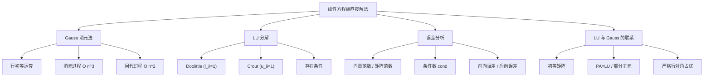
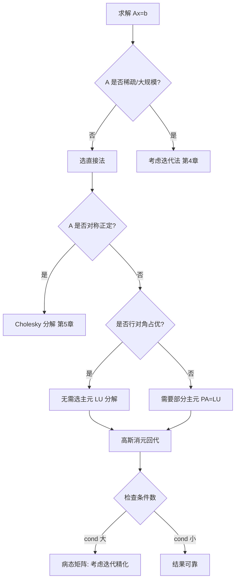

# 第3章 线性方程组的直接解法 — 知识点汇集

## 一、本章核心脉络

**核心问题**：给定线性方程组 $Ax=b$（$A$ 可逆），如何在有限步内求得精确解？通过行初等变换将 $A$ 化为上三角阵（Gauss 消元），或将 $A$ 分解为 $LU$（LU 分解），再回代求解。同时需要理解舍入误差的影响（范数、条件数）。

## 二、基础定义

| 术语 | 符号/表述 | 含义 |
|:--|:--|:--|
| 行初等运算 | — | 交换两行、非零数乘一行、一行加另一行的倍数 |
| Gauss 消元 | — | 通过行初等运算将方程组化为三角形方程组 |
| $LU$ 分解 | $A=LU$ | $L$ 下三角，$U$ 上三角 |
| Doolittle 分解 | $l_{ii}=1$ | $L$ 的对角元全为 $1$ |
| Crout 分解 | $u_{ii}=1$ | $U$ 的对角元全为 $1$ |
| 向量范数 | $\|x\|_1$, $\|x\|_2$, $\|x\|_\infty$ | 满足正定性、齐次性、三角不等式 |
| 算子范数 | $\|A\|=\max_{x\neq 0}\frac{\|Ax\|}{\|x\|}$ | 从属矩阵范数 |
| $\|A\|_\infty$ | $\max_{1\le i\le n}\sum_{j=1}^n \vert a_{ij}\vert$ | 最大绝对行和 |
| $\|A\|_1$ | $\max_{1\le j\le n}\sum_{i=1}^n \vert a_{ij}\vert$ | 最大绝对列和 |
| $\|A\|_2$ | $\sqrt{\rho(A^TA)}$ | $A^TA$ 谱半径的平方根 |
| 前向误差 | $\|x_a-x\|_\infty$ | 近似解与真解之差 |
| 后向误差 | $\|b-Ax_a\|_\infty=\|r\|_\infty$ | 残差范数 |
| 误差放大因子 | $\frac{\|x_a-x\|_\infty/\|x\|_\infty}{\|r\|_\infty/\|b\|_\infty}$ | 衡量误差传播 |
| 条件数 | $cond(A)=\|A\|_\infty\|A^{-1}\|_\infty$ | 最大误差放大因子 |
| 严格行对角占优 | $\vert a_{ii}\vert>\sum_{j\neq i}\vert a_{ij}\vert$ | 每行主对角元绝对值大于同行其他元素绝对值和 |
| 病态矩阵 | 条件数大 | 对误差敏感 |

## 三、核心方法/定理

### 3.1 Gauss 消元法

**核心思想**：将方程组化简为三角形方程组。

**理论支撑**：对有限次行初等运算得到的方程与原方程同解。

**消元过程**（第 $k$ 轮，$a_{kk}\neq 0$）：

$$
a_{ij}\leftarrow a_{ij}-\frac{a_{ik}}{a_{kk}}a_{kj},\quad b_i\leftarrow b_i-\frac{a_{ik}}{a_{kk}}b_k
$$

经过 $n-1$ 轮后得三角形方程组：

$$
\begin{aligned}
a_{11}x_1+a_{12}x_2+\cdots+a_{1n}x_n &= b_1 \\
a_{22}x_2+\cdots+a_{2n}x_n &= b_2 \\
&\vdots \\
a_{nn}x_n &= b_n
\end{aligned}
$$

**回代求解**：

$$
x_n=b_n/a_{nn},\quad x_i=\Bigl(b_i-\sum_{j=i+1}^n a_{ij}x_j\Bigr)/a_{ii},\; i=n-1,\ldots,1
$$

### 3.2 计算量

| 步骤 | 计算量 |
|:--|:--|
| 消元总计算量 $N_e$ | $\frac{2}{3}n^3+\frac{1}{2}n^2-\frac{7}{6}n=O(n^3)$ |
| 回代总计算量 $N_b$ | $n^2=O(n^2)$ |
| 消去一个元 | $1$ 次除法 + $n$ 次乘法 + $n$ 次减法 |

### 3.3 LU 分解

**Doolittle 分解**：$l_{ii}=1$，求解顺序 $u_{11}\to l_{i1},u_{1j}\to u_{22}\to l_{i2},u_{2j}\to\cdots\to u_{nn}$

**显式求解公式**：

$$
\begin{aligned}
u_{kj} &= \Bigl(a_{kj}-\sum_{s=1}^{k-1} l_{ks}u_{sj}\Bigr)/l_{kk} \\
l_{ik} &= \Bigl(a_{ik}-\sum_{s=1}^{k-1} l_{is}u_{sk}\Bigr)/u_{kk}
\end{aligned}
$$

**存在条件**：$n$ 个方程，$n^2+n$ 个未知数，需要额外条件（Doolittle: $l_{ii}=1$；Crout: $u_{ii}=1$）使解唯一。

### 3.4 误差与条件数

**定理**：可逆方阵 $A$ 的条件数 $cond(A)=\|A\|_\infty\|A^{-1}\|_\infty$，满足：

$$
\frac{\|x_a-x\|_\infty}{\|x\|_\infty} \le cond(A)\frac{\|r\|_\infty}{\|b\|_\infty}
$$

且

$$
\frac{1}{cond(A)}\frac{\|r\|_\infty}{\|b\|_\infty} \le \frac{\|x_a-x\|_\infty}{\|x\|_\infty} \le cond(A)\frac{\|r\|_\infty}{\|b\|_\infty}
$$

大条件数的矩阵是**病态**的。

### 3.5 LU 分解与 Gauss 消元的联系

- 行变换 $\longleftrightarrow$ 左乘初等矩阵
  - 交换第 $i$ 行和第 $j$ 行：左乘置换矩阵 $P$
  - 第 $j$ 行加 $\lambda$ 乘第 $i$ 行：左乘初等矩阵 $E$
- 顺序 Gauss 消元：$E_m\cdots E_1 A = U \iff A = E_1^{-1}\cdots E_m^{-1}U$，其中 $m\le \frac{n(n-1)}{2}$
- 若有行交换则引入置换矩阵：$PA=LU$

**定理**：不选主元 Gauss 消元法保持矩阵的严格行对角占优性质。

**推论**：行对角占优矩阵可逆且有 $LU$ 分解。

## 四、计算/应用

### 4.1 Gauss 消元示例

求解 $\begin{cases}x+2y-z=3\\2x+y-2z=3\\-3x+y+z=-6\end{cases}$

### 4.2 Doolittle 分解示例

$3\times 3$ 矩阵 $A$ 的 Doolittle 分解 $A=LU$，然后求解 $Ax=b$。

## 五、判定/决策流程

## 六、核心公式速查表

| 名称 | 公式 |
|:--|:--|
| 消元操作 | $a_{ij}\leftarrow a_{ij}-\frac{a_{ik}}{a_{kk}}a_{kj}$ |
| 回代 | $x_i=(b_i-\sum_{j=i+1}^n a_{ij}x_j)/a_{ii}$ |
| 消元计算量 | $N_e=\frac{2}{3}n^3+\frac{1}{2}n^2-\frac{7}{6}n$ |
| 回代计算量 | $N_b=n^2$ |
| LU 分解 | $a_{ij}=\sum_{s=1}^{\min(i,j)} l_{is}u_{sj}$ |
| Doolittle 求解 | $u_{kj}=(a_{kj}-\sum_{s=1}^{k-1}l_{ks}u_{sj})/l_{kk}$ |
| | $l_{ik}=(a_{ik}-\sum_{s=1}^{k-1}l_{is}u_{sk})/u_{kk}$ |
| $\|x\|_1$ | $\vert x_1\vert+\cdots+\vert x_n\vert$ |
| $\|x\|_2$ | $\sqrt{x_1^2+\cdots+x_n^2}$ |
| $\|x\|_\infty$ | $\max_{1\le i\le n}\vert x_i\vert$ |
| $\|A\|_\infty$ | $\max_{1\le i\le n}\sum_{j=1}^n \vert a_{ij}\vert$ |
| $\|A\|_1$ | $\max_{1\le j\le n}\sum_{i=1}^n \vert a_{ij}\vert$ |
| $\|A\|_2$ | $\sqrt{\rho(A^TA)}$ |
| 条件数 | $cond(A)=\|A\|_\infty\|A^{-1}\|_\infty$ |
| 误差关系 | $\frac{\|x_a-x\|_\infty}{\|x\|_\infty} \le cond(A)\frac{\|r\|_\infty}{\|b\|_\infty}$ |
| 严格行对角占优 | $\vert a_{ii}\vert>\sum_{j=1,j\neq i}^n \vert a_{ij}\vert$ |

## 七、易错点与注意事项

> [!warning]
> - **直接法有舍入误差**：虽然理论上精确，但浮点运算产生舍入误差，不是"无误差"。
> - **大条件数 = 病态**：条件数大时，小的后向误差可导致大的前向误差。
> - **算子范数三性质**：$\|I\|=1$，$\|A\cdot x\|\ge \|Ax\|$，$\|A\cdot B\|\ge \|AB\|$（注意方向）。
> - **Doolittle vs Crout**：Doolittle 的 $L$ 对角元为 $1$，Crout 的 $U$ 对角元为 $1$，计算顺序不同。
> - **$LU$ 分解需要 $a_{kk}\neq 0$**：否则需要行交换（部分主元：$PA=LU$）。
> - **严格行对角占优 $\implies$ 可逆且有 $LU$ 分解**：无需选主元。
> - **消元计算量 $O(n^3)$ 为主**，回代 $O(n^2)$ 可忽略。

## 八、相关知识点链接

- [[02-非线性方程求根-知识汇集]] — 非线性方程组牛顿法每步需求解线性方程组
- [[04-线性方程组的迭代法-知识汇集]] — 大规模稀疏矩阵时迭代法更优
- [[05-对称正定线性方程组-知识汇集]] — 对称正定矩阵可用 Cholesky 分解

## 九、作业与练习

- 证明矩阵的无穷算子范数 $\|A\|_\infty=\max_{1\le i\le n}\sum_{j=1}^n \vert a_{ij}\vert$
- 给定方程组 $\begin{bmatrix}1&1\\1&1+\delta\end{bmatrix}\begin{bmatrix}x_1\\x_2\end{bmatrix}=\begin{bmatrix}2\\2+\delta\end{bmatrix}$（$\delta>0$）：计算条件数；计算近似解 $x_a=[-1,3+\delta]^T$ 的误差放大因子
- 用 Gauss 消元法、列主消元法、$LU$ 分解法、$PA=LU$ 分解法求解方程组
- 编程：编写通用的 Gauss 消元法和 $LU$ 分解法程序；用 12 阶和 20 阶 Hilbert 矩阵 $Hx=b$（$b=H\cdot[1,\ldots,1]^T$）验证
