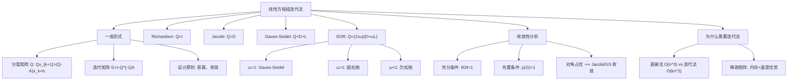
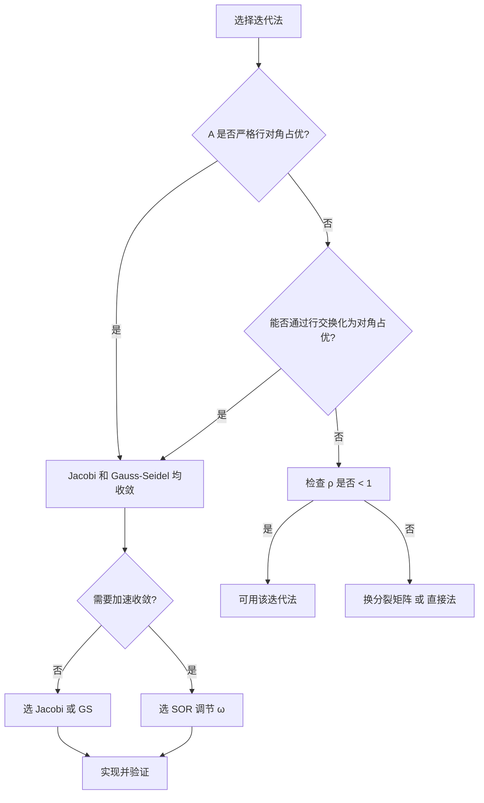

# 第4章 线性方程组的迭代法 — 知识点汇集

## 一、本章核心脉络

**核心问题**：求解 $Ax=b$。直接法（消元/LU）计算量 $O(n^3)$，对大规模稀疏矩阵不适用。迭代法每步 $O(n^2)$（或 $O(n)$ 对稀疏矩阵），通过不同的矩阵分裂（$Q$）得到不同迭代法，收敛性由迭代矩阵的谱半径决定。

## 二、基础定义

| 术语 | 符号/表述 | 含义 |
|:--|:--|:--|
| 分裂矩阵 | $Q$ | 将 $A$ 分裂为 $Q$ 和 $Q-A$，构造迭代 |
| 迭代矩阵 | $G=I-Q^{-1}A$ | 不动点形式的系数矩阵 |
| 迭代法一般形式 | $Qx_{k+1}=(Q-A)x_k+b$ | 选取不同 $Q$ 得到不同方法 |
| 不动点形式 | $x_{k+1}=(I-Q^{-1}A)x_k+Q^{-1}b$ | 等价于 $x_{k+1}=Gx_k+c$ |
| 赋范线性空间收敛 | $\lim_{k\to\infty}\|v_k-v\|=0$ | 向量序列依范数收敛 |
| 谱半径 | $\rho(A)=\max\vert\lambda_i\vert$ | 特征值的最大模 |
| 严格行对角占优 | $\vert a_{ii}\vert>\sum_{j\neq i}\vert a_{ij}\vert$ | 每行主对角元大于同行其他元绝对值和 |
| 松弛因子 | $\omega$ | SOR 中控制收敛速度的参数 |
| 谱半径定理 | $\rho(A)\le\|A\|$（任意算子范数）| 存在算子范数任意接近 $\rho(A)$ |

## 三、核心方法/定理

### 3.1 迭代法一般形式

迭代：$Qx_{k+1}=(Q-A)x_k+b$

不动点形式：$x_{k+1}=(I-Q^{-1}A)x_k+Q^{-1}b$

迭代矩阵：$G=I-Q^{-1}A$

设计原则：**易算**（$Q$ 易于求逆）、**收敛**。

### 3.2 Richardson 迭代

$Q=I$，$G=I-A$

### 3.3 Jacobi 迭代

$Q=D$（$A$ 的对角部分），$G=-D^{-1}(L+U)$

其中 $D=\operatorname{diag}(A)$，$L$ 为严格下三角，$U$ 为严格上三角。

**公式**：$x_{k+1}=D^{-1}(b-(L+U)x_k)$

### 3.4 Gauss-Seidel 迭代

$Q=D+L$，$G=-(L+D)^{-1}U$

**公式**：$x_{k+1}=-(L+D)^{-1}Ux_k+(L+D)^{-1}b$

### 3.5 SOR 迭代（连续超松弛）

**外推思想**：对一般迭代 $x_{k+1}=Gx_k+c$，用松弛因子 $\gamma$ 得：

$$
x_{k+1}=\gamma(Gx_k+c)+(1-\gamma)x_k
$$

**SOR 公式**：

$$
x_{k+1}=(1-\omega)x_k+\omega D^{-1}(b-Ux_k-Lx_{k+1})
$$

- $\omega=1$：Gauss-Seidel
- $\omega>1$：超松弛
- $\omega<1$：欠松弛

**分裂矩阵**：$Q=\frac{1}{\omega}(D+\omega L)$

**迭代矩阵**：$G=(D+\omega L)^{-1}[(1-\omega)D-\omega U]$

### 3.6 收敛性定理

**诺伊曼级数定理**：若对某个算子范数 $\|G\|<1$，则 $I-G$ 可逆，且 $(I-G)^{-1}=\sum_{k=0}^\infty G^k$

**迭代收敛定理**：若迭代矩阵的某个算子范数 $\|I-Q^{-1}A\|=\delta<1$，则 $x_{k+1}=(I-Q^{-1}A)x_k+Q^{-1}b$ 收敛于 $Ax=b$ 的解。且：

$$
\|x-x_k\| \le \frac{\delta}{1-\delta}\|x_k-x_{k-1}\| \le \cdots \le \frac{\delta^k}{1-\delta}\|x_1-x_0\|
$$

**推论2**：若 $A$ 严格行对角占优，则 Jacobi 迭代收敛。

**谱半径定理**：$\rho(A)\le\|A\|$（任意算子范数）；存在算子范数 $\|\cdot\|^*$ 任意接近 $\rho(A)$，即 $\|A\|^*\le\rho(A)+\epsilon$。

**迭代收敛定理2（充要条件）**：迭代 $x_{k+1}=Gx_k+c$ 对任意初始向量 $x_0$ 收敛于 $(I-G)^{-1}c$ 的**充要条件**是 $\rho(G)<1$。

**定理**：若 $A$ 严格行对角占优，则对任何初始向量 Gauss-Seidel 迭代收敛到 $Ax=b$ 的解。

### 3.7 收敛性示例对比

对 $A=\begin{bmatrix}3&1\\1&2\end{bmatrix}$，$b=[5,5]^T$：

| 方法 | $G$ | $\rho(G)$ | 收敛? |
|:--|:--|:--|:--|
| Richardson | $I-A$ | $\frac{3+\sqrt{5}}{2}\approx 2.618$ | 否 |
| Jacobi | $I-D^{-1}A$ | $\frac{1}{\sqrt{6}}\approx 0.408$ | 是 |
| Gauss-Seidel | $-(L+D)^{-1}U$ | $\frac{1}{6}\approx 0.167$ | 是 |

## 四、计算/应用

### 4.1 Jacobi 迭代示例

方程组 $\begin{cases}3u+v=5\\u+2v=5\end{cases}$，$A=\begin{bmatrix}3&1\\1&2\end{bmatrix}$

Jacobi 迭代：$Q=D=\begin{bmatrix}3&0\\0&2\end{bmatrix}$

$$
\begin{bmatrix}u_{k+1}\\v_{k+1}\end{bmatrix}=\begin{bmatrix}(5-v_k)/3\\(5-u_k)/2\end{bmatrix}
$$

### 4.2 Gauss-Seidel 迭代示例

同方程组，Gauss-Seidel 迭代：

$$
\begin{bmatrix}u_{k+1}\\v_{k+1}\end{bmatrix}=\begin{bmatrix}(5-v_k)/3\\(5-u_{k+1})/2\end{bmatrix}
$$

### 4.3 SOR 迭代示例

同方程组，SOR 迭代：

$$
\begin{bmatrix}u_{k+1}\\v_{k+1}\end{bmatrix}=(1-\omega)\begin{bmatrix}u_k\\v_k\end{bmatrix}+\omega\begin{bmatrix}(5-v_k)/3\\(5-u_{k+1})/2\end{bmatrix}
$$

### 4.4 大规模稀疏矩阵计算量对比

$n=10^5$ 时：

| | 直接法 (Gauss消元) | 迭代法 |
|:--|:--|:--|
| 内存 | $8\times n^2=80$GB | $O(n)$ |
| 计算量 | $n^3=10^{15}$ 次操作 | 每步 $O(n)$，100步秒级 |
| 耗时 | 量级 $10^7$ 秒（数月） | 秒量级 |

## 五、判定/决策流程

## 六、核心公式速查表

| 名称 | 公式 |
|:--|:--|
| 一般迭代 | $Qx_{k+1}=(Q-A)x_k+b$ |
| 不动点形式 | $x_{k+1}=Gx_k+c$，$G=I-Q^{-1}A$，$c=Q^{-1}b$ |
| Richardson | $Q=I$，$G=I-A$ |
| Jacobi | $Q=D$，$G=-D^{-1}(L+U)$ |
| Gauss-Seidel | $Q=D+L$，$G=-(L+D)^{-1}U$ |
| SOR | $x_{k+1}=(1-\omega)x_k+\omega D^{-1}(b-Ux_k-Lx_{k+1})$ |
| SOR 分裂矩阵 | $Q=\frac{1}{\omega}(D+\omega L)$ |
| SOR 迭代矩阵 | $G=(D+\omega L)^{-1}[(1-\omega)D-\omega U]$ |
| 收敛充分条件 | $\|G\|<1$（某算子范数） |
| 收敛充要条件 | $\rho(G)<1$ |
| 收敛误差界 | $\|x-x_k\|\le\frac{\delta^k}{1-\delta}\|x_1-x_0\|$ |
| 诺伊曼级数 | $(I-G)^{-1}=\sum_{k=0}^\infty G^k$（当 $\|G\|<1$） |

## 七、易错点与注意事项

> [!warning]
> - **$\|G\|<1$ 是充分条件，非必要**：某些迭代 $\|G\|>1$ 但 $\rho(G)<1$ 仍收敛。
> - **$\rho(G)<1$ 才是充要条件**：判断收敛必须检查谱半径。
> - **Richardson 迭代 $G=I-A$ 收敛性差**：大多数情况下 $\rho(I-A)\ge 1$，仅当 $A$ 的特征值在 $(0,2)$ 内才收敛。
> - **Jacobi 和 Gauss-Seidel 的收敛性无包含关系**：可能一个收敛另一个不收敛。
> - **严格行对角占优 $\implies$ Jacobi 和 GS 均收敛**：这是充分条件，不是必要条件。
> - **SOR 中 $\omega$ 取值关键**：$\omega$ 取最优值时收敛最快，但最优 $\omega$ 通常未知。
> - **迭代法优于直接法的前提是稀疏矩阵**：对稠密矩阵，迭代法不一定更快。
> - **引例中两种迭代的收敛性不同**：$u_{k+1}=(5-v_k)/3,\;v_{k+1}=(5-u_k)/2$ 收敛；$u_{k+1}=5-2v_k,\;v_{k+1}=5-3u_k$ 不收敛。

## 八、相关知识点链接

- [[03-线性方程组的直接解法-知识汇集]] — 直接法与迭代法的取舍依据
- [[05-对称正定线性方程组-知识汇集]] — 梯度下降法与共轭梯度法（另一种迭代思路）
- [[02-非线性方程求根-知识汇集]] — 不动点迭代与线性迭代法的理论相通（收敛性由导数值/谱半径决定）

## 九、作业与练习

- 对方程重新组织得到严格行对角占优系数矩阵，推导 Jacobi 和 Gauss-Seidel 迭代公式：$\begin{cases}u-8v-2w=1\\u+v+5w=4\\3u-v+w=-2\end{cases}$
- 编程实现 Jacobi 迭代、Gauss-Seidel 迭代和 SOR 迭代，迭代求解以上方程组。初始向量取 $0$，误差限 $10^{-6}$，结果保留 8 位小数
- 编程实现 Jacobi 迭代求解稀疏系数矩阵的线性方程组（维度尽可能高），与 Gauss 消元比较
