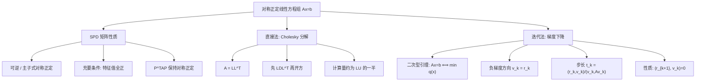
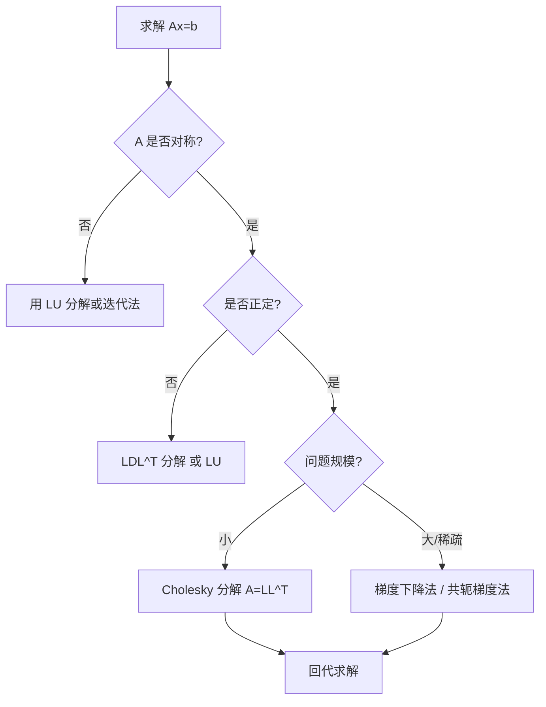

# 第5章 对称正定线性方程组 — 知识点汇集

## 一、本章核心脉络

**核心问题**：当 $A$ 为对称正定（SPD）矩阵时，如何高效求解 $Ax=b$？两种途径：(1) 利用 SPD 的结构性质，用 Cholesky 分解 $A=LL^T$（比 LU 分解节省一半存储和计算）；(2) 转化为优化问题 $\min q(x)=\frac{1}{2}x^TAx-x^Tb$，用梯度下降法迭代求解。

## 二、基础定义

| 术语 | 符号/表述 | 含义 |
|:--|:--|:--|
| 对称正定矩阵 (SPD) | $A=A^T$, $x^TAx>0$（$\forall x\neq 0$）| 对称且所有特征值 > 0 |
| Cholesky 分解 | $A=LL^T$ | $L$ 为下三角阵 |
| $LDL^T$ 分解 | $A=LDL^T$ | 实对称非奇异且存在 $LU$ 分解时 |
| 二次型 | $q(x)=\frac{1}{2}\langle x,Ax\rangle-\langle x,b\rangle$ | $\langle x,y\rangle=x^Ty$ |
| 残差向量 | $r_k=b-Ax_k$ | 当前迭代的梯度负方向 |
| 搜索方向 | $v_k$ | 第 $k$ 步的搜索方向 |
| 搜索步长 | $t_k=\frac{(r_k,v_k)}{(v_k,Av_k)}$ | 沿 $v_k$ 方向的最优步长 |

## 三、核心方法/定理

### 3.1 对称正定矩阵的性质

**性质1**：对称正定矩阵非奇异（可逆）。

**性质2**：任何对称正定矩阵的主子式也是对称正定矩阵。

**性质3**：若 $A$ 对称，则 $A$ 正定的**充要条件**是其所有特征值是正数。

**性质4**：若 $A$ 是 $n\times n$ 对称正定矩阵，$P$ 是一个满秩的 $n\times m$ 矩阵（$n\ge m$），则 $P^TAP$ 是 $m\times m$ 对称正定矩阵。

### 3.2 Cholesky 分解

**引理1**：两个上（下）三角阵相乘是上（下）三角阵。

**引理2**：上（下）三角阵的逆是上（下）三角阵。

**$LDL^T$ 分解定理**：$A$ 是实对称非奇异矩阵，并存在 $LU$ 分解，则它可以分解为 $A=LDL^T$，其中 $L$ 是下三角阵。

**Cholesky 分解定理**：$A$ 是实对称正定矩阵，则它可以分解为 $A=LL^T$，其中 $L$ 是下三角阵。

**分解过程**：

$$
a_{ij}=\sum_{s=1}^{\min(i,j)} l_{is}l_{js}
$$

共 $\frac{n^2+n}{2}$ 个方程，$\frac{n^2+n}{2}$ 个未知数。

求解顺序：$l_{11}\to l_{i1}\to l_{22}\to l_{i2}\to\cdots\to l_{nn}$

**显式求解公式**：

$$
\begin{aligned}
l_{kk} &= \sqrt{a_{kk}-\sum_{s=1}^{k-1} l_{ks}^2} \\
l_{ik} &= \Bigl(a_{ik}-\sum_{s=1}^{k-1} l_{is}l_{ks}\Bigr)/l_{kk}
\end{aligned}
$$

### 3.3 梯度下降法（最速下降法）

**二次型引理**：若 $A$ 是 $n$ 阶对称正定方阵，则求解 $Ax=b$ 等价于极小化二次型问题：

$$
\operatorname{argmin}_{x\in\mathbb{R}^n} q(x)=\frac{1}{2}\langle x,Ax\rangle-\langle x,b\rangle,\quad\langle x,y\rangle=x^Ty
$$

**迭代公式**：

$$
x_{k+1}=x_k+t_k v_k
$$

**步长**：

$$
t_k=\frac{\langle r_k,v_k\rangle}{\langle v_k,Av_k\rangle}
$$

**残差向量**：$r_k=b-Ax_k$

**迭代性质**：$\langle r_{k+1},v_k\rangle=0$

**梯度（最速）下降法**：取负梯度方向 $v_k=-\nabla q(x_k)=b-Ax_k=r_k$

**算法**：
1. $v_k = r_k = b-Ax_k$
2. $t_k = \frac{\langle r_k,v_k\rangle}{\langle v_k,Av_k\rangle}$
3. $x_{k+1}=x_k+t_k v_k$

### 3.4 共轭梯度法

本章提到共轭梯度法（在章节标题和思考题中提及），具体算法细节见相关材料。

## 四、计算/应用

### 4.1 Cholesky 分解示例

$A=\begin{bmatrix}4&2&2\\2&5&3\\2&3&6\end{bmatrix}=LL^T$ 的分解。

### 4.2 梯度下降法示例

方程组：$\begin{bmatrix}3&1\\1&2\end{bmatrix}\begin{bmatrix}u\\v\end{bmatrix}=\begin{bmatrix}6\\3\end{bmatrix}$，真解 $u=4, v=-1$。

- $x_0=(0,0)^T$，$v_0=b-Ax_0=(6,3)^T$，$Av_0=(18,27)^T$
- $t_0=\frac{\langle v_0,v_0\rangle}{\langle v_0,Av_0\rangle}=\frac{45}{189}=\frac{5}{21}$
- $x_1=x_0+t_0 v_0=(\frac{10}{7},\frac{5}{7})^T$
- $v_1=v_0-t_0 Av_0=(\frac{12}{7},-\frac{24}{7})^T$

## 五、判定/决策流程

## 六、核心公式速查表

| 名称 | 公式 |
|:--|:--|
| SPD 特征值条件 | $\lambda_i>0$（全部特征值为正） |
| $LDL^T$ 分解 | $A=LDL^T$（实对称非奇异 + 存在 LU 分解） |
| Cholesky 分解 | $A=LL^T$（实对称正定） |
| Cholesky 对角元 | $l_{kk}=\sqrt{a_{kk}-\sum_{s=1}^{k-1} l_{ks}^2}$ |
| Cholesky 非对角元 | $l_{ik}=(a_{ik}-\sum_{s=1}^{k-1} l_{is}l_{ks})/l_{kk}$ |
| 二次型极小化 | $\min q(x)=\frac{1}{2}x^TAx-x^Tb$ |
| 梯度下降步长 | $t_k=\frac{\langle r_k,v_k\rangle}{\langle v_k,Av_k\rangle}$ |
| 残差向量 | $r_k=b-Ax_k$ |
| 正交性质 | $\langle r_{k+1},v_k\rangle=0$ |
| 梯度方向 | $v_k=r_k=b-Ax_k$ |
| 迭代更新 | $x_{k+1}=x_k+t_k v_k$ |

## 七、易错点与注意事项

> [!warning]
> - **Cholesky 分解要求对称正定**：若 $A$ 仅对称但不定，只能用 $LDL^T$ 分解。
> - **$LDL^T$ 分解的条件是实对称非奇异 + 存在 LU 分解**：不要求正定性。
> - **$l_{kk}$ 需要开方**：若 $a_{kk}-\sum l_{ks}^2\le 0$，说明矩阵不是正定的，Cholesky 分解失败。
> - **性质4 要求 $P$ 满秩**：若 $P$ 秩亏，$P^TAP$ 不一定正定。
> - **梯度下降法收敛可能很慢**：当条件数大时，梯度下降呈"锯齿形"路径，收敛慢。
> - **步长 $t_k$ 是最优步长**：沿 $v_k$ 方向使 $q(x_{k+1})$ 最小的精确步长。
> - **$\langle r_{k+1},v_k\rangle=0$**：新残差与旧搜索方向正交，这是精确线搜索的必然结果。
> - **梯度下降 vs 共轭梯度**：梯度下降用负梯度方向，共轭梯度用共轭方向，收敛更快（本章仅提及共轭梯度法名称）。

## 八、相关知识点链接

- [[03-线性方程组的直接解法-知识汇集]] — LU 分解与 Cholesky 分解的对比
- [[04-线性方程组的迭代法-知识汇集]] — 线性迭代法（Jacobi/GS/SOR）与梯度类迭代法的关系
- [[02-非线性方程求根-知识汇集]] — 优化视角下的 Newton 法与最速下降法的联系

## 九、作业与练习

- 判断矩阵是否正定，若正定给出 Cholesky 分解，否则给出 $LDL^T$ 分解，并进行回代求解：$\begin{bmatrix}2&2&1\\2&5&2\\1&2&2\end{bmatrix}\begin{bmatrix}x_1\\x_2\\x_3\end{bmatrix}=\begin{bmatrix}0\\3\\-7\end{bmatrix}$
- 编程实现梯度下降法及共轭梯度法，用程序求解第 1 题中的方程并对两种方法进行比较
