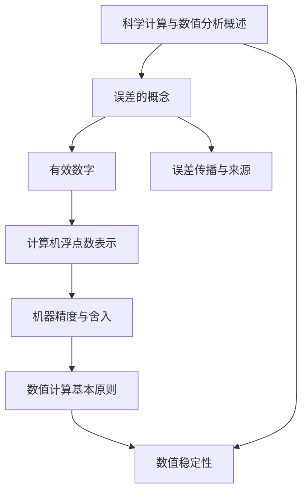
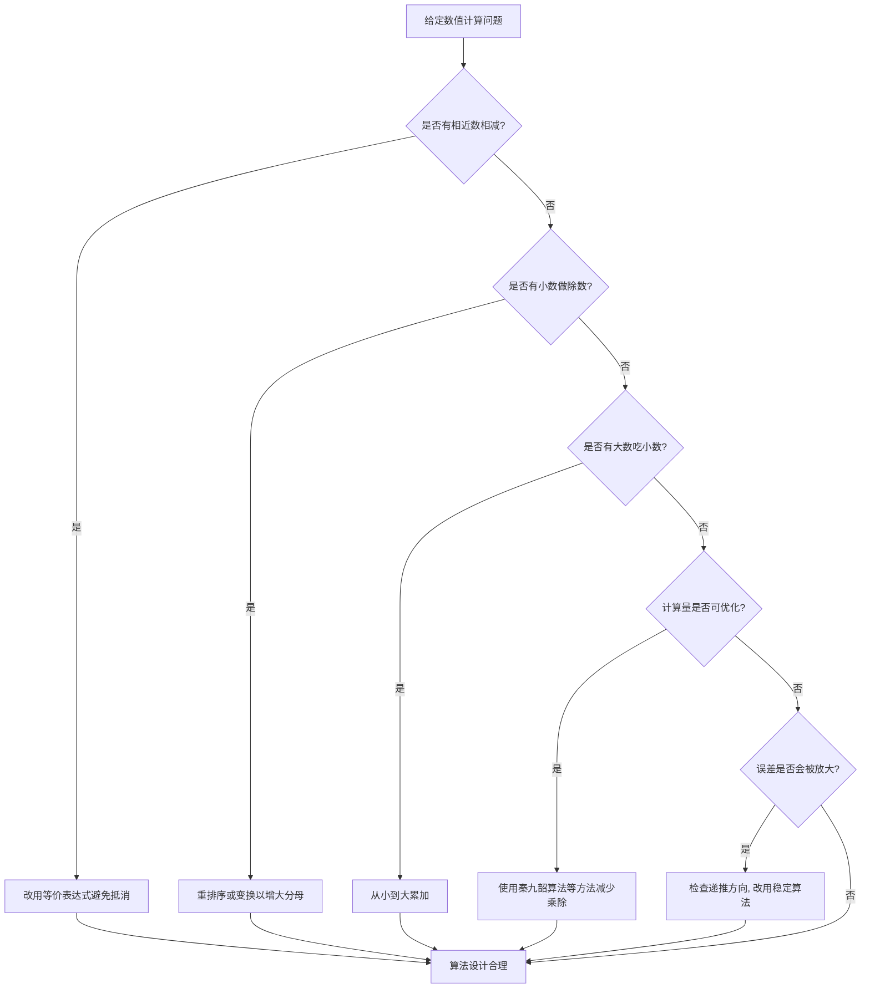

# 第1章 数值分析基础 — 知识点梳理

## 一、本章核心脉络

**核心问题：** 数值分析研究的是「如何在计算机上准确、高效地求解数学问题」。计算机只能表示有限精度的数，只能执行有限步运算，因此每一步计算都会引入误差。误差如何定义？如何传播？如何控制？——这是贯穿本章的主线。

**为什么是这个顺序？** 先建立宏观认知（科学计算是什么），再引入误差这一核心概念——没有误差意识就没有数值分析。有效数字是连接理论误差与计算机实际表示的桥梁。理解了浮点数的真实存储方式后，才可能理解为什么有些"数学上等价"的算法结果会天差地别——这引出数值稳定性的概念。

---

## 二、科学计算与数值分析概述（了解即可）

### 2.1 什么是科学计算

科学计算是利用电子计算机解决科学和工程问题的手段。其学科构成：

| 组成部分 | 内容 |
|----------|------|
| 计算数学 | 算法设计与理论分析（数值分析属于此） |
| 计算机科学 | 硬件、软件、编程语言 |
| 应用方向 (X) | 力学、物理、化学、生物学、金融、工程等 |

> 一句话来说：科学计算 = 数学建模 + 算法设计 + 计算机实现，是继理论、实验之后的第三大科研范式。

### 2.2 历史沿革

| 时期 | 事件 |
|------|------|
| 约公元前150年 | 《九章算术》成书，割圆术思想萌芽 |
| 约263年 | 刘徽注《九章算术》，提出割圆术；算得徽率 3.14（96边形）和 3.1416（3072边形） |
| 约480年 | 祖冲之算得 3.1415926 ~ 3.1415927，密率 355/113，领先世界千年 |
| 1910年 | Richardson 首次用数值方法预测天气（手摇计算器，3个月算24小时） |
| 1946年 | ENIAC 诞生（18000个电子管，5000次/秒） |
| 1950s | FORTRAN 问世，首个科学计算高级语言 |
| 1960s | Cleve Moler 博士论文 → 后发展出 MATLAB |
| 至今 | 计算能力是国家综合实力重要指标 |

### 2.3 数值分析关注的核心问题

> 正如 Trefethen 所言："As machines become more powerful, the efficiency of algorithms grows more important, not less."

| 问题 | 含义 |
|------|------|
| 误差多大？ | 计算结果离真值多远 |
| 收敛？收敛速度？ | 算法能否接近真解，多快 |
| 解是否稳定？ | 输入微小变化是否导致输出巨大变化 |
| 计算效率？ | 能否充分利用硬件算力 |

---

## 三、误差的基本概念（**本章核心**）

### 3.1 绝对误差与相对误差

设某一数据的准确值为 $x$，近似值为 $x^*$。

> 一句话来说：绝对误差告诉你「差了多少」，相对误差告诉你「差的比例有多大」——后者才是衡量"精度"的真正尺度。

| 概念 | 定义 | 含义 |
|------|------|------|
| **绝对误差** | $e(x) = x - x^*$ | 近似值与真值的差值，可正可负 |
| **相对误差** | $e_r(x) = \dfrac{x - x^*}{x^*}\ (x^* \neq 0)$ | 绝对误差相对于近似值的比例，无量纲 |
| **绝对误差限** $\varepsilon$ | $\vert e(x)\vert = \vert x - x^*\vert \leq \varepsilon$ | 绝对误差的可靠上界 |
| **相对误差限** $\varepsilon_r$ | $\left\vert e_r(x)\right\vert = \left\vert \dfrac{x - x^*}{x^*}\right\vert \leq \varepsilon_r$ | 相对误差的可靠上界 |

#### 直观理解
- 测量一栋楼高，差1米 vs 测量一枚硬币，差1米：绝对误差相同，但精度天差地别
- 10km 差了1m（相对误差 $10^{-4}$）$\ll$ 1cm 差了0.5mm（相对误差 $5\times10^{-2}$）
- 相对误差才是衡量精度的合理指标

### 3.2 误差的运算规律

> 一句话来说：加减运算的误差直接相加，乘除运算的误差按比例放大——这解释了为什么"相近数相减"和"小数做除数"是数值计算的两大毒瘤。

| 运算 | 误差公式 | 含义 |
|------|----------|------|
| 加减 | $e(x \pm y) = e(x) \pm e(y)$ | 绝对误差直接叠加 |
| 乘法 | $e(xy) \approx y^* e(x) + x^* e(y)$ | 误差按对方的值缩放 |
| 除法 | $e\!\left(\dfrac{x}{y}\right) \approx \dfrac{y^* e(x) - x^* e(y)}{y^* y}$ | 分母小则误差急剧放大 |

**核心洞察：**
- 相近数相减 → 有效数字大量抵消 → 相对误差**急剧增大**
- 小数做除数 → 绝对值大的误差被放大 → 绝对误差**急剧增大**

#### 例题：方程 $x^2 - 16x + 1 = 0$ 的根

两个根是 $x_1 = 8 - \sqrt{63} \approx 0.062746$ 和 $x_2 = 8 + \sqrt{63} \approx 15.93725$。

若取 $\sqrt{63} \approx 7.937$（4位有效数字），直接算 $x_1 = 8 - 7.937 = 0.063$，仅剩2位有效数字。

> [!solution]- 正确做法
> 改用等价公式 $x_1 = \dfrac{1}{8 + \sqrt{63}} = \dfrac{1}{15.937} \approx 0.062747$，避免了相近数相减，保留了精度。

### 3.3 误差的来源

| 来源 | 说明 | 可控性 |
|------|------|--------|
| **模型误差** | 数学/物理模型对真实世界的简化 | 本质存在，可通过改进模型减小 |
| **观测误差** | 实验测量引入的误差 | 受仪器精度限制 |
| **方法误差（截断误差）** | 用有限过程代替无限过程（如 Taylor 截断，以直代曲求圆周率） | 可通过增加计算量控制 |
| **舍入误差** | 计算机只能表示有限位数，必须舍入 | 不可避免，是数值分析的核心研究对象 |

> 一句话来说：模型误差来自「问题没建对」，观测误差来自「数据没测准」，方法误差来自「公式没算全」，舍入误差来自「计算机记不住完整数字」——数值分析主要研究后两种。

---

## 四、有效数字（**核心**）

### 4.1 定义

> 一句话来说：有效数字反映了「近似值中有多少位是可靠的」——当绝对误差限为某一位的半个单位时，从这一位往前数到第一个非零位，就是有效数字的位数。

设 $x^*$ 为 $x$ 的近似值。若
$$|x - x^*| \leq \frac{1}{2} \times 10^{m - n}$$

（其中 $m$ 是 $x^*$ 的最高位的幂次，即 $x^* = 0.a_1a_2\cdots \times 10^m$，$a_1 \neq 0$），则称 $x^*$ 具有 **$n$ 位有效数字**。

### 4.2 有效数字与相对误差的关系

| 关系                | 公式                                                                  | 方向        |
| ----------------- | ------------------------------------------------------------------- | --------- |
| 有效数字 $n$ → 相对误差上界 | $\vert e_r(x^*)\vert \leq \dfrac{1}{2a_1} \times 10^{-(n-1)}$       | 从有效数字推误差限 |
| 相对误差限 → 有效数字      | 若 $\vert e_r(x^*)\vert \leq \dfrac{1}{2(a_1+1)} \times 10^{-(n-1)}$ | 从误差限推有效数字 |

#### 例题

已知 $\sqrt{30}$ 的十进制浮点数第一位是 5，要使近似值的相对误差限小于 0.1%，问浮点数至少应该为多少位有效数字？

> [!solution]- 步骤解析
> 由 $|e_r(x)| < \dfrac{0.5 \times 10^{-(n-1)}}{5} = 10^{-n} \leq 10^{-3}$，得 $n \geq 3$。
>
> 即至少需要 **3 位有效数字**。

---

## 五、计算机浮点数表示（**核心**）

### 5.1 十进制与二进制转换

> 一句话来说：计算机内部一切数字都是二进制存储的——0.1 在十进制是个"干净"数，在二进制却是无限循环小数，这已经产生了误差。

例：$9.4_{10} = 1001.0110\overline{0110}_2$

例：$0.1_{10} = 0.00011\overline{0011}_2$（无限循环！）

**关键认识：** 看起来"精确"的十进制小数，在二进制中往往无法精确表示。这就是浮点数误差的根本来源。

### 5.2 IEEE 754 浮点数格式

浮点数表示：
$$x = \pm 1.b_1 b_2 \cdots b_n \times 2^p$$

存储形式：$s\ |\ e_1 e_2 \cdots e_m\ |\ b_1 b_2 \cdots b_n$（符号 | 指数 | 尾数）

| 精度 | 符号位 | 指数位 | 尾数位 | 总位数 | 指数偏差 | 指数范围 | 总范围 |
|------|--------|--------|--------|--------|----------|----------|--------|
| 单精度 | 1 | 8 | 23 | 32 | 127 | [-126, 127] | $\approx \pm 3.4 \times 10^{38}$ |
| 双精度 | 1 | 11 | 52 | 64 | 1023 | [-1022, 1023] | $\approx \pm 1.7 \times 10^{308}$ |
| 长双精度 | 1 | 15 | 64 | 80 | 16383 | [-16382, 16383] | $\approx \pm 1.1 \times 10^{4932}$ |

指数 $p = e_1e_2\cdots e_m\ (_2) - \text{Bias}$，其中 $\text{Bias} = 2^{m-1} - 1$。

> 一句话来说：浮点数 = 符号 × 1.尾数 × 2^指数，就像科学计数法——1.234 × 10^3 的二进制版本。

### 5.3 特殊值

| 指数域 | 尾数域 | 含义 |
|--------|--------|------|
| 全 0 | 全 0 | $\pm 0$ |
| 全 0 | 非全 0 | 非规格化数：$\pm 0.b_1\cdots b_n \times 2^{\text{min exp}}$ |
| 全 1 | 全 0 | $\pm\infty$（Inf） |
| 全 1 | 非全 0 | NaN（Not a Number，如 0/0） |
| 其他 | 任意 | 规格化浮点数 |

例：IEEE 754 双精度最小正浮点数 = $2^{-52} \times 2^{-1022} = 2^{-1074} \approx 2.02 \times 10^{-323}$。

### 5.4 机器精度 $\varepsilon_{\text{mach}}$

> 一句话来说：机器精度是 1 和比 1 大的最小浮点数之间的距离——相当于浮点数的"最小刻度"，是衡量舍入误差的基准。

$$ \varepsilon_{\text{mach}} = 2^{-n} $$

其中 $n$ 为尾数位数。

| 精度 | 机器精度 |
|------|----------|
| 单精度 | $2^{-23} \approx 1.19 \times 10^{-7}$ |
| 双精度 | $2^{-52} \approx 2.22 \times 10^{-16}$ |

### 5.5 IEEE 舍入规则（最近法则，双精度为例）

> 一句话来说：计算机不是简单"四舍五入"——它看第53位决定进位，再根据第52位做"向偶数舍入"，这样统计上不会偏向放大或缩小。

| 第53位 | 第53位之后 | 操作 |
|--------|-----------|------|
| 0 | — | 在第52位后截断（舍去） |
| 1 | 非全零 | 在第52位加1（进位） |
| 1 | 全零 | 使第52位为0（向偶数舍入） |

#### 例题：9.4 的双精度浮点表示

> [!solution]- 步骤解析
> $$9.4 = (1001.0110\overline{0110})_2 = 1.001011001100\cdots (51位) \times 2^3$$
>
> 第53位决定舍入方向。实际操作后：
> $$fl(9.4) = 9.4 + (1-0.8) \times 2^{-49}$$
> $$e_r = \frac{0.2 \times 2^{-49}}{9.4} = \frac{8}{47} \times 2^{-52}$$

### 5.6 浮点数加法

> 一句话来说：浮点数加法需要"对齐小数点"——小数的尾数右移后可能全部丢失，这就是"大数吃小数"的机理。

例：双精度下 $1 + 2^{-53}$

$$1.000\cdots000 \times 2^{0} + 1.000\cdots000 \times 2^{-53}$$
$$= 1.000\cdots000 \times 2^{0} + 0.\underbrace{000\cdots0001}_{\text{53位后}} \times 2^{0}$$
$$= 1.000\cdots000 \times 2^{0}$$（$2^{-53}$ 被"吃"掉了！）

---

## 六、数值计算的基本原则（**核心**）

### 6.1 避免绝对值小的数做除数

> 一句话来说：除以一个很小的数，会把任何微小误差放大几千几万倍。

例：6 ÷ 0.001 vs 6 ÷ 0.0012 → 结果从 6000 跳到 5000，除数仅变化了 $2\times 10^{-4}$。

### 6.2 防止大数"吃"小数

> 一句话来说：两个数量级相差悬殊的数相加，小的那个在"对齐小数点"时会完全消失。

例（8位浮点数）：$1.0000000 \times 10^9 + 0.000000009 \times 10^9 = 1.0000000 \times 10^9$，后一项完全丢失。

**应对策略：** 按绝对值从小到大累加，减少"吃小数"现象。

### 6.3 避免相近的数相减（灾难性抵消）

> 一句话来说：$1.23456 - 1.23450 = 0.00006$——6位相减后只剩1位有效数字，这是浮点计算中精度损失最大的操作。

| 情景 | 公式 | 改进方案 |
|------|------|----------|
| $x^2 - bx + c = 0$，小根 | $x_1 = b - \sqrt{b^2 - 4c}$ | $x_1 = \dfrac{2c}{b + \sqrt{b^2 - 4c}}$ |
| $\sqrt{x+1} - \sqrt{x}$ | 直接减 | $\dfrac{1}{\sqrt{x+1} + \sqrt{x}}$ |
| $1 - \cos x$（$x$ 小时） | 直接减 | $2\sin^2(x/2)$ 或泰勒展开 |

### 6.4 尽量减少计算工作量

> 一句话来说：聪明算法可以减少昂贵的乘除运算——秦九韶算法把 $n$ 次多项式的计算从 $O(n^2)$ 降到 $O(n)$。

**秦九韶算法（Horner's Method）：**

$$P(x) = 1 + 2x + 3x^2 + 4x^3 + 5x^4$$
$$= 1 + x(2 + x(3 + x(4 + 5x)))$$

原本需 10 次乘法和 4 次加法 → 现只需 4 次乘法和 4 次加法。

### 6.5 割圆术中的加速收敛——外推法

> 一句话来说：利用不同精度的近似值可以"消去"低阶误差项，实现加速收敛——这就是 Richardson 外推的思想。

割圆术中，用 $\pi_{2n}$ 和 $\pi_n$ 可以外推：

$$\pi \approx \frac{4\pi_{2n} - \pi_n}{3}$$

这使收敛速度大幅提升。刘徽的 3072 边形精度约为 $4.7 \times 10^{-10}$。

---

## 七、数值稳定性（**难点**）

### 7.1 什么是数值稳定性

> 一句话来说：数值稳定性衡量的是「误差在计算过程中是被放大还是被衰减」——不稳定的算法会把初始的微小误差指数级放大，最终淹没真实答案。

考虑积分序列：

$$I_n = \int_0^1 \frac{x^n}{x+5}dx, \quad I_0 = \ln\frac{6}{5}$$

递推关系：$I_n + 5I_{n-1} = \dfrac{1}{n}$

#### 正向递推（不稳定）

$$I_n = \frac{1}{n} - 5I_{n-1}$$

误差传播：$e(I_n) = (-5)^n e(I_0)$

**每次迭代误差被放大 5 倍！** 到 $n = 10$ 时误差放大约 $10^7$ 倍。

#### 反向递推（稳定）

$$I_{n-1} = \frac{1}{5}\left(\frac{1}{n} - I_n\right)$$

误差传播：$e(I_{n-1}) = -\frac{1}{5} e(I_n)$

**每次迭代误差缩小 5 倍！** 这是数值稳定的递推方向。

### 7.2 稳定性判据

| 条件 | 结论 |
|------|------|
| 误差放大因子 $\rho$ 的绝对值 $< 1$ | 算法**稳定**：误差逐步衰减 |
| 误差放大因子 $\rho$ 的绝对值 $> 1$ | 算法**不稳定**：误差指数级放大 |
| 误差放大因子 $\rho$ 的绝对值 $= 1$ | **中性稳定**：误差既不放大也不缩小 |

> [!warning] 关键区分
> 数值稳定性是**算法**的性质，不是问题本身的性质。同一个数学问题，不同的算法可能有完全不同的稳定性表现——正如 $I_n$ 的正向和反向递推。

---

## 判定/决策流程

---

## 核心公式速查表

| 类别 | 公式 | 说明 |
|------|------|------|
| 绝对误差 | $e(x) = x - x^*$ | 真值 - 近似值 |
| 相对误差 | $e_r(x) = \dfrac{x - x^*}{x^*}$ | 绝对误差 / 近似值 |
| 绝对误差限 | $\vert e(x) \vert \leq \varepsilon$ | 绝对误差的上界 |
| 相对误差限 | $\vert e_r(x) \vert \leq \varepsilon_r$ | 相对误差的上界 |
| 加减误差 | $e(x \pm y) = e(x) \pm e(y)$ | 绝对误差直接叠加 |
| 乘法误差 | $e(xy) \approx y^* e(x) + x^* e(y)$ | 误差按对方值缩放 |
| 除法误差 | $e(\frac{x}{y}) \approx \frac{y^* e(x) - x^* e(y)}{y^* y}$ | 分母小则放大 |
| 有效数字 → 误差 | $\vert e_r \vert \leq \frac{1}{2a_1} \times 10^{-(n-1)}$ | $a_1$ 为首位非零数字 |
| 浮点数表示 | $x = \pm 1.b_1\cdots b_n \times 2^p$ | IEEE 754 规范化形式 |
| 指数计算公式 | $p = (e_1\cdots e_m)_2 - \text{Bias}$ | $\text{Bias} = 2^{m-1} - 1$ |
| 机器精度 | $\varepsilon_{\text{mach}} = 2^{-n}$ | $n$ 为尾数位数 |
| 双精度 | $\varepsilon_{\text{mach}} = 2^{-52} \approx 2.22 \times 10^{-16}$ | 约 16 位十进制精度 |
| 正向递推误差 | $e(I_n) = (-5)^n e(I_0)$ | 不稳定！误差指数增长 |
| 反向递推误差 | $e(I_{n-1}) = -\frac{1}{5} e(I_n)$ | 稳定！误差指数衰减 |

---

## 易错点与注意事项

> [!warning] 1. 绝对误差 ≠ 相对误差
> 不要只用绝对误差衡量精度。10km 差 1m 是可以接受的精度（$10^{-4}$），而 1cm 差 0.5mm 是无法接受的精度（$5\times10^{-2}$）。

> [!warning] 2. $m:d$ 是分隔符（括号），不是分式
> OMML 公式中的 `m:d` 表示分隔符 $\left(\ \right)$，`m:f` 才是分式 $\frac{}{}$。混淆会导致所有括号变成分式。

> [!warning] 3. 十进制的 0.1 在二进制中是无限循环小数
> $0.1_{10} = 0.00011\overline{0011}_2$。这意味着 `0.1 + 0.2 == 0.3` 在浮点运算中可能为 `False`。

> [!warning] 4. 有效数字的"半个单位"条件
> 定义要求绝对误差限 $\leq$ 某一位的**半个单位**——不是"一个单位"。这是足够条件（充分条件），实际可能有更多的有效位。

> [!warning] 5. 正向递推不一定总不稳定
> 递推的稳定性取决于误差放大因子的绝对值。对于 $I_n + 5I_{n-1} = 1/n$，正向放大因子是 $-5$（绝对值 $> 1$，不稳定），反向放大因子是 $-\frac{1}{5}$（绝对值 $< 1$，稳定）。但如果系数小于 1，正向也可能是稳定的。

> [!hint] 记忆技巧
> - **"大除小加"口诀**：大数除以小数危险（误差放大），相近大数相减危险（有效数字丢失）
> - **机器精度**记住 $\varepsilon_{\text{mach}} = 2^{-52} \approx 10^{-16}$（双精度是数值分析的日常精度）

---

## 相关知识点链接

| 链接 | 为什么需要 |
|------|-----------|
| [[02-非线性方程求根-知识梳理]] | 本章的误差概念和稳定性分析是理解迭代法收敛性的基础 |
| [[05-插值与数据拟合-知识梳理]] | 插值中的 Runge 现象是数值不稳定的典型案例 |
| [[微积分基础]] | Taylor 展式是方法误差分析的核心工具 |
| [[线性代数基础]] | 向量和矩阵的范数、条件数是第3章的条件数概念的前置知识 |

---

## 作业与练习

> **习题库目录：** [[../习题库/01-BackgroundAndBasis/README]]

**做题建议：**
1. 先练——误差计算（绝对误差、相对误差、误差限）：确保能熟练切换真值公式和误差限公式
2. 再练——有效数字：给定近似值判断有效位数，给定误差限反推所需有效位数
3. 重点练——浮点数转换和舍入：十进制 ↔ 二进制、IEEE 754 格式的拆解
4. 练——稳定性分析：给定递推公式，判断正/反向哪个稳定，计算误差放大因子
5. 综合练——同时涉及误差传播和避免抵消的问题（如二次方程求小根）
