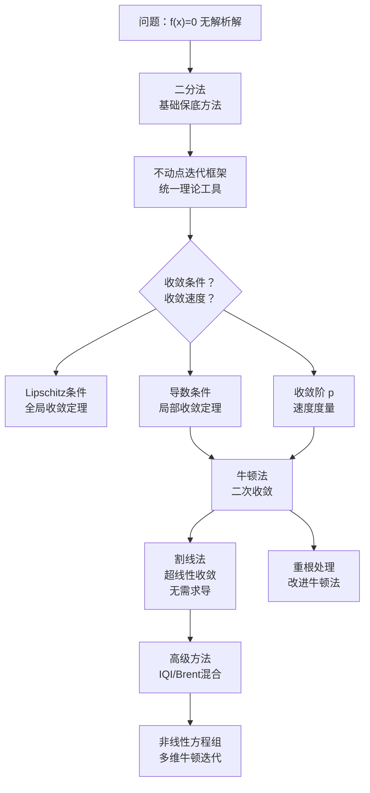
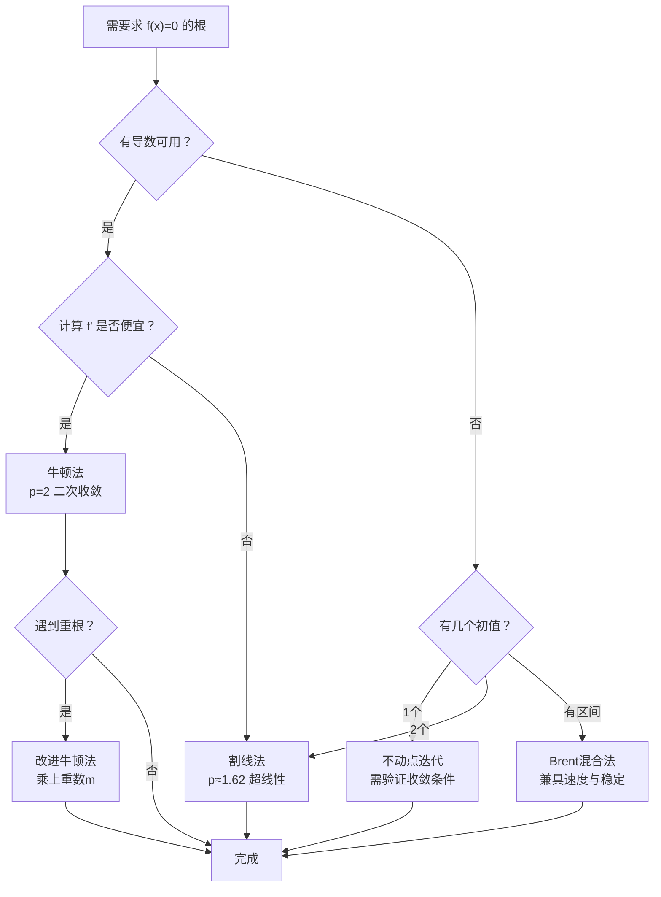

# 第02章 非线性方程求根

---

## 一、本章核心脉络

**核心问题**：给定 $f(x)=0$，在不知道解析解的情况下，如何用计算机算出足够精确的近似根？

> 这条脉络的核心逻辑：**二分法给了我们一个"一定能行"的底线 → 不动点迭代提供了统一的理论框架来理解"什么时候收敛、收敛多快" → 牛顿法通过在不动点迭代中精心选择 $g(x)$ 实现了二阶收敛 → 割线法等变种在避免求导的代价下实现了超线性收敛 → 最终推广到多维。**

---

## 二、数值求解方程的必要性

### 为什么需要数值方法？

> 一句话来说：很多方程根本写不出解析解，但数值方法能用迭代逼近到任意精度。

- **光的衍射理论**：$x - \tan x = 0$
- **行星轨道计算（Kepler 方程）**：$x - a\sin x = b$

这些方程无法用初等函数表达其解，必须依赖数值技术。

---

## 三、二分法（Bisection Method）— 基础保底方法

### 核心定理（介值定理）

> 一句话来说：如果连续函数在区间两端异号，则区间内必有一根——对半切就能逐步逼近。

**定理**：如果 $f \in C[a,b]$ 且 $f(a)f(b) < 0$，则 $\exists r \in (a,b)$ 使得 $f(r)=0$。

### 算法流程

1. 取中点 $c = \frac{a+b}{2}$
2. 若 $f(c)=0$，找到根
3. 若 $f(a)f(c)<0$，根在 $[a,c]$；否则在 $[c,b]$
4. 缩小区间，重复

### 误差分析

$n$ 步后的误差界：
$$\varepsilon_n = \frac{b-a}{2^{n+1}}$$

**例题**：用二分法求 $f(x)=\cos x - x$ 在 $[0,1]$ 的根到 6 位有效数字。

所需步数：$\varepsilon_n = \frac{1}{2^{n+1}} < 0.5 \times 10^{-6} \to n > \frac{6}{\log_{10}2} \approx 19.9$，约 20 步。

### 优缺点

| 优点 | 缺点 |
|------|------|
| 一定能收敛（最可靠） | 收敛速度慢（线性收敛） |
| 每步误差界明确 | 需要初始区间包含根 |
| 实现简单 | 不能求复根 |

---

## 四、不动点迭代（Fixed-Point Iteration）— 核心理论框架（**核心**）

### 基本定义

> 一句话来说：把 $f(x)=0$ 改写成 $x=g(x)$，然后反复代入，若收敛则得到不动点——也就是原方程的根。

- **不动点**：若 $g(r)=r$，则 $r$ 为 $g$ 的不动点
- **与方程根的关系**：$g(r)=r \iff f(r)=g(r)-r=0$

**引例**：对任意初值重复按计算器的 $\cos$ 键——无论初值是多少，最终都会收敛到 $0.739085\dots$（$\cos x = x$ 的解）。

### 三种构造方式（以 $x^3+x-1=0$ 为例）

| 构造 | $g(x)$ | 是否收敛？ | $\vert g'(r)\vert$ |
|------|--------|:--------:|:---:|
| 构造1 | $g(x)=1-x^3$ | ❌ | $\approx 1.395$ |
| 构造2 | $g(x)=\sqrt[3]{1-x}$ | ✅ | $\approx 0.716$ |
| 构造3 | $g(x)=\frac{1+2x^3}{1+3x^2}$ | ✅✅ | $= 0$ |

> 关键洞察：同一个方程可以有多种不动点迭代构造，但**收敛性天差地别**——取决于 $\vert g'(r)\vert$ 的大小。

### 收敛的几何解释

不动点迭代的收敛/发散可以在 $y=g(x)$ 和 $y=x$ 的图上用**蛛网图（cobweb）**直观看出：

- $\vert g'(x)\vert < 1$：蛛网向内收缩 → 收敛
- $\vert g'(x)\vert > 1$：蛛网向外扩张 → 发散

---

## 五、收敛性理论（**难点**）

### 5.1 全局收敛定理（Lipschitz 条件）

> 一句话来说：如果 $g(x)$ 把 $[a,b]$ 映射到自己内部，且是"压缩"的（Lipschitz 常数 $L<1$），则从任何起点出发都收敛到唯一不动点。

**定义**（Lipschitz 条件）：若存在 $L>0$，使得 $\forall x_1,x_2 \in I$：
$$\vert g(x_1)-g(x_2)\vert \leq L\vert x_1-x_2\vert$$
称 $g$ 在 $I$ 上满足 Lipschitz 条件，$L$ 称为 Lipschitz 常数。

**全局收敛定理**：若 $g \in C[a,b]$ 且满足：
1. $\forall x \in [a,b]$，$a \leq g(x) \leq b$（自映射）
2. $\exists L \in (0,1)$ 使 Lipschitz 条件成立（压缩映射）

则 $g$ 在 $[a,b]$ 上有**唯一**不动点 $x^*$，且 $\forall x_0 \in [a,b]$，不动点迭代全局收敛，误差满足：
$$\vert x_k - x^*\vert \leq \frac{L}{1-L}\vert x_k - x_{k-1}\vert \leq \cdots \leq \frac{L^k}{1-L}\vert x_1 - x_0\vert$$

**实用推论**（用导数判据）：若 $g$ 在 $[a,b]$ 连续可微，$\forall x \in (a,b)$ 有 $a \leq g(x) \leq b$，且 $\vert g'(x)\vert \leq L < 1$，则结论同上成立。

### 5.2 局部收敛定理

> 一句话来说：只要在不动点处的导数绝对值小于 1，从附近的初值出发就一定能收敛——局部收敛的条件比全局收敛宽松得多。

**定理**：设 $x^*$ 为 $g$ 的不动点，若 $g'$ 在 $x^*$ 的某邻域内连续且 $\vert g'(x^*)\vert < 1$，则不动点迭代 $x_{i+1}=g(x_i)$ 局部收敛。

### 5.3 收敛阶（Order of Convergence）

> 一句话来说：收敛阶 $p$ 衡量"每迭代一步，误差缩小多少倍"——$p=1$ 线性、$p=2$ 平方（每次迭代有效位数翻倍）。

**定义**：设 $\{x_k\}$ 收敛到 $x^*$，记 $e_i = \vert x_i - x^*\vert$。若存在 $p \geq 1$ 使得：
$$\lim_{i\to\infty} \frac{e_{i+1}}{e_i^p} = C \neq 0$$
则称序列 $p$ 阶收敛。

- $p=1$（$C<1$）：**线性收敛**——每步误差按固定比例缩小
- $p=2$：**平方收敛**——每步误差平方缩小，有效位数翻倍

**收敛阶定理**：若 $g \in C^p(a,b)$，$g(x^*) = x^*$，且
$$g'(x^*) = g''(x^*) = \cdots = g^{(p-1)}(x^*) = 0,\quad g^{(p)}(x^*) \neq 0$$
则不动点迭代 $p$ 阶局部收敛，且：
$$\lim_{i\to\infty} \frac{e_{i+1}}{e_i^p} = \frac{\vert g^{(p)}(x^*)\vert}{p!}$$

> 核心洞察：这就是设计牛顿法的数学原理——**故意构造 $g(x)$ 使 $g'(x^*)=0$，从而获得至少二阶收敛**。

### 5.4 迭代终止条件

| 类型 | 条件 | 适用场景 |
|------|------|----------|
| 绝对误差 | $\vert x_{i+1}-x_i\vert < TOL$ | 一般情况 |
| 相对误差 | $\frac{\vert x_{i+1}-x_i\vert}{\vert x_i\vert} < TOL$ | $x_i$ 远离零 |
| 混合 | $\frac{\vert x_{i+1}-x_i\vert}{\max(\theta, \vert x_i\vert)} < TOL$ | $x_i$ 在零附近 |

> [!warning] 必须加上最大迭代步数限制，防止不收敛时死循环。

---

## 六、精度极限与根搜索敏感度（**了解即可**）

### 前向误差 vs 后向误差

> 一句话来说：前向误差是"答案差多少"，后向误差是"代入原方程还剩多少"——即使后向误差极小，前向误差也可能很大。

- **前向误差**：$\vert x_n - r\vert$
- **后向误差**：$\vert f(x_n)\vert$
- **误差放大因子** $= \frac{\text{相对前向误差}}{\text{相对后向误差}}$

### 条件数与重根

**条件数**衡量问题本身对输入误差的敏感程度。

**重根定义**：若 $f(r) = f'(r) = \cdots = f^{(m-1)}(r) = 0$，$f^{(m)}(r) \neq 0$，则称 $r$ 为 $f(x)=0$ 的 $m$ 重根。

> [!warning] 重根处的条件数很大（分母 $f'(r)=0$），是病态问题。

**敏感度分析**：$f(x)+\epsilon g(x)=0$ 的根偏移量为
$$\Delta r \approx -\epsilon \frac{g(r)}{f'(r)}$$

**Wilkinson 多项式**：$W(x) = (x-1)(x-2)\cdots(x-20)$——一个经典的病态问题，${x}^{15}$ 项的微小扰动就能导致 $r=16$ 附近的根发生显著偏移。误差放大因子可达 $3.8 \times 10^{12}$！

---

## 七、牛顿迭代法（Newton's Method）— 本章核心（**核心**）

### 7.1 推导与几何解释

> 一句话来说：在每一点用切线代替曲线，切线与 $x$ 轴的交点就是下一次迭代值——这是"线性化"思想的最经典应用。

**几何推导**：过点 $(x_i, f(x_i))$ 作切线：
$$y = f(x_i) + f'(x_i)(x-x_i)$$
切线与 $x$ 轴的交点即为 $x_{i+1}$：
$$x_{i+1} = x_i - \frac{f(x_i)}{f'(x_i)}$$

**代数推导**：将 $f(x)=0$ 在 $x_i$ 处 Taylor 展开，忽略高阶项：
$$0 = f(x_i) + f'(x_i)(x-x_i) + \frac{1}{2}f''(\xi)(x-x_i)^2$$

### 7.2 收敛性分析

**定理**（局部二次收敛）：若 $f \in C^2[a,b]$，$f(r)=0$，$f'(r) \neq 0$，则牛顿法局部二次收敛，且：
$$\lim_{i\to\infty} \frac{e_{i+1}}{e_i^2} = \left\vert\frac{f''(r)}{2f'(r)}\right\vert$$

**定理**（全局收敛特例）：若 $f \in C^2(\mathbb{R})$ 是单调递增的凸函数，$f(r)=0$，则对 $\forall x_0 \in \mathbb{R}$，牛顿迭代都收敛到 $r$。

> 核心洞察：牛顿法可以看作一种特殊的不动点迭代 $g(x) = x - \frac{f(x)}{f'(x)}$，且 $g'(r) = 0$——这一设计使其获得了二阶收敛。

### 7.3 重根的处理

> 一句话来说：牛顿法在单根处二次收敛，在 $m$ 重根处退化为一阶收敛——但如果在迭代公式中乘上 $m$，就能恢复二次收敛。

**标准牛顿法在 $m$ 重根处**（$m>1$）：
$$\lim_{i\to\infty} \frac{e_{i+1}}{e_i} = \frac{m-1}{m} \quad \text{（线性收敛）}$$

> [!note]- 推导：为什么是 $(m-1)/m$？
> 
> $m$ 重根处 $f(x) = (x-r)^m h(x)$，$h(r) \neq 0$。牛顿法的 $g(x)=x-f(x)/f'(x)$。
> 
> **直观推导**（主导项近似）：对 $x \approx r$，
> $$f(x) \approx (x-r)^m h(r), \quad f'(x) \approx m(x-r)^{m-1} h(r)$$
> $$\frac{f(x)}{f'(x)} \approx \frac{(x-r)^m h(r)}{m(x-r)^{m-1} h(r)} = \frac{x-r}{m}$$
> $$g(x) = x - \frac{f}{f'} \approx x - \frac{x-r}{m}$$
> $$g'(r) = \lim_{x\to r} \left(1 - \frac{1}{m}\right) = \frac{m-1}{m}$$
> 
> **严格推导**：$g(x)=x-f/f'$，$g'(x)=f f''/(f')^2$（见单根证明）。代入 $m$ 重根展开式，
> 分子主导项 $= m(m-1)(x-r)^{2m-2}h(r)^2$，分母主导项 $= m^2(x-r)^{2m-2}h(r)^2$，
> 比值得 $g'(r) = m(m-1)/m^2 = (m-1)/m$。
> 
> $|g'(r)|<1 \implies$ 线性收敛，收敛因子 $(m-1)/m$：
> - $m=2$（二重根）：因子 $1/2$，每步误差折半
> - $m=3$（三重根）：因子 $2/3$，每步缩至 $2/3$
> - $m \gg 1$：因子 $\to 1$，近乎停滞

**改进的牛顿法**（恢复二次收敛）：
$$x_{i+1} = x_i - \frac{m f(x_i)}{f'(x_i)}$$
$$\lim_{i\to\infty} \frac{e_{i+1}}{e_i^2} = \frac{1}{m(m+1)}\left\vert\frac{f^{(m+1)}(r)}{f^{(m)}(r)}\right\vert$$

**例题**：$f(x)=\sin x + x^2\cos x - x^2 - x$，$r=0$ 是三重根。标准牛顿法每步误差缩小 $2/3$，约需 36 步达 6 位精度。

### 7.4 牛顿法的失效与修正

**牛顿下山法**：引入步长因子 $\lambda$ 保证函数值单调递减：
$$x_{i+1} = x_i - \lambda \frac{f(x_i)}{f'(x_i)}$$
初始 $\lambda=1$，若 $\vert f(x_{i+1})\vert \geq \vert f(x_i)\vert$ 则 $\lambda$ 减半重试。

> 直观理解：标准牛顿法"步子迈太大"时可能跳过根，下山法通过缩小步长来"稳住"——牺牲一点速度换稳定。

---

## 八、割线法（Secant Method）

### 8.1 动机与公式

> 一句话来说：牛顿法需要求导，而割线法用差分代替导数——用两个历史点的连线（割线）代替切线。

$$x_{i+1} = x_i - \frac{f(x_i)(x_i - x_{i-1})}{f(x_i) - f(x_{i-1})}$$

### 8.2 收敛速度

**超线性收敛**：割线法的收敛阶为 $\alpha = \frac{1+\sqrt{5}}{2} \approx 1.62$。

$$e_{i+1} \approx \left\vert\frac{f''(r)}{2f'(r)}\right\vert e_i e_{i-1}$$

| 方法 | 收敛阶 | 每步代价 | 哪个更高效？ |
|------|:---:|------|------|
| 牛顿法 | 2 | 1 次 $f$ + 1 次 $f'$ | 看导数计算成本 |
| 割线法 | 1.62 | 1 次 $f$ | 适合导数难以计算时 |

### 8.3 试位法（False Position / Regula Falsi）

割线法的一个变种——始终保持区间两端异号（类似二分法的区间收缩策略），比标准割线法更稳定但可能更慢。

---

## 九、高级方法（**了解即可**）

### 9.1 Muller 方法（抛物线法）

用三个点确定一条抛物线，取抛物线与 $x$ 轴的交点中离当前点较近的那个——收敛阶约 1.84，且能处理复根。

### 9.2 逆二次插值（IQI）

把 $x$ 看作 $y$ 的函数进行抛物线插值——这是 Brent 方法的核心组件。

### 9.3 Brent 混合方法

> 一句话来说：二分法保证收敛、IQI 和割线法追求速度——Brent 方法的策略是"优先尝试快方法，不行就退回二分法"。

这是工程实践中**最常用**的一维求根方法（MATLAB 的 `fzero` 即基于此）。

---

## 十、非线性方程组的牛顿迭代（拓展）

### 基本思路

> 一句话来说：把一维牛顿法的"切线"推广为多维的"切平面"——用 Jacobi 矩阵代替导数。

$$\mathbf{x}_{i+1} = \mathbf{x}_i - \mathbf{J}^{-1}(\mathbf{x}_i) \mathbf{F}(\mathbf{x}_i)$$

其中 $\mathbf{J}$ 是 Jacobi 矩阵：
$$J_{ij} = \frac{\partial f_i}{\partial x_j}$$

实际计算时解线性方程组 $\mathbf{J}(\mathbf{x}_i) \cdot \Delta\mathbf{x} = -\mathbf{F}(\mathbf{x}_i)$，而不是求逆。

**例题**：求解 $\begin{cases} v - u^3 = 0 \\ u^2 + v^2 - 1 = 0 \end{cases}$，取 $\mathbf{x}_0 = (1, 2)^T$，一步迭代后得 $(1, 1)^T$。

> [!note]- 完整计算
> $$F(\mathbf{x}) = \begin{pmatrix} f_1(u,v) \\ f_2(u,v) \end{pmatrix} = \begin{pmatrix} v-u^3 \\ u^2+v^2-1 \end{pmatrix}$$
> 
> **Jacobi 矩阵**：$\mathbf{J} = \begin{pmatrix} \partial f_1/\partial u & \partial f_1/\partial v \\ \partial f_2/\partial u & \partial f_2/\partial v \end{pmatrix} = \begin{pmatrix} -3u^2 & 1 \\ 2u & 2v \end{pmatrix}$
> 
> **在 $\mathbf{x}_0=(1,2)^T$ 处**：
> $$\mathbf{J}_0 = \begin{pmatrix} -3 & 1 \\ 2 & 4 \end{pmatrix}, \quad \mathbf{F}_0 = \begin{pmatrix} 2-1 \\ 1+4-1 \end{pmatrix} = \begin{pmatrix} 1 \\ 4 \end{pmatrix}$$
> 
> **解 $\mathbf{J}_0 \Delta\mathbf{x} = -\mathbf{F}_0$**（不求逆，解方程组）：
> $$\begin{cases} -3\Delta u + \Delta v = -1 \\ 2\Delta u + 4\Delta v = -4 \end{cases}$$
> 由 ①：$\Delta v = 3\Delta u - 1$，代入 ②：
> $$2\Delta u + 4(3\Delta u - 1) = -4 \implies 14\Delta u = 0 \implies \Delta u = 0$$
> 回代：$\Delta v = 3\cdot0 - 1 = -1$。即 $\Delta\mathbf{x} = (0, -1)^T$。
> 
> $$\mathbf{x}_1 = \mathbf{x}_0 + \Delta\mathbf{x} = (1,2)^T + (0,-1)^T = (1,1)^T$$
> 
> 验证：$f_1(1,1)=1-1=0$，$f_2(1,1)=1+1-1=1\neq0$——还未到根，需继续迭代。

---

## 判定/决策流程

---

## 核心公式速查表

| 方法 | 迭代公式 | 收敛阶 | 关键条件 |
|------|----------|:---:|------|
| 二分法 | $c=\frac{a+b}{2}$ | 1（线性） | $f(a)f(b)<0$ |
| 不动点迭代 | $x_{i+1}=g(x_i)$ | 取决于 $g$ | $\vert g'(x^*)\vert <1$ |
| 牛顿法 | $x_{i+1}=x_i-\frac{f}{f'}$ | 2（二次） | $f'(r)\neq 0$ |
| 改进牛顿（m重根） | $x_{i+1}=x_i-\frac{mf}{f'}$ | 2（二次） | 需知重数 $m$ |
| 割线法 | $x_{i+1}=x_i-\frac{f_i(x_i-x_{i-1})}{f_i-f_{i-1}}$ | 1.62 | 需两个初值 |
| 牛顿下山法 | $x_{i+1}=x_i-\lambda\frac{f}{f'}$ | ~2 | $\lambda$ 自适应 |

**误差公式**：
- 二分法：$\varepsilon_n = \frac{b-a}{2^{n+1}}$
- 不动点迭代先验界：$\vert x_k-x^*\vert \leq \frac{L^k}{1-L}\vert x_1-x_0\vert$
- 牛顿法近似：$e_{i+1} \approx \left\vert\frac{f''(r)}{2f'(r)}\right\vert e_i^2$

---

## 易错点与注意事项

> [!warning] **必要条件 vs 充分条件**
> - $\vert g'(x^*)\vert < 1$ 是局部收敛的**充分条件**，不是必要条件
> - Lipschitz 条件 + 自映射是全局收敛的**充分条件**
> - 牛顿法的二次收敛要求 $f'(r) \neq 0$（单根），重根处退化为线性收敛

> [!warning] **收敛阶与效率不是一回事**
> - 割线法的收敛阶（1.62）低于牛顿法（2），但每步只需计算一次 $f$，不需求导
> - 如果 $f'$ 的计算代价远高于 $f$，割线法可能总体更高效

> [!warning] **不动点迭代的构造很重要**
> - 同一个方程可以有多种 $g(x)$ 构造，收敛性完全不同
> - $g'(x^*) = 0$ 的构造至少有二阶收敛

> [!warning] **Wilkinson 多项式的教训**
> - 高次多项式求根是经典的病态问题
> - 输入数据的小误差（如系数舍入）可能导致根的大偏移
> - 实际应用中应避免直接展开高次多项式

---

## 相关知识点链接

| 章节 | 关联点 | 为什么相关 |
|------|--------|-----------|
| [[课程/数值分析/01-背景与基础知识]] | 误差、浮点数、条件数 | 理解根的精度极限和敏感度需要前章的误差理论 |
| [[课程/数值分析/03-线性方程组的直接解法]] | Jacobi矩阵、解线性方程组 | 牛顿迭代每步需要解 Jacobi 线性系统 |
| [[课程/数值分析/04-线性方程组的迭代法]] | 不动点迭代统一框架 | 迭代法的收敛性分析与本章完全相同 |
| [[课程/数值分析/10-常微分方程初值问题的数值解法]] | 隐式方法求解 | ODE 隐式公式每步需要求解非线性方程 |

---

## 作业与练习

本章练习覆盖所有核心方法。详见：
- [[课程/数值分析/02-非线性方程求根#思考与练习|课后思考题]]
- 重点练习：二分法误差估算、不动点迭代收敛性判断、牛顿法收敛阶分析、割线法与牛顿法的效率对比

**建议做题顺序**：
1. 先用二分法理解误差估算方式
2. 再用不动点迭代练习构造 $g(x)$ 和判断收敛性
3. 最后用牛顿法体会二次收敛的速度优势
