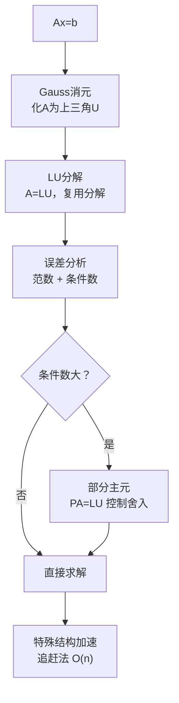
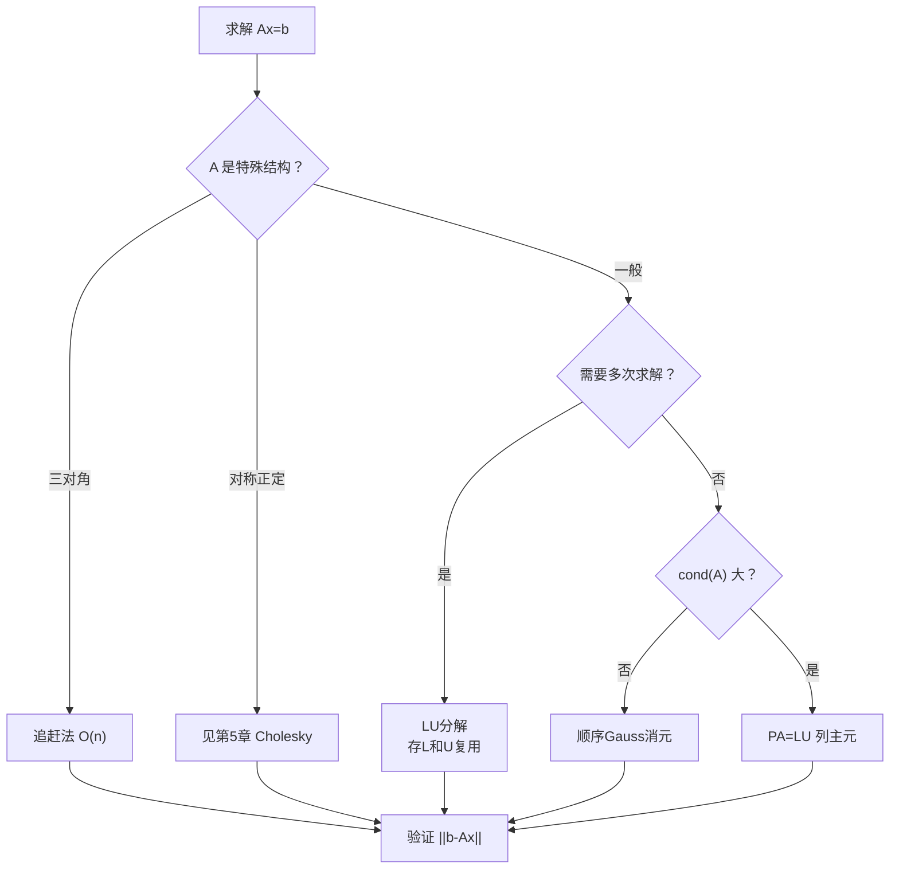

# 第03章 线性方程组的直接解法

---

## 一、本章核心脉络

**核心问题**：给定 $Ax=b$，如何在有限步内精确求解？直接法通过矩阵分解将 $A$ 化为三角形，然后回代。但有限精度下，"精确"≠"正确"——需要量化误差。

> 这条脉络的核心逻辑：**Gauss消元是基础 → LU分解让消元结果可复用 → 范数和条件数量化了"算得有多准" → 部分主元策略防止舍入误差的灾难性放大 → 对于三对角等特殊结构，可以降到 $O(n)$。**

---

## 二、理论基础

### 线性方程组的标准形式

> 一句话来说：$Ax=b$，其中 $A$ 是 $n \times n$ 系数矩阵，$x$ 是未知向量，$b$ 是右端项。

**求解方案对比**：
1. 求逆法：$x = A^{-1}b$（几乎从不用，求逆太贵）
2. Cramer 法则：$x_k = \frac{\det(A_k)}{\det(A)}$（计算量 $O(n!)$，完全不实用）
3. **直接法**：通过行变换将 $A$ 化为三角形，计算量 $O(n^3)$

### 容易求解的矩阵形态

| 类型 | 形式 | 求解方式 |
|------|------|----------|
| 单位阵 $I$ | 对角线全1 | $x=b$ |
| 对角阵 $D$ | 仅对角线非零 | $x_i = b_i/d_i$ |
| 下三角 $L$ | 对角线以上全零 | 前代（从上到下） |
| 上三角 $U$ | 对角线以下全零 | 回代（从下到上） |

> 核心洞察：Gauss消元的本质就是**把任意矩阵 $A$ 化归为上三角 $U$**——因为上三角方程组回代求解只需要 $O(n^2)$。

---

## 三、Gauss 消元法（**核心**）

### 3.1 核心思想

> 一句话来说：通过三种行初等运算（交换/倍乘/倍加），逐列把对角线以下的元素消成零，最终得到上三角方程组。

**理论支撑**：行初等运算不改变方程组的解（同解变换）。

### 3.2 具体操作

设 $a_{11} \neq 0$，对第 $i$ 行（$i=2,\ldots,n$）：

$$a_{ij} \leftarrow a_{ij} - \left(\frac{a_{i1}}{a_{11}}\right)a_{1j}, \quad b_i \leftarrow b_i - \left(\frac{a_{i1}}{a_{11}}\right)b_1$$

经过 $n-1$ 轮后得到上三角方程组：

$$\begin{pmatrix}
a_{11} & a_{12} & \cdots & a_{1n} \\
0 & a_{22} & \cdots & a_{2n} \\
\vdots & \vdots & \ddots & \vdots \\
0 & 0 & \cdots & a_{nn}
\end{pmatrix}
\begin{pmatrix} x_1 \\ x_2 \\ \vdots \\ x_n \end{pmatrix} =
\begin{pmatrix} b_1 \\ b_2 \\ \vdots \\ b_n \end{pmatrix}$$

### 3.3 计算量

消去一个元：1 次除法 + $n$ 次乘法 + $n$ 次减法

**消元总计算量**：
$$N_e = \sum_{j=1}^{n}(2j+1)(j-1) = \frac{2}{3}n^3 + \frac{1}{2}n^2 - \frac{7}{6}n = O(n^3)$$

**回代计算量**：
$$N_b = \sum_{i=1}^{n}(2(n-i)+1) = n^2 = O(n^2)$$

回代公式：$x_i = (b_i - \sum_{j=i+1}^{n} a_{ij}x_j) / a_{ii}$

**例题**：对 $500 \times 500$ 系统，消元时间与回代时间之比：
$$\frac{t_b}{t_e} \approx \frac{N_b}{N_e} \approx \frac{500^2}{\frac{2}{3}\times 500^3} = 0.003$$

> 核心洞察：消元占绝对主导（$O(n^3)$ vs $O(n^2)$）——规模翻倍，计算量翻8倍。

---

## 四、LU 分解（**核心**）

### 4.1 什么是 LU 分解？

> 一句话来说：把 $A$ 分解为一个下三角 $L$ 和一个上三角 $U$ 的乘积 $A=LU$——这样求解 $Ax=b$ 就变成两步三角形回代。

$$A = LU \implies \begin{cases} Ly = b & \text{（前代）} \\ Ux = y & \text{（回代）} \end{cases}$$

**优势**：如果 $b$ 变了但 $A$ 不变，不需要重做消元——这对迭代优化等场景极其重要。

### 4.2 Doolittle 分解 vs Crout 分解

| 分解 | $L$ 的对角线 | $U$ 的对角线 |
|------|:---:|:---:|
| Doolittle | 全 1 | 待定 |
| Crout | 待定 | 全 1 |
| 一般 | 待定 | 待定（$n^2+n$ 未知数，$n^2$ 方程，需 $n$ 个约束） |

### 4.3 递推公式（Doolittle）

$$\begin{aligned}
u_{kj} &= (a_{kj} - \sum_{s=1}^{k-1} l_{ks}u_{sj}) / l_{kk} \quad (k \leq j \leq n) \\
l_{ik} &= (a_{ik} - \sum_{s=1}^{k-1} l_{is}u_{sk}) / u_{kk} \quad (k < i \leq n)
\end{aligned}$$

求解顺序：$u_{11} \to l_{i1},u_{1j} \to u_{22} \to l_{i2},u_{2j} \to \cdots \to u_{nn}$

### 4.4 存在性定理

> **LU 分解定理**：若 $n \times n$ 矩阵 $A$ 的所有前主子式非奇异，则 $A$ 有 LU 分解。

**计算量**：$\frac{2}{3}n^3 - \frac{1}{2}n^2 - \frac{1}{6}n$，与 Gauss 消元同阶但系数更小。

#### 严格行对角占优与顺序消元

严格行对角占优指
$$
\vert a_{ii}\vert>\sum_{j\ne i}\vert a_{ij}\vert,\qquad i=1,\ldots,n.
$$
不选主元的 Gauss 消元保持严格行对角占优性质。严格行对角占优矩阵可逆且有 $LU$ 分解，因此可不选主元进行消元。

---

## 五、误差分析（**难点**）

### 5.1 向量范数

> 一句话来说：范数是"向量大小"的推广——不同的范数从不同角度衡量距离，但都满足正定性、齐次性、三角不等式。

| 范数          | 定义                            | 含义   |     |      |
| ----------- | ----------------------------- | ---- | --- | ---- |
| 1-范数        | $\|x\|_1 = \sum_{i=1}^n       | x_i  | $   | 绝对值和 |
| 2-范数        | $\|x\|_2 = \sqrt{\sum x_i^2}$ | 欧氏距离 |     |      |
| $\infty$-范数 | $\|x\|_\infty = \max_i        | x_i  | $   | 最大分量 |

### 5.2 矩阵范数（算子范数）

$$|A| = \max_{x \neq 0} \frac{\|Ax\|}{\|x\|}$$

| 范数 | 定义 |
|------|------|
| $\|A\|_1$ | 最大绝对列和 |
| $\|A\|_\infty$ | 最大绝对行和 |
| $\|A\|_2$ | $\sqrt{\rho(A^TA)}$ |

### 5.3 条件数

> 一句话来说：条件数告诉你"输入扰动会被放大多少倍"——条件数大 = 病态，再好的算法也难算准。

$$\mathrm{cond}(A) = \|A\| \cdot \|A^{-1}\|$$

**误差关系**（核心不等式）：
$$\frac{1}{\mathrm{cond}(A)}\frac{\|r\|}{\|b\|} \leq \frac{\|x_a - x\|}{\|x\|} \leq \mathrm{cond}(A)\frac{\|r\|}{\|b\|}$$

- **前向误差**：$\|x_a - x\|$（答案差了多少）
- **后向误差**：$\|r\| = \|b - Ax_a\|$（残差多大）
- **误差放大因子** = 相对前向误差 / 相对后向误差

**例题**：求解 $\begin{cases} x_1 + x_2 = 2 \\ 1.0001x_1 + x_2 = 2.0001 \end{cases}$

$$A = \begin{pmatrix} 1 & 1 \\ 1.0001 & 1 \end{pmatrix}, \quad \mathrm{cond}(A) \approx 40000$$

> [!warning] **典型病态矩阵：Hilbert 矩阵** $H_{ij} = \frac{1}{i+j-1}$，条件数随阶数指数增长。$H_{20}$ 的条件数约为 $10^{28}$——双精度（16位有效数字）完全不够。

---

## 六、部分主元 Gauss 消元（**核心**）

### 6.1 为什么需要选主元？

> 一句话来说：消元时除以小主元会把舍入误差放大很多倍——选最大元素做主元可以控制这种放大。

**经典例题**：

$$\begin{cases} 10^{-20}x_1 + x_2 = 1 \\ x_1 + 2x_2 = 4 \end{cases}$$

顺序 Gauss 消元（除以 $10^{-20}$）：$x_1 = 0, x_2 = 1$（完全错误！）

调换方程顺序（除以 $1$）：$x_1 = 2, x_2 = 1$（正确）

### 6.2 列主元策略

在第 $i$ 列消元前，找到该列中绝对值最大的元素 $a_{ji}$（$i \leq j \leq n$），交换第 $i$ 行和第 $j$ 行。

> 核心洞察：交换方程的顺序不改变解，但可以避免除以接近零的"小主元"——这就是"行交换"的全部奥义。

---

## 七、LU 分解与 Gauss 消元的联系

> 一句话来说：Gauss 消元的每一步行变换都等价于左乘一个初等矩阵——把这些矩阵的逆乘起来就是 $L$。

### 本质关系

- 行交换 → 左乘置换矩阵 $P$
- 倍加运算 → 左乘初等矩阵 $E_k$
- 顺序 Gauss 消元：$E_m \cdots E_1 A = U \implies A = E_1^{-1}\cdots E_m^{-1} U = LU$
- 列主元 Gauss 消元：$PA = LU$

### PA=LU 求解流程

$$PAx = Pb \implies LUx = Pb \implies \begin{cases} Ly = Pb \\ Ux = y \end{cases}$$

> [!note]- 实例：LU 失败 vs PA=LU 成功
> 
> **矩阵**：$A = \begin{pmatrix} 0 & 2 & 3 \\ 2 & -4 & 7 \\ 1 & -2 & 7 \end{pmatrix}$
> 
> **常规 LU**：$a_{11}=0$，首次消元就除以零 → **LU 分解不存在**（第一前主子式 $=0$）。
> 
> **列主元 $PA=LU$**：
> 
> ① **选主元**：第 1 列 $\max|a_{i1}| = |2|$ 在第 2 行 → 交换行 1 ↔ 行 2：
> $$P = \begin{pmatrix}0&1&0\\1&0&0\\0&0&1\end{pmatrix}, \quad PA = \begin{pmatrix}2&-4&7\\0&2&3\\1&-2&7\end{pmatrix}$$
> 
> ② **消元**：第 1 列用 $a_{11}=2$ 作主元。行 2 为 $0$ 跳过；行 3 消去：$r_3 \leftarrow r_3 - \frac{1}{2}r_1$，乘数 $m_{31}=\frac12$。
> 
> ③ 此时矩阵变为：
> $$\begin{pmatrix}2&-4&7\\0&2&3\\0&0&3.5\end{pmatrix} = U$$
> 
> ④ **$L$ 的构造**——消元乘数直接填入：
> 
> $L$ 的对角线全为 1，上三角全为 0。**下三角的每个非零元 = 消元时用的乘数**：
> - 消去 $a_{31}$ 时乘数 $m_{31}=\frac12$ → $L_{31}=\frac12$
> - 行 2 在列 1 无需消去，乘数 $m_{21}=0$ → $L_{21}=0$
> - 行 3 在列 2 无需消去（已是 0）→ $L_{32}=0$
> 
> $$L = \begin{pmatrix}1&0&0\\0&1&0\\\frac12&0&1\end{pmatrix}$$
> 
> > [!tip] $L$ 不需要额外计算——消元过程中把乘数记下来就是 $L$。这是 Gauss 消元与 LU 分解本质联系的直接体现：$L$ = 消元变换矩阵逆的乘积。
> 
> **验证 $L=E_1^{-1}$**（矩阵形式）：
> 
> 消元步骤「$r_3 \leftarrow r_3 - \frac12 r_1$」等价于左乘初等矩阵：
> $$E_1 = \begin{pmatrix}1&0&0\\0&1&0\\-\frac12&0&1\end{pmatrix}$$
> 
> 于是 $E_1 \cdot PA = U$。两边左乘 $E_1^{-1}$：
> $$PA = E_1^{-1} U$$
> 
> $E_1$ 的逆只需把乘数变号（消元时减 $\frac12$，逆就加 $\frac12$）：
> $$E_1^{-1} = \begin{pmatrix}1&0&0\\0&1&0\\\frac12&0&1\end{pmatrix} = L$$
> 
> 所以 $PA = E_1^{-1} U = LU$。**$L$ 的每个非对角元 = 对应消元步骤的乘数（取正号）**——因为 $E_k^{-1}$ 就是把 $E_k$ 中的乘数符号反转。下三角矩阵乘积仍是下三角，保证了 $L$ 的结构。
> 
> 数值验证：$LU = \begin{pmatrix}1&0&0\\0&1&0\\\frac12&0&1\end{pmatrix}\!\begin{pmatrix}2&-4&7\\0&2&3\\0&0&3.5\end{pmatrix} = \begin{pmatrix}2&-4&7\\0&2&3\\1&-2&7\end{pmatrix} = PA \; \checkmark$
> 
> **对比**：
> 
> | | 常规 LU | PA=LU |
> |:--|:--|:--|
> | 存在性 | ❌ 第一前主子式 $=0$ | ✅ 只要 $A$ 可逆就存在 |
> | 数值稳定性 | 取决于主元大小 | 列主元控制舍入放大 |
> | 适用场景 | 对角占优 / 正定矩阵 | 通用 |

---

## 八、带状方程组与追赶法

> 一句话来说：三对角矩阵的 LU 分解只需 $O(n)$——因为每行最多三个非零元，消元时只与前后邻居交互。

### 追赶法（Thomas 算法）

对三对角方程组：

$$\begin{pmatrix}
d_1 & c_1 & & & \\
a_1 & d_2 & c_2 & & \\
& \ddots & \ddots & \ddots & \\
& & a_{n-2} & d_{n-1} & c_{n-1} \\
& & & a_{n-1} & d_n
\end{pmatrix}
\begin{pmatrix} x_1 \\ x_2 \\ \vdots \\ x_{n-1} \\ x_n \end{pmatrix} =
\begin{pmatrix} b_1 \\ b_2 \\ \vdots \\ b_{n-1} \\ b_n \end{pmatrix}$$

计算量：$O(n)$（消元 $5n$ 次运算，回代 $3n$ 次运算）。

---

## 判定/决策流程

---

## 核心公式速查表

| 概念 | 公式 | 说明 |
|------|------|------|
| Gauss 消元核心 | $a_{ij} \leftarrow a_{ij} - \frac{a_{i1}}{a_{11}}a_{1j}$ | 第1轮消元 |
| 消元计算量 | $\frac{2}{3}n^3$ | $O(n^3)$ |
| 回代公式 | $x_i = (b_i - \sum_{j=i+1}^n a_{ij}x_j)/a_{ii}$ | — |
| Doolittle 分解 | $u_{kj}, l_{ik}$ 交替求解 | 递推公式 |
| 算子范数 | $\|A\| = \max_x \|Ax\|/\|x\|$ | 从属范数 |
| 条件数 | $\mathrm{cond}(A) = \|A\| \cdot \|A^{-1}\|$ | 误差放大上限 |
| 误差不等式 | $\frac{1}{\mathrm{cond}}\frac{\|r\|}{\|b\|} \leq \frac{\|\Delta x\|}{\|x\|} \leq \mathrm{cond}\frac{\|r\|}{\|b\|}$ | — |
| PA=LU | $PA = LU$ | 列主元形式 |
| 追赶法 | $O(n)$ | 三对角专用 |

---

## 易错点与注意事项

> [!warning] **求逆矩阵几乎永远不是正确答案**
> $x = A^{-1}b$ 的计算量远大于直接消元，且数值稳定性更差。实际应用中几乎总是用 $LU$ 分解。

> [!warning] **条件数大 ≠ 算不对**
> 条件数大意味着残差小也不保证前向误差小。但若残差本身也小，且使用列主元策略，仍能得到"对于给定精度而言的最佳可能解"。

> [!warning] **$LU$ 分解的存在性**
> 即使 $A$ 可逆，$LU$ 分解也可能不存在（如 $A = \begin{pmatrix}0 & 1 \\ 1 & 0\end{pmatrix}$）。需要前主子式非奇异。列主元 $PA=LU$ 总存在（只要 $A$ 可逆）。

> [!warning] **范数不同 ≠ 等价**
> $\|x\|_1 \neq \|x\|_2 \neq \|x\|_\infty$，但它们彼此等价。条件数的大小也依赖于所选的范数。

---

## 相关知识点链接

| 章节 | 关联点 | 为什么相关 |
|------|--------|-----------|
| [[课程/归档/数值分析/课件/MD/01-背景与基础知识]] | 误差、浮点数 | 舍入误差是选主元的根本原因 |
| [[课程/归档/数值分析/课件/MD/04-线性方程组的迭代法]] | 直接法 vs 迭代法 | 大规模稀疏问题用迭代法更高效 |
| [[课程/归档/数值分析/课件/MD/05-对称正定线性方程组]] | Cholesky | SPD矩阵的LU特化 |
| [[课程/归档/数值分析/课件/MD/06-矩阵特征值的数值解法]] | 条件数与谱 | $\mathrm{cond}_2(A) = \sigma_{\max}/\sigma_{\min}$ |

### 与非线性方程组的联系

- [[课程/归档/数值分析/知识点解析梳理/02-非线性方程求根-知识梳理|非线性方程求根]]：非线性方程组的牛顿法每步需要求解线性方程组。

---

## 作业与练习

1. 证明 $\|A\|_\infty = \max_{1\leq i\leq n}\sum_{j=1}^n |a_{ij}|$
2. 计算案例的条件数与误差放大因子
3. 编程实现 Gauss 消元、列主元、LU 分解、PA=LU 分解（验证、Hilbert 矩阵测试）

### 例题与实验参数

- 用 Gauss 消元求解
  $$
  \begin{cases}
  x+2y-z=3,\\
  2x+y-2z=3,\\
  -3x+y+z=-6.
  \end{cases}
  $$
- 对 $\delta>0$，给定
  $$
  \begin{pmatrix}1&1\\1&1+\delta\end{pmatrix}
  \begin{pmatrix}x_1\\x_2\end{pmatrix}
  =
  \begin{pmatrix}2\\2+\delta\end{pmatrix}.
  $$
  计算条件数，并计算近似解 $x_a=(-1,\,3+\delta)^T$ 的误差放大因子。
- 编程检验使用12阶和20阶 Hilbert 矩阵：$Hx=b$，$b=H(1,\ldots,1)^T$，比较 Gauss 消元和 $LU$ 分解的结果。

## 可复用知识条目

本章涉及以下独立条目；后续补充与跨课程应用统一维护在条目中。

### 概念入口

- [[概念/对角占优|对角占优]]
- [[概念/数值稳定性|数值稳定性]]
- [[概念/条件数|条件数]]
- [[概念/范数|范数]]
- [[概念/误差|误差]]

### 方法入口

- [[方法/Gauss消元法|Gauss消元法]]
- [[方法/LU分解(Doolittle)|LU分解(Doolittle)]]
- [[方法/列主元消元(PA=LU)|列主元消元(PA=LU)]]
- [[方法/追赶法|追赶法]]
